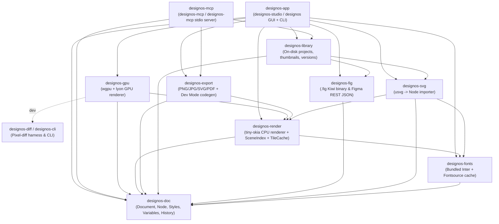

# DESIGN:OS Studio — Workspace Crate Map (`crates/`)

## Architecture Overview

---

## 1. `designos-doc` (`crates/designos-doc`)
- **Responsibility:** Canonical in-memory and serialized document model (`Document`), scene graph nodes, geometry primitives, paint/effect definitions, shared styles, design variables & modes, component/instance links, prototyping interactions/expressions, comments, and undo/redo history.
- **Key Types:**
  - `Document`, `DocKind` (`Design`, `Board`, `Slides`), `DocumentSettings` (`lib.rs`, `settings.rs`)
  - `Node`, `NodeId`, `NodeKind` (`Page`, `Frame`, `Group`, `Section`, `Rectangle`, `Ellipse`, `Polygon`, `Star`, `Line`, `Vector`, `BooleanOp`, `Text`, `Slice`, `Sticky`, `ShapeWithText`, `Connector`, `Stamp`, `WashiTape`, `Table`, `CodeBlock`), `FrameProps`, `TextProps`, `ComponentLink` (`node.rs`)
  - `Paint`, `PaintKind`, `Color`, `GradientStop`, `Stroke`, `Effect`, `BlendMode` (`paint.rs`)
  - `Affine`, `Vec2`, `Rect`, `Path`, `PathCmd`, `VectorNetwork` (`geom.rs`, `vector.rs`)
  - `VariableCollection`, `Variable`, `VariableId`, `VariableValue`, `resolve_node` (`variables.rs`, `variables_apply.rs`)
  - `History` (`history.rs`)
- **Hot Paths & Invariants:**
  - `Document::to_json` / `Document::from_json` (`lib.rs`): Uses compact single-line `serde_json::to_string` + `serde_images` (`"hex:..."` encoding with backward-compatible integer-array deserialization) + `#[serde(default, skip_serializing_if = "...")]` on `Node`, `FrameProps`, `TextProps`, and `ComponentLink`. Reduces a 112,474-node (723,136 Kiwi records) `.fig` library save from `6.8 GB` to `242 MB` (`-96.5%`, `28.3x` smaller).
  - `resolve_node(doc, node) -> Cow<'_, Node>` (`variables_apply.rs`): Returns `Cow::Borrowed(node)` with zero allocation when a node has no bound design variables.

---

## 2. `designos-fig` (`crates/designos-fig`)
- **Responsibility:** Imports and exports Figma `.fig` binary archives (`fig-kiwi` container + schema + DEFLATE/Zstd compression + image blobs) and Figma REST API JSON payloads into `designos_doc::Document`.
- **Key Types & Modules:**
  - `container` (`container.rs`): Unzip `.fig` archive / parse `fig-kiwi` header chunks (`schema` + encoded data + `images/`).
  - `kiwi` (`kiwi.rs`): Dynamic Kiwi binary schema decoder/encoder.
  - `fig` (`fig.rs`): Converts Kiwi `nodeChanges` into `designos_doc::Document`, expands `SYMBOL` / `INSTANCE` subtrees, maps auto-layout, constraints, strokes, effects, and text overrides.
  - `vecnet` & `svgpath` (`vecnet.rs`, `svgpath.rs`): Decodes Figma binary `vectorNetworkBlob` and `fillGeometry` / `strokeGeometry` path blobs into `designos_doc::VectorNetwork` and `Path`.
  - `rest` & `rest_import` (`rest.rs`, `rest_import.rs`): Blocking Figma REST API client and JSON importer.
  - `export` (`export.rs`): Exports `Document` back to `.fig` binary container.
- **Hot Paths:**
  - `fig::import_fig_bytes` (`fig.rs`): Multi-hundred-thousand node decoding, `vectorNetworkBlob` parsing, and component instance expansion (`VSF - PCP.fig`: 17 MB archive, `723,136` Kiwi records -> `112,474` scene nodes on the 7-page benchmark / `1,082,324` scene nodes across all 31 pages).

---

## 3. `designos-render` (`crates/designos-render`)
- **Responsibility:** Deterministic CPU reference renderer (`tiny-skia 0.11`), spatial & paint-order scene indexing (`SceneIndex`), tiled viewport cache (`TileCache`), path boolean operations (`i_overlay`), stroke outlining, and multi-script text layout (`cosmic-text` + `ttf-parser`).
- **Key Types:**
  - `SceneIndex` (`index.rs`): Maps `NodeId -> (world_transform, world_bounds, ancestor_clips)` for a `(page_id, rev)` pair.
  - `TileCache`, `Viewport` (`tiles.rs`): Rasterizes 256x256 CPU tiles on `rayon` worker threads when GPU rendering is disabled or unavailable.
  - `PaintCache` (`paint.rs`): Decoded image (`image::RgbaImage`, limit `1024`) and shader cache for `tiny-skia`.
  - `NodeShape`, `outline_of`, `stroke_plan`, `stroke_outline`, `miter_outline` (`outline.rs`, `boolean.rs`).
  - `text_outlines` (`text.rs`, `text/flow.rs`): Shapes rich text runs via `cosmic-text` and extracts glyph outline paths via `ttf-parser`.
- **Hot Paths:**
  - `SceneIndex::ensure(doc, page, rev)` & `SceneIndex::bounds_of(node_id)` (`index.rs`): Rebuilt ONLY when `(page, rev)` changes; queried Millions of times per second during GPU frustum culling and cursor hit-testing.

---

## 4. `designos-gpu` (`crates/designos-gpu`)
- **Responsibility:** Native `wgpu` (Metal on macOS, Vulkan/DX12/GL elsewhere) GPU canvas renderer with `lyon_tessellation` geometry caching and multi-pass offscreen effect compositing (`shaders/fx.wgsl`).
- **Key Types:**
  - `Canvas` (`canvas.rs`): Bridges `SceneCompiler` + `Renderer` for interactive `egui-wgpu` paint callbacks and headless GPU rendering.
  - `SceneCompiler`, `CompileOptions` (`compile.rs`): Walks visible scene nodes using `SceneIndex` world bounds and records a `Frame` of `Program`s and `Op`s (`DrawOp`, `CompositeOp`, `Post::Blur`, `Post::Displace`).
  - `GeomCache`, `NodeGeom`, `TextGeom`, `bucket_of` (`geom.rs`): Per-node, per-zoom-bucket (`log2` scale) tessellated `lyon` mesh cache with cumulative per-frame time budgeting (`budget: Option<Duration>`, `frame_build_nanos: u64`, `stale_hits: u32`).
  - `PaintCache`, `PaintInst` (`paintconv.rs`): Converts `designos_doc::Paint` into GPU instance uniforms, gradient colour-ramp rows, and decoded RGBA image data (cached up to `2048` images).
  - `Renderer`, `Output`, `ExecStats` (`exec.rs`): Manages `wgpu` pipelines (`pipelines.rs`), vertex/index `Arena`, uniform `Ring`, MSAA/single-sample render target `Pool` (`resources.rs`), and executes `Frame` programs.
- **Hot Paths & Invariants:**
  - `Ctx::draw_children` & `Ctx::draw_body_inner` (`compile.rs`):
    - Pre-resolve visibility & world-bounds frustum culling (`self.index.bounds_of(*cid)`) BEFORE calling `board::get` or `resolve_node`.
    - `self.interactive()` (`self.cull && self.geom.budget.is_some()`): Enables `< 0.75px` sub-pixel culling, `< 3.5px` text greeking (`1.25px..3.5px` renders a single translucent bar; `< 1.25px` skips), hardware scissor fallback for rounded clips (`max_r_px <= 2.5` or `progs.len() >= 32`), and a hard cap of `self.progs.len() < 64` offscreen `Program`s.
  - `GeomCache::get` (`geom.rs`): Enforces cumulative 8ms per-frame tessellation budget (`frame_build_nanos >= budget`), reusing prior zoom-bucket meshes or deferring uncached `Text`/`Vector`/`BooleanOp` nodes and incrementing `stale_hits` so the UI schedules a progressive follow-up repaint.

---

## 5. `designos-app` (`crates/designos-app`)
- **Responsibility:** Desktop editor application (`designos-studio` and `designos` binaries) built on `egui 0.31` + `eframe 0.31`. Owns windowing, EaseUI BrainWave 2.0 dark/light theme, canvas interaction, Layers/Inspector/Assets/Variables/Dev/Prototype panels, Home project browser, and background autosave/font threads.
- **Key Types & Modules:**
  - `Shell` (`shell.rs`), `App` (`app.rs`), `Options` (`cli.rs`).
  - `GpuView`, `FrameKey` (`canvas/gpu.rs`): Caches compiled frame state by `(page, rev, offset_bits, zoom_bits, dpr_bits, size, font_gen)` and skips compilation (`Cb { frame: None }`) when idle (`0.0%` CPU).
  - `TileView` (`canvas/tiles.rs`): Holds `rev: u64` (incremented ONLY on `App::changed()`) and CPU tile fallback.
  - `hit_test_with_index`, `deep_hit_test_with_index` (`canvas/hit.rs`, `canvas/interact.rs`): `SceneIndex`-culled cursor hit-testing.
  - `LayersState` (`panels/layers.rs`): Virtualized layer tree caching `Vec<Row>` keyed by `(page, rev, expanded_gen, filter)` and borrowing `&Node` via lightweight `RowInfo`.
  - `Autosave`, `doc_hash` (`home/session.rs`): Streaming zero-allocation `HashSerializer` for background autosave detection.
  - `Icon`, `paint_logo` (`icons.rs`): Lucide SVG icon atlas + embedded spherical orange DESIGN:OS Studio mark (`assets/icon/png/icon_256.png`).
  - `theme` (`theme.rs`): EaseUI BrainWave 2.0 palette (`#121215` canvas, `#18181B` panels, `#27272A` surface/borders, `#E36323` BrainWave orange brand accent, `#3582FF` canvas blue selection, `#8755E9` component violet).

---

## 6. `designos-library` (`crates/designos-library`)
- **Responsibility:** On-disk workspace library managing project folders, `.designos` / `.designos` / `.fig` / `.svg` imports, PNG thumbnails, trash, version snapshots, and published component libraries.
- **Key Types:**
  - `Library`, `FileEntry`, `FolderEntry` (`store.rs`)
  - `VersionEntry` (`versions.rs`), `PublishedLibrary` (`publish.rs`)
- **Hot Paths:**
  - `Library::file_kind(path)` (`store.rs`): Reads only the first `8 KB` header before `"nodes"` to classify `DocKind` in microseconds instead of reading/parsing multi-hundred-MB files on Home screen refresh.
  - `Library::import_file_with_doc` (`store.rs`): Single-pass import returning `(FileEntry, Document)` so the caller can generate thumbnails directly from the in-memory `Document` without re-loading from disk.

---

## 7. `designos-fonts` (`crates/designos-fonts`)
- **Responsibility:** Bundled Inter font family + on-demand open-source font resolution from Fontsource/Google Fonts with on-disk caching and script-specific Noto fallbacks.
- **Key Types & Functions:**
  - `FontRequest`, `SharedFontDb`, `EnsureReport`, `FontFetcher`, `GoogleFonts` (`lib.rs`, `request.rs`, `fontsource.rs`, `cache.rs`).
  - `ensure_font_requests_with(requests: &[FontRequest], db: &SharedFontDb, fetcher: &dyn FontFetcher)` (`ensure.rs`): Zero-clone background font loader entry point so `designos-app` never clones a 723k-node `Document` onto a worker thread.

---

## 8. `designos-svg` (`crates/designos-svg`)
- **Responsibility:** Parses SVG documents via `usvg` / `roxmltree` and converts groups, paths, gradients, clip paths, filters, and text spans into editable `designos_doc::Node` trees.
- **Key Functions:** `import_svg_str`, `import_svg_bytes` (`lib.rs`, `convert.rs`, `paint.rs`, `effects.rs`, `text.rs`).

---

## 9. `designos-export` (`crates/designos-export`)
- **Responsibility:** Exports `Document` nodes/pages to PNG, JPEG, SVG, and multi-page vector PDF, and generates Dev Mode code (`CSS`, `Tailwind`, `React`, `SwiftUI`, `Jetpack Compose`).
- **Key Modules:** `raster.rs`, `svg.rs`, `pdf.rs`, `css.rs`, `tailwind.rs`, `react.rs`, `swiftui.rs`, `compose.rs`, `codegen.rs`.

---

## 10. `designos-mcp` (`crates/designos-mcp`)
- **Responsibility:** Headless Model Context Protocol (MCP) server (`designos-mcp` and `designos-mcp` binaries) over `tokio` stdio transport (`rmcp = "=3.5.1"`), allowing AI agents to create, query, mutate, layout, render, and export DESIGN:OS Studio documents and libraries.
- **Key Types:** `McpServer` (`server.rs`), `Engine` (`engine.rs`).

---

## 11. `designos-diff` / `designos-cli` (`crates/designos-diff` & `crates/designos-app/src/cli.rs`)
- **Responsibility:**
  - `crates/designos-diff` (`designos-diff` binary & library): Pixel-diff verification harness (`clap` CLI + `suite.rs`) comparing rendered outputs against reference PNGs with configurable per-channel tolerance and diff-image output.
  - `crates/designos-app/src/cli.rs`: Command-line automation interface (`designos-studio` / `designos` CLI flags `--screenshot`, `--open-id`, `--gpu`, `--size`, `--scale`, `--zoom`, `--select`, `--fixture`, `--panel`, `--dev`, `--seed-library`).
