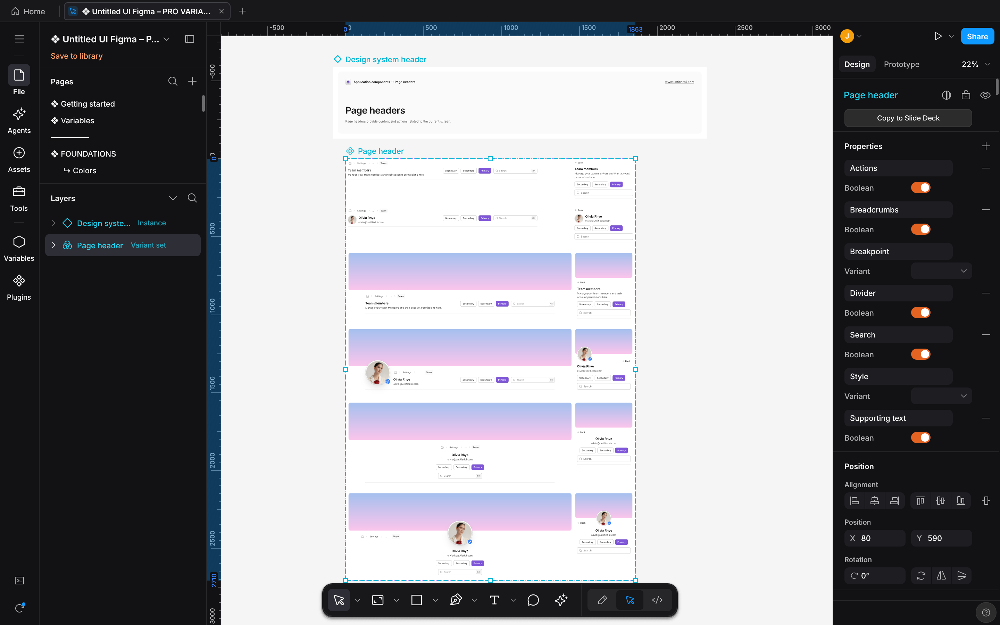
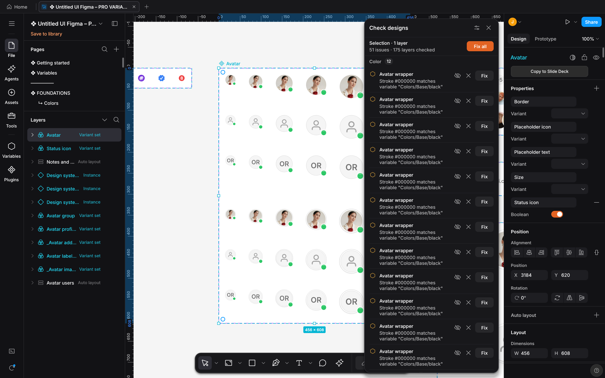
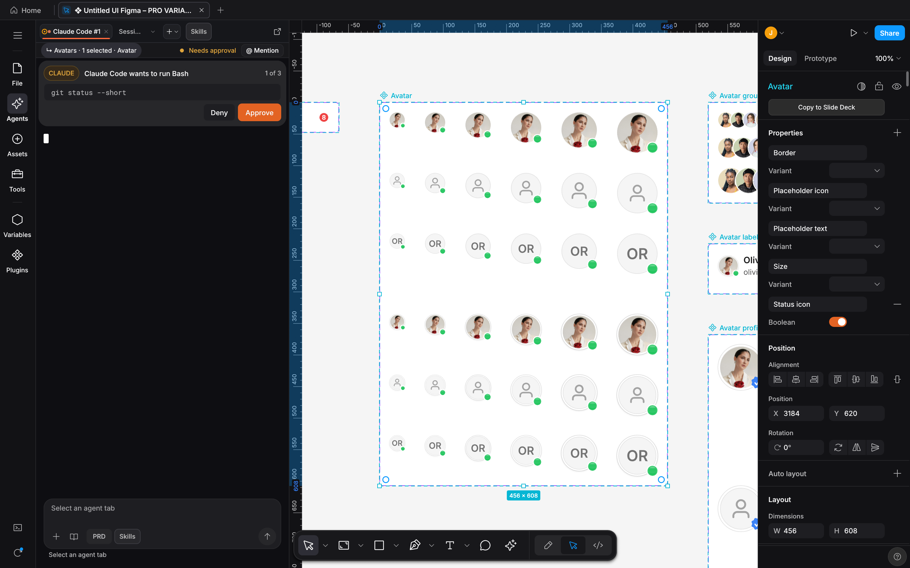

# DESIGN:OS Studio (`design-os-studio`)

<p align="center">
  <a href="docs/images/v0.6/studio-hero.png">
    
  </a>
  <br>
  <sub>DESIGN:OS Studio 0.6.0 on a copy of the Untitled UI PRO v8.0 Figma kit, by Untitled UI. Click for full size.</sub>
</p>

**Native GPU-accelerated interface design studio in Rust. It opens and saves Figma `.fig` files, runs your own coding agent CLI in an Agents panel on the open file, and ships a Model Context Protocol server.**

Open Figma `.fig` files, edit them and save them back. Studio draws the canvas on the GPU with `wgpu` (Metal, DirectX 12 or Vulkan). The Agents panel runs Claude Code, Codex, Grok, Antigravity or Gemini CLI as a live session on the open file with your own sign-in, so Studio needs no API key. Work with variables and modes, select matching layers with Multi-Edit (`Q`), read Dev Mode code in eight languages (CSS, Tailwind, React, SwiftUI, UIKit, Compose, Android XML and HTML), and capture headless screenshots from a terminal or CI.

<p align="center">
  <a href="LICENSE"></a>
  
  
  
  <a href="commands/doctor.md"></a>
  <a href="llms.txt"></a>
  <a href="https://jangtrinh.github.io/design-os-studio/"></a>
  <a href="https://buymeacoffee.com/jangtrinh"></a>
</p>

<p align="center">
  <a href="https://unikorn.vn/p/designos-studio?ref=embed-designos-studio" target="_blank"></a>
</p>

<p align="center">
  <a href="#why-this-exists">Why DESIGN:OS</a> · <a href="#facts-register">Facts</a> · <a href="#quickstart">Quickstart</a> · <a href="#first-safe-use--the-practical-loop">Safe Loop</a> · <a href="#whats-new">What's new</a> · <a href="#what-it-makes">What it makes</a> · <a href="#100-figma-micro-interactions">Micro-Interactions</a> · <a href="#installation">Install</a> · <a href="#how-it-works">How it works</a> · <a href="#commands--diagnostics">Commands</a> · <a href="#quality-bar--limitations">Limits &amp; FAQ</a>
</p>

---

## Why this exists

### Why DESIGN:OS Studio?

Browser-based design tools keep your files on a vendor's servers and give coding agents little more than a REST export. **`design-os-studio`** is a local-first studio written in Rust. It reads and writes `.fig` files on your disk, runs your own agent CLI in an Agents panel, and serves the open file to agents through a local MCP server.

| Dimension | DESIGN:OS Studio | How to check |
| :--- | :--- | :--- |
| **Rendering** | Native Rust canvas: `wgpu` on Metal, DirectX 12 or Vulkan, with a `tiny-skia` CPU renderer for headless captures. It requests no repaint while the view is idle (`FrameKey` frame reuse). | Open a file, leave it still, and read the process CPU time twice with `ps -o time= -p <pid>`. |
| **Large files** | A spatial index of 2048-unit grid cells (`SceneIndex`) limits work to the viewport, and repeated shapes share one mesh (`GeomCache`). The 336 MB Untitled UI PRO kit opens as one document of 207,601 nodes. | `designos <file> --inspect-json` prints the node count. |
| **`.fig` files** | Reads `.fig` containers (`fig-kiwi`, `DEFLATE` or `Zstd`) and writes container version 106, in a ZIP with `meta.json` and `images/`. [Known issue in 0.6.0](https://github.com/jangtrinh/design-os-studio/issues/834): saving a `.fig` drops numbered-list formatting and writes inherited or variable-bound paints on instances as fixed values. | Export a file, then read the version from the `canvas.fig` header (see below). |
| **Agents** | The Agents panel starts your own agent CLI (Claude Code, Codex, Grok, Antigravity or Gemini CLI) as a live session on the open file, and keeps a file's sessions across restarts. Each CLI uses its own sign-in, so Studio needs no API key. | `designos-studio <file> --panel agents` |
| **MCP server** | `designos-mcp` serves its tools over stdio: see the design, read its design system, write in one step (`designos_apply_batch`) and lint the result (`designos_lint`). | Send `tools/list` to `designos-mcp --workspace <dir>`. The tool table below is generated from that list. |
| **Variables** | Color, number, string and boolean variables in collections with modes. A frame can pin its own mode per collection, and modes round-trip through `.fig`. Import and export Figma JSON and W3C Design Tokens (DTCG). | `designos <file> --export-variables <out>` |
| **Dev Mode** | Built-in Dev Mode (`Shift+D`) with code in CSS, Tailwind, React, SwiftUI, UIKit, Compose, Android XML and HTML. | `designos <file> --select <layer> --codegen react` |
| **Privacy and license** | No telemetry. Studio makes these network requests: open-licensed font downloads from the Fontsource API when a file uses fonts you do not have, a public status-page check after an agent provider error, a connection check when you click Retry connection, and a plugin download from GitHub when you install a plugin. The agent CLIs you start use the network under their own terms. Source-available under `PolyForm Shield 1.0.0`. | `git grep -n 'ureq::' -- crates` lists the HTTP calls. The Figma REST client in `designos-fig` is a cargo feature that is off by default. |

To read the container version of an exported file, run `unzip -p out.fig canvas.fig | head -c 12 | xxd`. The header starts with `fig-kiwi` and ends with `6a00 0000`, which is 106 in little-endian.

> **Where hosted tools win, and it is not close:** real-time multiplayer with live cursors, enterprise cloud administration with SSO and SCIM, and hosted comment notifications by email or Slack. Studio has none of these. If your workflow needs real-time cloud multiplayer without local file ownership, use Figma (paired with our live bridge [`design-os-figma-plugin`](https://jangtrinh.github.io/design-os-figma-plugin/)) or a hosted Penpot instance instead.

---

<a id="facts-register"></a>
### Facts Register

| Instrument Field | Specification | Verification / Notes |
| :--- | :--- | :--- |
| **Repository** | [`jangtrinh/design-os-studio`](https://github.com/jangtrinh/design-os-studio) | Cargo workspace, `crates/designos-*`. Four binaries ship: `designos-studio`, `designos`, `designos-mcp`, `designos-diff` |
| **Engine Stack** | Rust + `wgpu` + `tiny-skia` | Metal (verified on macOS) · Direct3D 12 / Vulkan (Windows and Linux, not verified before release) · No Electron |
| **Figma Interop** | Reads `.fig`; writes container version 106 | `crates/designos-fig` round-trip tests · more than `6,000` automated tests pass in the macOS CI job · [known issue #834](https://github.com/jangtrinh/design-os-studio/issues/834) |
| **Agent Surface** | Agents panel + `designos-mcp` | `Claude Code` · `Codex` · `Grok` · `Antigravity` · `Gemini CLI`, each with its own sign-in |
| **Telemetry / Network** | No telemetry | Network use: font downloads from the Fontsource API for fonts a file needs, a status-page check after an agent provider error, a connection check when you click Retry connection, plugin downloads you start from GitHub, and the agent CLIs you start |
| **License** | `PolyForm Shield 1.0.0` (source-available) | Release packages: macOS `.dmg` (verified), Windows `.zip`, Linux `.deb` and `.tar.gz` (built, not verified before release) |

---

## Quickstart

### 1. Install once

Install the agent skill plugin in Claude Code, copy the skill into Codex, download a release package (`.dmg`, `.zip`, `.deb`, `.tar.gz`), or build the four binaries from source:

```bash
# Option A: Claude Code plugin marketplace
/plugin marketplace add jangtrinh/design-os-studio
/plugin install design-os-studio@design-os-studio

# Option B: Clone and launch the native Rust/wgpu Studio (or package a .dmg / .zip / .deb)
git clone https://github.com/jangtrinh/design-os-studio
cd design-os-studio
cargo run --release -p designos-app --bin designos-studio
./scripts/build-release.sh <version> --local-host
```

<a id="first-safe-use--the-practical-loop"></a>
### 2. First Safe Use & The Practical Loop

**First safe use (three bounded, non-destructive steps):**

1. **Run the deterministic offline repository, crate, and skill self-check:**
   ```bash
   python3 scripts/self_check.py
   ```
2. **Apply `--apply-spec your-screen.spec.json` (any NodeSpec JSON you or your agent write) to a document and export it as a Figma `.fig` file (container version 106).** `app.designos` is created if it does not exist:
   ```bash
   designos app.designos --apply-spec your-screen.spec.json
   designos app.designos --export-fig out.fig
   ```
   `--export-fig` writes only to a path that ends in `.fig` and does not exist yet. Re-running it needs `--overwrite`, which replaces an existing regular file; a symbolic link is never written through.
3. **Render the file on the CPU and on the GPU, then compare the two PNGs.** `designos-diff` prints the SSIM score and exits `0` while the mismatch ratio stays under the threshold:
   ```bash
   designos-studio out.fig --size 1600x1000 --no-toast --screenshot cpu.png
   designos-studio out.fig --gpu --size 1600x1000 --no-toast --screenshot gpu.png
   designos-diff compare cpu.png gpu.png --tolerance 8 --threshold 0.02 --out diff.png
   ```

**The Practical Agentic Loop:**

| Lifecycle Verb / Flag | Role in the Loop |
| :--- | :--- |
| **`--panel variables`** | Opens the Variables view: collections, modes and alias bindings. |
| **`--panel agents`** | Opens the Agents panel: pick an agent CLI, resume the file's last session, or start from a sample prompt. |
| **`--apply-spec / --export-fig`** | Compiles declarative JSON specs through Auto-Layout 5.0, then writes a `.fig` file (container version 106). |
| **`--screenshot / designos-diff`** | Renders a headless frame, on the GPU with `--gpu`, and compares two PNGs. |

### 3. Ask in plain English (or invoke the Agent CLI directly)

Open your project in your AI coding agent (or in the Studio's Agents panel) and describe the outcome you need:

> "Apply `your-screen.spec.json` (any NodeSpec JSON you or your agent write) to a new document, export it to `out.fig`, and capture a 1600x1000 GPU screenshot."

> "List the open comment threads, make the change each one asks for, and resolve the thread."

> "Lint the open page with `designos_lint`, apply the safe fixes, and list what is left."

> "Generate React, Tailwind and SwiftUI code for the selected frame, then compare a before and after screenshot with `designos-diff`."

---

<a id="whats-new"></a>
## What's new

Notes for every release are in the [CHANGELOG](CHANGELOG.md). The newest is 0.7.0. [v0.6.0](https://github.com/jangtrinh/design-os-studio/releases/tag/v0.6.0) has captures from the release build, and older releases are short lists.

<a id="new-in-v070"></a>
### 0.7.0

- **Styles.** Delete a style (`Delete style`) while linked layers keep its resolved values and variable bindings, group styles by `/` prefix into renameable folders (`Rename folder`) in Figma's order, edit style descriptions (`Description`) and read them as hover tooltips in style pickers and the colour picker's `Libraries` tab, and keep text alignment on each text layer while text styles carry paragraph indent, list spacing and leading trim.
- **Effects and shadows.** Drop shadows and inner shadows take a blend mode (`Blend`), the shadow cut-out of a frame with no fill and `Show behind` off follows its visible children's shapes, and the `Effects` section's `+` menu caps each effect type (8 drop shadows, 8 inner shadows, 1 layer blur, 1 background blur) without trimming imported effects.
- **Export and files.** PNG and SVG export bounds match Figma for shadows, strokes and groups; after an export, a toast shows where the file went with `Show in folder` (using `Downloads` when no save dialog is available) and never overwrites an existing file (`Card-1.png`, `Card-2.png`, …); and atomic saves keep macOS ACLs and extended attributes while leaving your own `.tmp` files alone.
- **Left rail and panels.** The left rail is icon-only with hover and keyboard-focus tooltips (`Main menu`, `File`, `Agents`, `Assets`, `Tools`, `Variables`, `Plugins`, `Updates & Shortcuts`), and a draggable separator between `Pages` and `Layers` resizes the `Pages` list and remembers its height.
- **Agents panel and canvas.** Expanding the `changed layers` card with `Show all` scrolls inside the Agents panel with `Show less` while keeping `Revert` and `Keep` reachable, and an interrupted move on the canvas keeps the last pointer position.
- **CLI and MCP.** A `--screenshot` run with unsaved edits closes after writing the PNG without stopping on `Save changes to {name}?`, and `--apply-spec`, `designos_apply_spec` and `designos_apply_batch` centre hugging button labels inside `NodeSpec` presets and aligned frames while `designos_create_node` and `designos_update_node` keep explicit text box sizes.

<a id="new-in-v065"></a>
### 0.6.5

- **Starter file.** A new library gets a `Getting started` project with `DESIGN-OS Studio Starter`, and an existing library gets it once on its first launch of 0.6.5; files you already have are not touched. `Open starter sample` opens a fresh copy, launching with no file argument opens Home, and the older samples, `--seed-library`, release `--fixture` and the old `examples` folder are removed.
- **Variables.** `designos FILE --export-variables OUT.json --format dtcg --mode MODE` exports one variable mode across the file's collections (or `--collection`) as a single self-contained DTCG `.tokens.json` file with default-mode fallback, `--resolve-aliases`, and `--color-format` (`hex` or `object`), and multi-file DTCG exports keep same-named collections distinct.
- **Agents panel.** Tabs clear their scrollback when an agent redraws on a UI zoom so output no longer repeats, quiet Codex turns change from `Working…` to `Done` after 1.5 s and hide `Stop`, and the approval banner shows `Show prompt` to focus the current waiting tab or `Open tab` to switch to another waiting tab.
- **Canvas and `.fig` import.** Frame, component and instance labels repaint after an agent rename and cut to fit with `…` like Figma; hug and fixed-width `NodeSpec` text is measured with the text renderer; `.fig` files with top-bit 64-bit values import and export cleanly; and icons and vectors inside resized component instances scale with the instance while keeping their strokes.
- **Styles and performance.** Deleted and orphan style records from imported `.fig` files are hidden from style pickers, Assets, layer chips and MCP listings, while unnamed listed styles show `Unnamed fill style`, `Unnamed text style`, `Unnamed effect style` or `Unnamed grid style`; large multi-layer edits finish faster by recording only the layers that changed.
- **CLI and MCP.** `--select` accepts `id:<n>`, `fig:<figma id>`, `name:<text>`, `none` or a layer name, supports `--zoom fit`, and exits 2 without writing on a miss; Home › `Import` › `Enter a path…` opens `~/` and `file://` paths and starts toast timers on first paint; MCP imports enforce a 512 MiB `FILE_TOO_LARGE` limit, and MCP file writes return `INVALID_NAME` and `NAME_TOO_LONG`.

<a id="new-in-v063"></a>
### 0.6.3

- **Agents panel.** Hook outputs (`agent-status.json`, `agent-events.jsonl`, `turn-marks.jsonl`, `claude-transcript.json`) and Claude's prompt-hook replies live in a Studio-private `hook-out` folder outside the session folder, `$TMPDIR`, `/tmp`, `/var/tmp` and every folder an agent CLI is granted, and the turn-mark hook reads `doc-patch.jsonl` size with `stat -L` instead of opening it.
- **CLI and MCP.** `--screenshot` on a missing, empty or corrupt file exits 1 with an error message and writes no PNG. `--apply-spec`, `designos_apply_spec` and `designos_apply_batch` report invalid `NodeSpec` fields in plain words instead of serde type errors, and the docs note that Ask covers agent tabs started from Studio while your own `designos` CLI and external `designos-mcp` hosts approve their own calls.
- **Linux.** Home › `Import` opens the file chooser when `org.freedesktop.portal.Desktop` starts on first use or when `zenity` is installed, and when no file dialog can open it names the cause and offers `Enter a path…`.

<a id="new-in-v062"></a>
### 0.6.2

- **Agents panel.** Ask-mode approvals, Claude's hooks and MCP config, and session folders for unsaved files live in Studio's own data folder, and Studio and `designos-mcp` refuse links and FIFOs in session files. The skill and agent files no longer include the document or page name.
- **Gemini, Grok and Antigravity.** Gemini CLI tabs in Ask mode show `Needs approval` with an `Open tab` button and hold the composer while Gemini's confirmation prompt is on screen. Ask-mode Grok and Antigravity tabs move non-Studio session configs aside before starting, and Grok never evaluates a `.envrc`.
- **Styles and Properties.** Create a text style from a text layer in the Typography section (`Create text style`), pick styles from enabled libraries when the file has none of its own, and export a page from the page panel's Export section.
- **Components and Dev Mode.** Syncing a main component keeps its instances' own layer names. Dev Mode keeps each code line on one row with horizontal scrolling, grows the MCP prompt box to fit, and escapes `\`, `"`, `\(` and control characters in SwiftUI strings.
- **Command palette.** Rename layers semantically and Boost resolution take about a second per click on a very large page, where they took about four.
- **CLI and MCP.** `designos-diff --version` prints the version. MCP file writes (`designos_save_file`, `designos_render_png`, `designos_export_fig_file`) refuse links, control or bidi characters, and names over 255 bytes; `designos_export_fig_file` refuses an existing file unless `overwrite` is set; and outside-workspace errors no longer echo the path.

<a id="new-in-v061"></a>
### 0.6.1

- **Agents panel.** The bottom terminal dock and the `>_` rail button are gone. ``Cmd+` `` (``Ctrl+` `` on Windows and Linux) opens and closes the Agents panel. Agents ask before acting by default.
- **Unsaved edits.** Studio asks `Save changes to {name}?` before a close, a quit or an open drops edits to a file outside the library, and asks before a file changed on disk replaces them. On macOS, Cmd+Q asks too. An agent that opens another document no longer replaces yours.
- **Undo.** Undo and redo of your own edits restore the document exactly. The command palette's design fix and its Figma AI rows are one undo step each. After a font face arrives, and for an agent's edits, undo solves layout again.
- **Paste and drop.** Paste text and images from other apps, and drop PNG, JPEG or WebP files on the canvas. Pasting a main component in its own file makes an instance.
- **`.fig` files.** Export never replaces an existing file and says where it wrote. `designos --export-fig` refuses a path that does not end in `.fig` and a symbolic link, and needs `--overwrite` to replace a file. A save or export to `.fig` or `.pen` warns when it leaves comments out.
- **Slow machines.** Draw, move, resize and rotate end where the pointer let go. A software renderer starts on the CPU canvas.
- **CLI.** `designos --version` prints the version, and a file argument that is not on disk stops with an error.

<a id="new-in-v060"></a>
### 0.6.0

Real screenshots from the v0.6.0 macOS build, captured headlessly with `designos-studio --screenshot` (2x) on a copy of the Untitled UI PRO v8.0 Figma kit, by Untitled UI. Click an image for full size. The approval card comes from the built-in `--panel agents-approval-queued` preview.

<table>
  <tr>
    <td width="50%" valign="top" align="center">
      <a href="docs/images/v0.6/check-designs-color-fixes.png"></a><br>
      <sub><b>Check designs: Color</b><br>Hard-coded colors that match a variable are listed under Color, each with a one-click Fix, plus Fix all.</sub>
    </td>
    <td width="50%" valign="top" align="center">
      <a href="docs/images/v0.6/ask-before-acting-approval.png"></a><br>
      <sub><b>Ask before acting</b><br>With Ask before acting on, Claude Code's request to run a command waits in the Agents panel for Approve or Deny.</sub>
    </td>
  </tr>
</table>

**Also in 0.6.0**

- **Agents panel.** A file keeps its sessions after a restart. Review what an agent changed in a turn and keep it or revert it in one undo step. Stop one agent or all of them from the panel.
- **Variables.** Import and export Figma JSON and W3C Design Tokens (DTCG) from the Variables menu, or with `--import-variables` and `--export-variables`. An import merges into the file and reports what it skipped.
- **MCP.** Agents can see the design, read its design system, write in one step with `designos_apply_batch` and check their work with `designos_lint`.
- **Dev Mode.** HTML joins CSS, Tailwind, React, SwiftUI, UIKit, Compose and Android XML.
- **License.** Studio is source-available under PolyForm Shield 1.0.0. Releases up to 0.5.0 keep MIT or Apache-2.0.

### 0.5.0

- **Slots.** Create a slot on a component and set its rules: minimum and maximum children, preferred components, stretch on insert and show empty. Edit slot content in an instance without detaching it.
- **Empty slots.** An empty slot shows a **+** that opens the preferred-instance picker. Migrate to slot turns an instance-swap or boolean region into a slot in one undo step.
- **Dev Mode.** Code for React, Tailwind, SwiftUI and Compose gets one parameter per slot. The component playground lets you try properties and variants without editing the file.
- **Check designs.** It flags hard-coded numbers that match a number variable, suggests variables and styles from enabled libraries, and audits text and overrides inside instances.
- **`.fig` files.** Export follows Figma's own field numbering, types and enum values, and slot preferred values are written as Figma's real object.
- **Agent tabs.** Antigravity and Grok tabs start again, and a tab that fails to start shows the cause.

### 0.4.0

- **Grid auto layout.** More than 8 rows and columns, auto-placed items and auto rows, and children aligned inside their cell. Edit tracks on the canvas or in the Properties panel: insert, delete, resize and drag to reorder.
- **Auto layout.** Child margins from `.fig` files, per-child align-self, and an Update auto layout action that upgrades an older frame.
- **Layout guides match Figma.** Alignment, a fixed column or row width, auto count, and show or hide per guide. All of it round-trips through `.fig`.
- **Check designs.** A panel that audits the page for low contrast, unbound colors, detached styles and detached instances, with a one-click Fix per finding and Fix all.
- **Vectors and export.** Offset path, and scale for several selected points. PDF export draws vectors with selectable text. Lossless WebP export.
- **Dev Mode.** Grid code for CSS, Tailwind and React is printed from the real tracks and placement.

<a id="new-in-v030"></a>
### 0.3.0

- **Paste from Figma.** Copy a selection in Figma desktop and press Cmd+V on the canvas. The layers land centered in the view as one undo step, images included.
- **Effect and grid styles.** Create, apply, detach and rename them. Edit a style from the picker and every layer that uses it updates in one undo step. `.fig` files bring their effect and grid styles.
- **Auto layout and text.** Space around and Space evenly, vertical wrap, and the text wrap modes Balance and Pretty.
- **Variables.** Bind paint and effect opacity to number variables. Variables keep their Web, Android and iOS code syntax.
- **Dev Mode.** UIKit and Android XML join the code languages, and a variable prints the way Figma does.
- **PDF export.** Selected frames export as one multi-page PDF from the Export panel.

---

## What it makes

Studio compiles every document through one scene graph (`SceneCompiler` + `GeomCache`), writes `.fig` files, and captures headless frames (`--screenshot` and `designos-diff`).

Screenshots below are headless captures from the v0.6.0 macOS build on a copy of the Untitled UI PRO v8.0 Figma kit, by Untitled UI. Each caption shows the command that made it, with the kit as `untitled-ui-kit.fig`.

### Pillar 1 — Agents panel (`Claude Code` · `Codex` · `Grok` · `Antigravity` · `Gemini CLI`)

<p align="center">
  <br>
  <sub>Command: <code>designos-studio untitled-ui-kit.fig --select "Avatar group" --zoom 100 --panel agents --gpu --size 1440x900 --scale 2 --screenshot docs/images/designos-agents-chat.png</code><br>
  The new-session picker reads each CLI's version and sign-in state from the machine that took the capture. A live session is not shown.</sub>
</p>

The **Agents** panel (`RailItem::Agents`) starts your own agent CLI (`claude`, `codex`, `grok`, `agy`, `gemini`, or a command you add) as a live session on the open file, in a real `portable-pty` + `vt100` terminal tab (`crates/designos-app/src/terminal.rs`). Opening the panel resumes the file's last session, and a file keeps its sessions after a restart. The composer sends into the tab's live session. A chip hands the current selection to the agent, `@` mentions a layer, page, component, variable or style, and each turn ends with a receipt. Review what an agent changed and keep it or revert it in one undo step, or stop one agent or all of them. Agents read and change the file through the local `designos-mcp` server. Agents ask before acting by default, and Preferences > Agent permissions… switches to Skip permissions. In Ask mode, Claude Code's requests to run a command show as Approve or Deny in the panel. The other CLIs ask in their own tab. Ask covers agent tabs started from Studio's Agents panel. The `designos` CLI you run yourself, and a `designos-mcp` started by another host, are not gated by Studio; that host approves its own MCP calls.

### Pillar 2 — Variables, Multi-Edit (`Q`) & Suggest Auto-Layout

<p align="center">
  <br>
  <sub>Command: <code>designos-studio untitled-ui-kit.fig --panel variables --gpu --size 1440x900 --scale 2 --screenshot docs/images/designos-variables.png</code></sub>
</p>

The Variables view lists a file's collections, groups and modes in one table, with an alias picker for bindings. Variables are color, number, string or boolean. A frame can pin its own mode per collection (for example `Light` or `Dark`), and modes survive a `.fig` round trip. Import and export variables as Figma JSON and W3C Design Tokens (DTCG) from the Variables menu, or with `--import-variables` and `--export-variables`. Press **`Q`** (or `⌘⌥A`; `Ctrl+Alt+A` on Windows and Linux) to run Select matching layers: it selects the layers that share the selection's name and type across top-level frames and component variants, for Multi-Edit. Press **`⌘⇧⌥A`** (`Ctrl+Shift+Alt+A`) to run Suggest Auto-Layout on the selection. `⇧A` runs Add auto layout.

### Pillar 3 — Dev Mode (`Shift+D` / `</>`) Multi-Target Codegen & Box-Model Inspector

<p align="center">
  <br>
  <sub>Command: <code>designos-studio untitled-ui-kit.fig --select "Avatar group" --zoom 100 --dev react --gpu --size 1440x900 --scale 2 --screenshot docs/images/designos-devmode.png</code></sub>
</p>

Switch into **Dev Mode (`Shift+D` or `</>`)** to inspect a layer: its Ready for dev status, annotations, dev links, a CSS box-model diagram, resolved variables, and copy-ready code in **CSS**, **Tailwind**, **React (JSX)**, **SwiftUI**, **UIKit**, **Jetpack Compose**, **Android XML** and **HTML**. This capture shows the top of the panel. From a terminal, `designos <file> --select <layer> --codegen <language>` prints the same code, and `--dev <language>` opens Dev Mode on that language. Both take `css`, `tailwind`, `react`, `swiftui`, `uikit`, `compose`, `android-xml` or `html`.

### Pillar 4 — Declarative `NodeSpec` JSON -> Auto-Layout 5.0 -> `.fig` export

AI agents author compact, diffable `NodeSpec` JSON and apply it with `--apply-spec your-screen.spec.json` (any NodeSpec JSON you or your agent write) rather than guessing pixel coordinates. `designos-doc` computes recursive Auto-Layout 5.0 geometry (`relayout_subtree`), and `designos-fig` exports the result as a `.fig` file (`export_fig`, container version 106):

```bash
designos app.designos --apply-spec your-screen.spec.json
designos app.designos --export-fig out.fig
```

| Deliverable / Mode | Best for | Output Format | Verification Gate |
| :--- | :--- | :--- | :--- |
| **Native `.fig` Read/Write** | Opening, editing, and saving Figma archives offline | `.fig` (`fig-kiwi`, version 106 on write, plus `meta.json` and `images/`) | `crates/designos-fig` round-trip tests · [known issue #834](https://github.com/jangtrinh/design-os-studio/issues/834) |
| **Declarative `NodeSpec` Canvas Compiler** | Agent-authored UI screens with deterministic Auto-Layout 5.0 | `.spec.json` / `.designos` / `.fig` | `designos --apply-spec` + `--inspect-json` |
| **Agents Panel & `designos-mcp`** | Live agent sessions on the open file and prompt-to-canvas work | `designos-mcp` (`stdio`) + `RailItem::Agents` | MCP tool-list test pins the tool list |
| **Dev Mode Multi-Target Codegen** | Exporting production UI code and token bindings per frame | `CSS` · `Tailwind` · `React` · `SwiftUI` · `UIKit` · `Compose` · `Android XML` · `HTML` | `crates/designos-export` codegen tests |
| **Headless Visual Proof & Diff** | Automated CI screenshot capture and pixel and SSIM comparison | `PNG` / `SVG` / `PDF` / `JPG` + diff report | `designos-studio --gpu --screenshot` + `designos-diff` |

---

<a id="100-figma-micro-interactions"></a>
### Figma-style micro-interactions

The Studio implements the small, tactile interactions Figma users expect on the canvas. The table names what exists, by area. Not every interaction has an automated test: `launch_e2e_proves_100_figma_micro_interactions_end_to_end` drives eight of them: Smart Selection and Tidy up, a CSS Grid track pill, the Scale tool, the Eyedropper and its format cycle, copy and paste of properties, and Shift+Align as a group.

| Area | What the canvas does |
| :--- | :--- |
| **Inspector fields** | Drag a field label to scrub the value, step it with the arrow keys, type math such as `+ - * /`, and edit `Mixed` selections. The digits `0` to `9` set opacity. |
| **Auto layout and CSS Grid** | On-canvas gap and padding handles, add (`⇧A`) and remove (`⌥⇧A`) auto layout, Suggest Auto-Layout, CSS Grid track pills, and Smart Selection with Tidy up. |
| **Selection and guides** | Marquee select, hierarchy keys (`Enter`, `Tab`, and `N` or `⇧N` between frames), `⌥`-hover distance guides, and smart snap guides. |
| **Shapes and vectors** | On-canvas corner radius handles, ellipse, polygon and star controls, and vector network editing with join and split. |
| **Layers, Eyedropper and Scale** | Inline layer rename, the Eyedropper (`I`) and the Scale tool (`K`). |
| **Arrange** | Group (`⌘G`), ungroup (`⇧⌘G`) and frame selection (`⌥⌘G`), plus align with `⌥A`, `⌥W`, `⌥S`, `⌥D`, `⌥H` and `⌥V`. |
| **Components, prototype and comments** | Create component (`⌥⌘K`) and detach instance (`⌥⌘B`), variants, variable binding, prototype flows, pin comments, and copy and paste of properties (`⌥⌘C`, `⌥⌘V`). |

### How large files stay fast

| Mechanism | What it does | Code |
| :--- | :--- | :--- |
| **Idle frame reuse** | No repaint is requested while the view is idle. The cached frame is re-blitted. | `FrameKey` in `crates/designos-app/src/canvas/gpu.rs` |
| **Viewport culling** | Top-level and hit-test queries scan a uniform spatial grid of 2048-unit cells, not every node. | `SceneIndex::query_top_level` |
| **Incremental index** | Moving or resizing one node updates its subtree, not the whole index. | `SceneIndex::update_subtree` |
| **Shared meshes** | Component instances and repeated shapes share one tessellation. | `GeomCache::shared` |

Measured with v0.6.0 on an Apple M4 Max (Metal): after the 336 MB Untitled UI PRO kit, which has 207,601 nodes, finished loading, the process used 0.01 s of CPU in each of two 20 s idle windows. This was not measured on DirectX 12 or Vulkan.

---

## Installation

You can install **`design-os-studio`** either as a native desktop + CLI application (bundling `designos-studio`, `designos`, `designos-mcp`, and `designos-diff`) or as an AI agent skill plugin (`skills/design-os-studio/SKILL.md` + `commands/doctor.md`). See [`docs/install.md`](docs/install.md) for full OS-specific details.

### Native Cross-Platform Installers (`macOS` · `Windows` · `Linux`)

| Platform | Primary Installer | Portable Archive & CLI Installer | Bundled Binaries |
| :--- | :--- | :--- | :--- |
| **macOS** (Apple Silicon and Intel, universal) | `designos-<ver>-macos.dmg` (`designos.app` + `install-cli.command`) | `designos-<ver>-macos-universal.tar.gz` | `designos-studio`, `designos`, `designos-mcp`, `designos-diff` |
| **Windows** (x64) | `designos-<ver>-x86_64-pc-windows-msvc.zip` (per-user `install.ps1` / `uninstall.ps1`, no admin prompt) | None. An NSIS installer is built only when NSIS is on the build machine, and the release runner does not have it. | `designos-studio.exe`, `designos.exe`, `designos-mcp.exe`, `designos-diff.exe` |
| **Linux** (x64) | `designos_<ver>_amd64.deb` (`apt install`, `.desktop`, `.designos`/`.fig` MIME) | `designos-<ver>-x86_64-unknown-linux-gnu.tar.gz` (`./install.sh`) | `designos-studio`, `designos`, `designos-mcp`, `designos-diff` |

Releases are verified on macOS (Apple Silicon). The Windows and Linux packages are built by the same release workflow but are not verified before release. A failed Windows or Linux build leaves its package out of the release and does not block it. Please report anything that breaks.

```bash
# Build & package native installers + release-manifest.json + SHA256SUMS locally into dist/
./scripts/build-release.sh <version> --local-host
```

### Claude Code

Run these two commands inside Claude Code:

```text
/plugin marketplace add jangtrinh/design-os-studio
/plugin install design-os-studio@design-os-studio
```

### OpenAI Codex

Install to your personal Codex skills directory:

```bash
git clone https://github.com/jangtrinh/design-os-studio /tmp/design-os-studio
mkdir -p ~/.codex/skills/design-os-studio ~/.codex/prompts
cp -R /tmp/design-os-studio/skills/design-os-studio/* ~/.codex/skills/design-os-studio/
cp /tmp/design-os-studio/prompts/doctor.md ~/.codex/prompts/design-os-studio-doctor.md
rm -rf /tmp/design-os-studio
```

### Gemini CLI & Google Antigravity

```bash
git clone https://github.com/jangtrinh/design-os-studio /tmp/design-os-studio
mkdir -p ~/.gemini/skills/design-os-studio
cp -R /tmp/design-os-studio/skills/design-os-studio/* ~/.gemini/skills/design-os-studio/
rm -rf /tmp/design-os-studio
```

### OpenCode, Cursor, Windsurf & Other Agent Harnesses (Skill + `designos-mcp`)

```bash
git clone https://github.com/jangtrinh/design-os-studio /tmp/design-os-studio
mkdir -p ~/.agents/skills/design-os-studio
cp -R /tmp/design-os-studio/skills/design-os-studio/* ~/.agents/skills/design-os-studio/
rm -rf /tmp/design-os-studio
```

To wire the local stdio MCP server (`designos-mcp`) in `mcpServers`:

```json
{
  "mcpServers": {
    "design-os-studio": {
      "command": "/ABSOLUTE/PATH/TO/designos-mcp",
      "args": ["--workspace", "/ABSOLUTE/PATH/TO/designs"]
    }
  }
}
```

<details>
<summary>Verify or uninstall</summary>

**Verify installation:**

```bash
python3 scripts/self_check.py
```

Or run the doctor command to inspect installed skill paths, plugin manifests, workspace crates, and visual proof images: `/design-os-studio:doctor` in Claude Code (the plugin namespace keeps it apart from Claude Code's own `/doctor`), or the `design-os-studio-doctor` prompt in Codex.

**Uninstall:**

```bash
rm -rf ~/.claude/skills/design-os-studio ~/.codex/skills/design-os-studio ~/.gemini/skills/design-os-studio ~/.agents/skills/design-os-studio
```

</details>

---

## Usage & Prompt Cookbook

Once installed, your agent loads `skills/design-os-studio/SKILL.md` when your request touches `.fig` / `.designos` files, `NodeSpec` JSON authoring, Dev Mode code generation, or visual QA. See [`docs/cookbook.md`](docs/cookbook.md) for full copy-paste recipes.

**Generate & Export `.spec.json` -> `.fig`**

```text
"Apply your-screen.spec.json (any NodeSpec JSON you or your agent write) to a new document, export it to out.fig, and capture a 1600x1000 GPU screenshot."
```

**Resolve Canvas Comments**

```text
"List the open comment threads, make the change each one asks for, and resolve the thread."
```

**Export Multi-Target Code & Compare Screenshots**

```text
"Generate React, Tailwind, and SwiftUI code for the selected frame, then compare a before and after screenshot with designos-diff."
```

---

## Commands & Diagnostics

| Command | Environment | What it does |
| :--- | :--- | :--- |
| `/design-os-studio:doctor` | Claude Code | Read-only diagnostic check of installed skill paths, plugin manifests, Cargo crates, and binary availability (Codex: the `design-os-studio-doctor` prompt) |
| `python3 scripts/self_check.py` | Terminal / CI | Deterministic offline self-check of required files, plugin manifests, crate manifests, visual proof images, the skill file, and the Zero Fake UI gate |
| `designos-studio [file] [flags]` | Desktop / Headless CI | Launch the native GPU/CPU Studio GUI or render headless screenshots (`--gpu --screenshot out.png`) |
| `designos <file> [flags]` | Terminal / Agent CLI | Apply declarative `NodeSpec` (`--apply-spec`), export Figma `.fig` (`--export-fig OUT.fig`, add `--overwrite` to replace an existing file), inspect JSON (`--inspect-json`), generate code (`--codegen`), or manage comments (`--comments-json`) |
| `designos-mcp --workspace <dir>` | MCP Client (`stdio`) | Expose typed MCP tools listed below (`designos_open_file`, `designos_apply_spec`, `designos_export_fig_file`, `designos_generate_code`, etc.) |
| `designos-diff compare <a> <b>` | Terminal / CI | Compute SSIM and anti-aliasing-aware pixel diffs between two PNGs |
| `./scripts/build-release.sh <ver> --local-host` | Terminal / CI | Compile all 4 binaries and package the host's native release packages (`.dmg`, `.zip`, `.deb`), `release-manifest.json`, and `SHA256SUMS` |

<!-- designos-mcp-tools:begin -->
<!-- Generated by `cargo run -p designos-mcp --bin gen-tool-docs`. Do not edit by hand. -->

| Tool (`36` total) | Mode | Required Args | Description |
| --- | --- | --- | --- |
| `designos_get_document` | read-only | — | Summarize the current in-memory document: pages, counts, shared styles (fill, text, effect, grid) with their values, and undo state. |
| `designos_get_libraries` | read-only | — | List this file's local publishable assets, enabled libraries (with pinned and latest versions and update_available), and disabled libraries in the active library root. |
| `designos_get_metadata` | read-only | — | Return a sparse XML node hierarchy (IDs, types, names, page-space bounds, layout, component/variant props, text previews, and lint issue counts) for a page or subtree. |
| `designos_search_design_system` | read-only | `query` | Search components, component sets, shared styles, and variables across this file and its enabled libraries, returning ranked instance-ready references and NodeSpec examples. |
| `designos_list_nodes` | read-only | — | List node summaries in numeric ID order. Query matches names case-insensitively; parent_id filters direct children. Use next_offset to paginate. |
| `designos_get_node` | read-only | `node_id` | Read the full native node including geometry, paints, text, bindings, and child IDs. |
| `designos_get_variables` | read-only | — | Read variable definitions and collections. With node_id, also resolve that node's direct bindings using inherited collection modes. |
| `designos_generate_code` | read-only | `language`, `node_id` | Generate developer handoff code or SVG for a layer using resolved variable values. Returns source text; writes no files. |
| `designos_create_node` | mutating | `kind`, `parent_id` | Create one layer in a container; defaults to x/y=0, width/height=100. Supports undo. Text is only valid for text layers. Changes are in memory until saved. Content added to, removed from or moved in an instance slot is kept when the main component changes. |
| `designos_update_node` | mutating | `node_id` | Update specified fields of one non-page layer. Coordinates are parent-relative. Replacing text clears text runs and list ranges. Supports undo; changes remain in memory until saved. |
| `designos_delete_node` | mutating | `node_id` | Remove a non-page layer and its entire subtree. Supports undo; changes remain in memory until saved. Content added to, removed from or moved in an instance slot is kept when the main component changes. |
| `designos_list_comments` | read-only | — | List canvas comment threads enriched with resolved world coordinates, target node ID/name/kind, and top-level frame ID/name. Filter by resolved state, page_id, or node_id. |
| `designos_add_comment` | mutating | `text` | Pin a new comment thread to a node (with local offset x/y) or page coordinates. Supports undo. |
| `designos_reply_comment` | mutating | `text`, `thread_id` | Append a reply message to an existing canvas comment thread and optionally mark it resolved/unresolved. Supports undo. |
| `designos_resolve_comment` | mutating | `thread_id` | Mark a canvas comment thread resolved (default true) or unresolved (false). Supports undo. |
| `designos_apply_spec` | mutating | `spec` | Build a complete UI subtree from a declarative NodeSpec (supports EaseUI BrainWave 2.0 presets like easeui-screen/easeui-card/easeui-button-primary, $easeui.* tokens, and Auto-Layout 5.0 row/column/wrap/hug/fill) in a single atomic undoable step together with the variables it creates. Replies with bindings_created, styles_linked and warnings (for example DEPRECATED_EASEUI_TOKEN). Content added to, removed from or moved in an instance slot is kept when the main component changes.  Examples: 1) Token-bound frame with auto-layout: {"parent_id":1,"spec":{"kind":"frame","name":"Hero","layout":{"direction":"column","gap":16,"padding":[24,24,24,24]},"fill":"var:Color/Surface","children":[{"kind":"text","name":"Title","text":"Welcome"}]}} 2) Component instance with variant and overrides: {"parent_id":1,"spec":{"kind":"instance","name":"PrimaryCTA","component":"Button","variant":{"Size":"lg","State":"default"},"overrides":[{"path":"Label","text":"Continue"}]}} 3) Component instance with filled slots: {"parent_id":1,"spec":{"kind":"instance","name":"SettingsCard","component":"Card","slots":{"header":[{"kind":"instance","component":"CardHeader"}],"body":[{"kind":"instance","component":"FormRow"}],"footer":false}}} |
| `designos_export_spec` | read-only | `node_id` | Export a node and its descendants as a declarative NodeSpec JSON tree, enriched with Dev Mode status/annotations and any canvas comment threads pinned within the subtree. |
| `designos_set_dev_status` | mutating | `node_id` | Set a layer's Dev Mode handoff status ('ready', 'completed', or 'clear') and/or append a developer annotation. Supports undo. |
| `designos_export_fig_file` | mutating | `output_path` | Export the current session document to a Figma binary .fig container (with fig-kiwi header and deflate chunks) inside the workspace. |
| `designos_query_xpath` | read-only | `selector` | Query layers in a page or subtree with a streaming single-pass XPath evaluator, node budget, cursor pagination, compact rows, and solver-backed linter predicates (has-problem, is-bound, has-hardcoded, @problems, @inProgress).  Examples: 1) Truncated text: {"selector":"//TEXT[has-problem('text-truncated')]"} 2) Hard-coded fills inside a frame: {"selector":"//FRAME[@name='Card']//*[has-hardcoded('fills/0')]"} 3) Layers an agent is working on: {"selector":"//*[@inProgress]"} |
| `designos_lint` | read-only | — | Run the unified solver-backed geometric, text, token, and structural design linter on a page, specific node subtrees, or the active page. |
| `designos_get_guidelines` | read-only | — | List available design guideline topics or return the guideline document for a topic ('design-system', surface guides, 'archetypes', 'archetype:<id>', or 'rules'). |
| `designos_import_web_capture` | mutating | — | Import a .webcapture.json / .capture.json bundle (or inline capture JSON) into a page as an editable auto-layout frame tree in one undoable step, returning the ImportReport. |
| `designos_undo` | mutating | — | Undo the latest successful edit in this session; returns changed=false if the stack is empty. |
| `designos_lint_fix` | mutating | — | Apply deterministic fixes for auto-fixable lint findings on a page, specific node subtrees, or the active page in a single undo step. |
| `designos_redo` | mutating | — | Redo the most recently undone edit in this session; returns changed=false if the stack is empty. |
| `designos_get_screenshot` | read-only | — | Render a node, a set of nodes on the same page, or a page-space rectangular region and return it inline as MCP image content (PNG or JPEG), automatically downsized to max_long_edge (default 1024). |
| `designos_set_in_progress` | mutating | `node_ids`, `value` | Flag or clear root frames as in progress while an agent works on them (work state, not an undo step). |
| `designos_apply_batch` | mutating | `ops` | Execute 1..=200 write operations (apply_spec, insert/create, update, move, delete, set_slot, set_variables, set_style, set_in_progress) as a single atomic transaction and one undo group. Later ops may reference nodes created by earlier ops via '$prev', '@<as>', or '@<as>/<name path>'. With dry_run=true, computes and returns created IDs, name_to_id map, touched_roots, and touched_bounds without mutating the document or publishing a live patch. Pass idempotency_key to deduplicate retries (a key names one logical write; after a reconnect, call designos_get_node before trusting a replayed id). Note: in a live Studio session, if the editor remaps a colliding ID on replay, the reply holds the session IDs until the next canvas reload. Examples: (1) create + $prev: {"ops":[{"op":"create","parent":1,"kind":"frame","name":"Header"},{"op":"create","parent":"$prev","kind":"text","text":"Title"}]}; (2) apply_spec with as + @handle/Child update: {"ops":[{"op":"apply_spec","as":"hero","spec":{"kind":"frame","name":"Hero","children":[{"kind":"text","name":"Child","text":"Hi"}]}},{"op":"update","node":"@hero/Child","opacity":0.9}]}; (3) set_slot: {"ops":[{"op":"set_slot","node":"@card","slot":"body","fill":[{"kind":"text","text":"Body"}]}]}; (4) dry_run: {"dry_run":true,"ops":[{"op":"insert","kind":"rectangle","name":"Box"}]}. |
| `designos_get_design_context` | read-only | `node_id` | Return generated code in the target language, Dev Mode hints (variables with CSS/platform code syntax, linked styles, component instances/properties, annotations, dev status, Code Connect stub), and an inline screenshot (scale 0.5, max_long_edge 1024), with an XML outline fallback when the subtree exceeds 5,000 nodes or generated code exceeds 40,000 characters. |
| `designos_configure_session` | mutating | — | Configure per-session MCP options for the automatic mutating-call lint issues block (issues.mode: preset \| errors_only \| off, issues.preset, issues.max_items: 1..=100) and auto_fix settings. Persists across reconnects in the session directory and resets on document switch. |
| `designos_get_app_state` | read-only | — | Return the pre-fetched design context block. Sections: freshness, document, depth-3 target frames outline, variables summary, components and libraries, active style, and rules pack, plus session state. Pass include_selection=true ONLY when the user explicitly asks about their canvas selection. |
| `designos_open_file` | mutating | `path` | Import a .designos, .designos, .fig, SVG or Figma REST JSON file inside the workspace into this isolated session. Does not control an open editor. Unsaved changes require discard_changes=true. |
| `designos_save_file` | mutating | `path` | Save this session to a .designos file inside the workspace. Existing files are not overwritten unless overwrite=true. Parent directory must exist. |
| `designos_render_png` | mutating | `node_id`, `path` | Rasterize a frame or layer to a NEW .png file inside the workspace using DESIGN:OS Studio's deterministic renderer. Existing files are never overwritten. |
| `designos_new_document` | mutating | `name` | Start a blank document with one page. Unsaved changes require discard_changes=true. |
<!-- designos-mcp-tools:end -->

---

## How it works

1. **Intent & Skill Routing** — Your AI agent matches your request against `skills/design-os-studio/SKILL.md` frontmatter triggers, or works in the Agents panel (`RailItem::Agents`) with `designos-mcp` connected.
2. **Progressive Context Loading** — Only the concise `SKILL.md` router loads initially; `docs/cookbook.md`, `docs/install.md`, and `crates/designos-mcp/README.md` load on demand.
3. **Deterministic Scene-Graph & Auto-Layout Compilation** — `designos-doc` mutates the typed `Document` tree and runs Auto-Layout 5.0 (`relayout_subtree`), while `designos-fig` reads `.fig` archives and writes them as `fig-kiwi` version 106.
4. **Uniform Spatial Culling & GPU Compilation** — `designos-render` indexes world bounds and clips in a uniform spatial grid with 2048-unit cells (`SceneIndex`) with zoom-based level of detail, and `designos-gpu` compiles visible primitives into canonical `GeomCache` meshes and multi-pass `wgpu` shaders.
5. **Visual & Test Verification** — Outputs are verified via headless screenshots (`--gpu --screenshot`), `designos-diff` comparison, `cargo test --workspace`, which passes more than `6,000` tests in the macOS CI job, and `python3 scripts/self_check.py`.

```text
User Prompt / Agents Panel / CLI / MCP Invocation
                        │
                        ▼
┌───────────────────────────────────────────────────────────┐
│ skills/design-os-studio/SKILL.md + designos-mcp (stdio)   │
│ Progressive disclosure router & typed MCP/CLI contracts   │
└───────────────────────┬───────────────────────────────────┘
                        │ mutates / queries
                        ▼
┌───────────────────────────────────────────────────────────┐
│ designos-doc (Auto-Layout 5.0) + designos-fig (.fig)      │
│ Canonical scene graph, Variables, Components & Kiwi I/O   │
└───────────────────────┬───────────────────────────────────┘
                        │ indexes & renders
                        ▼
┌───────────────────────────────────────────────────────────┐
│ designos-render (2048-unit grid) + designos-gpu (wgpu)    │
│ Zoom-based LOD, GeomCache & UI3 Phosphor Chrome           │
└───────────────────────┬───────────────────────────────────┘
                        │ verifies
                        ▼
┌───────────────────────────────────────────────────────────┐
│ scripts/self_check.py + designos-diff + doctor command    │
│ Local visual & contract verification gate                 │
└───────────────────────────────────────────────────────────┘
```

### What loads when

`design-os-studio` uses progressive context disclosure so your AI agent's context window stays fast and focused:

| File | Loaded when |
| :--- | :--- |
| `skills/design-os-studio/SKILL.md` | Always — routing rules, binary flags, and execution workflow |
| `docs/cookbook.md` | When selecting copy-paste CLI/MCP workflows, `.spec.json` roundtrips, or headless screenshot recipes |
| `docs/install.md` / `docs/releasing.md` | When installing or packaging `.dmg`, `.zip`, or `.deb` releases |
| `commands/doctor.md` / `prompts/doctor.md` | Only when running the doctor command |
| `llms.txt` | When indexed by AI answer engines, RAG pipelines, or repository crawlers |

---

## File structure

```text
design-os-studio/
├── .claude-plugin/
│   ├── plugin.json                 # Claude Code plugin manifest
│   └── marketplace.json            # Claude Code marketplace catalog
├── .codex-plugin/
│   └── plugin.json                 # OpenAI Codex plugin & interface manifest
├── .agents/
│   └── plugins/marketplace.json    # Cross-agent local plugin registry
├── .factory-plugin/
│   ├── plugin.json                 # Factory / Droid plugin manifest
│   └── marketplace.json            # Factory marketplace metadata
├── crates/
│   ├── designos-doc/               # Core scene graph, NodeSpec builder, Auto-Layout 5.0
│   ├── designos-fig/               # Figma .fig (fig-kiwi, writes version 106) & REST JSON read/write
│   ├── designos-render/            # Deterministic tiny-skia CPU renderer & SceneIndex (2048-unit grid cells)
│   ├── designos-gpu/               # wgpu GPU compiler (SceneCompiler, GeomCache, WGSL shaders)
│   ├── designos-app/               # Desktop studio, Agents panel, micro-interactions, Variables & Dev Mode
│   ├── designos-library/           # Local library, 8 KB fast header probe, zero-alloc autosave
│   ├── designos-fonts/             # Bundled Inter and Roboto Mono variable fonts & async Fontsource cache
│   ├── designos-export/            # PNG/JPG/PDF/SVG exporters & Dev Mode codegen in eight languages
│   ├── designos-svg/               # SVG parser & scene-graph importer
│   ├── designos-diff/              # Pixel diff & SSIM CLI (designos-diff)
│   ├── designos-eval/              # Design evaluation harness (source tree only, not in release packages)
│   ├── designos-webcapture/        # Rendered web page capture importer
│   └── designos-mcp/               # Local stdio MCP server (designos-mcp)
├── skills/
│   └── design-os-studio/
│       └── SKILL.md                # Canonical agent skill entrypoint
├── commands/
│   └── doctor.md                   # doctor diagnostic command (Claude Code)
├── prompts/
│   └── doctor.md                   # Codex diagnostic prompt mirror
├── scripts/
│   ├── self_check.py               # Deterministic repository, crate & skill self-check
│   ├── zero_fake_ui_gate.py        # Zero-Fake-UI deterministic enforcement gate
│   ├── capture-visual-proof.sh     # Headless GPU screenshot generator
│   ├── build-release.sh            # Cross-platform release builder (.dmg, .zip, .deb, .tar.gz)
│   ├── package-macos.sh            # macOS .app + .dmg + install-cli.command packager
│   └── package.sh                  # Windows .zip + Linux .deb / .tar.gz packager
├── docs/
│   ├── index.html                  # GitHub Pages landing page
│   ├── images/                     # Screenshots and 2x captures from the app
│   ├── videos/                     # Video and GIF assets
│   ├── cookbook.md                 # Copy-paste prompt & CLI recipes
│   ├── install.md                  # Cross-platform installation guide
│   ├── releasing.md                # Release engineering & self-updater guide
│   └── llms.txt                    # GEO / LLM discovery index
├── PRIVACY.md                      # Privacy statement
├── SECURITY.md                     # Vulnerability disclosure & security policy
├── CONTRIBUTING.md                 # Contribution workflow & verification rules
├── CODE_OF_CONDUCT.md              # Contributor Covenant code of conduct
├── CHANGELOG.md                    # Release history
├── llms.txt                        # Root LLM indexing manifest
├── LICENSE                         # PolyForm Shield 1.0.0 license text
└── README.md
```

---

## Quality bar & Limitations

### It's working if...

- `python3 scripts/self_check.py` prints `ok: design-os-studio self-check passed (design-os-studio)` and exits `0`.
- `cargo test --workspace` passes with `0` failures. The macOS CI job runs more than `6,000` tests.
- A file you leave still stops using CPU: on Metal, the process used 0.01 s of CPU in 20 s idle on the Untitled UI PRO kit.
- Your AI coding agent loads `skills/design-os-studio/SKILL.md` automatically or connects via the Agents panel / `designos-mcp`.

### Known issues

- Not in 0.7.0: Codex approvals answered from the Agents panel ([#930](https://github.com/jangtrinh/design-os-studio/issues/930)) and the Ubuntu test-memory change ([#1205](https://github.com/jangtrinh/design-os-studio/issues/1205)) were reverted before release ([#1284](https://github.com/jangtrinh/design-os-studio/pull/1284)). Codex still asks for approval in its own terminal menu, and the Ubuntu test job passes without the change.
- Scrolling the terminal with the mouse wheel after a large agent edit is not fixed, and the terminal parts of [#1173](https://github.com/jangtrinh/design-os-studio/issues/1173) were not smoke-tested. [#1173](https://github.com/jangtrinh/design-os-studio/issues/1173) stays open on 0.7.1. The `changed layers` card scrolling from [#1276](https://github.com/jangtrinh/design-os-studio/pull/1276) is in 0.7.0.
- Saving a `.fig` from Studio drops numbered-list formatting and writes inherited or variable-bound paints on instances as fixed values ([#834](https://github.com/jangtrinh/design-os-studio/issues/834)). Keep the original `.fig`, or save as `.designos`, until it is fixed. v0.5.0 behaves the same.
- Shadow cut-out of a frame with no fill cuts the wrong region when a child is a mask, a group, or paints nothing ([#1277](https://github.com/jangtrinh/design-os-studio/issues/1277)).
- A drop or inner shadow's blend mode is lost when saving or exporting to `.pen` or SVG ([#1278](https://github.com/jangtrinh/design-os-studio/issues/1278)).
- Editing a text style in a file imported before 0.7.0 resets its linked layers' paragraph indent and list spacing to 0 ([#1279](https://github.com/jangtrinh/design-os-studio/issues/1279)).
- On macOS, Quit from the Dock, logout and shutdown still skip the Save changes question ([#977](https://github.com/jangtrinh/design-os-studio/issues/977)). Cmd+Q and Quit in the app menu ask.
- The Windows test suite is advisory for 0.7.0. Releases are verified on macOS, and known Windows test failures are tracked in [#1158](https://github.com/jangtrinh/design-os-studio/issues/1158).
- The macOS app is ad-hoc signed, so the first launch asks for a one-time Open Anyway in System Settings > Privacy & Security.

### When not to use

- Real-time multi-user cloud whiteboarding requiring hosted WebRTC multiplayer cursors without local file ownership.
- Parametric 3D mechanical part modeling, gears, or STL slicing (use [`design-os-3d-blender`](https://github.com/jangtrinh/design-os-3d-blender) instead).
- Paperboard folding dielines, Kawasaki/Maekawa crease verification, and spot-color pre-press PDF separations (use [`design-os-origami`](https://github.com/jangtrinh/design-os-origami) instead).

<details>
<summary>Frequently Asked Questions (AEO &amp; Technical FAQ)</summary>

**What is DESIGN:OS Studio (`design-os-studio`)?**
DESIGN:OS Studio (`design-os-studio`) is a native Rust interface design studio drawn on the GPU (`wgpu`), a Figma `.fig` reader and writer, an Agents panel for `Claude Code`, `Codex`, `Grok`, `Antigravity` and `Gemini CLI`, a Dev Mode code generator for eight languages, and a Model Context Protocol server (`designos-mcp`).

**How does DESIGN:OS Studio compare with Figma, Penpot, and similar tools?**
It is local-first. Files stay on your disk, the canvas is native Rust drawn through `wgpu` (Metal on macOS; Direct3D 12 and Vulkan on Windows and Linux) with a `tiny-skia` CPU renderer, and agents reach the open file through a local MCP server. It has no real-time multiplayer or cloud administration. Use Figma or a hosted Penpot instance for those.

**Can DESIGN:OS Studio both open and save standard Figma `.fig` files?**
Yes, with one known issue. `crates/designos-fig` reads `.fig` containers (`DEFLATE` or `Zstd`, ZIP-wrapped or bare) and writes version 106 with `meta.json` and `images/`. It carries Auto-Layout traits, `VectorNetwork` geometry, `symbolOverrides`, `parameterConsumptionMap` variable bindings, and `handoffStatusMap` Dev Mode statuses, except for the cases in [#834](https://github.com/jangtrinh/design-os-studio/issues/834): numbered-list formatting is dropped and inherited or variable-bound paints on instances are written as fixed values.

**How does the Agents panel work without paid third-party API keys?**
The panel starts your already-signed-in local CLI (`claude`, `codex`, `grok`, `agy`, `gemini`, or a command you add) in a real `portable-pty` + `vt100` terminal tab. Studio sets `DESIGNOS_BIN`, `DESIGNOS_FILE`, and `DESIGNOS_SESSION_DIR` for the session and registers `designos-mcp` with the CLIs that support it, and the composer sends into the live session. Each CLI bills through its own plan, not through Studio.

**How fast does DESIGN:OS Studio render large files?**
It limits work to the viewport with a spatial index of 2048-unit grid cells (`SceneIndex`) and zoom-based level of detail, shares meshes between repeated shapes (`GeomCache`), and reuses the cached frame when nothing changed (`FrameKey`). On Metal, an idle view used 0.01 s of CPU in 20 s on the 336 MB Untitled UI PRO kit, which has 207,601 nodes, measured with v0.6.0 on an Apple M4 Max. Load time depends on the file and the machine.

**How is DESIGN:OS Studio installed and licensed?**
Pre-built packages are available for macOS (`.dmg` + `.tar.gz`, verified on Apple Silicon), Windows (`.zip` with a per-user `install.ps1`), and Linux (`.deb` + `.tar.gz`). The Windows and Linux packages are built by the same release workflow but are not verified before release. Or you can build from source with `cargo run --release -p designos-app --bin designos-studio`. It is source-available under PolyForm Shield 1.0.0, with no telemetry.

</details>

---

## DESIGN:OS Ecosystem

`design-os-studio` is the flagship native Rust/GPU studio in the **`DESIGN:OS`** ecosystem:

| Engine | Live Docs | Repository | Layer |
| :--- | :--- | :--- | :--- |
| **DESIGN:OS Studio** | [jangtrinh.github.io/design-os-studio](https://jangtrinh.github.io/design-os-studio/) | [`jangtrinh/design-os-studio`](https://github.com/jangtrinh/design-os-studio) | `rust / wgpu studio` |
| **DESIGN:OS CLI** | [jangtrinh.github.io/design-os](https://jangtrinh.github.io/design-os/) | [`jangtrinh/design-os`](https://github.com/jangtrinh/design-os) | `cli` |
| **Knowledge Builder** | [jangtrinh.github.io/design-os-knowledge-builder](https://jangtrinh.github.io/design-os-knowledge-builder/) | [`jangtrinh/design-os-knowledge-builder`](https://github.com/jangtrinh/design-os-knowledge-builder) | `compiler` |
| **Figma Plugin & CLI** | [jangtrinh.github.io/design-os-figma-plugin](https://jangtrinh.github.io/design-os-figma-plugin/) | [`jangtrinh/design-os-figma-plugin`](https://github.com/jangtrinh/design-os-figma-plugin) | `plugin` |
| **SVG Animation Engine** | [jangtrinh.github.io/design-os-svg-animation](https://jangtrinh.github.io/design-os-svg-animation/) | [`jangtrinh/design-os-svg-animation`](https://github.com/jangtrinh/design-os-svg-animation) | `engine` |
| **3D Blender Agent** | [jangtrinh.github.io/design-os-3d-blender](https://jangtrinh.github.io/design-os-3d-blender/) | [`jangtrinh/design-os-3d-blender`](https://github.com/jangtrinh/design-os-3d-blender) | `3d / cad` |
| **OPAH ONE Drone** | [jangtrinh.github.io/design-os-drone-showcase](https://jangtrinh.github.io/design-os-drone-showcase/) | [`jangtrinh/design-os-drone-showcase`](https://github.com/jangtrinh/design-os-drone-showcase) | `hardware` |
| **GitHub Pages Engine** | [jangtrinh.github.io/design-os-github-page](https://jangtrinh.github.io/design-os-github-page/) | [`jangtrinh/design-os-github-page`](https://github.com/jangtrinh/design-os-github-page) | `pages` |
| **Apple Design OS** | [jangtrinh.github.io/design-os-apple](https://jangtrinh.github.io/design-os-apple/) | [`jangtrinh/design-os-apple`](https://github.com/jangtrinh/design-os-apple) | `swiftui` |
| **Agent Teacher** | [jangtrinh.github.io/design-os-pedagogy](https://jangtrinh.github.io/design-os-pedagogy/) | [`jangtrinh/design-os-pedagogy`](https://github.com/jangtrinh/design-os-pedagogy) | `pedagogy` |
| **Origami CAD** | [jangtrinh.github.io/design-os-origami](https://jangtrinh.github.io/design-os-origami/) | [`jangtrinh/design-os-origami`](https://github.com/jangtrinh/design-os-origami) | `packaging` |
| **Voice UX Architecture** | [jangtrinh.github.io/design-os-voice-ux](https://jangtrinh.github.io/design-os-voice-ux/) | [`jangtrinh/design-os-voice-ux`](https://github.com/jangtrinh/design-os-voice-ux) | `voice-ai` |
| **Code2Flow** | [jangtrinh.github.io/design-os-code2flow](https://jangtrinh.github.io/design-os-code2flow/) | [`jangtrinh/design-os-code2flow`](https://github.com/jangtrinh/design-os-code2flow) | `ast / audit` |
| **Generative UI** | [jangtrinh.github.io/design-os-generative-ui](https://jangtrinh.github.io/design-os-generative-ui/) | [`jangtrinh/design-os-generative-ui`](https://github.com/jangtrinh/design-os-generative-ui) | `runtime` |

---

## Read Next & Documentation

- **[README](https://github.com/jangtrinh/design-os-studio#readme)** — Architecture, facts, install options, and FAQ.
- **[Cross-Platform Installation Guide (`docs/install.md`)](docs/install.md)** — macOS `.dmg`, Windows `.zip`, Linux `.deb`, and agent skill setup.
- **[Prompt & CLI Cookbook (`docs/cookbook.md`)](docs/cookbook.md)** — Copy-paste `NodeSpec` roundtrips, Agents panel workflows, and headless GPU QA recipes.
- **[Release Engineering (`docs/releasing.md`)](docs/releasing.md)** — Cross-platform packaging and the release checklist.
- **[PolyForm Shield 1.0.0 License (`LICENSE`)](LICENSE)**: source-available terms. Third-party notices are in [`THIRD_PARTY_LICENSES.md`](THIRD_PARTY_LICENSES.md).

---

## Contributing & Governance

- **Contributing**: See [`CONTRIBUTING.md`](CONTRIBUTING.md) for pull request guidelines and verification gates (`python3 scripts/self_check.py` and `cargo test --workspace`).
- **Code of Conduct**: Governed by [`CODE_OF_CONDUCT.md`](CODE_OF_CONDUCT.md).
- **Security & Privacy**: No telemetry. See [`SECURITY.md`](SECURITY.md) and [`PRIVACY.md`](PRIVACY.md).
- **Changelog & LLM Index**: Track releases in [`CHANGELOG.md`](CHANGELOG.md) and machine-readable index in [`llms.txt`](llms.txt).

---

## License

DESIGN:OS Studio is source-available under [PolyForm Shield 1.0.0](LICENSE) © [Jang Trinh](https://github.com/jangtrinh). You can use and modify it freely, including for paid work. You cannot resell it or use it to build a product that competes with it.

Releases up to v0.5.0 were published under MIT OR Apache-2.0 and keep that license.

Third-party files keep their own licenses (full notices in [`THIRD_PARTY_LICENSES.md`](THIRD_PARTY_LICENSES.md)):

- **Bundled Fonts**: Inter is © The Inter Project Authors under the SIL Open Font License 1.1 (`crates/designos-fonts/assets/inter/OFL.txt`). Roboto Mono is © The Roboto Mono Project Authors under the SIL Open Font License 1.1 (`crates/designos-fonts/assets/roboto-mono/OFL.txt`).
- **Icons**: Studio UI3 chrome and canvas tool icons use official Phosphor Icons under the MIT License (`crates/designos-app/assets/icons/phosphor/`) alongside Lucide under the ISC License (`crates/designos-app/assets/icons/lucide/LICENSE`).
- **Trademarks**: DESIGN:OS Studio is an independent source-available project by Jang Trinh and is not affiliated with, endorsed by, or sponsored by Figma, Inc.

---

## Listed on

<p align="left">
  <a href="https://mcpservers.org/servers/jangtrinh/design-os-studio"></a>
  <a href="https://fazier.com" target="_blank" rel="noopener"></a>
  <a href="https://abacklaunch.com" target="_blank" rel="noopener"></a>
</p>

---

If `design-os-studio` saves you time, a star on GitHub helps other engineers and AI agents find it.

<p align="left">
  <a href="https://buymeacoffee.com/jangtrinh">
    
  </a>
</p>
