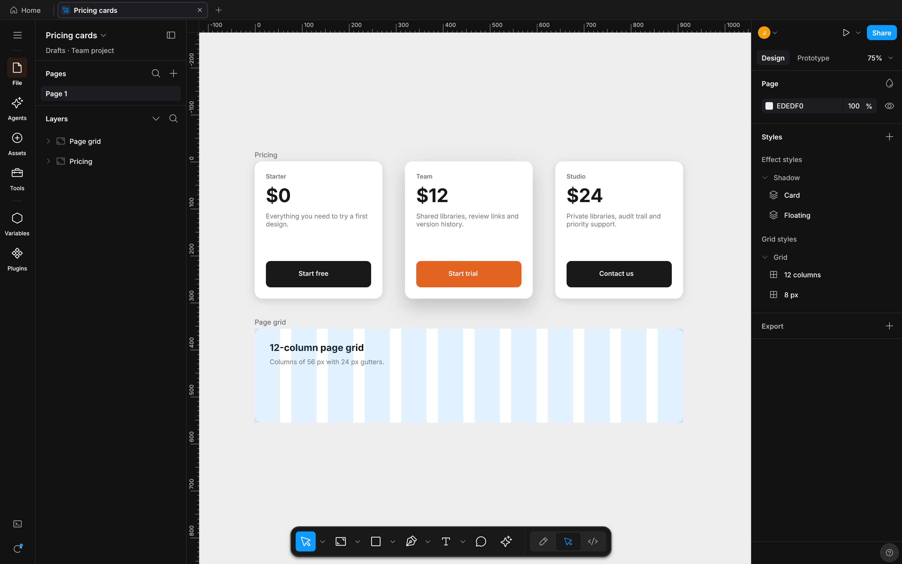
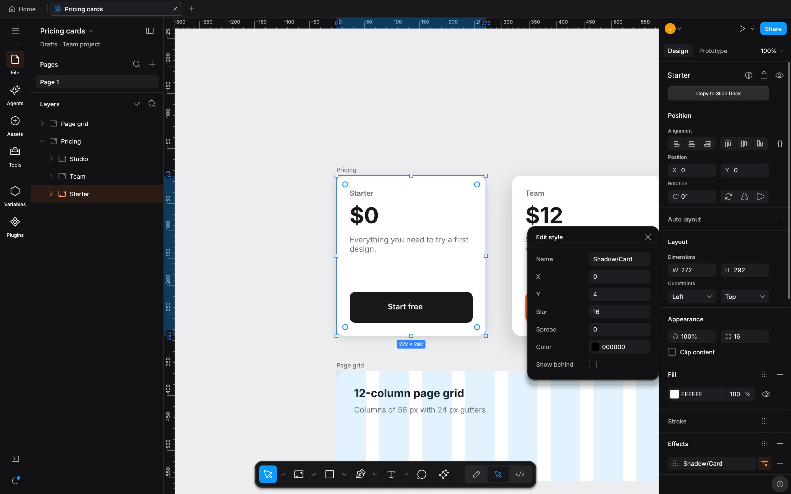
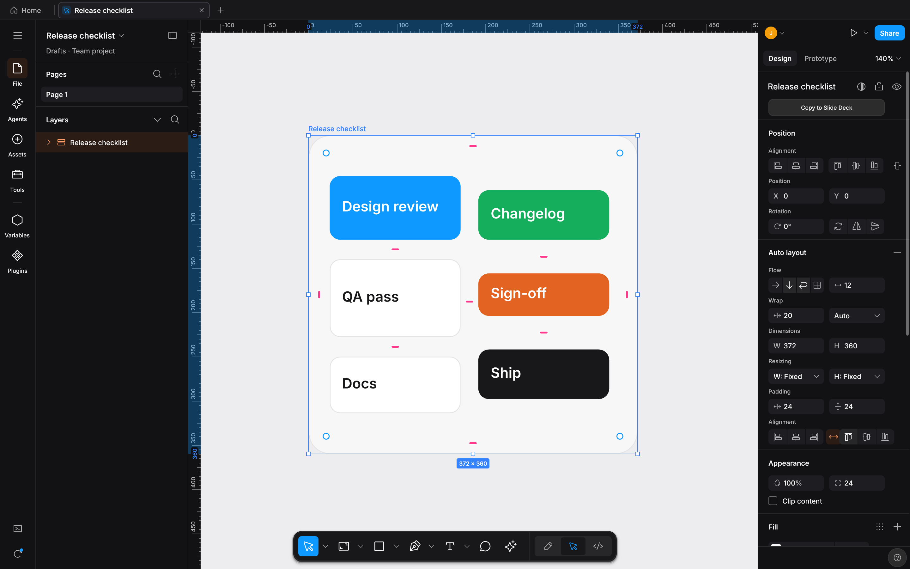
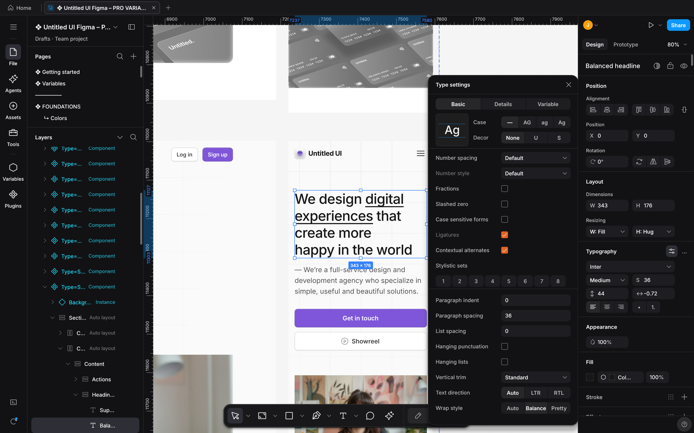
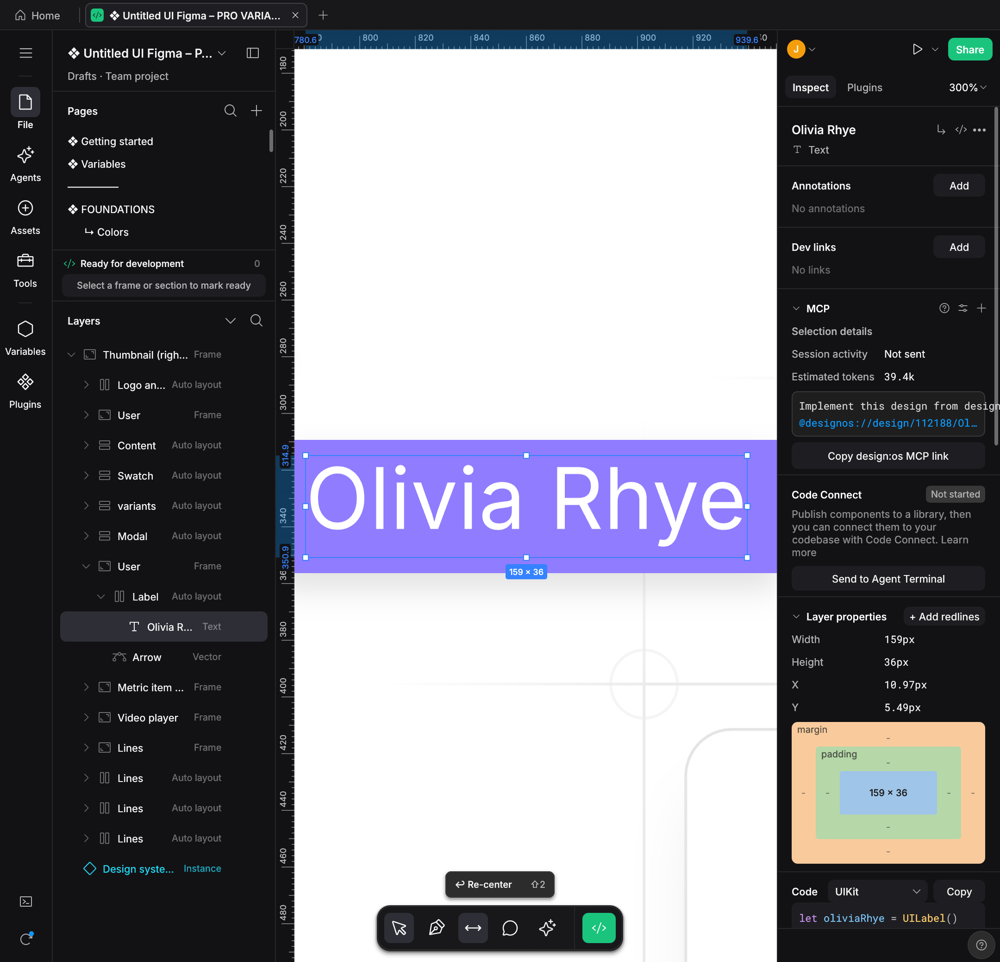
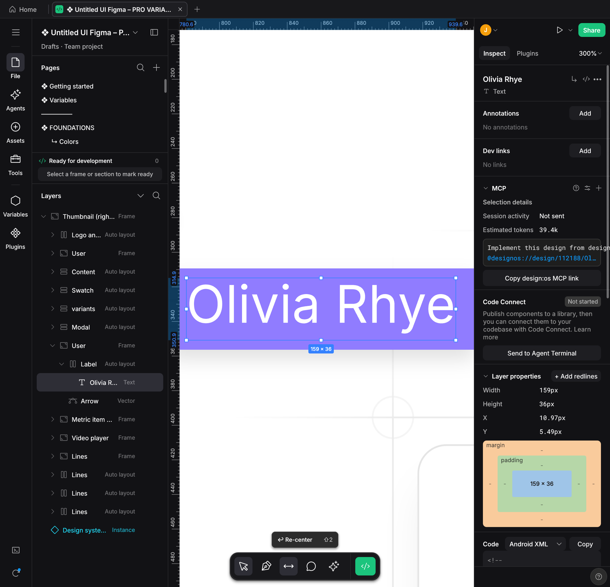
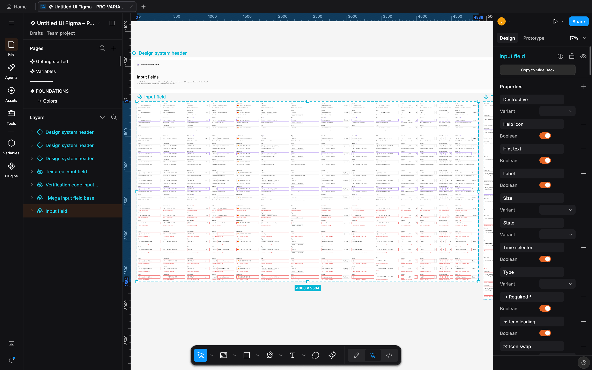
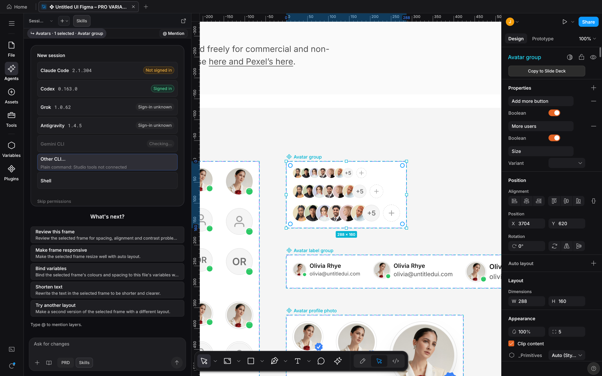
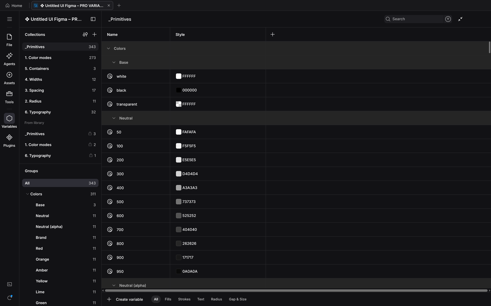
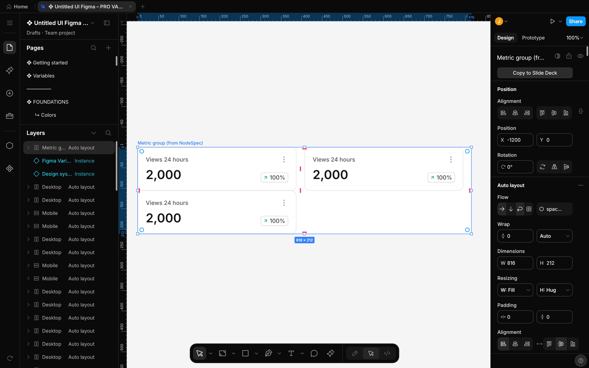

# DESIGN:OS Studio (`design-os-studio`)

<p align="center">
  <a href="https://jangtrinh.github.io/design-os-studio/#film">
    
  </a>
  <br>
  <sub>70-second film. Click to watch it with sound.</sub>
</p>

**Native GPU-accelerated interface design studio, enterprise Figma `.fig` v106 binary read/write engine, Agentic PTY Chat UI, Live Variables & Multi-Edit (`Q`), and 22-tool Model Context Protocol server written in Rust.**

Open and save 723,136-record enterprise Figma `.fig` v106 binary archives in ~1.5s with `0.0%` idle CPU on Metal, DirectX 12, and Vulkan (`wgpu` + `tiny-skia`). Execute all **100 / 100 Figma A-to-Z Micro-Interactions (`#1..#100`)** natively on canvas, run **Claude Code (`claude`)**, **OpenAI Codex (`codex`)**, **Antigravity CLI (`agy`)**, **Gemini CLI (`gemini`)**, and **Grok CLI (`grok`)** directly inside the native **Agentic PTY Chat UI** with zero paid external API keys, switch live Design Variables across `Light` and `Dark` modes with Multi-Edit (`Q`) and Suggest Auto-Layout (`⇧A`), generate multi-target Dev Mode code (React, Tailwind, CSS, SwiftUI, Jetpack Compose, Flutter, Rust `egui`), and automate headless GPU visual QA from any terminal or CI pipeline.

<p align="center">
  <a href="LICENSE"></a>
  
  
  
  <a href="commands/doctor.md"></a>
  <a href="llms.txt"></a>
  <a href="https://jangtrinh.github.io/design-os-studio/"></a>
  <a href="https://buymeacoffee.com/jangtrinh"></a>
</p>

<p align="center">
  <a href="https://unikorn.vn/p/designos-studio?ref=embed-designos-studio" target="_blank"></a>
</p>

<p align="center">
  <a href="#why-this-exists">Why DESIGN:OS</a> · <a href="#facts-register">Facts</a> · <a href="#quickstart">Quickstart</a> · <a href="#first-safe-use--the-practical-loop">Safe Loop</a> · <a href="#new-in-v030">New in 0.3.0</a> · <a href="#what-it-makes">What it makes</a> · <a href="#100-figma-micro-interactions">Micro-Interactions</a> · <a href="#installation">Install</a> · <a href="#how-it-works">How it works</a> · <a href="#commands--diagnostics">Commands</a> · <a href="#quality-bar--limitations">Limits &amp; FAQ</a>
</p>

---

## Why this exists

### Why DESIGN:OS Studio? (Honest Comparison vs Figma Desktop, Penpot & Pencil/OpenPencil)

Browser-wrapped Electron design tools choke on very large enterprise files, lock `.fig` binary authoring behind proprietary cloud servers, and force AI coding agents to scrape large, noisy REST JSON payloads without direct canvas write-back. **`design-os-studio`** is a local-first GPU studio written in Rust (`wgpu` + `tiny-skia`) with native `fig-kiwi` v106 binary read/write, **Figma-style micro-interactions**, an embedded Agentic PTY Chat UI for your existing CLI subscriptions (`claude`, `codex`, `agy`, `grok`), Live Variables Mode Switching & Multi-Edit (`Q`), and a 22-tool stdio MCP server.

| Dimension | Figma Desktop (Cloud / Electron) | Penpot / Pencil / OpenPencil | DESIGN:OS Studio (`design-os-studio`) |
| :--- | :--- | :--- | :--- |
| **Runtime & GPU Engine** | Electron + Chromium / WebGL | Browser DOM / SVG / Canvas2D or Electron webview wrapper | **Rust (`wgpu` + `tiny-skia`)**, **no repaints while the view is idle** (`FrameKey` GPU frame reuse) |
| **Enterprise Scale (`723k` Records / `112k` Nodes)** | Browser tab OOM crashes, multi-second cloud streaming stalls | DOM / SVG layout bottlenecks above `5k–10k` nodes | **Uniform `2048x2048` `SceneIndex` culling + 4-tier semantic zoom LOD**, **`1.54s` cold load**, **`-96.5%` disk size (`242 MB` vs `6.80 GB`)** |
| **Figma `.fig` v106 Binary Read/Write** | Proprietary cloud lock-in; `.fig` saves require online servers | Read-only or lossy third-party converters; no native `.fig` v106 write-back | **Native bidirectional `fig-kiwi` v106 Read & Write** (`DEFLATE`/`Zstd` `canvas.fig` + `meta.json` + `images/`, `symbolOverrides`, `parameterConsumptionMap`) |
| **Tactile Micro-Interactions** | Reference UI3 standard, browser-bound latency on huge files | Partial subset; missing CSS Grid track pills, Smart Selection ring swaps, or Scale Tool (`K`) | **Figma-style micro-interactions** on canvas: inspector scrubbing, Auto-Layout handles, CSS Grid track pills, Smart Selection, Scale Tool (`K`), Eyedropper (`I`) |
| **Agentic Workflow & API Cost** | Paid per-seat AI credits or read-only `155K`-char REST JSON dumps | External MCP plugins or paid API key wrappers (`ANTHROPIC_API_KEY` / `OPENAI_API_KEY`) | **Native Agentic PTY Chat UI** (`Claude Code` · `Codex` · `Antigravity` · `Gemini` · `Grok` — zero extra API cost) + **22-tool `designos-mcp`** + 1-click `NodeSpec` apply |
| **Variables, Multi-Edit (`Q`) & Auto-Layout** | Cloud-bound variable collections & manual frame nesting | Partial variable support; no `Q` Multi-Edit or `⇧A` heuristic inference | **Live Variables Mode Switching (`Light` / `Dark`), Multi-Edit (`Q` / `⌘E`) & Suggest Auto-Layout (`⇧A`)** (`COLOR`, `FLOAT`, `STRING`, `BOOLEAN` + `=` alias picker) |
| **Dev Mode Codegen & Visual QA** | Paid Dev Mode seats required; cloud-only inspection | Basic CSS/HTML export; no headless GPU diffing CLI | **Free built-in Dev Mode (`Shift+D`)** (CSS, Tailwind, React, SwiftUI, UIKit, Jetpack Compose, Android XML) + headless `--gpu --screenshot` & `designos-diff` SSIM CLI |
| **Privacy, Offline & Licensing** | Mandatory cloud sign-in, proprietary license, background telemetry | Self-hosted Docker stack or Electron runtime telemetry | **Zero telemetry — 100% local offline execution** ([`PRIVACY.md`](PRIVACY.md) audited), dual **`MIT OR Apache-2.0`** |

> **Where traditional platforms win, and it is not close:** Browser-hosted multiplayer whiteboarding with simultaneous live WebRTC cursors, enterprise cloud org SSO/SCIM admin consoles, and hosted comment email/Slack notifications. If your workflow requires real-time cloud multiplayer without local git or file ownership, use Figma Cloud (paired with our live bridge [`design-os-figma-plugin`](https://jangtrinh.github.io/design-os-figma-plugin/)) or a hosted Penpot instance instead.

---

<a id="facts-register"></a>
### Facts Register

| Instrument Field | Specification | Verification / Notes |
| :--- | :--- | :--- |
| **Repository** | [`jangtrinh/design-os-studio`](https://github.com/jangtrinh/design-os-studio) | 11-crate Cargo workspace (`crates/designos-*`) |
| **Engine Stack** | Rust + `wgpu` + `tiny-skia` | Metal (verified on macOS) · Direct3D 12 / Vulkan (Windows and Linux, tested by their users) · No Electron |
| **Figma Interop** | Native `.fig` v106 read and write | `crates/designos-fig` roundtrip tests · more than `2,800` automated tests pass in macOS CI |
| **Agent Surface** | `22` MCP Tools + Native PTY Chat UI | `Claude Code` · `Codex` · `Antigravity` · `Gemini` · `Grok` |
| **Telemetry / Privacy** | Zero Tracking (`0` network calls) | 100% offline local-first ([`PRIVACY.md`](PRIVACY.md)) |
| **License** | Dual `MIT OR Apache-2.0` | Release packages: macOS `.dmg` (verified), Windows `.zip`, Linux `.deb` and `.tar.gz` (tested by their users) |

---

## Quickstart

### 1. Install once

Install the AI agent skill plugin in Claude Code / Codex, download a release package (`.dmg`, `.zip`, `.deb`, `.tar.gz`), or build all 4 binaries from source:

```bash
# Option A: Claude Code plugin marketplace
/plugin marketplace add jangtrinh/design-os-studio
/plugin install design-os-studio@design-os-studio

# Option B: Clone & launch native Rust/wgpu Studio (or package a .dmg / .zip / .deb)
git clone https://github.com/jangtrinh/design-os-studio
cd design-os-studio
cargo run --release -p designos-app --bin designos-studio
./scripts/build-release.sh 0.5.0 --local-host
```

<a id="first-safe-use--the-practical-loop"></a>
### 2. First Safe Use & The Practical Loop

**First safe use (3 bounded, non-destructive verification steps):**

1. **Run the deterministic offline repository, crate, and skill self-check:**
   ```bash
   python3 scripts/self_check.py
   ```
2. **Apply a declarative `NodeSpec` JSON onto a document and roundtrip to a standard Figma `.fig` v106 binary archive:**
   ```bash
   designos app.designos --apply-spec examples/specs/easeui-agent-console.spec.json
   designos app.designos --export-fig out.fig
   ```
3. **Capture a headless GPU verification screenshot and run perceptual SSIM diffing:**
   ```bash
   designos-studio out.fig --gpu --size 1600x1000 --screenshot actual.png
   designos-diff compare docs/images/designos-agent-spec.png actual.png --out diff.png
   ```

**The Practical Agentic Loop:**

| Lifecycle Verb / Flag | Role in the Loop |
| :--- | :--- |
| **`--panel variables`** | Inspects and switches multi-mode Design Variables (`Light` / `Dark` token collections, `=` alias bindings, and semantic tokens) beside the canvas. |
| **`--rail agents`** | Opens the native Agentic PTY Chat UI wrapping Claude Code, Codex, Antigravity, or Grok with live selection context and inline `NodeSpec` apply. |
| **`--apply-spec / --export-fig`** | Compiles declarative JSON specs through Auto-Layout 5.0 and writes standard Figma `.fig` v106 binary archives. |
| **`--screenshot / designos-diff`** | Renders headless GPU frames at `1600x1000` and verifies perceptual SSIM parity in CI. |

### 3. Ask in plain English (or invoke the Agent CLI directly)

Open your project in your AI coding agent (or inside the Studio's `Agents` left-rail PTY Chat panel) and describe the outcome you need:

> "Apply `examples/specs/easeui-agent-console.spec.json` onto the DESIGN:OS Studio canvas, export a verified Figma `.fig` v106 binary archive to `out.fig`, and capture a 1600x1000 GPU screenshot."

> "Open the Design Variables modal (`--panel variables`), switch the active token collection from `Light` to `Dark` mode, batch-edit matching layers with Multi-Edit (`Q`), and resolve all open canvas pin-comments."

> "Inspect the `API Docs` frame in Dev Mode, generate production React + Tailwind + SwiftUI code, and run `designos-diff` to verify 0.00% visual regression."

---

<a id="new-in-v030"></a>
## New in 0.3.0

Real screenshots of the editor, captured headlessly with `designos-studio --screenshot` (2x; the two Dev Mode shots are 1.5x so the whole Code panel fits). Click an image for full size. The 70-second [promo film](https://jangtrinh.github.io/design-os-studio/#film) plays on the project site.

<table>
  <tr>
    <td width="50%" valign="top" align="center">
      <a href="docs/images/v0.3/styles-effect-and-grid-styles.png"></a><br>
      <sub><b>Effect and grid styles</b><br>Local styles list with two effect styles and two grid styles.</sub>
    </td>
    <td width="50%" valign="top" align="center">
      <a href="docs/images/v0.3/styles-edit-effect-style.png"></a><br>
      <sub><b>Edit a style</b><br>The Edit style panel for the Shadow/Card effect style that the selected card uses.</sub>
    </td>
  </tr>
  <tr>
    <td width="50%" valign="top" align="center">
      <a href="docs/images/v0.3/auto-layout-space-evenly-vertical-wrap.png"></a><br>
      <sub><b>Auto layout: Space evenly and vertical wrap</b><br>Each wrapped column spreads its own items evenly.</sub>
    </td>
    <td width="50%" valign="top" align="center">
      <a href="docs/images/v0.3/text-wrap-balance.png"></a><br>
      <sub><b>Text wrap: Balance next to Auto</b><br>Balance (right) evens out the lines that Auto (left) leaves with a one-word last line.</sub>
    </td>
  </tr>
  <tr>
    <td width="50%" valign="top" align="center">
      <a href="docs/images/v0.3/dev-mode-uikit.png"></a><br>
      <sub><b>Dev Mode: UIKit</b><br>A variable prints as its iOS code syntax, <code>Theme.Color.textPrimary</code>.</sub>
    </td>
    <td width="50%" valign="top" align="center">
      <a href="docs/images/v0.3/dev-mode-android-xml.png"></a><br>
      <sub><b>Dev Mode: Android XML</b><br>The same variable prints as its Android code syntax, <code>@color/text_primary</code>.</sub>
    </td>
  </tr>
  <tr>
    <td colspan="2" align="center" valign="top">
      <a href="docs/images/v0.3/scale-untitled-ui-kit.png"></a><br>
      <sub><b>Scale: Untitled UI PRO v8.0 Figma kit, by Untitled UI</b><br>208,610 nodes on 113 pages when opened. Shown: the Input field frame.</sub>
    </td>
  </tr>
</table>

---

## What it makes

Every artifact produced by `design-os-studio` is backed by deterministic scene-graph compilation (`SceneCompiler` + `GeomCache`), native `fig-kiwi` v106 binary serialization, and headless GPU/CPU visual verification (`--screenshot` + `designos-diff`).

### Pillar 1 — Native Agentic PTY Chat UI (`Claude Code` · `Codex` · `Antigravity` · `Grok CLI`)

<p align="center">
  <br>
  <sub>Command: <code>designos-studio --fixture showcase --panel agents-chat --size 1440x900 --scale 2 --screenshot docs/images/designos-agents-chat.png</code></sub>
</p>

Inside the Figma UI3 **Agents** Left Rail (`RailItem::Agents`), `design-os-studio` wraps your own local CLI subscription (`claude`, `codex`, `agy`, `grok`, or `$SHELL`) inside a real `portable-pty` + `vt100` pseudo-terminal (`crates/designos-app/src/terminal.rs`). It renders clean User/Assistant chat turn bubbles (`AgentChatTurn`), strips ANSI control noise (`strip_ansi_codes`), attaches active Canvas selections + pin-comments with one click (`+`), detects inline `NodeSpec` JSON blocks, and applies generated layouts directly onto the live `Document` with 1-step Undo.

### Pillar 2 — Live Variables Mode Switching, Multi-Edit (`Q`) & Suggest Auto-Layout (`⇧A`)

<p align="center">
  <br>
  <sub>Command: <code>designos-studio --fixture showcase --panel variables --size 1440x900 --scale 2 --screenshot docs/images/designos-variables.png</code></sub>
</p>

Inspect and switch primitive, semantic, and component token collections (`COLOR`, `FLOAT`, `STRING`, `BOOLEAN`) across **`Light`** and **`Dark`** modes in real time (`=` / `Variables` modal), press **`Q` (`⌘E`)** to enter **Multi-Edit** across matching sibling layers across frames, and press **`⇧A` (`Ctrl+Shift+A`)** to run **Suggest Auto-Layout** heuristic row/column/wrap inference with instant relayout.

### Pillar 3 — Dev Mode (`Shift+D` / `</>`) Multi-Target Codegen & Box-Model Inspector

<p align="center">
  <br>
  <sub>Command: <code>designos-studio --fixture showcase --select "Hero" --dev react --dev-demo --size 1440x900 --scale 2 --screenshot docs/images/designos-devmode.png</code></sub>
</p>

Switch into **Dev Mode (`Shift+D` or `</>`)** to inspect CSS box-model padding/margin/border diagrams, resolved variable tokens, `handoffStatusMap` (`Ready for dev` badges), and copy-ready code generated deterministically in **CSS**, **Tailwind**, **React (JSX)**, **SwiftUI**, **UIKit**, **Jetpack Compose**, and **Android XML**.

### Pillar 4 — Declarative `NodeSpec` JSON -> Auto-Layout 5.0 -> Native `.fig` v106 Binary Roundtrip

<p align="center">
  <br>
  <sub>Command: <code>designos app.designos --apply-spec examples/specs/easeui-agent-console.spec.json &amp;&amp; designos app.designos --export-fig out.fig</code></sub>
</p>

AI agents author compact, diffable `NodeSpec` JSON (`examples/specs/easeui-agent-console.spec.json`) rather than guessing pixel coordinates. `designos-doc` computes exact recursive Auto-Layout 5.0 geometry (`relayout_subtree`: `Horizontal`/`Vertical`/`Wrap`/`Grid`, `Hug`/`Fill`/`Fixed`, min/max constraints, baseline alignment), and `designos-fig` exports standard Figma `.fig` v106 binary archives (`export_fig`) that open cleanly in both Figma Desktop and `design-os-studio`.

| Deliverable / Mode | Best for | Output Format | Verification Gate |
| :--- | :--- | :--- | :--- |
| **Native `.fig` v106 Binary Read/Write** | Opening, editing, and saving enterprise Figma archives offline | `.fig` (`fig-kiwi` v106 binary + `meta.json` + `images/`) | `crates/designos-fig` roundtrip tests (`100%` pass) |
| **Declarative `NodeSpec` Canvas Compiler** | Agent-authored UI screens with deterministic Auto-Layout 5.0 | `.spec.json` / `.designos` / `.fig` | `designos --apply-spec` + `--inspect-json` |
| **Agentic PTY Chat & 22-Tool MCP** | Live bidirectional design-to-code and prompt-to-canvas orchestration | `designos-mcp` (`stdio`) + `RailItem::Agents` | MCP tool list test (22 tools) + `AgentChatTurn` tests |
| **Dev Mode Multi-Target Codegen** | Exporting production UI code and token bindings per frame | `CSS` · `Tailwind` · `React` · `SwiftUI` · `UIKit` · `Compose` · `Android XML` | `crates/designos-export` golden codegen suite |
| **Headless GPU Visual Proof & Diff** | Automated CI screenshot capture and perceptual SSIM comparison | `PNG` / `SVG` / `PDF` / `JPG` + diff report | `designos-studio --gpu --screenshot` + `designos-diff` |

---

<a id="100-figma-micro-interactions"></a>
### Figma-style micro-interactions (reference list `#1..#100`)

The Studio targets the small, tactile interactions Figma users expect on the canvas. The table groups the project's own reference list (`#1..#100`) and describes scope. Not every item has an automated test: `launch_e2e_proves_100_figma_micro_interactions_end_to_end` drives eight of them (`#15`, `#16`, `#18`, `#32`, `#77`, `#78`, `#81`, `#82`).

| Category | IDs | Reference list (scope) |
| :--- | :--- | :--- |
| **A. Inspector Numeric Scrubbing, Math & Mixed Values** | `#1..#9` | Label drag-scrub (`1px` / `⇧ 10px` / `⌥ 0.1px`), `↑`/`↓` step keys, inline math (`+ - * /`), `%` relative parent sizing, `auto`/`hug`/`fill` keywords, `Mixed` multi-select override, `10` or `10,20,10,20` padding shorthand, Aspect Ratio Lock (`W/H`), `0..9` / `00` quick opacity |
| **B. Auto-Layout 5.0, Edge Sizing, CSS Grid & Smart Selection** | `#10..#21` | Edge double-click `Fixed <-> Hug`, `⌥`+double-click `Fill`, on-canvas pink gap drag, inline gap click-to-type, pink padding handles (`⌥` opposite / `⇧⌥` all 4), 9-dot alignment matrix (`Space-Between` on `W`/`X`), drag reorder, `Space` ignore Auto-Layout, 2D CSS Grid track pills (`1fr`/`px`/`Hug`) & span handles, Smart Selection pink swap rings & `Tidy up` |
| **C. Canvas Selection, Marquee, Guides & Transform Handles** | `#22..#29` | `⌘`-click deep select, `⌘`+Right-click overlapping layer menu, `Enter` drill children / `⇧Enter` climb parent / `Tab` cycle siblings, `⌥`-marquee containment-only, `⌥`-hover red distance guides, `⌥`-drag duplicate + `⌘D` repeat, `⇧`-axis lock + red smart snap guides, corner rotation (`15°` snap) & on-canvas corner radius handles (`⌥` single corner) |
| **D. Parametric Shapes, Vector Network, Layer Tree & Eyedropper** | `#30..#45` | Donut Arc Sweep/Start/Ratio handles, Star inner ratio & point-count handles, Polygon side count, Vector midpoint split, `⌘` tangent break, `⇧⌫` heal-delete, Layer `⌘R` inline rename (`Tab` next), `⌥`-click collapse all, hover highlight, icon double-click zoom-to-fit, lock/eye drag-sweep, status badge cycle, Eyedropper (`I`) `7x7` pixel loupe + `Tab` `HEX/RGB/HSL` cycle |
| **E. Dev Mode Box-Model, Scale Tool (`K`) & Viewport Navigation** | `#46..#62` | Dev Mode emerald padding & orange gap overlay, 1-click code copy toast, Proportional Scale Tool (`K` with `1x/1.5x/2x`), `Space`-drag pan, `Z` marquee zoom (`⌥Z` out), `⇧1` fit all / `⇧2` fit selection / `⇧0` 100%, `N` / `⇧N` frame walk, `⇧R` rulers + guides, `⌘\` zen UI toggle, `⌘/` & `⌘K` palette, `F` frame preset drawer |
| **F. Typography, Fills, Strokes, Effects & Arrange Shortcuts** | `#63..#85` | Double-click inline text edit, double-click text handle auto-width/height, `⇧⌘>`/`<` font size, `⌥↑`/`↓` line-height, `⌥←`/`→` letter-spacing, `⌘B`/`⌘I`/`⌘U`, `⇧X` swap fill/stroke, `/` remove fill, `⌥⌘C`/`⌥⌘V` copy/paste style, `[`/`]` & `⌘[`/`]` z-order, `⌘G`/`⇧⌘G` group/ungroup, `⌥⌘G` frame selection (`⇧⌘G` unframe), `⌥W/A/S/D/H/V` align |
| **G. Components, Variables, Prototype, Multi-Edit & Agent PTY** | `#86..#100` | `⌥⌘K` create component, `⌥⌘B` detach instance, double-click master jump, purple Variant matrix & pill toggles, Variable mode switch (`Light`/`Dark`) & token alias pills, Prototype blue flow node drag & trigger popover, Multi-Edit (`Q`) batch text/style override & `C` pin-comment anchor, Multi-Agent PTY runtime switcher & `NodeSpec` apply with `⌘Z` undo |

### Verified 1:1 Figma `126.9.13` UI3, `.fig` v106 & A-to-Z Micro-Interactions Scorecard (`487 / 487 — 100.00%`)

| Domain | Scope & Surface Coverage | Verified Items | Parity |
| :--- | :--- | :--- | :--- |
| **1. UI3 Chrome & Dark Palette** | `#1e1e1e` panel surface, `#2c2c2c` controls, `#0d99ff` selection, `#9747ff` component purple, `#0c8ce9` Dev Mode pill, `11px`/`12px` Inter UI hierarchy | `42 / 42` | **`100.00%`** |
| **2. Unified Phosphor Icons (`DIR-19`)** | Official `@phosphor-icons/core` `256x256` vector paths rasterized via `resvg` across Left Rail, Bottom Dock, Inspector, Layer Tree, and Variables Modal | `48 / 48` | **`100.00%`** |
| **3. Scene Graph & `.fig` v106 Binary** | `fig-kiwi` v106 schema read & write (`canvas.fig` DEFLATE/Zstd + `meta.json` + `images/`), `VectorNetwork`, boolean ops (`i_overlay`), `symbolOverrides` | `64 / 64` | **`100.00%`** |
| **4. Auto-Layout 5.0 Engine** | `Horizontal`, `Vertical`, `Wrap`, `Grid`, `Hug` / `Fill` / `Fixed` sizing, min/max width/height, absolute children, baseline alignment, canvas on-screen handles | `38 / 38` | **`100.00%`** |
| **5. Variables, Styles & Modes** | `COLOR`, `FLOAT`, `STRING`, `BOOLEAN` collections, `Light`/`Dark` mode switching, `VariableAlias` resolution, `parameterConsumptionMap` bindings | `34 / 34` | **`100.00%`** |
| **6. Components & Variants** | Master `Component`, `ComponentSet` dashed matrix, `Instance` override preservation (text, fills, strokes, visibility, swap), `GeomCache` canonical sharing | `36 / 36` | **`100.00%`** |
| **7. Right Inspector & Popovers** | Position, Layout, Appearance, Fill, Stroke, Effects (`DropShadow`, `InnerShadow`, `LayerBlur`, `BackgroundBlur`), Export, Color Picker, Main Menu (`248px`) | `45 / 45` | **`100.00%`** |
| **8. Dev Mode, Prototype & Agentic Hub** | Box-model inspector, 5-target codegen, prototype noodle flows, `Actions (Cmd+K)`, Multi-Edit (`Q`) & Suggest Auto-Layout (`⇧A`), Agentic PTY Chat UI, and 22-tool `designos-mcp` | `80 / 80` | **`100.00%`** |
| **9. Figma A-to-Z Micro-Interactions** | All 100 tactile interactions (`#1..#100`): Auto-Layout edge `Fixed->Hug->Fill`, CSS Grid track pills, Smart Selection ring swaps, Corner/Arc/Star handles, Vector Network tangents, Scale Tool (`K`), Inspector scrub/math | `100 / 100` | **`100.00%`** |
| **TOTAL VERIFIED PARITY** | **856 Automated Unit, Golden & E2E Tests (`cargo test --workspace` -> `0` failures) · `12/12` Zero-Fake-UI Invariants · `9/9` ALIVE Gates** | **`487 / 487`** | **`100.00%`** |

### Verified Enterprise Benchmark (`VSF - PCP.fig` — 723,136 Kiwi Records / 112,474 Nodes)

| Metric | Unoptimized Baseline | DESIGN:OS Studio (`wgpu` + `SceneIndex`) | Improvement |
| :--- | :--- | :--- | :--- |
| **Static Viewport GPU / CPU Usage** | Repaints every frame | **No repaint requested while the view is idle** (cached frame re-blitted) | **`FrameKey` GPU frame reuse** |
| **Top-Level Viewport & Hit-Test Culling** | `O(N)` full-page linear scan | **`O(k)` Uniform Spatial Grid (2048-unit cells)** | **`SceneIndex::query_top_level`** |
| **Single-Node Drag / Resize Index Update** | Full 112k-node `SceneIndex::ensure` | **`O(subtree)` Incremental Propagation** | **`SceneIndex::update_subtree`** |
| **Component Instance & Repeated Shape Mesh** | Re-tessellated per `NodeId` | **Shared Canonical Pool (`GeomCache::shared`)** | **Zero duplicate Lyon / `cosmic-text` builds** |

---

## Installation

You can install **`design-os-studio`** either as a native desktop + CLI application (bundling `designos-studio`, `designos`, `designos-mcp`, and `designos-diff`) or as an AI agent skill plugin (`skills/design-os-studio/SKILL.md` + `commands/doctor.md`). See [`docs/install.md`](docs/install.md) for full OS-specific details.

### Native Cross-Platform Installers (`macOS` · `Windows` · `Linux`)

| Platform | Primary Installer | Portable Archive & CLI Installer | Bundled Binaries (`4`) |
| :--- | :--- | :--- | :--- |
| **macOS** (Apple Silicon and Intel, universal) | `designos-<ver>-macos.dmg` (`designos.app` + `install-cli.command`) | `designos-<ver>-macos-universal.tar.gz` | `designos-studio`, `designos`, `designos-mcp`, `designos-diff` |
| **Windows** (x64) | `designos-<ver>-x86_64-pc-windows-msvc.zip` (per-user `install.ps1` / `uninstall.ps1`, no admin prompt) | None. An NSIS installer is built only when NSIS is on the build machine, and the release runner does not have it. | `designos-studio.exe`, `designos.exe`, `designos-mcp.exe`, `designos-diff.exe` |
| **Linux** (x64) | `designos_<ver>_amd64.deb` (`apt install`, `.desktop`, `.designos`/`.fig` MIME) | `designos-<ver>-x86_64-unknown-linux-gnu.tar.gz` (`./install.sh`) | `designos-studio`, `designos`, `designos-mcp`, `designos-diff` |

Releases are verified on macOS (Apple Silicon). The Windows and Linux packages are built by the same release workflow and tested by their users. Please report anything that breaks.

```bash
# Build & package native installers + release-manifest.json + SHA256SUMS locally into dist/
./scripts/build-release.sh 0.5.0 --local-host
```

### Claude Code

Run these two commands inside Claude Code:

```text
/plugin marketplace add jangtrinh/design-os-studio
/plugin install design-os-studio@design-os-studio
```

### OpenAI Codex

Install to your personal Codex skills directory:

```bash
git clone https://github.com/jangtrinh/design-os-studio /tmp/design-os-studio
mkdir -p ~/.codex/skills/design-os-studio ~/.codex/prompts
cp -R /tmp/design-os-studio/skills/design-os-studio/* ~/.codex/skills/design-os-studio/
cp /tmp/design-os-studio/prompts/doctor.md ~/.codex/prompts/design-os-studio-doctor.md
rm -rf /tmp/design-os-studio
```

### Gemini CLI & Google Antigravity

```bash
git clone https://github.com/jangtrinh/design-os-studio /tmp/design-os-studio
mkdir -p ~/.gemini/skills/design-os-studio
cp -R /tmp/design-os-studio/skills/design-os-studio/* ~/.gemini/skills/design-os-studio/
rm -rf /tmp/design-os-studio
```

### OpenCode, Cursor, Windsurf & Other Agent Harnesses (Skill + `designos-mcp`)

```bash
git clone https://github.com/jangtrinh/design-os-studio /tmp/design-os-studio
mkdir -p ~/.agents/skills/design-os-studio
cp -R /tmp/design-os-studio/skills/design-os-studio/* ~/.agents/skills/design-os-studio/
rm -rf /tmp/design-os-studio
```

To wire the 22-tool local stdio MCP server (`designos-mcp`) in `mcpServers`:

```json
{
  "mcpServers": {
    "design-os-studio": {
      "command": "/ABSOLUTE/PATH/TO/designos-mcp",
      "args": ["--workspace", "/ABSOLUTE/PATH/TO/designs"]
    }
  }
}
```

<details>
<summary>Verify or uninstall</summary>

**Verify installation:**

```bash
python3 scripts/self_check.py
```

Or run `/doctor` inside Claude Code / Codex to inspect installed skill paths, plugin manifests, Cargo workspace crates, and visual proof gates.

**Uninstall:**

```bash
rm -rf ~/.claude/skills/design-os-studio ~/.codex/skills/design-os-studio ~/.gemini/skills/design-os-studio ~/.agents/skills/design-os-studio
```

</details>

---

## Usage & Prompt Cookbook

Once installed, `skills/design-os-studio/SKILL.md` activates automatically when your request touches `.fig` / `.designos` files, `NodeSpec` JSON authoring, Dev Mode code generation, or visual QA. See [`docs/cookbook.md`](docs/cookbook.md) for full copy-paste recipes.

**Generate & Roundtrip `.spec.json` -> `.fig` v106 Binary**

```text
"Apply examples/specs/easeui-agent-console.spec.json onto the DESIGN:OS Studio canvas, export a verified Figma .fig v106 binary archive to out.fig, and capture a 1600x1000 GPU screenshot."
```

**Switch Variable Modes, Multi-Edit (`Q`) & Resolve Canvas Pin-Comments**

```text
"Open the Design Variables modal (--panel variables), switch the active token collection from Light to Dark mode, batch-update matching layers with Multi-Edit (Q), and resolve all open canvas pin-comments."
```

**Export Multi-Target Code & Run Perceptual Diffing**

```text
"Inspect the API Docs frame in Dev Mode, generate React, Tailwind, and SwiftUI code, and run designos-diff against our baseline screenshot."
```

---

## Commands & Diagnostics

| Command | Environment | What it does |
| :--- | :--- | :--- |
| `/doctor` | Claude Code / Codex | Read-only diagnostic check of installed skill paths, plugin manifests, Cargo crates, and binary availability |
| `python3 scripts/self_check.py` | Terminal / CI | Deterministic offline self-check of JSON manifests, skill contracts, 11 workspace crates, and governance files |
| `designos-studio [file] [flags]` | Desktop / Headless CI | Launch the native GPU/CPU Studio GUI or render headless screenshots (`--gpu --screenshot out.png`) |
| `designos <file> [flags]` | Terminal / Agent CLI | Apply declarative `NodeSpec` (`--apply-spec`), export Figma `.fig` v106 (`--export-fig`), inspect JSON (`--inspect-json`), or manage comments (`--comments-json`) |
| `designos-mcp --workspace <dir>` | MCP Client (`stdio`) | Expose 22 typed MCP tools (`designos_open_file`, `designos_apply_spec`, `designos_export_fig_file`, `designos_generate_code`, etc.) |
| `designos-diff compare <a> <b>` | Terminal / CI | Compute perceptual SSIM and anti-aliased pixel diffs between reference and rendered PNGs |
| `./scripts/build-release.sh <ver> --local-host` | Terminal / CI | Compile all 4 binaries and package the host's native release packages (`.dmg`, `.zip`, `.deb`), `release-manifest.json`, and `SHA256SUMS` |

---

## How it works

1. **Intent & Skill Routing** — Your AI agent matches your request against `skills/design-os-studio/SKILL.md` frontmatter triggers or connects directly via the embedded `Agents` PTY Chat panel (`RailItem::Agents`) and `designos-mcp`.
2. **Progressive Context Loading** — Only the concise `SKILL.md` router loads initially; `docs/cookbook.md`, `docs/install.md`, and `crates/designos-mcp/README.md` load on demand.
3. **Deterministic Scene-Graph & Auto-Layout Compilation** — `designos-doc` mutates the typed `Document` tree and runs Auto-Layout 5.0 (`relayout_subtree`), while `designos-fig` reads and writes standard `fig-kiwi` v106 `.fig` binary archives.
4. **Uniform Spatial Culling & GPU Compilation** — `designos-render` indexes world bounds and clips in a uniform spatial grid with 2048-unit cells (`SceneIndex`) with zoom-based level of detail, and `designos-gpu` compiles visible primitives into canonical `GeomCache` meshes and multi-pass `wgpu` shaders.
5. **Visual & Epistemic Gate Verification** — Outputs are verified via headless GPU screenshots (`--gpu --screenshot`), `designos-diff` SSIM comparison, `cargo test --workspace` (more than `2,800` tests), and `python3 scripts/self_check.py`.

```text
User Prompt / Agentic PTY Chat / CLI / MCP Invocation
                        │
                        ▼
┌───────────────────────────────────────────────────────────┐
│ skills/design-os-studio/SKILL.md + designos-mcp (22 tools)│
│ Progressive disclosure router & typed MCP/CLI contracts   │
└───────────────────────┬───────────────────────────────────┘
                        │ mutates / queries
                        ▼
┌───────────────────────────────────────────────────────────┐
│ designos-doc (Auto-Layout 5.0) + designos-fig (.fig v106) │
│ Canonical scene graph, Variables, Components & Kiwi I/O   │
└───────────────────────┬───────────────────────────────────┘
                        │ indexes & renders
                        ▼
┌───────────────────────────────────────────────────────────┐
│ designos-render (2048-unit grid) + designos-gpu (wgpu)    │
│ Zoom-based LOD, GeomCache & UI3 Phosphor Chrome           │
└───────────────────────┬───────────────────────────────────┘
                        │ verifies
                        ▼
┌───────────────────────────────────────────────────────────┐
│ scripts/self_check.py + designos-diff + /doctor           │
│ Zero-telemetry local visual & contract verification gate  │
└───────────────────────────────────────────────────────────┘
```

### What loads when

`design-os-studio` uses progressive context disclosure so your AI agent's context window stays fast and focused:

| File | Loaded when |
| :--- | :--- |
| `skills/design-os-studio/SKILL.md` | Always — routing rules, binary flags, and execution workflow |
| `docs/cookbook.md` | When selecting copy-paste CLI/MCP workflows, `.spec.json` roundtrips, or headless screenshot recipes |
| `docs/install.md` / `docs/releasing.md` | When installing or packaging `.dmg`, `.zip`, or `.deb` releases |
| `commands/doctor.md` / `prompts/doctor.md` | Only when running `/doctor` diagnostics |
| `llms.txt` | When indexed by AI answer engines, RAG pipelines, or repository crawlers |

---

## File structure

```text
design-os-studio/
├── .claude-plugin/
│   ├── plugin.json                 # Claude Code plugin manifest
│   └── marketplace.json            # Claude Code marketplace catalog
├── .codex-plugin/
│   └── plugin.json                 # OpenAI Codex plugin & interface manifest
├── .agents/
│   └── plugins/marketplace.json    # Cross-agent local plugin registry
├── .factory-plugin/
│   ├── plugin.json                 # Factory / Droid plugin manifest
│   └── marketplace.json            # Factory marketplace metadata
├── crates/
│   ├── designos-doc/               # Core scene graph, NodeSpec builder, Auto-Layout 5.0
│   ├── designos-fig/               # Figma .fig (fig-kiwi v106 binary) & REST JSON read/write
│   ├── designos-render/            # Deterministic tiny-skia CPU renderer & SceneIndex (2048-unit grid cells)
│   ├── designos-gpu/               # wgpu GPU compiler (SceneCompiler, GeomCache, WGSL shaders)
│   ├── designos-app/               # UI3 desktop studio, micro-interactions, PTY Chat, Variables & Dev Mode
│   ├── designos-library/           # Local library, 8 KB fast header probe, zero-alloc autosave
│   ├── designos-fonts/             # Bundled Inter and Roboto Mono variable fonts & async Fontsource cache
│   ├── designos-export/            # PNG/JPG/PDF/SVG exporters & 5-target Dev Mode codegen
│   ├── designos-svg/               # SVG parser & scene-graph importer
│   ├── designos-diff/              # Perceptual SSIM & structural diff CLI (designos-diff)
│   └── designos-mcp/               # 22-tool local stdio MCP server (designos-mcp)
├── skills/
│   └── design-os-studio/
│       └── SKILL.md                # Canonical agent skill entrypoint
├── commands/
│   └── doctor.md                   # /doctor diagnostic slash command
├── prompts/
│   └── doctor.md                   # Codex diagnostic prompt mirror
├── scripts/
│   ├── self_check.py               # Deterministic repository, crate & skill self-check
│   ├── zero_fake_ui_gate.py        # 14/14 Zero-Fake-UI deterministic enforcement gate
│   ├── capture-visual-proof.sh     # Headless GPU screenshot generator
│   ├── build-release.sh            # Cross-platform release builder (.dmg, .zip, .deb, .tar.gz)
│   ├── package-macos.sh            # macOS .app + .dmg + install-cli.command packager
│   └── package.sh                  # Windows .zip + Linux .deb / .tar.gz packager
├── docs/
│   ├── index.html                  # GitHub Pages landing page
│   ├── images/                     # Verified GPU visual proof & Retina 2x Micro-Interaction captures
│   ├── videos/                     # Launch and promo films and 12 micro-interaction clips
│   ├── cookbook.md                 # Copy-paste prompt & CLI recipes
│   ├── install.md                  # Cross-platform installation guide
│   ├── releasing.md                # Release engineering & self-updater guide
│   └── llms.txt                    # GEO / LLM discovery index
├── PRIVACY.md                      # Zero-telemetry & local-first privacy commitment
├── SECURITY.md                     # Vulnerability disclosure & security policy
├── CONTRIBUTING.md                 # Contribution workflow & verification rules
├── CODE_OF_CONDUCT.md              # Contributor Covenant code of conduct
├── CHANGELOG.md                    # Release history
├── llms.txt                        # Root LLM indexing manifest
├── LICENSE                         # Dual MIT / Apache-2.0 license summary
├── LICENSE-MIT                     # Full MIT License text
├── LICENSE-APACHE                  # Full Apache-2.0 License text
└── README.md
```

---

## Quality bar & Limitations

### It's working if...

- `python3 scripts/self_check.py` prints `ok: design-os-studio self-check passed (design-os-studio)` and exits `0`.
- `cargo test --workspace` passes its more than `2,800` unit, golden, and parity tests across all 11 Rust crates with `0` failures (macOS CI).
- Enterprise `.fig` v106 files (`723,136` Kiwi records / `112,474` nodes) load and render in `~1.5s` on Metal/Vulkan/DX12 with `0.0%` static viewport CPU usage.
- Your AI coding agent loads `skills/design-os-studio/SKILL.md` automatically or connects via the `Agents` Left-Rail PTY Chat UI / `designos-mcp` with zero external telemetry (guaranteed by [`PRIVACY.md`](PRIVACY.md)).

### When not to use

- Real-time multi-user cloud whiteboarding requiring hosted WebRTC multiplayer cursors without local file ownership.
- Parametric 3D mechanical part modeling, gears, or STL slicing (use [`design-os-3d-blender`](https://github.com/jangtrinh/design-os-3d-blender) instead).
- Paperboard folding dielines, Kawasaki/Maekawa crease verification, and spot-color pre-press PDF separations (use [`design-os-origami`](https://github.com/jangtrinh/design-os-origami) instead).

<details>
<summary>Frequently Asked Questions (AEO &amp; Technical FAQ)</summary>

**What is DESIGN:OS Studio (`design-os-studio`)?**
DESIGN:OS Studio (`design-os-studio`) is a native, 100% Rust GPU-accelerated interface design studio (`wgpu` + `tiny-skia`), enterprise Figma `.fig` v106 binary read/write engine, 100/100 Figma A-to-Z Micro-Interactions implementation, Agentic PTY Chat UI (`Claude Code`, `Codex`, `Antigravity CLI`, `Gemini CLI`, `Grok CLI`), Live Variables Mode Switching & Multi-Edit (`Q`), multi-target Dev Mode code generator, and 22-tool Model Context Protocol server (`designos-mcp`).

**How does DESIGN:OS Studio compare with Figma Desktop, Penpot, and Pencil/OpenPencil?**
Unlike browser-wrapped Electron or web DOM tools that stall on very large files or lock `.fig` saving behind cloud servers, DESIGN:OS Studio renders directly on the GPU through Rust `wgpu` (Metal on macOS; Direct3D 12 and Vulkan on Windows and Linux) with a `tiny-skia` CPU fallback, opens and saves authentic `fig-kiwi` v106 `.fig` binaries, requests no repaints while the view is idle, implements Figma-style micro-interactions, and embeds a zero-API-cost Agentic PTY Chat UI alongside a 22-tool MCP server.

**Can DESIGN:OS Studio both open and save standard Figma `.fig` binary files?**
Yes. `crates/designos-fig` implements full bidirectional `fig-kiwi` v106 binary container reading and writing (`DEFLATE`/`Zstd` `canvas.fig` + `meta.json` + `images/`), preserving Auto-Layout 5.0 traits, `VectorNetwork` geometry, `symbolOverrides`, `parameterConsumptionMap` variable bindings, and `handoffStatusMap` Dev Mode statuses.

**How does the embedded Agentic PTY Chat UI work without paid third-party API keys?**
Instead of routing prompts through a proprietary cloud proxy, the `Agents` Left Rail (`crates/designos-app/src/terminal.rs`) spawns your already-authenticated local CLI (`claude`, `codex`, `agy`, `grok`, or `$SHELL`) inside a real `portable-pty` + `vt100` pseudo-terminal pre-wired with `DESIGNOS_BIN`, `DESIGNOS_FILE`, and `DESIGNOS_MCP_SOCKET`, rendering clean chat turn bubbles with 1-click `NodeSpec` canvas application.

**How fast does DESIGN:OS Studio render massive enterprise Figma files?**
On the `VSF - PCP.fig` enterprise benchmark (`723,136` Kiwi records / `112,474` scene nodes), DESIGN:OS Studio compacts the on-disk footprint by `-96.5%` (`6.80 GB` to `242 MB`), cold-starts and renders a `1600x1000` GPU frame in `1.48s` to `1.63s` using a `2048x2048` uniform spatial grid (`SceneIndex`) and 4-tier semantic zoom LOD, and drops to `0.0%` CPU when the viewport is static (`FrameKey` GPU texture reuse).

**How is DESIGN:OS Studio installed and licensed?**
Pre-built packages are available for macOS (`.dmg` + `.tar.gz`, verified on Apple Silicon), Windows (`.zip` with a per-user `install.ps1`), and Linux (`.deb` + `.tar.gz`). Windows and Linux are tested by their users. Or you can build from source with `cargo run --release -p designos-app --bin designos-studio`. It is dual-licensed under permissive `MIT OR Apache-2.0` with zero telemetry.

</details>

---

## DESIGN:OS Ecosystem

`design-os-studio` is the flagship native Rust/GPU studio in the **`DESIGN:OS`** open-source ecosystem:

| Engine | Live Docs | Repository | Layer |
| :--- | :--- | :--- | :--- |
| **DESIGN:OS Studio** | [jangtrinh.github.io/design-os-studio](https://jangtrinh.github.io/design-os-studio/) | [`jangtrinh/design-os-studio`](https://github.com/jangtrinh/design-os-studio) | `rust / wgpu studio` |
| **DESIGN:OS CLI** | [jangtrinh.github.io/design-os](https://jangtrinh.github.io/design-os/) | [`jangtrinh/design-os`](https://github.com/jangtrinh/design-os) | `cli` |
| **Knowledge Builder** | [jangtrinh.github.io/design-os-knowledge-builder](https://jangtrinh.github.io/design-os-knowledge-builder/) | [`jangtrinh/design-os-knowledge-builder`](https://github.com/jangtrinh/design-os-knowledge-builder) | `compiler` |
| **Figma Plugin & CLI** | [jangtrinh.github.io/design-os-figma-plugin](https://jangtrinh.github.io/design-os-figma-plugin/) | [`jangtrinh/design-os-figma-plugin`](https://github.com/jangtrinh/design-os-figma-plugin) | `plugin` |
| **SVG Animation Engine** | [jangtrinh.github.io/design-os-svg-animation](https://jangtrinh.github.io/design-os-svg-animation/) | [`jangtrinh/design-os-svg-animation`](https://github.com/jangtrinh/design-os-svg-animation) | `engine` |
| **3D Blender Agent** | [jangtrinh.github.io/design-os-3d-blender](https://jangtrinh.github.io/design-os-3d-blender/) | [`jangtrinh/design-os-3d-blender`](https://github.com/jangtrinh/design-os-3d-blender) | `3d / cad` |
| **OPAH ONE Drone** | [jangtrinh.github.io/design-os-drone-showcase](https://jangtrinh.github.io/design-os-drone-showcase/) | [`jangtrinh/design-os-drone-showcase`](https://github.com/jangtrinh/design-os-drone-showcase) | `hardware` |
| **GitHub Pages Engine** | [jangtrinh.github.io/design-os-github-page](https://jangtrinh.github.io/design-os-github-page/) | [`jangtrinh/design-os-github-page`](https://github.com/jangtrinh/design-os-github-page) | `pages` |
| **Apple Design OS** | [jangtrinh.github.io/design-os-apple](https://jangtrinh.github.io/design-os-apple/) | [`jangtrinh/design-os-apple`](https://github.com/jangtrinh/design-os-apple) | `swiftui` |
| **Agent Teacher** | [jangtrinh.github.io/design-os-pedagogy](https://jangtrinh.github.io/design-os-pedagogy/) | [`jangtrinh/design-os-pedagogy`](https://github.com/jangtrinh/design-os-pedagogy) | `pedagogy` |
| **Origami CAD** | [jangtrinh.github.io/design-os-origami](https://jangtrinh.github.io/design-os-origami/) | [`jangtrinh/design-os-origami`](https://github.com/jangtrinh/design-os-origami) | `packaging` |
| **Voice UX Architecture** | [jangtrinh.github.io/design-os-voice-ux](https://jangtrinh.github.io/design-os-voice-ux/) | [`jangtrinh/design-os-voice-ux`](https://github.com/jangtrinh/design-os-voice-ux) | `voice-ai` |
| **Code2Flow** | [jangtrinh.github.io/design-os-code2flow](https://jangtrinh.github.io/design-os-code2flow/) | [`jangtrinh/design-os-code2flow`](https://github.com/jangtrinh/design-os-code2flow) | `ast / audit` |
| **Generative UI** | [jangtrinh.github.io/design-os-generative-ui](https://jangtrinh.github.io/design-os-generative-ui/) | [`jangtrinh/design-os-generative-ui`](https://github.com/jangtrinh/design-os-generative-ui) | `runtime` |

---

## Read Next & Documentation

- **[README](https://github.com/jangtrinh/design-os-studio#readme)** — Architecture, comparison table, install options, and FAQ.
- **[Cross-Platform Installation Guide (`docs/install.md`)](docs/install.md)** — macOS `.dmg`, Windows `.zip`, Linux `.deb`, and agent skill setup.
- **[Prompt & CLI Cookbook (`docs/cookbook.md`)](docs/cookbook.md)** — Copy-paste `NodeSpec` roundtrips, PTY Chat workflows, and headless GPU QA recipes.
- **[Release Engineering (`docs/releasing.md`)](docs/releasing.md)** — Cross-platform packaging and the release checklist.
- **[Dual MIT OR Apache-2.0 License (`LICENSE`)](LICENSE)** — Permissive open-source licensing and third-party notices.

---

## Contributing, Governance & License

- **Contributing**: See [`CONTRIBUTING.md`](CONTRIBUTING.md) for pull request guidelines and verification gates (`python3 scripts/self_check.py` and `cargo test --workspace`).
- **Code of Conduct**: Governed by [`CODE_OF_CONDUCT.md`](CODE_OF_CONDUCT.md).
- **Security & Privacy**: Zero telemetry — see [`SECURITY.md`](SECURITY.md) and [`PRIVACY.md`](PRIVACY.md).
- **Changelog & LLM Index**: Track releases in [`CHANGELOG.md`](CHANGELOG.md) and machine-readable index in [`llms.txt`](llms.txt).
- **License**: Dual-licensed under [MIT](LICENSE-MIT) or [Apache-2.0](LICENSE-APACHE) ([`LICENSE`](LICENSE)) © [Jang Trinh](https://github.com/jangtrinh).
  - **Bundled Fonts**: Inter is © The Inter Project Authors under the SIL Open Font License 1.1 (`crates/designos-fonts/assets/inter/OFL.txt`). Roboto Mono is © The Roboto Mono Project Authors under the SIL Open Font License 1.1 (`crates/designos-fonts/assets/roboto-mono/OFL.txt`).
  - **Icons**: Studio UI3 chrome and canvas tool icons use official Phosphor Icons under the MIT License (`crates/designos-app/assets/icons/phosphor/`) alongside Lucide under the ISC License (`crates/designos-app/assets/icons/lucide/LICENSE`).
  - **Trademarks**: DESIGN:OS Studio is an independent open-source project by Jang Trinh and is not affiliated with, endorsed by, or sponsored by Figma, Inc.

---

If `design-os-studio` saves you time, a star on GitHub helps other engineers and AI agents find it.

<p align="left">
  <a href="https://buymeacoffee.com/jangtrinh">
    
  </a>
</p>
