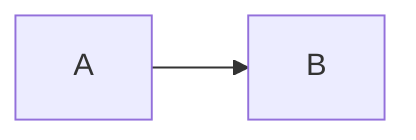

# Checkout

Customers pay with a **card** or *bank* transfer.

## Goals

- Fewer steps
- Clear errors

1. Collect the cart
2. Take payment

- [x] Spec drafted
- [ ] Spec reviewed

> [!tip]
> Pin the screens first.

| Step | Owner |
| --- | --- |
| Cart | Ana |




```sh
cargo test
```
