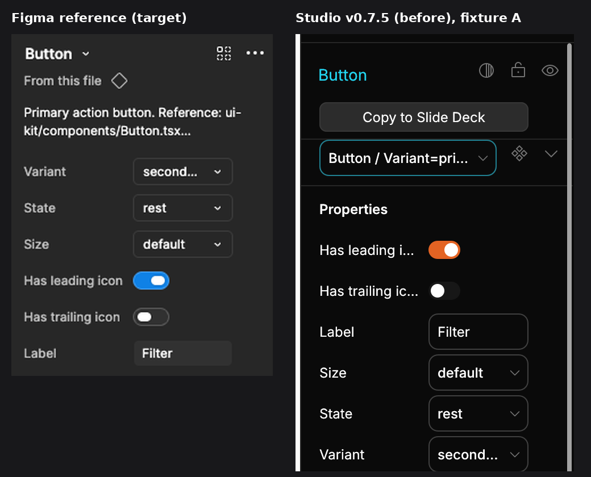

# Gap list: component properties panel, Studio v0.7.5 vs Figma

Base: `main` @ `8cf5dfd` (v0.7.5). Milestone target: v0.7.6 (UI Revamp slice 2).
Reference: `figma-reference.png`. Studio capture: `before.png` (fixture A, Button instance, `designos --screenshot --select fig:1:2`).



What already matches: the label-left / control-right 2-column grid (label x=17 w=92, control x=113 w=88, row pitch 36). Verified from `--layout-json`: all rows share x and w. So the arrangement problem is **order and structure**, not the grid.

| # | Area | Figma reference | Studio v0.7.5 | Gap | Checker rule | Fix (spec AC) |
|---|---|---|---|---|---|---|
| 1 | Property order | Variant, State, Size (dropdowns) > Has leading icon, Has trailing icon (toggles) > Label (text field) | Stored definition order, which is alphabetical after Figma import: Has leading icon, Has trailing icon, Label, Size, State, Variant. Variants end up last | Rows not grouped by kind | `SRC_PROP_ORDER` | AC2, AC3 |
| 2 | Source line | Always: "From this file" + diamond icon, under the header | Only a library row, and only for library instances (`library_instance_info`). Local components show nothing | Missing for local components | `SRC_SOURCE_LINE` | AC12, AC13 |
| 3 | Description | 1-2 lines of the component description, truncated, under the source line | Not shown anywhere in the instance panel. The data exists (`ComponentData.description`, node.rs:287; filled by the importer, rest_import.rs:1181) but is never read by the panel | Missing row, no new data field needed | `SRC_DESCRIPTION` | AC14-AC17 |
| 4 | More button icon | Ellipsis (three dots) | `Icon::ChevronDown` (reads as a dropdown), and the icon set has no ellipsis | Wrong glyph, no ellipsis in the set | `SRC_MORE_ICON` | AC10, AC11 |
| 5 | Section title | No "Properties" title; rows follow the description | "Properties" section title above the rows | Extra heading breaks the block | none | AC8 |
| 6 | Header name | Plain name + chevron | Bordered teal swap dropdown (156px) | Chrome differs. Kept on purpose (swap picker needs a field affordance); flagged as D1 | none | AC9 (D1) |
| 7 | Boolean control | Pill switch | Local `toggle()` (components.rs:69-88): hard-coded colors, no focus ring, bypasses the widget kit | Off-kit widget, no keyboard focus ring | none | AC7 |
| 8 | Label width | "Has leading icon" shown in full | Elided to "Has leading i…" at the 88px label budget; no tooltip | Truncation without tooltip. Grid kept (D4) | none | AC21 |
| 9 | Go-to-main vs source icon | Two different glyphs | One glyph (`Icon::Component`) available; would be reused for the source icon | Icon-set decision, not done here (D2) | none | D2 |
| 10 | Import order | Figma keeps the designer's property order | Import loses it (serde_json map sorted by key) | Root cause behind part of gap 1. Needs `preserve_order` or an order-carrying import. Follow-up | none | Finding in spec |

Gaps 1-4 are machine-checked: `props_panel_check.py --source` reports **4 FAIL** on `8cf5dfd`:

```
FAIL  SRC_MORE_ICON     the more button uses Icon::ChevronDown, not a more/ellipsis icon
FAIL  SRC_SOURCE_LINE   no always-present source line ('From this file' / source_line()) between the header and the props
FAIL  SRC_DESCRIPTION   no description row between the header and the props
FAIL  SRC_PROP_ORDER    props are iterated in definition order; no sort by kind (variant > boolean > text) before the loop
props_panel_check[source] components.rs: 4 FAIL
```

Before captures (all `--select fig:1:2 --size 1440x900 --scale 2`): `before.png` (A, composite), `shots/before-A-reference-order.png`, `shots/before-B-mixed-order.png` (interleaved kinds), `shots/before-C-stress.png` (long names/values, many props), `shots/before-D-no-props.png` (no props). Panel crops: `shots/before-*-panel.png`.
