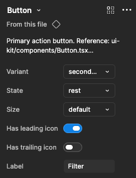
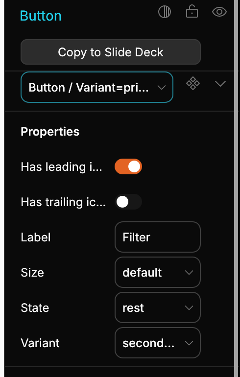

# Spec: Component properties panel, Figma arrangement

- Milestone: v0.7.6 (UI Revamp slice 2)
- Base: `main` @ `8cf5dfd86b97fd0371570923bb748aa56f5ab01c` (contains v0.7.5)
- Owner: Design. Build: Grok Build. Review: Codex (read-only). Spec gate: PM G1-G2.
- Source of truth for "right": Jang, 2026-10-30: "Đây là cách Figma sắp xếp phần component properties, học hỏi cách sắp xếp đó cho chuẩn chứ."
- Acceptance gate (machine): `python3 /workspace/projects/maintenance/checks/props_panel_check.py --source crates/designos-app/src/panels/components.rs` exits 0.

## Reference (Figma)



Top to bottom: **header** (component name + chevron, go-to-main icon, more icon) > **source line** ("From this file" + component icon) > **description** (1-2 lines, truncated) > **one row per property** in a fixed label-left / control-right 2-column grid, ordered **variant dropdowns > boolean toggles > text fields**.

## Current state at v0.7.5



See `gap-list.md` for the numbered gaps. Four of them are machine-checked and fail on `8cf5dfd`: `SRC_PROP_ORDER`, `SRC_SOURCE_LINE`, `SRC_DESCRIPTION`, `SRC_MORE_ICON`.

## Scope

In scope: the **instance** inspector, i.e. `instance_header()` and `instance_props()` in `crates/designos-app/src/panels/components.rs`, plus the one icon it needs.

Out of scope (explicit):
- The main-component editor `component_props()` (components.rs:378-480). It edits definitions, not values, and keeps definition order.
- Editing the description. The panel shows it read-only (see Data model).
- New data-model fields. None are needed (see Data model).
- Variant-matrix / "Add property" flows, nested-instance property bubbling, slots.

## Widget kit and tokens used (v0.7.5, all existing unless marked NEW)

| Need | Use | Where |
|---|---|---|
| Section layout | `Pane` (`rect`, `col`, `row_end`, `section_sep`) | panels/properties.rs:176-192, 206, 312 |
| Name dropdown / variant dropdown / swap dropdown | `widgets::menu::dropdown` (kit `select_look`) | widgets/menu.rs:584-630 |
| Boolean control | `widgets::kit::choice::toggle` (`toggle_look`, focus ring via `paint_ring`) | widgets/kit/choice.rs:37-44, 115-129 |
| Text control | `widgets::field::text_input` (kit `property_field_look`) | widgets/field.rs |
| Header icon buttons | `widgets::icon_button`, `theme::PANEL_ACTION_BUTTON` (24) | widgets/mod.rs |
| Truncation | `widgets::elide` | widgets/mod.rs |
| Column grid | `theme::SECTION_CONTENT_X` 17, `theme::FIELD_COL_X` [17, 113], `theme::FIELD_WIDTH_HALF` 88, `theme::FIELD_HEIGHT` 32, `theme::SECTION_TRAILING_X` 209 | theme.rs |
| Type + color | `theme::font_body()`, `theme::font_caption()`, `theme::TEXT`, `theme::TEXT_SECONDARY` | theme.rs |
| Source icon | `Icon::Component` (existing) | icons.rs:63, 200, 323 |
| More icon | **NEW** `Icon::Ellipsis` -> Phosphor `dots-three` | icons.rs (enum, `ALL`, `phosphor_name`, `phosphor!` list), vendored SVG `assets/icons/phosphor/dots-three.svg` (MIT, `@phosphor-icons/core`, same license as the rest of the set). A ready file is at `fixtures/dots-three.svg`. |

No new color, spacing, or radius token is introduced. Row rhythm stays `FIELD_HEIGHT + SPACE_ROW` (36) via `row_end`.

## Data model

- The description already exists: `ComponentData.description` (`crates/designos-doc/src/node.rs:287-289`, serde name `symbolDescription`). The Figma REST importer fills it (`crates/designos-fig/src/rest_import.rs:1181-1183`, `symbolDescription` or `description`).
- Decision: **no new field.** The Maintainer rule "no description field in the data model" is satisfied by reading the existing field; the gap is that the panel never shows it.
- Resolution order for the displayed text: the main component's own `component.description`; if empty and its parent is a `ComponentSet`, the set's `component.description`. First non-empty wins. Trim, collapse newlines to spaces.

## Design

### Layout (instance panel, all x in panel-local px, width 240)

```
y=0    [ Button  ⌄ ........ ] [◇ go-to-main] [··· more]    header row, height 32
+8     From this file ◇                                     source line, height 20 (text, then icon, as in Figma)
+8     Primary action button. Reference: ui-kit/…           description, max 2 lines, font_body, LINE_BODY 18
+8     ─────────────────────────────────────────────        section_sep
       Variant ............ [ Primary      ⌄ ]              rows, 36 pitch
       State .............. [ Default      ⌄ ]
       Size ............... [ Medium       ⌄ ]
       Has leading icon ... [●  ]
       Has trailing icon .. [ ●]
       Label .............. [ Button        ]
+4     ─────────────────────────────────────────────        section_sep
```

Label column: x=17, w=92. Control column: x=113, w=88 (`pane.col(1, ..)`). Both unchanged from v0.7.5; the redesign makes them the *only* positioning path.

### Property order

Stable sort of the displayed definitions by group rank before the loop:

| Rank | Kind | Control |
|---|---|---|
| 0 | `Variant` | dropdown |
| 1 | `Boolean` | toggle |
| 2 | `Text` | text field |
| 3 | `InstanceSwap` | dropdown (existing behavior) |
| 4 | `Slot` | unchanged from v0.7.5 |

Within one rank the definition order is preserved (stable sort). Ranks 3-4 are not in Figma's reference; they go last so the Figma-defined order (variant > boolean > text) is never broken. Implemented as a small pure fn (suggested name `sort_props_by_kind(&mut Vec<ComponentPropDef>)` with a `fn kind_rank(&PropKind) -> u8`) so it is unit-testable.

## Acceptance criteria

Numbered so PM, Codex and the test log can cite them.

**Order and structure**
1. AC1. Instance panel top-to-bottom is: header > source line > description (when non-empty) > property rows. No other element between them.
2. AC2. Property rows are ordered Variant > Boolean > Text, then InstanceSwap, then Slot. Order inside a group equals the stored definition order (alphabetical for imported Figma files, see Finding). Verified on fixtures A and B (B's stored order interleaves kinds: Appearance variant, Border bool, Caption text, Density variant, Elevated bool, Footnote text, Gap variant; displayed: Appearance, Density, Gap, Border, Elevated, Caption, Footnote).
3. AC3. The sort happens once, before the `for def in ...` loop in `instance_props()`. The per-kind `match` arms only create the control; none of them calls `pane.rect`, `pane.col`, or `pane.full`.

**Grid**
4. AC4. Every row has its label at x=17 (w=92, elided to w-4 with `widgets::elide`) and its control at x=113 (w=88). Label x and control x are identical for all rows, for all kinds, on every fixture. The label is always left of the control.
5. AC5. Controls by kind: Variant = kit dropdown, Boolean = kit toggle, Text = kit text field, InstanceSwap = kit dropdown. No kind uses another kind's control.
6. AC6. Row height is 32 (`FIELD_HEIGHT`), pitch 36 (`row_end`). Toggle track is 28x16, left-aligned to x=113, vertically centered in the row.
7. AC7. The boolean control is `widgets::kit::choice::toggle`. The local `toggle()` in components.rs:69-88 (hard-coded colors, no focus ring) is deleted. Keyboard focus shows the kit focus ring.
8. AC8. The "Properties" section title is removed from the instance panel (Figma has none). The property block starts directly after the separator below the description.

**Header**
9. AC9. Header row = name dropdown (swap picker, shows `comp_label`, has a chevron) + go-to-main icon button (tooltip "Go to main component") + more icon button (tooltip "More"). Positions unchanged: dropdown x=17 w=156, go-to-main x=181, more x=`SECTION_TRAILING_X`.
10. AC10. The more button uses `Icon::Ellipsis` (Phosphor `dots-three`), not `ChevronDown`. It keeps id `inst-more`, the pressed state while the menu is open, and the same menu.
11. AC11. The vendored SVG `assets/icons/phosphor/dots-three.svg` is added, `Icon::ALL`'s count test is bumped (118 -> 119), and `no_vendored_svg_is_unused` stays green.

**Source line**
12. AC12. A source line is always present when the main component resolves. Local component: "From this file" (`font_body`, `TEXT_SECONDARY`) followed by `Icon::Component` (16px, `TEXT_SECONDARY`), the same order as the Figma reference. Library instance: the existing `instance_library_row` (Book icon + library name or "From another file"). Both occupy the same 20px row at x=17, so the panel does not jump when switching.
13. AC13. If the main component is missing, the header shows "Missing component"; the source line, description, and property rows are all omitted (we do not claim a source we cannot resolve).

**Description**
14. AC14. The description row shows the resolved text (Data model above) in `font_body`, `TEXT` (the reference shows it brighter than the labels), wrapped to the 184px content width, **max 2 lines**, last line elided with "…".
15. AC15. Hovering the description shows the full text in a tooltip. If the text fits in 2 lines there is no tooltip.
16. AC16. Empty or whitespace-only description: the row is omitted completely (no placeholder, no gap).
17. AC17. The description is read-only in this panel.

**Edge cases**
18. AC18. Mixed prop types (fixture B, fixture C): all six kinds of ordering permutations land in the AC2 order; no row is dropped, duplicated, or overlapping.
19. AC19. Empty props (fixture D, empty `componentPropertyDefinitions`): header, source line and description still render; no "Properties" title, no empty block, no extra separator; panel below is not shifted by a phantom 4px. No panic.
20. AC20. Many props (fixture C and a 20-row synthetic case): all rows render in order; the panel content height includes every row; the right-panel scroll reaches the last row; no row is clipped at the bottom; no overlap with the section below.
21. AC21. Long property names: the label column is w=92 and the label is elided at w-4 (= 88 text width, `widgets::elide`, same as AC4), the control column is w=88; the label never overlaps the control, and shows the full name as a tooltip when elided.
22. AC22. Long values (long variant option, long text default): the control keeps w=88, the value is elided inside the control with "…", never overflows into the label column or past the panel edge. Editing a long text value still works and commits the full string.
23. AC23. Interaction parity: toggling a boolean, picking a variant option, editing text, and swapping an instance each call the same `app.set_instance_prop` path as v0.7.5; undo/redo and the "is set" label color (`TEXT` when overridden, `TEXT_SECONDARY` otherwise) are unchanged.
24. AC24. No behavior change for `component_props()` (main component editor).

**Gate**
25. AC25. `props_panel_check.py --source components.rs` exits 0 (0 FAIL). On `8cf5dfd` it reports 4 FAIL; after the change 0.
26. AC26. `cargo build -p designos-app --bin designos` and `cargo test -p designos-app` pass (run through `HEAVY_BOT=Design heavy`).
27. AC27. 100% English in code, comments, commit, PR. No new dependency.

### Checker contract (so the implementation does not trip rules by shape)

`--source` matches by source shape. The implementation must keep: `go-to-main` literal in `instance_header`; a `"instance-more"` record followed by `icon_button(.. Icon::Ellipsis ..)`; a `dropdown(` call in `instance_header`; `source_line(` or the literal `"From this file"` in `instance_header`/`instance_props`; the word `description`; a `.sort..(.. kind|rank ..)` or `sort_props_by_kind` before `for def in <defs>`; `let lab = pane.rect(theme::SECTION_CONTENT_X, ..` and `let ctl = pane.col(1, ..`; no `pane.rect/col/full(` inside the `match (&def.kind, ..)` arms.

## Test steps

Fixtures: `fixtures/props-A-reference-order.json`, `props-B-mixed-order.json`, `props-C-stress.json`, `props-D-no-props.json` (generated by `fixtures/make_fixtures.py`). In each, the selected instance is the Button with Figma id `1:2`.

Automated
1. T1. `python3 props_panel_check.py --source <worktree>/crates/designos-app/src/panels/components.rs` -> exit 0 (AC25). Also run on `origin/main` to prove 4 FAIL before.
2. T2. Unit tests in `panels/components.rs`: `kind_rank` ordering; `sort_props_by_kind` is stable and puts a [Text, Boolean, Variant, Boolean, Variant] input into [Variant, Variant, Boolean, Boolean, Text] with in-group order kept (AC2, AC3); description resolver: own text, set fallback, empty, whitespace, newlines collapsed (AC14, AC16); `Icon::Ellipsis` maps to `dots-three` (AC10, AC11).
3. T3. `cargo test -p designos-app` (heavy) all green, including `icons` tests (AC11, AC26).
4. T4. Layout assertion. For each fixture: `designos <fixture> --select fig:1:2 --size 1440x900 --screenshot out.png --layout-json layout.json`, then `python3 fixtures/check_layout.py layout.json "<expected order>"`. It checks the `prop:<name>` records: same x for every row, w=88, h=32, pitch 36, control x = label x + 96 (label x taken from `instance-swap`), y increasing in the expected order, header records present (AC2, AC4, AC6, AC9). Expected: A `Size,State,Variant,Has leading icon,Has trailing icon,Label`; B `Appearance,Density,Gap,Border,Elevated,Caption,Footnote`; D `` (empty). On v0.7.5, A fails on order only (grid already passes), proven in `shots/before-A-layout.json`.

Visual (headless: `designos <fixture> --screenshot out.png --select fig:1:2 --size 1440x900 --scale 2`)
5. T5. Fixture A -> `after.png`; compare to `figma-reference.png` side by side: same block order, same 2-column grid.
6. T6. Fixture B -> same displayed order as A (AC2).
7. T7. Fixture C -> long names and values elided, no overflow (AC21, AC22); rows below the fold reachable (AC20).
8. T8. Fixture D -> no title, no empty block (AC19).
9. T9. Library instance and missing-component cases rendered once each (AC12, AC13).

Manual, in the app
10. T10. Select the instance. Click the name dropdown: list opens, picking swaps. Click ellipsis: menu opens, button stays pressed, Esc closes. Tab through rows: toggle shows focus ring. Toggle, pick, type in Label: values commit; Cmd/Ctrl+Z undoes each (AC23).
11. T11. Hover a truncated description and a truncated label: tooltip with full text (AC15, AC21).

## Finding: definition order is alphabetical after Figma import

`parse_component_props` iterates `serde_json::Map` (rest_import.rs:1377). The workspace builds `serde_json` without `preserve_order`, so the keys come out **sorted by key** and the order the designer chose in Figma is lost on import. Evidence: fixture A defines Variant, State, Size, Has leading icon, Has trailing icon, Label; v0.7.5 renders Has leading icon, Has trailing icon, Label, Size, State, Variant (before.png).

Consequence for this slice: after the kind sort, A renders **Size, State, Variant, Has leading icon, Has trailing icon, Label**. Group order matches Figma (variant > boolean > text); order inside the variant group is alphabetical, not Figma's Variant, State, Size. Restoring file order needs `serde_json`'s `preserve_order` feature in `designos-fig` (feature unification touches every crate's `Map` iteration order) or an order-carrying import. That is a data-model/import change, **out of scope here, recommended as a follow-up issue**. AC2 therefore says "definition order *as stored*".

## Open points for PM (Design's call, flagged not hidden)

- D1. The header keeps the bordered kit dropdown for the name (Figma shows plain text + chevron). We keep it because it is the swap picker and needs a field affordance in Studio; the order and grid are what Jang asked to learn from Figma. Reversible later without touching this spec.
- D2. Go-to-main and the source line both use `Icon::Component`. Figma uses two different glyphs (dashed-corner square for go-to-main, diamond for the source). A second icon is a separate icon-set decision; not done here.
- D3. Studio keeps its `section_sep` lines (one under the description, one at the end); Figma's panel has none inside this block.
- D4. Label width. The Figma reference shows "Has leading icon" in full; with the 88px label budget Studio elides it ("Has leading i…", see before.png). The 92/88 grid is fixed by the checker (`SRC_GRID`) and by the shared tokens, so v0.7.6 keeps it and adds the tooltip (AC21). A smaller label font or a wider label column is a separate token decision.
- D5. Empty description omits the row. The snapshot-mode checker would flag `DESCRIPTION_MISSING` on such a panel; the source-mode gate (the acceptance gate here) does not. Maintainer: please confirm snapshot mode is only run on the described-component fixtures.
