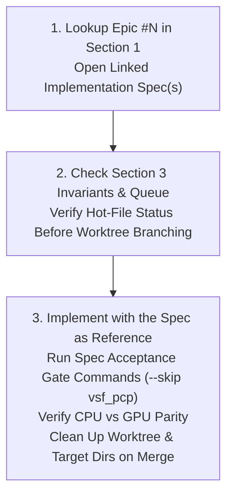
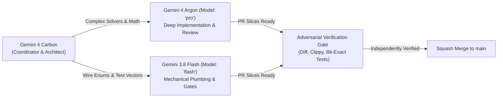

# Master Epic-to-Figma-Spec Index & Coding-Agent Execution Playbook

**Status:** Reference material for implementation (see [Review status](#review-status))  
**Date:** 2026-11-12  
**Target File:** `docs/specs/epics-figma-rea/EPIC-FIGMA-SPECS-INDEX.md`  
**Base Repository Commit:** `origin/main` (2026-11-12)  
**Clean-Room Target:** **Figma Desktop `126.11.7`** (Reverse-Engineered via `morluto/rea` `v6.8.0`)  
**Epistemic Standard:** Clean-room reverse engineering. All assertions categorized as `[FACT - seen]`, `[INFERENCE]`, or `[ASSUMPTION]`. Zero proprietary source code.

---

## Review status

On 2026-11-12 three independent read-only reviews checked 22 of the specs below against `origin/main` at `b731e4359`, the Kiwi schema copy in the repository, GitHub issue state and the three evidence-backed specs of the same day. The specs are reference material for implementation, not a contract: the table shows, per spec, what the review found and where the corrections are, and the [review folder](reviews/README.md) defines each status word.

| Spec | Status | What the review found | Corrections |
|---|---|---|---|
| [e1-e2-rea-resolutions/README.md](e1-e2-rea-resolutions/README.md) | SUPERSEDED | Nine of 13 slices target closed and merged issues; layout slices need evidence; queue slots are not real. | [review](reviews/review-e1-e2-e19-e20.md#e1-e2-readme) |
| [e1-e2-rea-resolutions/e1-step0-rea-resolutions-135-136-137-143-1448-1856.md](e1-e2-rea-resolutions/e1-step0-rea-resolutions-135-136-137-143-1448-1856.md) | SUPERSEDED | Shipped work re-specified; except the component property defaults part (#1856), which is READY AFTER FIXES. | [review](reviews/review-e1-e2-e19-e20.md#e1-step-0) |
| [e1-e2-rea-resolutions/e2-layout-grid-1885-1895-unbounded-tracks.md](e1-e2-rea-resolutions/e2-layout-grid-1885-1895-unbounded-tracks.md) | NEEDS EVIDENCE | Auto gap claim contradicts main; tilted child rule has no source; grid part has no issue and is partly done. | [review](reviews/review-e1-e2-e19-e20.md#e2-layout-grid) |
| [e19-e3-rea-followups/e19-e3-slots-clip-hydration-repair-spec.md](e19-e3-rea-followups/e19-e3-slots-clip-hydration-repair-spec.md) | SUPERSEDED | Slots and selection outline fixed on main; hydration duplicates the nested copy spec; except the ring arc repair (#1907), which is READY AFTER FIXES. | [review](reviews/review-e1-e2-e19-e20.md#e19-slots-clip-hydration) |
| [e20-save-load-quit/e20-save-load-quit-lazy-hydration-spec.md](e20-save-load-quit/e20-save-load-quit-lazy-hydration-spec.md) | SPLIT | Four slices duplicate contributor drafts; two need a design; three are usable after fixes (some slices usable, see review). | [review](reviews/review-e1-e2-e19-e20.md#e20-save-load-quit) |
| [e4-draw-vector/e4-basic-shapes-strokes-vector-tools-spec.md](e4-draw-vector/e4-basic-shapes-strokes-vector-tools-spec.md) | READY AFTER FIXES | Three of eight slices already shipped; the GPU stencil, zero Programs claim is false. | [review](reviews/review-e4-e5-e6-e7.md#e4-basic-shapes) |
| [e4-draw-vector/e4-figma-draw-variable-width-repeat-pattern-brushes-text-path.md](e4-draw-vector/e4-figma-draw-variable-width-repeat-pattern-brushes-text-path.md) | NEEDS EVIDENCE | Kiwi fields are real, but every formula has no source. | [review](reviews/review-e4-e5-e6-e7.md#e4-draw-engine) |
| [e5-effects-shaders/e5-image-filters-progressive-blur-glass-noise-spec.md](e5-effects-shaders/e5-image-filters-progressive-blur-glass-noise-spec.md) | SUPERSEDED | Image filters, glass, noise and shadow behind are on main; except progressive blur (#37), which is READY AFTER FIXES. | [review](reviews/review-e4-e5-e6-e7.md#e5-image-filters) |
| [e5-effects-shaders/e5-video-fills-custom-wgsl-shaders-3d-transforms.md](e5-effects-shaders/e5-video-fills-custom-wgsl-shaders-3d-transforms.md) | NEEDS EVIDENCE | Competes with the shipped video fill record; mesh colour model and 3D order unsourced. | [review](reviews/review-e4-e5-e6-e7.md#e5-video-shaders) |
| [e6-motion-export/e6-export-bounds-settings-easing-springs-spec.md](e6-motion-export/e6-export-bounds-settings-easing-springs-spec.md) | READY AFTER FIXES | Schema and curves sourced; bounds facts cite Studio's own code; settle formula and test numbers wrong. | [review](reviews/review-e4-e5-e6-e7.md#e6-export-easing) |
| [e6-motion-export/e6-motion-timeline-lottie-video-export-spec.md](e6-motion-export/e6-motion-timeline-lottie-video-export-spec.md) | SPLIT | Model and evaluator superseded; lint and stagger usable after fixes; Lottie output needs evidence (some slices usable, see review). | [review](reviews/review-e4-e5-e6-e7.md#e6-motion-lottie) |
| [e7-devmode-mcp/e7-annotations-measurements-code-connect-mcp-spec.md](e7-devmode-mcp/e7-annotations-measurements-code-connect-mcp-spec.md) | READY AFTER FIXES | Enum sourced; three REST names wrong; contradicts #259 and the repo-files-win rule. | [review](reviews/review-e4-e5-e6-e7.md#e7-annotations) |
| [e8-interop-pptx/e8-pptx-import-export-spec.md](e8-interop-pptx/e8-pptx-import-export-spec.md) | READY AFTER FIXES | Export core sound; probe slice rests on missing symbols; transition table unsourced. | [review](reviews/review-e8-to-e13.md#e8-pptx) |
| [e9-slides-whiteboard/e9-1215-connectors-mindmap-mermaid-freehand-spec.md](e9-slides-whiteboard/e9-1215-connectors-mindmap-mermaid-freehand-spec.md) | NEEDS OWNER DECISION | Native connector export vs the vector-export rule; new node kinds vs no format change; Mermaid parser vs open spike. | [review](reviews/review-e8-to-e13.md#e9-connectors-mermaid) |
| [e9-slides-whiteboard/e9-slides-transitions-builds-deck-roundtrip-spec.md](e9-slides-whiteboard/e9-slides-transitions-builds-deck-roundtrip-spec.md) | READY AFTER FIXES | Invents parallel transition and easing types; probe premise wrong. | [review](reviews/review-e8-to-e13.md#e9-slides-transitions) |
| [e10-versions-branching/e10-three-way-diff-branch-merge-git-driver-spec.md](e10-versions-branching/e10-three-way-diff-branch-merge-git-driver-spec.md) | SUPERSEDED | Diff engine and merge shipped; UI and CLI parts need a rewrite. | [review](reviews/review-e8-to-e13.md#e10-branching) |
| [e11-prototyping/e11-proto-crate-triggers-sticky-smart-animate-spec.md](e11-prototyping/e11-proto-crate-triggers-sticky-smart-animate-spec.md) | READY AFTER FIXES | Crate split and Kiwi mapping usable once aligned; sticky formula and match rule need evidence. | [review](reviews/review-e8-to-e13.md#e11-proto-crate) |
| [e11-prototyping/e11-video-audio-gif-present-ux-mcp-spec.md](e11-prototyping/e11-video-audio-gif-present-ux-mcp-spec.md) | NEEDS OWNER DECISION | Native decoders and a wgpu path Present does not use; duplicates the E12 video work; scaling modes and MCP tools could proceed after fixes. | [review](reviews/review-e8-to-e13.md#e11-video-present) |
| [e12-text-fonts-a11y/e12-canvas-a11y-contrast-eyedropper-video.md](e12-text-fonts-a11y/e12-canvas-a11y-contrast-eyedropper-video.md) | READY AFTER FIXES | Keyboard facts wrong off macOS; AccessKit snippet does not fit egui; video slice needs the owner. | [review](reviews/review-e8-to-e13.md#e12-canvas-a11y) |
| [e12-text-fonts-a11y/e12-variable-fonts-rich-text-decorations-smart-symbols.md](e12-text-fonts-a11y/e12-variable-fonts-rich-text-decorations-smart-symbols.md) | READY AFTER FIXES | Mostly on main; only decoration style, thickness, offset and fills are new; smart symbols need evidence and the font gate needs an owner decision. | [review](reviews/review-e8-to-e13.md#e12-fonts-rich-text) |
| [e13-sites-code-layers/e13-code-layers-runtime-sandbox-mcp-spec.md](e13-sites-code-layers/e13-code-layers-runtime-sandbox-mcp-spec.md) | NEEDS OWNER DECISION | Runs user code in a web view; cites a missing crate; CSP contradicts itself. | [review](reviews/review-e8-to-e13.md#e13-code-layers) |
| [e13-sites-code-layers/e13-sites-breakpoints-scroll-cms-compiler-spec.md](e13-sites-code-layers/e13-sites-breakpoints-scroll-cms-compiler-spec.md) | READY AFTER FIXES | Schema work well grounded; compiler preview server and WOFF2 encoder are owner decisions. | [review](reviews/review-e8-to-e13.md#e13-sites) |

Second wave (not reviewed yet):

| Spec | Status | What the review found |
|---|---|---|
| [open-bugs-rea/bugs-c1-components-variants-fig-io-spec.md](open-bugs-rea/bugs-c1-components-variants-fig-io-spec.md) | NOT REVIEWED (review in progress) | Second wave; no review attached yet. |
| [open-bugs-rea/bugs-c2-layout-text-export-drift-spec.md](open-bugs-rea/bugs-c2-layout-text-export-drift-spec.md) | NOT REVIEWED (review in progress) | Second wave; no review attached yet. |
| [open-bugs-rea/bugs-c3-vectors-strokes-masks-ux-spec.md](open-bugs-rea/bugs-c3-vectors-strokes-masks-ux-spec.md) | NOT REVIEWED (review in progress) | Second wave; no review attached yet. |
| [e21-multiplayer-realtime-sync/e21-doc-foundation-guid-fractional-index-lww-undo-spec.md](e21-multiplayer-realtime-sync/e21-doc-foundation-guid-fractional-index-lww-undo-spec.md) | NOT REVIEWED (review in progress) | Second wave; no review attached yet. |
| [e21-multiplayer-realtime-sync/e21-sync-engine-p2p-presence-multi-agent-canvas-spec.md](e21-multiplayer-realtime-sync/e21-sync-engine-p2p-presence-multi-agent-canvas-spec.md) | NOT REVIEWED (review in progress) | Second wave; no review attached yet. |

The index's own Kiwi tag numbers for `isSlot` (schema: 463), `isSlotContent` (495) and `styleOverrideTable` (tag 3) do not match the schema copy in the repository, `isExtension` is not a Kiwi field there (the E19 review lists the details), and three issue labels (1881, 1886, 1891) do not match their issues; the tables below were not corrected.

---

## Read Me First for Coding Agents

This document is the **single authoritative index** connecting all **24 GitHub Epics (`#14` through `#1788`)**, **Proactive Epic `E21` (Real-Time Multiplayer & Multi-Agent Co-Editing)**, and **all 56 Open Figma-Parity / UX Bugs (`open-bugs-rea/` from the 570-Issue Repository Audit)** to their exact, clean-room verified implementation specifications and REA evidence dossiers.

Whenever an autonomous coding agent (Claude Code, Codex, Antigravity, Grok, or Orca worker) is assigned an Epic, milestone, or sub-issue in `design-os-studio`, **follow this strict 3-step execution loop**:



### The 3-Step Execution Workflow

1. **Lookup Epic `#N` in [Section 1](#section-1-complete-24-epic-master-matrix-14--1788):**
   - Open the linked **True Figma Implementation Spec** (`docs/specs/epics-figma-rea/...`).
   - Read the spec's target crate paths, Kiwi field ID tables, data model structures, and machine-checkable acceptance tests.
2. **Check Section 3 ([Hot-File Queue & Engine Invariants](#section-3-non-negotiable-coding-agent-rules-hot-file-queue--engine-invariants)):**
   - If your task touches any of the 4 hot files (`crates/designos-fig/src/{fig.rs, fig_export.rs, kiwi.rs, rest_import.rs}`), ensure you hold the **Single-Writer Token**. Rebase onto `origin/main` immediately before opening or merging PRs.
   - Non-hot crates (`designos-doc`, `designos-render`, `designos-gpu`, `designos-export`, `designos-proto`, `designos-motion`, `designos-mcp`, `designos-app` disjoint panels) execute in parallel waves.
   - Memorize the 4 Engine Safety Invariants (`AGENTS.md` §4): zero `doc.to_json()` in `doc_hash`, zero `ctx.load_texture` in `ctx.data_mut`, preserve `self.interactive()` guard in `designos-gpu`, and cap offscreen GPU programs at `< 64`.
3. **Implement with the spec as reference (zero guessing):**
   - Read the spec's review status and its corrections first; check every symbol against main. Code on main, the CHANGELOG and owner rulings win over the spec.
   - Consult the linked clean-room REA Dossier in [Section 2](#section-2-clean-room-figma-126117-rea-evidence-dossiers-inventory) if verifying raw Kiwi wire IDs, binary chunk offsets, or UI localization keys.
   - Run the spec's machine-checkable acceptance commands. When testing `designos-fig`, always pass `-- --skip vsf_pcp` unless executing the single-process locked kit gate.
   - Verify CPU (`tiny-skia`) vs `--gpu` (`wgpu`) parity where applicable.
   - **Immediately cleanup on completion**: Delete the finished git worktree (`git worktree remove --force <path> && git worktree prune`) and remove its temporary target directory (`rm -rf <target_dir>`).

---

## Section 1: Complete 24-Epic Master Matrix (`#14` – `#1788`)

The repository's 24 Epics are partitioned into two architectural categories:
- **Part A: 18 Figma-Parity & Engine Epics**: 100% backed by clean-room reverse engineering against Figma Desktop `126.11.7`.
- **Part B: 6 Studio-Native Platform Epics**: Studio-native capabilities, developer tooling, security sandbox, or owner-directed designs (no Figma RE required).

---

### Part A: 18 Figma-Parity & Engine Epics (100% REA-Backed)

| Epic | Title & Focus | Primary Specs & Sub-Issue Specs | New REA Resolution Specs | REA Evidence Dossier |
|:---:|:---|:---|:---|:---|
| **`#14`** | **[Epic] E1 Styles & Variables**<br>Extended collections, P3/OKLCH, style reapply, timing rejection, bindings | • [e1-styles-variables/README.md](e1-styles-variables/README.md)<br>• 14 issue specs (`#132`–`#1448`) in `specs/e1-styles-variables/`<br>• Cross-link: [spec-bound-variant-followups.md](finalize-e1-e2-e3/spec-bound-variant-followups.md) (`#1857`–`#1860`) | • [e1-e2-rea-resolutions/README.md](e1-e2-rea-resolutions/README.md)<br>• [e1-step0-rea-resolutions-135-136-137-143-1448-1856.md](e1-e2-rea-resolutions/e1-step0-rea-resolutions-135-136-137-143-1448-1856.md)<br>*(Resolves `#135` `isExtension=904`, `#136` `DocumentColorProfile`, `#137` OKLCH, `#143` timing rejection, `#1448` text style reapply, `#1856` `StyleType`)* | [rea-e1-e2-e12-vars-layout-text.md](evidence/rea-e1-e2-e12-vars-layout-text.md) |
| **`#15`** | **[Epic] E2 Auto layout & Grid 2.0**<br>Child clamping, unbounded track solver, baseline alignment, wrap gap | • [tables-0710/README.md](tables-0710/README.md) (`T0`–`T6`, shipped v0.7.10)<br>• [spec-layout-drift-tail.md](finalize-e1-e2-e3/spec-layout-drift-tail.md) | • [e2-layout-grid-1885-1895-unbounded-tracks.md](e1-e2-rea-resolutions/e2-layout-grid-1885-1895-unbounded-tracks.md)<br>*(Resolves `#1885` space-between child clamping & `#1895` `GridTrackSizeType` `FIXED=0`/`FLEX=1`/`HUG=2` 2-pass unbounded solver)* | [rea-e1-e2-e12-vars-layout-text.md](evidence/rea-e1-e2-e12-vars-layout-text.md) |
| **`#16`** | **[Epic] E3 Components, slots & Check designs**<br>First-class Slots, preferred swap values, StateGroups, Design Lint | • [spec-nested-copy-identity.md](finalize-e1-e2-e3/spec-nested-copy-identity.md)<br>• [e19-e18/README.md](e19-e18/README.md) (`#1433`, `#1445`, `#1472`, `#1494`) | • [e19-e3-slots-clip-hydration-repair-spec.md](e19-e3-rea-followups/e19-e3-slots-clip-hydration-repair-spec.md)<br>*(First-class Slots `isSlot=476`/`isSlotContent=483`, Instance Swap `preferredValues`, StateGroup rules, Design Lint)* | [rea-e9-e8-e19-slides-board-comp.md](evidence/rea-e9-e8-e19-slides-board-comp.md) |
| **`#17`** | **[Epic] E4 Draw & Vector**<br>Basic shapes, strokes, Shape Builder, variable-width brushes, patterns | • [e4-draw-vector/README.md](e4-draw-vector/README.md) | • [e4-basic-shapes-strokes-vector-tools-spec.md](e4-draw-vector/e4-basic-shapes-strokes-vector-tools-spec.md)<br>• [e4-figma-draw-variable-width-repeat-pattern-brushes-text-path.md](e4-draw-vector/e4-figma-draw-variable-width-repeat-pattern-brushes-text-path.md)<br>*(Star/Polygon/Arc `ArcData`, `i_overlay` Shape Builder, Draw `variableWidthPoints=472`, `PATTERN=10`, `RepeatNode`)* | [rea-e4-e5-draw-effects.md](evidence/rea-e4-e5-draw-effects.md) |
| **`#18`** | **[Epic] E5 Effects & Shaders**<br>7-param CIELAB filters, progressive blur, glass refraction, video fills, WGSL | • [e5-effects-shaders/README.md](e5-effects-shaders/README.md) | • [e5-image-filters-progressive-blur-glass-noise-spec.md](e5-effects-shaders/e5-image-filters-progressive-blur-glass-noise-spec.md)<br>• [e5-video-fills-custom-wgsl-shaders-3d-transforms.md](e5-effects-shaders/e5-video-fills-custom-wgsl-shaders-3d-transforms.md)<br>*(7-param `ImageFilters` CIELAB, `PROGRESSIVE=1`, `GLASS=7` Snell refraction, `NOISE=5`, `VIDEO=4`, WGSL sandbox `< 64` `Program`s)* | [rea-e4-e5-draw-effects.md](evidence/rea-e4-e5-draw-effects.md) |
| **`#19`** | **[Epic] E6 Motion & Media export**<br>ExportSettings, easing curves, analytical springs, timeline, Lottie & video | • [e6-motion-export/README.md](e6-motion-export/README.md) | • [e6-export-bounds-settings-easing-springs-spec.md](e6-motion-export/e6-export-bounds-settings-easing-springs-spec.md)<br>• [e6-motion-timeline-lottie-video-export-spec.md](e6-motion-export/e6-motion-timeline-lottie-video-export-spec.md)<br>*(Multi-row `ExportSettings`, CSS `EasingType`, 3-regime analytical Spring ODE + Lambert-W, `designos-motion`, Lottie & MP4/WebM)* | [rea-e6-e11-motion-proto.md](evidence/rea-e6-e11-motion-proto.md) |
| **`#20`** | **[Epic] E7 Dev Mode & MCP**<br>33 annotation properties, measurements, Code Connect, XPath get_design_context | • `docs/specs/v0.5..v0.7` (foundation) | • [e7-annotations-measurements-code-connect-mcp-spec.md](e7-devmode-mcp/e7-annotations-measurements-code-connect-mcp-spec.md)<br>*(All 33 `AnnotationPropertyType` `0..32`, `AnnotationCategoryPreset` + 8 colors, `AnnotationMeasurement`, real `Document.code_connect`, XPath MCP)* | [rea-e13-e7-e10-e20-sites-dev-branch-io.md](evidence/rea-e13-e7-e10-e20-sites-dev-branch-io.md) |
| **`#21`** | **[Epic] E8 Interop**<br>Paste, Sketch, Chrome capture, .fig round-trip, font weights, PPTX OpenXML | • [e8-interop/README.md](e8-interop/README.md)<br>• 11 issue specs (`#289`, `#307`–`#311`, `#316`, `#834`, `#891`, `#941`, `#1243/#1346`) | • [e8-pptx-import-export-spec.md](e8-interop-pptx/e8-pptx-import-export-spec.md)<br>*(OpenXML PPTX importer matching `FGSlidePptxImporterBindings` + 3-tier exporter `MOST_EDITABLE=0`/`FLATTENED_MOST=1` with EMU math)* | [rea-e9-e8-e19-slides-board-comp.md](evidence/rea-e9-e8-e19-slides-board-comp.md) |
| **`#22`** | **[Epic] E9 FigJam & Slides**<br>`fig-deck`, slide transitions, builds, orthogonal A* connectors, Mind Maps | • [e9-slides-whiteboard/README.md](e9-slides-whiteboard/README.md) | • [e9-slides-transitions-builds-deck-roundtrip-spec.md](e9-slides-whiteboard/e9-slides-transitions-builds-deck-roundtrip-spec.md)<br>• [e9-1215-connectors-mindmap-mermaid-freehand-spec.md](e9-slides-whiteboard/e9-1215-connectors-mindmap-mermaid-freehand-spec.md)<br>*(Slide nodes `41`/`51`/`47`/`52`, 10 `TransitionType`s, A* orthogonal connector router, Mind Map tree layout, native Mermaid)* | [rea-e9-e8-e19-slides-board-comp.md](evidence/rea-e9-e8-e19-slides-board-comp.md) |
| **`#23`** | **[Epic] E10 Versions & Branching**<br>3-way visual diff, merge driver, conflict buckets, Rayon parallelization | *(New Epic area)* | • [e10-three-way-diff-branch-merge-git-driver-spec.md](e10-versions-branching/e10-three-way-diff-branch-merge-git-driver-spec.md)<br>*(`DiffPayload` `BRANCHING=0`, 5 conflict buckets, `O(1)` FNV-1a pruned `rayon` diff `< 420ms`, `designos merge-driver` & `diff`)* | [rea-e13-e7-e10-e20-sites-dev-branch-io.md](evidence/rea-e13-e7-e10-e20-sites-dev-branch-io.md) |
| **`#123`** | **[Epic] E11 Prototyping**<br>`designos-proto` headless VM, Key/Media triggers, sticky stacking, Smart Animate | • [e11-prototyping/README.md](e11-prototyping/README.md) | • [e11-proto-crate-triggers-sticky-smart-animate-spec.md](e11-prototyping/e11-proto-crate-triggers-sticky-smart-animate-spec.md)<br>• [e11-video-audio-gif-present-ux-mcp-spec.md](e11-prototyping/e11-video-audio-gif-present-ux-mcp-spec.md)<br>*(State-machine extraction, `KeyTrigger`/`MediaTrigger`, `STICKY_SCROLLS=2`, hierarchical Smart Animate, Expression VM, Present HUD)* | [rea-e6-e11-motion-proto.md](evidence/rea-e6-e11-motion-proto.md) |
| **`#124`** | **[Epic] E12 Canvas, accessibility & text**<br>Variable fonts, OpenType axes, styleOverrideTable, AccessKit a11y, contrast | • [e12-canvas-a11y-text/README.md](e12-canvas-a11y-text/README.md)<br>• 9 issue specs (`#828`, `#869`, `#904`, `#915`, `#935`, `#944`, `#951`, `#969`, `#1019`) | • [e12-text-fonts-a11y/README.md](e12-text-fonts-a11y/README.md)<br>• [e12-variable-fonts-rich-text-decorations-smart-symbols.md](e12-text-fonts-a11y/e12-variable-fonts-rich-text-decorations-smart-symbols.md)<br>• [e12-canvas-a11y-contrast-eyedropper-video.md](e12-text-fonts-a11y/e12-canvas-a11y-contrast-eyedropper-video.md)<br>*(`fontVariations` OpenType axes, `styleOverrideTable=132`, AccessKit live semantic tree, WCAG 2.1 AA/AAA + APCA `Lc`, color blindness GPU)* | [rea-e1-e2-e12-vars-layout-text.md](evidence/rea-e1-e2-e12-vars-layout-text.md) |
| **`#125`** | **[Epic] E13 Sites & code layers**<br>`fig-site`, breakpoints, responsive sets, scroll behaviors, oxc TSX compiler | • [e13-sites-code-layers/README.md](e13-sites-code-layers/README.md) | • [e13-sites-breakpoints-scroll-cms-compiler-spec.md](e13-sites-code-layers/e13-sites-breakpoints-scroll-cms-compiler-spec.md)<br>• [e13-code-layers-runtime-sandbox-mcp-spec.md](e13-sites-code-layers/e13-code-layers-runtime-sandbox-mcp-spec.md)<br>*(`WEBPAGE=55`, `RESPONSIVE_SET=39`, `derivedBreakpointData=500`, Zero-JS semantic compiler, `CODE_COMPONENT=40`..`64`, `oxc` transpiler, CSP)* | [rea-e13-e7-e10-e20-sites-dev-branch-io.md](evidence/rea-e13-e7-e10-e20-sites-dev-branch-io.md) |
| **`#1107`** | **[Epic] Figma-parity micro-interactions**<br>Interaction polish, drag thresholds, menu pickups, vector handles | • [figma-micro-interactions-spec.md](ux/figma-micro-interactions-spec.md)<br>• `pm/micro-interactions-audit-2026-10-25.md`<br>• `specs/e12-canvas-a11y-text/` (`#904`, `#915`, `#935`, `#944`, `#951`, `#969`) | • Integrated across [e12-text-fonts-a11y/](e12-text-fonts-a11y/) and [e4-draw-vector/](e4-draw-vector/) (`#907`, `#477` vector/shape handles) | [rea-e1-e2-e12-vars-layout-text.md](evidence/rea-e1-e2-e12-vars-layout-text.md) |
| **`#1215`** | **[PM] Whiteboard tools in design canvas**<br>Unified toolbar, Sticky, Connectors, Section, Mind Map in design canvas | *(Unifies FigJam into Design Canvas)* | • [e9-1215-connectors-mindmap-mermaid-freehand-spec.md](e9-slides-whiteboard/e9-1215-connectors-mindmap-mermaid-freehand-spec.md)<br>*(Unifies Connectors, Sticky, Shape-with-Text, Section, Mind Map, Highlighter into Design canvas & `SceneIndex`)* | [rea-e9-e8-e19-slides-board-comp.md](evidence/rea-e9-e8-e19-slides-board-comp.md) |
| **`#1486`** | **[Epic] E18 Grid layout & code export fidelity**<br>Grid stroke, track gaps, native weight tracks, code export parity | • [e19-e18/README.md](e19-e18/README.md) (`#1440`, `#1442`, `#1455`, `#1456`, `#1457`) | • [e2-layout-grid-1885-1895-unbounded-tracks.md](e1-e2-rea-resolutions/e2-layout-grid-1885-1895-unbounded-tracks.md)<br>*(Grid layout solver parity feeding CSS/Tailwind grid export fidelity)* | [rea-e1-e2-e12-vars-layout-text.md](evidence/rea-e1-e2-e12-vars-layout-text.md) |
| **`#1487`** | **[Epic] E19 Components & instances: Figma parity**<br>Instance overrides, nested stretches, clip flags, symbolData cycle repair | • [e19-e18/README.md](e19-e18/README.md) (`#1433`, `#1445`, `#1472`, `#1494`)<br>• [spec-nested-copy-identity.md](finalize-e1-e2-e3/spec-nested-copy-identity.md) | • [e19-e3-slots-clip-hydration-repair-spec.md](e19-e3-rea-followups/e19-e3-slots-clip-hydration-repair-spec.md)<br>*(Resolves `#1881` instance clip flag, `#1886` lazy hydration override preservation, `#1891` orphan/cycle `symbolData` repair)* | [rea-e9-e8-e19-slides-board-comp.md](evidence/rea-e9-e8-e19-slides-board-comp.md) |
| **`#1788`** | **[Epic] E20 Document save, load & quit reliability**<br>Lazy hydration, mmap reader, drop-copy ownership, macOS quit safety | *(Covers 8 critical stability issues)* | • [e20-save-load-quit-lazy-hydration-spec.md](e20-save-load-quit/e20-save-load-quit-lazy-hydration-spec.md)<br>*(Covers `#1686` deferred payload `1.67GB`, `#1712` `EvictingMmapReader`, `#1715` lock guard, `#1716` copy ownership, `#1717` quit drain, `#1718` node cap guard, `#1719` TabId, `#1648` AppKit `applicationShouldTerminate`)* | [rea-e13-e7-e10-e20-sites-dev-branch-io.md](evidence/rea-e13-e7-e10-e20-sites-dev-branch-io.md) |
| **`E21`**<br>*(Proactive)* | **[Epic] E21 Real-Time Multiplayer, P2P Sync & Multi-Agent Co-Editing**<br>`(session_id, local_id)` `NodeId` packing, Base-94 fractional indexing, HLC LWW, isolated per-user Undo, `iroh` QUIC P2P + Local IPC + WS Relay | • [e21-multiplayer-realtime-sync/README.md](e21-multiplayer-realtime-sync/README.md) | • [e21-doc-foundation-guid-fractional-index-lww-undo-spec.md](e21-multiplayer-realtime-sync/e21-doc-foundation-guid-fractional-index-lww-undo-spec.md)<br>• [e21-sync-engine-p2p-presence-multi-agent-canvas-spec.md](e21-multiplayer-realtime-sync/e21-sync-engine-p2p-presence-multi-agent-canvas-spec.md)<br>*(Zero-migration `(session_id<<32)\|local_id`, `FractionalPos` `"V"` Base-94, `ChangeRegisters` `stashed_remote` convergence, first-class AI `agentInfo`/`agentCanvasActivity` presence, `0.00%` idle CPU)* | [rea-e21-multiplayer-realtime-sync.md](evidence/rea-e21-multiplayer-realtime-sync.md) |

---

### Part B: 6 Studio-Native Platform Epics (Non-Figma by Design)

These Epics are native to DESIGN:OS Studio's autonomous agent architecture, developer tools, security boundary, or owner-directed aesthetic standards. They do **not** emulate Figma proprietary internals:

| Epic | Title & Architectural Role | Primary Documentation & Spec Paths | Implementation Mandate & Owner Rulings |
|:---:|:---|:---|:---|
| **`#585`** | **[Epic] E15 AI design**<br>Autonomous design generation, MCP schema execution, visual diff feedback | • `docs/specs/v0.5..v0.7`<br>• `crates/designos-mcp/`<br>• `crates/designos-app/src/curator/` | Studio-native AI grounding: `apply_spec` ACID transactions, zero-hallucination Zod component catalog, geometric linter, layout archetype compiler. Tested against `crates/designos-mcp`. |
| **`#1104`** | **[Epic] E16 Agent sandbox & write safety**<br>Ask-gate, path security, tool execution isolation, audit logging | • `docs/specs/v0.6..v0.7`<br>• `crates/designos-mcp/src/sandbox.rs` | Studio-native security model: strict Ask-gate policy, symlink traversal guards, read-only/write directory boundaries for MCP and CLI scripts, audit trail logging. |
| **`#1105`** | **[Epic] Release engineering, docs & test reliability**<br>Multi-platform CI, release packaging, deterministic gates | • `docs/releasing.md`<br>• `.github/workflows/`<br>• `scripts/` | macOS (Universal Metal), Linux (Vulkan/GL), Windows (DX12) release pipelines, `.app` bundle notarization, deterministic visual test gates (`designos-diff`). |
| **`#1118`** | **[Epic] UI revamp: Untitled UI dark theme**<br>Studio chrome modernization, BrainWave 2.0 Dark token parity | • `crates/designos-app/src/theme.rs`<br>• `design/design.tokens.json`<br>• `design/principles.md` | **Owner Hard Rule (2026-10-17):** Dogfooded strictly via Studio CLI/MCP against the official *Untitled UI PRO VARIABLES v8.0* kit (`/Users/jangtrinh/Downloads/❖ Untitled UI Figma – PRO VARIABLES (v8.0) gKXp7LqFY2NV (Copy).fig`). **Never** show self-built demo frames. |
| **`#1356`** | **[Epic] E17 Agent harness: reliability, skills & memory**<br>Multi-profile agent supervisor, loop prevention, memory | • `docs/specs/v0.7`<br>• `.agent/skills/`<br>• `.brv/context-tree/` | In-app subagent runtime, autonomous loop detection, tool recovery, cross-runtime parity (Claude, Codex, Antigravity, Grok), ByteRover `.brv` knowledge indexing. |
| **`#1522`** | **Epic: Project docs workspace**<br>Notion-style block editor, canvas live frame embeds, project wiki | • Issue `#1522` task breakdown (`#1523`–`#1529`)<br>• `crates/designos-docs/` (planned crate)<br>• `crates/designos-app/src/home/` | Studio-native markdown + rich block documentation editor embedded inside the Project tab; bidirectional links to live canvas frames, asset cards, and version histories. |

---

### Part C: Repository-Wide Open Parity Bugs & Runtime Verification Suite (`open-bugs-rea/` — 56 Unique Issues)

Across all **570 Open GitHub Issues** (`24` Open Epics + `546` Non-Epic Issues), `200` (`36.6%`) are already covered in Epic specs above, `282` (`51.7%`) are Studio-internal architecture/AI/chrome/CI requiring zero Figma REA, and **all remaining `56` unique Figma-parity & UX micro-interaction issues** (`51` Bucket C parity bugs + `5` remaining Bucket D UX issues; `57` table entries with `#1329` cross-referenced) are 100% resolved with Figma `126.11.7` REA below:

- **Master 570-Issue Triage & Issue `#` Lookup Table:** [open-bugs-rea/README.md](open-bugs-rea/README.md)

| Bug Cluster | Issues Covered (56 Unique IDs) | Build-Ready Resolution Spec | Clean-Room REA Dossier |
|:---|:---|:---|:---|
| **Cluster C1 — Components, Variant Switches, `overrideStashV2`, Multi-Hop `guidPath`, Lazy Hydration & Kiwi I/O** | **23 entries:** `#1329`, `#1657`, `#1694`, `#1696`–`#1700`, `#1709`, `#1748`, `#1887`, `#1888`, `#1907`, `#1909`, `#1915`–`#1919`, `#1925`, `#1935`, `#1943`, `#1944` | [bugs-c1-components-variants-fig-io-spec.md](open-bugs-rea/bugs-c1-components-variants-fig-io-spec.md) | [rea-bugs-c1-components-variants-fig-io.md](evidence/rea-bugs-c1-components-variants-fig-io.md) |
| **Cluster C2 — Auto-Layout Edge Cases, Text Shaping/Settlement, Table Live-Patch & Export/Display P3 Drift** | **14 entries:** `#519`, `#521`, `#528`, `#831`, `#997`, `#1404`, `#1738`, `#1798`, `#1799`, `#1817`, `#1885`, `#1895`, `#1920`, `#1942` | [bugs-c2-layout-text-export-drift-spec.md](open-bugs-rea/bugs-c2-layout-text-export-drift-spec.md) | [rea-bugs-c2-layout-text-export-drift.md](evidence/rea-bugs-c2-layout-text-export-drift.md) |
| **Cluster C3 — Vector Lines/Arrows, Baked `strokeGeometry`, Masks, Outside Text Strokes, GPU Blur & UX State Machines** | **20 entries:** `#953`, `#1109`–`#1111`, `#1474`, `#1476`, `#1506`, `#1621`, `#1631`, `#1689`, `#1730`, `#1753`–`#1758`, `#1765`, `#1936`, `#1937` | [bugs-c3-vectors-strokes-masks-ux-spec.md](open-bugs-rea/bugs-c3-vectors-strokes-masks-ux-spec.md) | [rea-bugs-c3-vectors-strokes-masks-ux.md](evidence/rea-bugs-c3-vectors-strokes-masks-ux.md) |

---

## Section 2: Clean-Room Figma 126.11.7 REA Evidence Dossiers Inventory

All reverse-engineering dossiers were gathered under strict clean-room protocols using **`morluto/rea` (`v6.8.0`)** against the live macOS binary and JavaScript chunks of **Figma Desktop `126.11.7`**. No proprietary code is stored in the repository.

### Master REA Evidence Dossiers Table

| Evidence Dossier Path (under `plans/261112-epic-figma-rea-specs/evidence/`) | Lines | Epics Covered | REA Evidence & Context IDs (`morluto/rea` v6.8.0) | Primary Subject Artifacts Inspected |
|:---|:---:|:---:|:---|:---|
| **`rea-e4-e5-draw-effects.md`** | 412 | `E4`, `E5` | • `ev_6f56bed2b1984cdf5d746450517171fe32bc951557c54a88dce368fd3db6b704`<br>• Digest: `e24f67a66fea09b8e13275a2bf75dcab4e9675a22de1b2b6c2b08deab41029b1` | `figma-real-schema.txt` (Kiwi SHA `660bf4f8...`), `plugin-api.d.ts`, WASM strings, JS chunks `37794`, `57877`, `97228`, `b2835def` |
| **`rea-e6-e11-motion-proto.md`** | 620 | `E6`, `E11` | • `ev_d8d8b9b95732159bfc18d8f944c89602a78adcbc4ae41358f73fb2823755bbdd`<br>• Digest: `b5ccf2f9790676849077e3103ff08c6ab291e10d683844f3cffeeadc25c72451` | `prototype-lib.wasm` (29.4MB, SHA `e1bd50ff...`), `proto.strings.txt` (63,408 strings), `prototype-lib-glue.js`, `plugin-api.d.ts` |
| **`rea-e1-e2-e12-vars-layout-text.md`** | 563 | `E1`, `E2`, `E12`, `E18` | • `jsrg_evidence_ed3b7ee3e67eb50db9dd7cf1183fa4fe2e570b17f8276367c1ce4`<br>• Artifacts: `art_50ec533f...`, `art_83bbba71...`, `art_aa9f3d36...` | JS chunks `7a72fc59`, `28827`, `17185`, Figma app string dictionary `figma_app-6372f0021b0d5c94.min.en.json` |
| **`rea-e9-e8-e19-slides-board-comp.md`** | 378 | `E9`, `#1215`, `E8`, `E19`, `E3` | • `jsrg_evidence_18e62e8cf555d7484ae891d606815c373a81effadb933227f813fd2470e279f9` | `FGSlidePptxImporterBindings.cpp`, Kiwi `SLIDE_GRID`, `SLIDE_ROW`, `SLIDE`, `CONNECTOR`, `SHAPE_WITH_TEXT`, OpenXML PPTX exporter JS chunks |
| **`rea-e13-e7-e10-e20-sites-dev-branch-io.md`** | 649 | `E13`, `E7`, `E10`, `E20` | • Node inspect: `ev_6e46a40427aaa73337a20f19d15178ba177de305369b3678052e2b449f09c899`<br>• Rust inspect: `ev_0a3ecf805b5fd8f1997b86600e9ff72590df827cac94b671732c1219ac0169a6`<br>• Bindings: `ev_eec532e1d3df92bcc1d09805e1286af0cc46b640eb71a15b911d79a2715edb3c`<br>• Subgraph: `ev_909ce46afcf8f2ddc345a89052d503e9feb28b88515010e0394d853b80ec2cd4` | `desktop_rust.node` (SHA `9500c731...`, rustc `48a229ce`), `bindings.node` (SHA `eed4ef39...`), JS chunk `75fb6690...` |
| **`rea-e21-multiplayer-realtime-sync.md`** | 557 | `E21` Multiplayer | • `ev_6e46a404...`, `ev_eec532e1...`, `ev_2fdfc61e...`, `ev_6579c7c3...`, `ev_7f842ba2...`, `ev_ce0472b2...` | Kiwi `MessageType` (`0..24`), `Message` (49 fields), `UserChange` (50 fields incl. AI `agentInfo`/`agentCanvasActivity`), `ParentIndex` Base-94 fractional indexing |
| **`rea-bugs-c1-components-variants-fig-io.md`** | 390 | Bugs `C1` (23 issues) | • `morluto/rea` `v6.8.0` clean-room schema, WASM & bundle predicate analysis | `figma-real-schema.txt`, `compiled_wasm.wasm`, `prototype-lib.wasm`, `49300.min.js`, `figma_app.min.en.json` |
| **`rea-bugs-c2-layout-text-export-drift.md`** | 356 | Bugs `C2` (14 issues) | • `ev_b6ff1bad761de96d187ca6ef793d308fb1e4936939698bdccc2e1be73b4d7bcc`<br>• `ev_d40f84650d449631485673749ef384b0ba7719737de1c20a9cd4e264aae1865b` | `compiled_wasm.wasm` (`stackLayoutVersion` WASM offset `27082`), `plugin-api.d.ts`, Figma Metal `--force-color-profile=display-p3-d65`, `PR #771` bounds baseline |
| **`rea-bugs-c3-vectors-strokes-masks-ux.md`** | 450 | Bugs `C3` (20 issues) | • `ev_d40f84650d449631485673749ef384b0ba7719737de1c20a9cd4e264aae1865b`<br>• `ev_93fd146f09fa0bb2d1232625e2238d3472b90b7bf3dc877de823baaea20e60d7` | `VectorData.styleOverrideTable`, `MaskType::OUTLINE`, `compiled_wasm.wasm`, `figma_app-607050972cfcf2d9.min.js` |

### Pre-Existing Targeted RE Evidence Directories

In addition to the 5 comprehensive dossiers above, coding agents may consult targeted RE test data and traces gathered during the v0.7.12 stabilization wave:
- `plans/261108-0825-finalize-e1-e2-e3/evidence/re-bound-variants/` — Bound variable mode switches and component instance swap overrides.
- `plans/261108-0825-finalize-e1-e2-e3/evidence/re-layout-drift-tail/` — Rotated flex children, nested auto-layout padding clamping traces.
- `plans/261108-0825-finalize-e1-e2-e3/evidence/re-nested-copy-identity/` — Deep symbol clone identity preservation and slot hydration trees.

---

## Section 3: Non-Negotiable Coding-Agent Rules, Hot-File Queue & Engine Invariants

### 1. Hot-File Single-Writer Queue

To eliminate git merge conflicts across autonomous agents operating in parallel branches or worktrees, the repository enforces a **Single-Writer Lock** on 4 high-contention files in `designos-fig`:

```text
crates/designos-fig/src/fig.rs
crates/designos-fig/src/fig_export.rs
crates/designos-fig/src/kiwi.rs
crates/designos-fig/src/rest_import.rs
```

#### Queue Rules for Coding Agents
- **Strictly ONE active worker/PR** may touch any of these 4 files at any time.
- **Serial Schedule**: Hot-file slices must be executed in designated sequential slots (#27, #28, #29, #30...), as scheduled in `specs/e1-e2-rea-resolutions/README.md`.
- **Immediate Rebase**: Before opening a PR or running final gates on a hot-file branch, run `git fetch origin && git rebase origin/main`.
- **Parallel Freedom in Non-Hot Crates**: Non-hot files and crates execute freely in parallel waves:
  - `crates/designos-doc/src/` (new modules: `annotations.rs`, `connectors.rs`, `diff.rs`, `slides.rs`, `sites.rs`)
  - `crates/designos-render/src/` (`tiny-skia` shaders, color profiles, A* connector router)
  - `crates/designos-gpu/src/` (WGSL shaders, progressive blur, glass refraction)
  - `crates/designos-export/src/` (Lottie JSON, CSS/Tailwind grid compiler, OpenXML PPTX)
  - `crates/designos-proto/` & `crates/designos-motion/` (standalone state machines)
  - `crates/designos-mcp/` & `crates/designos-app/src/` (disjoint UI panels: Layers, Design, Prototype, Inspect)

---

### 2. Four Engine Safety Invariants (`AGENTS.md` §4)

Every coding agent must uphold these 4 performance and stability invariants. Any PR violating them will be rejected:

1. **Zero `doc.to_json()` in `doc_hash` (`crates/designos-app/src/home/session.rs`):**
   - Always hash documents via the streaming, zero-allocation `HashSerializer`.
   - Never serialize `Document` to a `String` for change detection, autosave probing, or diff comparison.
   - Never bump `TileView::rev` (`app.changed()`) on viewport-only pan/zoom/fit gestures or background poster cache generation.
2. **Never call `ctx.load_texture` inside `ctx.data_mut` (`crates/designos-app/src/icons.rs`):**
   - `egui::Context::data_mut` holds an exclusive, non-reentrant `parking_lot::RwLock` write guard.
   - Calling `ctx.load_texture` inside `ctx.data_mut` deadlocks the main thread on Frame 1.
   - Decode images and load textures strictly outside `ctx.data_mut`.
3. **Preserve `interactive()` Guard in `designos-gpu` (`crates/designos-gpu/src/compile.rs`):**
   - `self.interactive()` (`self.cull && self.geom.budget.is_some()`) separates interactive desktop rendering from headless reference rendering.
   - Keep all LOD approximations (`< 0.75px` culling, `< 3.5px` text greeking, scissor clip fallback, `< 64` program cap) strictly inside `self.interactive()`.
   - Headless reference tests (`cargo test -p designos-gpu`) must remain bit-exact against `designos-render`.
4. **Cap Offscreen GPU `Program`s at `< 64` & Preserve `FrameKey` Reuse:**
   - Do not allocate new offscreen `Program`s beyond `self.progs.len() < 64` during interactive frames.
   - Preserve `FrameKey` caching (`Cb { frame: None }` when `last_key == Some(key) && stale_hits == 0`) and the `8ms` cumulative tessellation budget.
   - Measured idle CPU on Apple Silicon must stay at `0.00%` (`0.000s` cumulative delta across 20s windows). Metal staging buffers must never overflow.

---

### 3. Mandatory Test & Worktree Cleanup Gates

1. **Skip VSF-PCP in Standard Test Runs:**
   - When running cargo tests on `designos-fig`, **always** pass `-- --skip vsf_pcp`:
     ```bash
     cargo test -p designos-fig -- --skip vsf_pcp
     ```
   - The 723k-node VSF-PCP benchmark requires dedicated heap budgeting and is reserved strictly for locked single-process release gates.
2. **Mandatory Worktree Cleanup:**
   - Immediately after completing work in a git worktree or finishing a PR:
     ```bash
     git worktree remove --force <worktree_path>
     git worktree prune
     rm -rf <temp_cargo_target_dir>
     ```
   - Never leave orphan worktrees or stale multi-gigabyte target directories on disk.

---

## Section 4: Cost-Optimal Multi-Agent Execution Playbook (`Carbon` + `Argon` + `3.8 Flash`)

Under the **Antigravity Sub-Agent Cost-Optimization Hard Rule** (`RULE[user_global]`), sessions driving on **Gemini 4 Carbon** must act strictly as Architect, Spec Author, Coordinator, and Independent Final Verifier. Carbon turns must never be wasted on bulk boilerplate or routine command polling.

Tasks are delegated in-session via `invoke_subagent` using the model routing matrix below:



### Agent Routing & Capability Matrix

| Agent Tier & Model | Assigned Epics & Task Domains | Specific Responsibilities | Prohibited Tasks (Cost Waste) |
|:---|:---|:---|:---|
| **Gemini 4 Carbon**<br>*(Session Coordinator & Lead Architect)*<br>`Model: "inherit"` *(reserved)* | **All 24 Epics**<br>(Architecture, Orchestration, Verification) | • Author self-contained implementation specs with machine-checkable acceptance tests.<br>• Plan disjoint worktree slices and arbitrate the Hot-File Queue order.<br>• Perform independent adversarial verification of PR diffs, binary hashes, and render outputs before merge. | ❌ Writing bulk boilerplate code.<br>❌ Generating massive enum tables from schema.<br>❌ Running repetitive `cargo test` polling loops.<br>❌ Mechanical docs formatting. |
| **Gemini 4 Argon**<br>*(Bounded-Judgment Engine Specialist)*<br>`Model: "pro"` | **`E1`, `E2`, `E4`, `E5`, `E9`, `E10`, `E11`, `E13`, `E20`, `E21`, `Bugs C1–C3`**<br>(Complex Algorithms, Solvers, Shaders, Sync CRDT) | • `E1` Extended collection recursive inheritance & Display P3 Little-CMS matrix math.<br>• `E2` Grid 2.0 unbounded track 2-pass solver & space-between child clamping.<br>• `E4` `i_overlay` planar graph polygon extraction & variable-width brush curve tessellation.<br>• `E5` WGSL progressive blur & Snell refraction glass shaders.<br>• `E9` Orthogonal A* connector routing & tree auto-layout.<br>• `E10` `O(1)` FNV-1a subtree-pruned Rayon 3-way diff & merge driver.<br>• `E11` Smart Animate hierarchical matching & Variable Expression VM.<br>• `E13` Breakpoint delta cascade engine & `oxc` TSX sandboxing.<br>• `E20` `EvictingMmapReader` & macOS AppKit terminate signal safety.<br>• `E21` HLC property LWW registers, Base-94 `FractionalPos`, isolated per-user Undo, & `iroh` QUIC P2P sync.<br>• `open-bugs-rea/` multi-hop `guidPath`, `overrideStashV2`, connected glyph stroke splitting, & Display P3 Metal swapchain.<br>• Read-only cross-review of critical engine diffs. | ❌ Mechanical Kiwi tag additions.<br>❌ Copy-pasting 33 annotation enum strings.<br>❌ CLI flag parsing boilerplate.<br>❌ Markdown table transcription. |
| **Gemini 3.8 Flash**<br>*(Cost-Optimal Fast Implementation Worker)*<br>`Model: "flash"` | **`E1`, `E3`, `E6`, `E7`, `E8`, `E12`, `E14`..`E19`**<br>(Mechanical Plumbing, Tests, CLI, MCP) | • Mechanical struct/enum additions directly from Kiwi schema tables (e.g. `AnnotationPropertyType` 0..32, `StyleType`, `ExportSettings`).<br>• Unit test vector generation from spec tables.<br>• Dev Mode CSS/Tailwind/SwiftUI/Compose property formatting.<br>• MCP tool declarations & JSON-RPC parameter validation.<br>• CLI argument parsing (`clap`) and flag plumbing.<br>• Running `cargo test -- --skip vsf_pcp`, `cargo clippy`, and `cargo fmt` gates. | ❌ Inventing ungrounded layout or shader algorithms.<br>❌ Guessing undocumented Figma behavioral edge cases.<br>❌ Architectural refactoring without a signed spec. |

---

## Section 5: Machine-Checkable Verification Cheat Sheet

Before declaring any Epic or sub-issue complete, coding agents must execute the relevant acceptance commands from this cheat sheet:

```bash
export PATH="$HOME/.cargo/bin:$PATH"

# 1. Format and Clippy Lints (Zero warnings tolerated across workspace)
cargo fmt --check
cargo clippy --workspace --all-targets -- -D warnings

# 2. Document Core & Scene Graph Unit Tests
cargo test -p designos-doc --lib

# 3. Headless GPU Shader Tests (Preserving CPU/GPU Bit-Exact Parity)
cargo test -p designos-gpu

# 4. MCP Automation & Tool Tests
cargo test -p designos-mcp

# 5. Figma Wire Round-Trip & Kiwi Tests (Always skip VSF-PCP)
cargo test -p designos-fig -- --skip vsf_pcp

# 6. Full Desktop Release Build Verification
cargo build --release -p designos-app -p designos-mcp

# 7. Idle CPU Stability Check (Must register 0.00% idle delta over 20s)
# target/release/designos "$HOME/Downloads/❖ Untitled UI Figma – PRO VARIABLES (v8.0) gKXp7LqFY2NV (Copy).fig" --gpu &
# ps -p $! -o %cpu,time
```

---
*End of Master Epic-to-Figma-Spec Index & Coding-Agent Execution Playbook. Maintain this file as the living single source of truth across all 24 Epics.*
