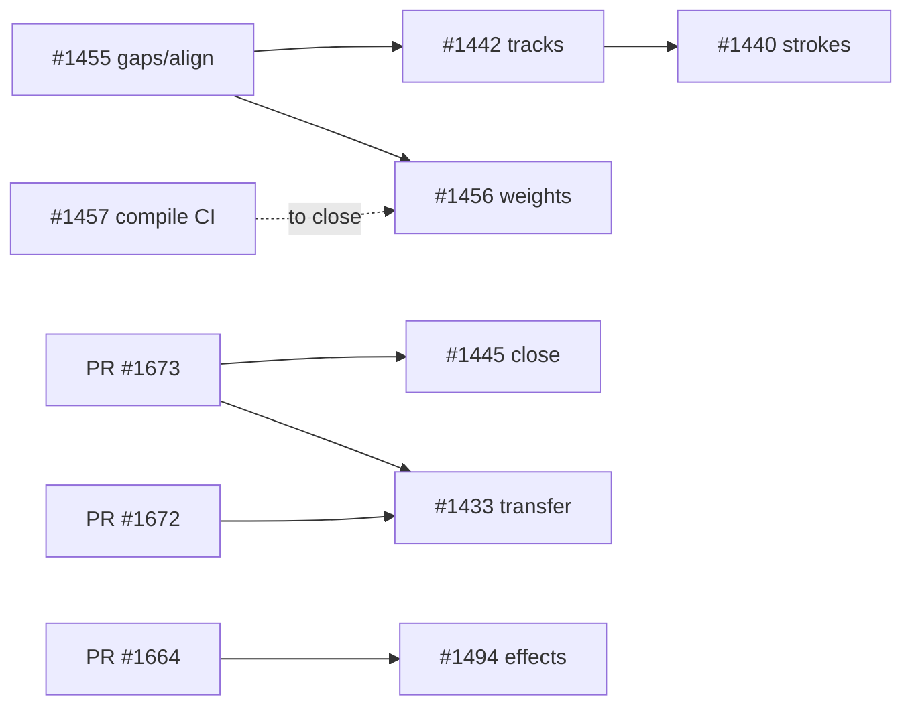

# Components parity and grid export fidelity: build-ready specs (epics #1487 and #1486)

Code baseline: `origin/main@d22dad970` (2026-11-06 22:55 +07). Every spec cites file:line on that commit and tells the builder to re-anchor and report drift before coding. Nothing on GitHub was edited.

## Status of the 9 open issues

| Issue | Still real? | Size | Builder | Depends on | Ready after owner answers? |
|---|---|---|---|---|---|
| [Nested Stretch instance after a sync (#1445)](1445-nested-stretch-instance-keeps-size-after-sync.md) | Mostly fixed: #1655 merged; draft PR #1673 covers the rest. Close after #1673 + one App-path test | 1.5 h | Sonnet (test), Opus reviews #1673 | PR #1673 (and #1672, same file) | Yes, no question |
| [Override transfer: inner swaps, single text, variant gate, NIVB (#1433)](1433-instance-override-transfer-inner-swap-text-rule-variant-gate.md) | Real (drops are counted but never shown) | L, 12–16 h + 1 h probes | Sonnet | #1673, #1672 merged first (same `components.rs`) | After questions 3, 4, 5 |
| [Create multiple components (#1472)](1472-create-multiple-components.md) | Real, but the issue has Studio backwards: Ctrl+Alt+K already makes one component per layer; missing are the "Create multiple components" item and Figma's wrap-into-one | M, 5–7 h | Sonnet | none | After question 1 |
| [Effect style beats stale self-override (#1494)](1494-instance-effect-style-wins-over-stale-self-override.md) | Real (#1464's rule never covered effects) | M, 6–8 h | Sonnet | #1664 merged first (same `fig.rs` override path); #1671, #1578 rebase | After question 6 |
| [Grid strokes vs the solver (#1440)](1440-grid-stroke-export-matches-solver.md) | Partly fixed (Tailwind per-side done by #1619); Center stroke, no-space strokes and the harness traceback remain | M, 5–7 h | Argon | #1455, then #1442 (same files) | After question 8 |
| [Remaining grid track drifts (#1442)](1442-grid-export-remaining-track-drifts.md) | Real (C3, S6, S8, S10, N2d, empty-grid nit) | M, 6–8 h | Argon | #1455 | Yes, no question |
| [Gaps and cell alignment from the solver (#1455)](1455-export-reads-grid-gaps-and-alignment-from-solver.md) | Real (rule copied at 7 sites) | S, 2–3 h | Grok build-fast (Claude reviews) | none; goes first | Yes, no question |
| [Native grid tracks as weights (#1456)](1456-native-grid-tracks-as-weights.md) | Real (px only in all 4 generators) | M–L, 9–12 h | Sonnet | #1455 (hard), #1457 (to close) | After question 2 |
| [CI compile check for native export (#1457)](1457-ci-compile-check-native-export.md) | Partly done (SwiftUI typecheck for 19 fixtures on macOS); UIKit, Compose, Android, grid scenes missing | M, 6–8 h | Sonnet | none (`ci.yml` PRs #1578, #1408, #1202, #1147 rebase only) | After question 7 |

Total builder time ≈ 53–70 h.

## Build order (no two parallel legs share a file)

1. Now, in parallel: #1455 (export + solver grid files), #1457 (CI + new tools folder), #1445 test (`comp_ops.rs` tests), #1472 (menus, `comp_ops.rs` command; after question 1). #1445 and #1472 both touch `comp_ops.rs`: run them in sequence or keep #1445 to a separate test file.
2. After #1455: #1442 (web track rules). After #1673 + #1672 merge: #1433. After #1664 merges: #1494.
3. After #1442: #1440 (web strokes) in parallel with #1456 (native; disjoint files once #1455 is in).

Risks: `components.rs` (8,316 lines) is hot: three open PRs plus #1433. `fig.rs` has four open PRs. The Chrome grid harness (`scripts/qa/grid-chrome-compare.py`) is not in CI, so #1440/#1442 evidence is a local run the controller must rerun.

## Owner questions

1. **When several layers are selected, what should Create component (Ctrl+Alt+K) do?** Unblocks #1472.
   - **Wrap them into one component, as Figma does, and add "Create multiple components" for one per layer (recommended).** Figma Help says Create component nests the selection in one component frame; this is the epic's parity goal.
   - Keep Ctrl+Alt+K as one per layer (today) and add "Create component from selection" for the wrap.
   - Keep today's behaviour and only add a "Create multiple components" label to the same command (two items doing the same thing).
2. **How should exported SwiftUI grids express flexible columns?** Unblocks #1456.
   - **Equal flexible columns stretch with `maxWidth: .infinity`; unequal weights keep pixel widths with a comment naming the weights (recommended).** SwiftUI `Grid` has no per-column weights; this stays plain SwiftUI.
   - Wrap the grid in a `GeometryReader` and compute weighted widths (exact, but heavier code).
   - Keep pixel widths for SwiftUI only.
3. **When a swap or variant switch cannot keep some of the user's changes, how should Studio say so?** Unblocks #1433.
   - **A short toast "Couldn't keep {n} changes" and a `dropped_overrides` count in the agent (MCP) reply (recommended).** Users and agents both see it; nothing is silent.
   - Toast only.
   - Agent reply only; the canvas stays quiet.
   - Log file only (today: a console line nobody sees).
4. **On a variant switch, should a changed colour (or other property) reset when the two variants did not originally share that value?** Unblocks #1433.
   - **Yes, as Figma does (recommended).** Figma Help: changes are kept only if the property originally matched between variants. Some overrides users keep today will reset.
   - No, keep every change across variant switches (today's behaviour).
5. **Should the new override rules wait for checks in live Figma first?** Unblocks #1433 (single-text rule, variant reset, and the unexplained "NIVB" drop rule).
   - **Build now from the documented rules; you run the 4 short Figma probes listed in the spec before merge (recommended).** Keeps the build moving; probes only gate the merge.
   - Run the probes before any build starts.
   - Skip the probes; ship on the documented rules and drop the NIVB investigation.
6. **An instance names an effect style, but its own override entry lists no effects at all. What should it show?** Unblocks #1494.
   - **The style's effects (recommended).** The instance's style link is the current value; the override list is an old copy. Same rule #1464 applied to fills and strokes.
   - No effects (treat the empty list as the user removing them).
7. **Should the new native-code compile check block merges into `main`?** Unblocks #1457.
   - **Advisory for two weeks, then required (recommended).** Lets the Gradle/Android cache settle before it can block a release.
   - Required from day one.
   - Advisory only.
8. **How should exported CSS and Tailwind draw a stroke that does not push content in Studio?** Unblocks #1440.
   - **Draw it as an outline (or inset shadow per side) that takes no space, for every auto-layout frame (recommended).** Content lands exactly where Studio draws it; one rule for grid and flex.
   - Keep `border` and subtract its width from the padding (closer to hand-written CSS; drifts when the padding is smaller than the stroke).
   - Same as the first option, but grid frames only.

Unresolved: none beyond the 8 questions. Assumptions are listed at the end of each spec with what would flip them.
