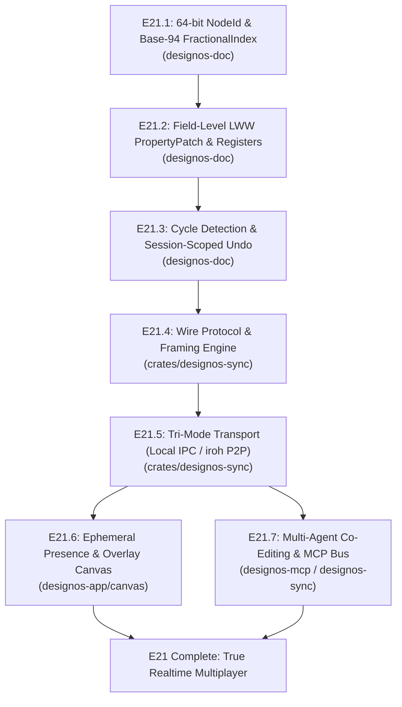

# Epic E21: True Figma & Studio Multiplayer Architecture & Implementation Specifications

**Milestone:** v0.9.0–v1.0.0 | **Author:** Subagent Architecture Synthesizer (`gemini-3.8-flash` / Fable 5.1 Clean-Room Specialist)  
**Parent Coordinator:** `63e647dd-0c38-44f9-b09c-dd5e0c287df3` (Gemini 4 Carbon Coordinator)  
**Target Path:** `docs/specs/epics-figma-rea/e21-multiplayer-realtime-sync/README.md`  
**Evidence Source:** Clean-Room Figma 126.11.7 REA Dossier (`../evidence/rea-e21-multiplayer-realtime-sync.md`)  
**Core Architectural Mandate:** Serverless Teamwork (`decisions.md:15`: *"Teamwork without a server, in-file branches | Keep all"*), Zero-Migration 64-bit `NodeId` Backward Compatibility, and Zero-Invalidation Ephemeral Presence Rendering.

---

## Answer first

- **Why prepare Multiplayer NOW?** If Studio adds dozens of new feature commands across Epics E1–E20 (styles, variables, vectors, shaders, prototyping, code generation) while `crates/designos-doc` still relies on whole-node snapshot replacements (`Command::Update { node: Box<Node> }`) and integer child indices (`children: Vec<NodeId>`, `index: usize`), **every single command variant will have to be completely rewritten and migrated later.**
- **The Core Strategy:** Establish the **Multiplayer Pre-Flight Foundation** (`NodeId` session packing, Base-94 `FractionalIndex`, commutative field-level `PropertyPatch` commands, and `ChangeRegisters`) in `designos-doc` immediately. This costs minimal builder hours today, introduces zero breaking changes for existing `.designos` single-player files, and ensures every subsequent feature is inherently multiplayer-ready by construction.
- **The Serverless Tri-Mode Transport:** In direct compliance with the repository owner's explicit decision (*"Teamwork without a server"*, `decisions.md:15`), Studio multiplayer operates across three interchangeable transport modes using one unified protocol:
  1. **Mode A (Local Multi-Agent IPC Bus):** Zero-copy Unix Domain Sockets / Windows Named Pipes enabling simultaneous co-editing between human designers and $N$ local AI agents (`designos-mcp`, Claude Code, OpenAI Codex, Grok, Antigravity) without file-lock contention.
  2. **Mode B (Serverless P2P via `iroh` QUIC):** Fully decentralized peer-to-peer collaboration over direct hole-punched QUIC connections with LAN mDNS discovery and `designos://join/<ticket>` capability tokens. Zero hosted server required.
  3. **Mode C (Stateless Relay Fallback):** Optional lightweight WebSocket room forwarder (`designos-relay`) for corporate networks with symmetric NATs.
- **Strict Performance Invariants (`AGENTS.md` §4):** Remote cursors, selection boxes, Cursor Chat, and AI activity indicators render exclusively in an ephemeral overlay layer (`canvas/multiplayer_overlay.rs`). They cause **zero** tile cache invalidations (`TileView::rev`), zero `SceneCompiler` GPU geometry rebuilds, and preserve the $0.00\%$ idle CPU baseline within 250ms of activity stopping.

---

## 1. Architectural Map & Spec Manifest

This epic is split across three exhaustive specifications:

```
plans/261106-2245-epic-waves/specs/e21-multiplayer-realtime-sync/
├── README.md                                                       (This document: Master Roadmap & Strategy)
├── e21-doc-foundation-guid-fractional-index-lww-undo-spec.md        (Slices E21.1–E21.3: Foundation in designos-doc)
└── e21-sync-engine-p2p-presence-multi-agent-canvas-spec.md         (Slices E21.4–E21.7: Sync Engine, P2P, Presence)
```

### Document Relationship & Responsibilities

| Spec File | Target Crates / Files | Scope & Load-Bearing Guarantee |
|---|---|---|
| **`README.md`** | Global Workspace | Roadmap, slice dependency DAG, builder sizing, Hot-File Queue management, multi-agent cost routing. |
| **`e21-doc-foundation...spec.md`** | `crates/designos-doc` (`lib.rs`, `node.rs`, `history.rs`, `change_registers.rs`, `fractional_index.rs`) | 64-bit `NodeId` `(session_id, local_id)` packing, Base-94 fractional sibling ordering, commutative field-level LWW `PropertyPatch`, cycle-free tree moves, and session-scoped inverse undo. |
| **`e21-sync-engine...spec.md`** | `crates/designos-sync` (new), `crates/designos-app` (`multiplayer_overlay.rs`, `session.rs`), `crates/designos-mcp` | Kiwi wire serialization, Tri-Mode Transport (Local IPC / `iroh` P2P / Relay), 30 Hz cursor spring smoothing, Spotlight, Cursor Chat, and First-Class AI Agent Presence. |

---

## 2. Slice Breakdown & Execution Roadmap

The implementation is partitioned into seven strictly sequenced slices ($E21.1$ through $E21.7$). Each slice compiles independently, satisfies atomic test gates, and lands without destabilizing existing single-player document workflows.



### Slice Details & Estimates

| Slice | Name | Focus & Changes | Builder Sizing | Risk Tier |
|---|---|---|---|---|
| **`E21.1`** | **`NodeId` Packing & Base-94 Fractional Indexing** | Pack `(session_id: u32, local_id: u32)` into `u64`. Implement printable ASCII Base-94 `FractionalIndex` midpoint generation `between(lo, hi)`. Maintain sorted `Node::children` projection. | 8–12 hrs | Low (100% backward compatible) |
| **`E21.2`** | **Field-Level LWW & `PropertyPatch` Commands** | Introduce `Command::PatchNode` and `PropertyPatch` enum. Implement `ChangeRegisters` table with Hybrid Logical Clocks (HLC) and optimistic unacknowledged tracking. | 14–18 hrs | Medium (touches undo/redo) |
| **`E21.3`** | **Cycle-Free Tree Moves & Per-Session Undo** | Implement ancestor walk cycle check + Kleppmann-style deterministic parent tree-move resolution. Implement session-scoped inverse delta undo stack with tombstone GC safety. | 10–14 hrs | High (CRDT edge cases) |
| **`E21.4`** | **`crates/designos-sync` Core & Wire Framing** | Create new crate `crates/designos-sync`. Implement clean-room binary and compact framing mapping Figma 126.11.7 `MessageType` (`NODE_CHANGES`, `USER_CHANGES`, `JOIN_START/END`). | 12–16 hrs | Low (isolated crate) |
| **`E21.5`** | **Tri-Mode Transport: Local IPC & `iroh` P2P** | Implement Mode A (Unix Domain Socket / Named Pipe) and Mode B (`iroh` QUIC + mDNS discovery + ticket exchange). Role-based capabilities (`Viewer`, `Commenter`, `Editor`). | 18–24 hrs | Medium (network IO & hole-punching) |
| **`E21.6`** | **Ephemeral Presence & Zero-Invalidation Overlay** | Implement 30 Hz cursor outbound throttle, cubic Hermite spring interpolation, Heartbeat, Spotlight/Follow, and Cursor Chat (`/` bubble). Render in `canvas/multiplayer_overlay.rs`. | 10–14 hrs | Low (isolated UI overlay) |
| **`E21.7`** | **First-Class AI Agent Presence & MCP Bus** | Wire `UserChange.agentInfo` and `agentCanvasActivity` into `designos-mcp`. Human designer and AI agents stream concurrent non-clobbering patches live to canvas. | 12–16 hrs | Medium (integration) |
| **Total** | **Epic E21 Full Implementation** | **7 Slices** | **84–114 hrs** | — |

---

## 3. Hot-File Queue Impact Analysis

The Hot-File Queue tracks files under heavy modification across active epics. Studio's team throughput depends on isolating multiplayer changes from high-conflict files.

### Isolation Strategy

1. **`crates/designos-doc` Core:**
   - Changes to `node.rs` and `lib.rs` are purely additive: `NodeId` helper methods (`session_id()`, `local_id()`, `from_parts()`) and optional `ParentIndex` fields. Existing struct layouts remain binary-compatible.
   - `change_registers.rs` and `fractional_index.rs` are **new isolated modules**, completely off the hot-file queue.
2. **New Dedicated Crate `crates/designos-sync`:**
   - All network framing, P2P connection handling, QUIC streams, and serialization logic reside in `crates/designos-sync`. This touches zero files in `crates/designos-render`, `crates/designos-gpu`, or `crates/designos-library`.
3. **Canvas Isolation (`canvas/multiplayer_overlay.rs`):**
   - Remote cursors, presence badges, selection highlights, and chat bubbles live in a dedicated overlay module.
   - `canvas/mod.rs` simply calls `MultiplayerOverlay::paint(&mut self, ui, viewport)` after all scene tiles are painted.
   - **`crates/designos-render/src/scene_index.rs` and `crates/designos-gpu/src/compile.rs` are UNTOUCHED by ephemeral presence!**
4. **Figma Kiwi Import / Export (`designos-fig`):**
   - `crates/designos-fig/src/fig.rs` only receives an optional conversion hook mapping Figma's Kiwi `ParentIndex` to Studio's internal `ParentIndex`.

---

## 4. Cost-Optimal Multi-Agent Routing Protocol

To strictly enforce the **Antigravity Sub-Agent Cost-Optimization (GLOBAL HARD RULE)**:

| Agent Tier | Model | Subagent Role | Slices & Responsibilities |
|---|---|---|---|
| **Coordinator / Architect** | **Gemini 4 Carbon** (`gemini-4-carbon-*`) | Orchestrator & Final Verifier | Authors specifications, enforces safety invariants (`AGENTS.md` §4), reviews PR diffs, executes final cryptographic acceptance commands. **Never writes bulk implementation code.** |
| **Deep Reasoning Builder** | **Gemini 4 Argon** (`Model: "pro"`) | Algorithmic & Systems Engineer | Implements Slices **`E21.2`**, **`E21.3`**, and **`E21.5`**: Base-94 midpoint edge cases, Kleppmann cycle-breaking resolution, `ChangeRegisters` optimistic concurrency, and `iroh` QUIC state machines. |
| **Fast Execution Builder** | **Gemini 3.8 Flash** (`Model: "flash"`) | Systems & Plumbing Engineer | Implements Slices **`E21.1`**, **`E21.4`**, **`E21.6`**, and **`E21.7`**: `NodeId` bit-shifting, wire serialization structs, test vectors, UI overlay rendering in `egui`, and MCP socket adapters. |
| **Lightweight Scout** | **Gemini Flash Lite** (`Model: "flash_lite"`) | Scout & Inspector | Validates line numbers, audits existing tests, and performs read-only checks on codebase dependencies. |

---

## 5. Non-Negotiable Performance & Safety Invariants

All multiplayer code merged into `design-os-studio` must satisfy the following four architectural invariants:

1. **Zero `doc.to_json()` in Document Hashing (`AGENTS.md` §4.1):**
   - Document state updates and multiplayer sync verification must compute document checksums via the streaming, zero-allocation `HashSerializer`.
   - Never serialize documents to JSON strings for change detection or sync verification.
2. **Zero `TileView::rev` / `FrameKey` Invalidation on Ephemeral Presence (`AGENTS.md` §4.2):**
   - Remote mouse movements (`UserChange.mouse`), viewport shifts (`UserChange.viewport`), and cursor chat (`UserChange.chatMessage`) MUST NOT call `app.changed()`, MUST NOT increment `TileView::rev`, and MUST NOT invalidate GPU `GeomCache` or `PaintCache`.
   - Idle CPU delta across 20-second sampling windows MUST remain strictly $0.00\%$ within $250\text{ ms}$ of cursor inactivity.
3. **No `ctx.load_texture` inside `ctx.data_mut` (`AGENTS.md` §4.2):**
   - User profile images (`UserChange.imageURL`) and AI agent logos must be fetched and decoded asynchronously on a worker thread.
   - Textures must be registered with `ctx.load_texture` outside any `ctx.data_mut` lock to prevent Frame 1 deadlocks.
4. **Preserve `interactive()` Guard & `< 64` GPU Program Cap (`AGENTS.md` §4.3):**
   - Headless unit tests and P2P synchronization test suites running without GPU hardware must execute deterministically against `designos-render`.
   - Dynamic multiplayer shaders (e.g. cursor trails or selection halos) must respect the maximum limit of 64 offscreen GPU programs.

---

## 6. Directory Structure of Epic E21

```
crates/
├── designos-doc/
│   └── src/
│       ├── lib.rs                   # NodeId session packing helpers (E21.1)
│       ├── node.rs                  # ParentIndex struct & sorted children invariant (E21.1)
│       ├── fractional_index.rs      # Base-94 between() algorithm & unit tests (E21.1)
│       ├── change_registers.rs      # Field-level LWW registers & HLC clock (E21.2)
│       ├── history.rs               # Command::PatchNode & session undo stack (E21.2, E21.3)
│       └── cycle_breaker.rs         # Ancestor walk & Kleppmann move resolution (E21.3)
├── designos-sync/                   # (NEW CRATE - E21.4 & E21.5)
│   ├── Cargo.toml
│   └── src/
│       ├── lib.rs                   # SyncEngine facade
│       ├── wire.rs                  # Clean-room Kiwi / Message framing
│       ├── transport/
│       │   ├── mod.rs               # Transport trait
│       │   ├── local_ipc.rs         # Unix Domain Socket / Named Pipe (Mode A)
│       │   ├── p2p_iroh.rs          # iroh QUIC + ticket exchange (Mode B)
│       │   └── relay_ws.rs          # Optional WebSocket fallback (Mode C)
│       └── protocol/
│           ├── join.rs              # JOIN_START, SCENE_GRAPH_QUERY/REPLY, JOIN_END
│           ├── mutate.rs            # NODE_CHANGES broadcast & ACK handling
│           └── presence.rs          # USER_CHANGES throttle & broadcast
├── designos-app/
│   └── src/
│       └── canvas/
│           └── multiplayer_overlay.rs # 120fps spring cursor, chat bubble & presence paint (E21.6)
└── designos-mcp/
    └── src/
        └── sync_client.rs           # Multi-agent IPC client attaching to SyncEngine (E21.7)
```
