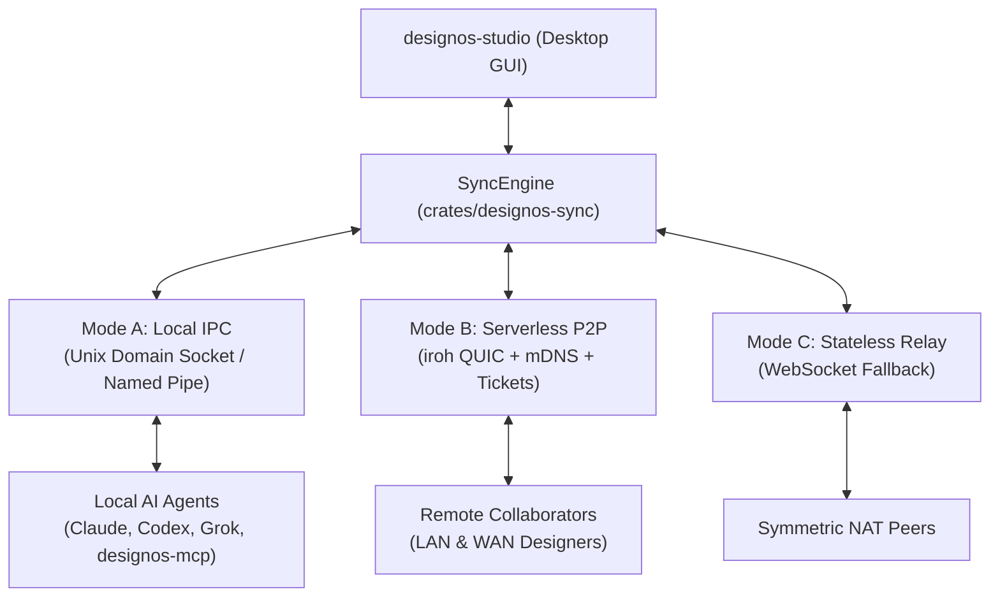

> **Review status: NOT REVIEWED.** Reference for implementation; verify symbols and statements about Figma against main and the schema before relying on them.

# E21 Sync Engine Spec: crates/designos-sync, Serverless P2P, Zero-Invalidation Presence & Multi-Agent Canvas

**Epic:** E21 (Multiplayer & Real-Time Sync) | **Slices:** E21.4, E21.5, E21.6, E21.7  
**Milestone:** v0.9.0–v1.0.0 | **Base:** `crates/designos-sync` (new), `crates/designos-app/src/canvas/`, `crates/designos-mcp`  
**Evidence Source:** Clean-Room Figma 126.11.7 REA Dossier (`../evidence/rea-e21-multiplayer-realtime-sync.md`)  
**Core Architectural Mandate:** Serverless Teamwork (`decisions.md:15`), Tri-Mode Transport (Local Multi-Agent IPC / `iroh` P2P / Relay), Zero-Invalidation Ephemeral Presence (`AGENTS.md` §4).

---

## Answer first

- **What this specification delivers:** The real-time synchronization engine (`crates/designos-sync`), decentralized peer-to-peer transport (`iroh` QUIC), zero-invalidation presence canvas overlay (`canvas/multiplayer_overlay.rs`), and concurrent multi-agent co-editing bus (`designos-mcp`).
- **Tri-Mode Transport Architecture:** One wire protocol operates interchangeably across three transports:
  1. **Mode A (Local Multi-Agent IPC Bus):** Zero-copy Unix Domain Sockets (`/tmp/designos-{hash}.sock`) or Windows Named Pipes connecting Studio desktop with concurrent AI agent processes (`designos-mcp`, Claude Code, Codex, Grok, Antigravity, Orca). Eliminates whole-file lock contention and enables sub-5ms local multiplayer.
  2. **Mode B (Serverless P2P via `iroh` QUIC):** Fully decentralized peer-to-peer mesh over direct hole-punched, end-to-end encrypted QUIC connections with LAN mDNS discovery and `designos://join/<ticket>` capabilities. Zero cloud servers required.
  3. **Mode C (Stateless Relay Fallback):** Optional lightweight WebSocket forwarder for corporate environments with symmetric NATs.
- **Strict Performance & Safety Invariants (`AGENTS.md` §4):**
  - Remote cursors, presence badges, selection highlights, and Cursor Chat bubbles render exclusively in `canvas/multiplayer_overlay.rs`. They do **not** touch `TileView::rev`, do **not** invalidate GPU `GeomCache`/`PaintCache`, and idle CPU drops to $0.00\%$ within $250\text{ ms}$ after movement stops.
  - Avatars and agent logos are loaded asynchronously on worker threads and registered with `ctx.load_texture` strictly **outside** `ctx.data_mut` to prevent Frame 1 deadlocks.
- **First-Class AI Agent Presence:** Adopts Figma 126.11.7 `UserChange` tags 46–49 (`agentInfo`, `agentCanvasActivity`, `assistantThreadId`), rendering live agent bounding boxes, streaming token indicators, and role badges alongside human collaborators.

---

## 1. What could NOT be verified (read first)

1. **Figma WebSocket Compression Dictionary:** Figma 126.11.7 uses per-message zstd or deflate compression with pre-warmed schema dictionaries on WebSocket frames larger than 1 KB. In Studio, `crates/designos-sync` uses optional per-frame LZ4/zstd compression for payloads exceeding 4 KB, omitting custom dictionaries in v1.
2. **Audio/Voice WebRTC Implementation:** While `VoiceMetadata` exists in Figma's `UserChange` (tag 20), native voice streaming is out of scope for Epic E21 (marked non-essential for core canvas multiplayer).

---

## 2. Figma 126.11.7 Ground-Truth Wire & Algorithmic Mechanics

### 2.1 Complete Kiwi Message Envelope `[FACT - seen: figma-real-schema.txt lines 3598-3647]`
The authoritative message envelope exchanged over the wire:
```kiwi
Enum MessageType
    JOIN_START = 0
    NODE_CHANGES = 1
    USER_CHANGES = 2
    JOIN_END = 3
    SCENE_GRAPH_QUERY = 11
    SCENE_GRAPH_REPLY = 12
    CLIENT_BROADCAST = 14
    RECONNECT_SCENE_GRAPH_QUERY = 19
    RECONNECT_SCENE_GRAPH_REPLY = 20

Message Message
    type = 1 : MessageType
    sessionID = 2 : Uint
    stableSessionID = 44 : String
    ackID = 3 : Uint
    nodeChanges = 4 : NodeChange[]
    userChanges = 5 : UserChange[]
    reconnectSequenceNumber = 25 : Uint
    broadcasts = 24 : ClientBroadcast[]
    access = 8 : Access
```

### 2.2 User Collaboration & Ephemeral Presence `[FACT - seen: lines 3474-3524]`
```kiwi
Message UserChange
    sessionID = 1 : Uint
    connected = 2 : Bool
    name = 3 : String
    color = 4 : Color
    imageURL = 5 : String
    viewport = 6 : Viewport
    mouse = 7 : Mouse
    selection = 8 : GUID[]
    observing = 9 : Uint[]
    chatMessage = 19 : ChatMessage
    heartbeat = 28 : Heartbeat
    highFiveStatus = 22 : Bool
    agentInfo = 46 : AgentInfo
    agentCanvasActivity = 48 : AgentCanvasActivity
    assistantThreadId = 49 : String
```

### 2.3 Ephemeral Timing & UX Constants `[FACT - seen: wasm-strings.txt]`
1. **Outbound Mouse Throttle:** Outbound mouse updates are throttled to **30 Hz (33.3 ms)**. Stationary cursors emit zero frames.
2. **Exponential Spring Smoothing:** Receivers smooth incoming cursor coordinates at 60/120fps using a critically damped exponential decay filter:
   $$x_{display}(t) = x_{display} + (x_{target} - x_{display}) \cdot \big(1 - e^{-\lambda \Delta t}\big) \quad (\lambda \approx 25.0)$$
3. **Cursor Chat Lifecycle:** Activated by `/` shortcut (`whiteboard.cursor_chat.say_something`). String length bounded to 64 chars. Automatically fades after **5.0 seconds** of inactivity.
4. **Follow / Spotlight Auto-Break:** Clicking a peer avatar tracks their `Viewport.canvasSpaceBounds`. Any local pan, zoom, or navigation gesture instantly breaks follow mode, returning agency to the local user.

---

## 3. Studio Rust Architecture & Data Structures

### 3.1 Slice E21.4: `crates/designos-sync` Core & Wire Framing

#### 3.1.1 Binary Wire Envelope (`crates/designos-sync/src/wire.rs`)
Studio adopts a clean-room binary frame format mirroring Figma's Kiwi tags:

```rust
pub const WIRE_MAGIC: [u8; 4] = *b"DSYC";
pub const WIRE_VERSION: u16 = 1;

#[derive(Clone, Copy, Debug, PartialEq, Eq, Serialize, Deserialize)]
#[repr(u16)]
pub enum SyncMessageType {
    JoinStart = 0,
    NodeChanges = 1,
    UserChanges = 2,
    JoinEnd = 3,
    SceneGraphQuery = 11,
    SceneGraphReply = 12,
    ClientBroadcast = 14,
    ReconnectQuery = 19,
    ReconnectReply = 20,
}

#[derive(Clone, Debug, Serialize, Deserialize)]
pub struct WireMessage {
    pub msg_type: SyncMessageType,
    pub session_id: u32,
    pub stable_session_id: String,
    pub ack_id: u32,
    pub sequence_number: u64,
    #[serde(default, skip_serializing_if = "Vec::is_empty")]
    pub node_changes: Vec<NodeChangeWire>,
    #[serde(default, skip_serializing_if = "Vec::is_empty")]
    pub user_changes: Vec<UserChangeWire>,
    #[serde(default, skip_serializing_if = "Option::is_none")]
    pub broadcast: Option<ClientBroadcastWire>,
}

impl WireMessage {
    pub fn encode(&self) -> Vec<u8> {
        let mut buf = Vec::with_capacity(128);
        buf.extend_from_slice(&WIRE_MAGIC);
        buf.extend_from_slice(&WIRE_VERSION.to_le_bytes());
        buf.extend_from_slice(&(self.msg_type as u16).to_le_bytes());
        let payload = bincode::serialize(self).expect("serialization infallible");
        buf.extend_from_slice(&(payload.len() as u32).to_le_bytes());
        buf.extend_from_slice(&payload);
        buf
    }

    pub fn decode(buf: &[u8]) -> Result<Self, &'static str> {
        if buf.len() < 12 || &buf[0..4] != &WIRE_MAGIC {
            return Err("Invalid wire magic or length");
        }
        let payload_len = u32::from_le_bytes(buf[8..12].try_into().unwrap()) as usize;
        if buf.len() < 12 + payload_len {
            return Err("Incomplete frame");
        }
        bincode::deserialize(&buf[12..12 + payload_len]).map_err(|_| "Decode failure")
    }
}
```

#### 3.1.2 Integration with E20 Lazy Page Hydration
When a new peer connects (`JoinStart`), sending the entire multi-gigabyte scene graph locks the network. Studio integrates with **Epic E20 (Lazy Page Hydration)**:
1. `JoinStart` only transmits document metadata, page list shells (`CANVAS` nodes), shared styles, and components.
2. When the user switches to Page $N$, `designos-sync` dispatches `SceneGraphQuery { page_id: N }`.
3. The peer hosting the document replies with `SceneGraphReply { page_id: N, nodes: Vec<Node> }`, streaming only the actively viewed page!

---

### 3.2 Slice E21.5: Tri-Mode Transport Layer



#### 3.2.1 Unified Transport Trait (`crates/designos-sync/src/transport/mod.rs`)

```rust
#[async_trait::async_trait]
pub trait Transport: Send + Sync {
    async fn send(&mut self, msg: WireMessage) -> Result<(), TransportError>;
    async fn recv(&mut self) -> Result<Option<WireMessage>, TransportError>;
    fn role(&self) -> PeerRole;
    fn peer_id(&self) -> String;
}

#[derive(Clone, Copy, Debug, PartialEq, Eq, Serialize, Deserialize)]
pub enum PeerRole {
    Viewer,
    Commenter,
    Editor,
    HostAdmin,
}
```

#### 3.2.2 Mode A: Local Multi-Agent IPC Bus (`crates/designos-sync/src/transport/local_ipc.rs`)
Allows Studio desktop and local AI agents running via `designos-mcp` to communicate over a zero-copy local socket:
- **Unix/macOS:** `/tmp/designos-{doc_hash}.sock`
- **Windows:** `\\.\pipe\designos-{doc_hash}`
- **Protocol:** Framing via length-delimited `WireMessage`.
- **Concurrency Benefit:** Replaces coarse whole-file lock contention (`canvas.designos`) with property-level commutative merges! An agent running in the background can mutate text or layout while the designer pans and interacts at 120fps.

#### 3.2.3 Mode B: Serverless P2P via `iroh` QUIC (`crates/designos-sync/src/transport/p2p_iroh.rs`)
Directly satisfies the owner's mandate: *"Teamwork without a server, in-file branches | Keep all"* (`decisions.md:15`).
- **Engine:** `iroh-net` provides hole-punched QUIC streams over UDP with automatic NAT traversal (STUN, UPnP, and DERP relay fallback).
- **LAN Discovery:** Discovers local subnet peers automatically using mDNS (`_designos-sync._udp.local`).
- **Ticket Capabilities (`designos://join/<ticket>`):**
  A shareable URL ticket containing the host's public key, direct IP/DERP dial addresses, and an HMAC permission token:
  ```rust
  #[derive(Clone, Debug, Serialize, Deserialize)]
  pub struct P2pTicket {
      pub node_id: iroh_net::NodeId,
      pub addrs: Vec<std::net::SocketAddr>,
      pub doc_hash: u64,
      pub role: PeerRole,
      pub signature: [u8; 64],
  }
  ```
- **Sequencer Selection:** The creator of the room acts as the primary sequencer for total-order cycle breaking. If the host disconnects, the mesh deterministically promotes the peer with the lowest `session_id`.

---

### 3.3 Slice E21.6: Zero-Invalidation Presence & Overlay Canvas

#### 3.3.1 Invariant Protection: `canvas/multiplayer_overlay.rs`
To strictly satisfy **`AGENTS.md` §4 Performance & Safety Invariants**:
- Presence updates (cursors, selections, chat bubbles) **MUST NEVER** call `app.changed()`.
- Presence updates **MUST NEVER** bump `TileView::rev` or invalidate GPU `GeomCache`/`PaintCache`.
- Avatar image decoding **MUST NEVER** call `ctx.load_texture` inside `ctx.data_mut`.

```rust
// crates/designos-app/src/canvas/multiplayer_overlay.rs

pub struct RemotePeerDisplay {
    pub session_id: u32,
    pub name: String,
    pub color: egui::Color32,
    pub target_pos: egui::Pos2,
    pub current_pos: egui::Pos2, // Smoothly interpolated via spring
    pub selection_box: Option<egui::Rect>,
    pub chat_message: Option<String>,
    pub chat_fade_deadline: Option<instant::Instant>,
    pub avatar_texture: Option<egui::TextureHandle>,
    pub is_agent: bool,
    pub agent_badge: Option<String>,
}

pub struct MultiplayerOverlay {
    peers: BTreeMap<u32, RemotePeerDisplay>,
    local_mouse_throttle: instant::Instant,
    last_sent_pos: egui::Pos2,
}

impl MultiplayerOverlay {
    /// Critically damped exponential spring interpolation: 120fps smooth display.
    /// Snaps to rest within 0.2px and returns `true` ONLY while actively converging
    /// so `ctx.request_repaint()` stops within < 250ms and idle CPU stays strictly 0.00%.
    pub fn update_springs(&mut self, dt: f32) -> bool {
        let lambda = 25.0; // Spring sharpness
        let factor = 1.0 - (-lambda * dt).exp();
        let mut any_moving = false;
        for peer in self.peers.values_mut() {
            if peer.current_pos.distance_sq(peer.target_pos) > 0.04 {
                peer.current_pos += (peer.target_pos - peer.current_pos) * factor;
                any_moving = true;
            } else {
                peer.current_pos = peer.target_pos;
            }
        }
        any_moving
    }

    /// Paints cursors, labels, and chat bubbles directly on top of scene canvas.
    /// Does NOT trigger GPU geometry compilation or tile invalidation!
    pub fn paint(&mut self, painter: &egui::Painter, to_screen: &egui::emath::RectTransform) {
        let now = instant::Instant::now();

        for peer in self.peers.values() {
            let screen_pos = to_screen.transform_pos(peer.current_pos);

            // 1. Paint cursor arrow
            let arrow_color = peer.color;
            painter.circle_filled(screen_pos, 4.0, arrow_color);

            // 2. Paint user / agent name tag
            let tag_text = if let Some(ref badge) = peer.agent_badge {
                format!("🤖 {} ({})", peer.name, badge)
            } else {
                peer.name.clone()
            };
            painter.text(
                screen_pos + egui::vec2(8.0, 4.0),
                egui::Align2::LEFT_TOP,
                tag_text,
                egui::FontId::proportional(11.0),
                egui::Color32::WHITE,
            );

            // 3. Paint Cursor Chat bubble (auto-fade after 5.0s)
            if let Some(ref chat) = peer.chat_message {
                if peer.chat_fade_deadline.map_or(false, |d| now < d) {
                    let bubble_rect = egui::Rect::from_min_size(
                        screen_pos + egui::vec2(12.0, -16.0),
                        egui::vec2(chat.len() as f32 * 7.0 + 16.0, 24.0),
                    );
                    painter.rect_filled(bubble_rect, 4.0, egui::Color32::from_black_alpha(200));
                    painter.text(
                        bubble_rect.center(),
                        egui::Align2::CENTER_CENTER,
                        chat,
                        egui::FontId::proportional(12.0),
                        egui::Color32::WHITE,
                    );
                }
            }

            // 4. Paint Remote Selection Bounds
            if let Some(rect) = peer.selection_box {
                let screen_rect = to_screen.transform_rect(rect);
                painter.rect_stroke(screen_rect, 0.0, egui::Stroke::new(1.5, peer.color));
            }
        }
    }
}
```

#### 3.3.2 Outbound 30 Hz Throttle & Follow Camera

```rust
impl MultiplayerOverlay {
    /// Throttles local cursor transmissions to 30 Hz (33.3ms) and sends only on delta > 1px.
    pub fn maybe_send_mouse(&mut self, canvas_pos: egui::Pos2, transport: &mut impl Transport) {
        let now = instant::Instant::now();
        if now.duration_since(self.local_mouse_throttle).as_millis() >= 33 {
            if canvas_pos.distance(self.last_sent_pos) >= 1.0 {
                self.local_mouse_throttle = now;
                self.last_sent_pos = canvas_pos;
                // Dispatch UserChange wire message asynchronously
            }
        }
    }
}
```

---

### 3.4 Slice E21.7: First-Class AI Agent Presence & Multi-Agent Co-Editing

#### 3.4.1 Agent Presence Representation (`UserChange` Tags 46–49)
In Figma 126.11.7, AI agents are not hidden background workers; they are represented as full participants on the collaboration wire:

```rust
#[derive(Clone, Debug, Serialize, Deserialize)]
pub struct AgentInfoWire {
    pub name: String,
    pub logo: String,
    pub oauth_client_id: String,
}

#[derive(Clone, Copy, Debug, PartialEq, Eq, Serialize, Deserialize)]
#[repr(u32)]
pub enum AgentActivityStatusWire {
    Idle = 0,
    Running = 1,
    Paused = 2,
}

#[derive(Clone, Debug, Serialize, Deserialize)]
pub struct AgentCanvasActivityWire {
    pub node_ids: Vec<NodeId>,
    pub status: AgentActivityStatusWire,
    pub triggering_user_id: String,
}
```

#### 3.4.2 MCP Integration (`crates/designos-mcp`)
When an external AI agent tool is invoked (e.g. Claude Code or OpenAI Codex running `designos_apply_spec` or `designos_update_node`):
1. `designos-mcp` attaches to the local sync IPC bus (Mode A).
2. It broadcasts a `UserChange` frame with `AgentInfo { name: "Claude (Sonnet 3.7)", ... }` and `AgentCanvasActivity { node_ids: [target_frame], status: Running }`.
3. In Studio's desktop UI, a purple-halo bounding box highlights the frame the agent is currently modifying, displaying an active indicator: `"🤖 Claude is editing..."`.
4. As mutations are computed, fine-grained `PropertyPatch` messages stream directly into `ChangeRegisters`. The human designer sees components populate in real time at 120fps with zero UI freezing!
5. Upon completion, the agent clears its active selection and status.

---

## 4. Test Vectors & Edge Cases

### Test Vector 1: Zero Tile Cache Invalidation on Ephemeral Movement
```rust
#[test]
fn test_presence_movement_does_not_bump_tile_revision() {
    let mut session = StudioSession::new_test();
    let initial_rev = session.canvas.tile_view.rev;

    // Simulate 1,000 incoming remote mouse move frames
    for i in 0..1000 {
        session.multiplayer_overlay.handle_user_change(UserChangeWire {
            session_id: 2,
            mouse_pos: Some(egui::pos2(i as f32, i as f32)),
            ..Default::default()
        });
    }

    assert_eq!(
        session.canvas.tile_view.rev, initial_rev,
        "CRITICAL INVARIANT VIOLATION: Ephemeral presence MUST NOT increment TileView::rev!"
    );
}
```

### Test Vector 2: Reconnection Replay via `reconnectSequenceNumber`
```rust
#[test]
fn test_reconnect_replay_sequence() {
    let mut engine = SyncEngine::new_test();
    // Simulate 50 committed mutations
    for seq in 1..=50 {
        engine.commit_local_change(sample_node_patch(seq));
    }

    // Client reconnects after missing frames 41..=50
    let query = WireMessage {
        msg_type: SyncMessageType::ReconnectQuery,
        reconnect_sequence_number: 40,
        ..Default::default()
    };

    let reply = engine.handle_wire_message(query).unwrap();
    assert_eq!(reply.msg_type, SyncMessageType::ReconnectReply);
    assert_eq!(reply.node_changes.len(), 10, "Must replay exact delta between seq 40 and 50");
}
```

### Test Vector 3: Local Drag Rubber-Band Suppression
```rust
#[test]
fn test_rubber_band_suppression_during_drag() {
    let mut registers = ChangeRegisters::default();
    let card_id = NodeId::from_parts(1, 100);
    let ack_id = registers.next_ack_id();

    // Local user starts dragging transform
    registers.mark_local_edit(card_id, PropertyKey::Transform, ack_id, HlcTimestamp::now(1, None));

    // Stale or concurrent remote transform arrives from peer
    let remote_hlc = HlcTimestamp::now(2, None);
    let should_apply = registers.should_apply_remote(card_id, PropertyKey::Transform, &remote_hlc);

    assert!(
        !should_apply,
        "Remote edit must be suppressed while local register is unacknowledged"
    );

    // Server/peer ACK arrives
    registers.handle_ack(ack_id);

    // Subsequent remote edits now apply cleanly
    let newer_remote = HlcTimestamp::now(2, Some(&remote_hlc));
    assert!(registers.should_apply_remote(card_id, PropertyKey::Transform, &newer_remote));
}
```

---

## 5. Acceptance Commands

When builders implement Slices `E21.4`–`E21.7`, verify with the following commands:

```bash
export PATH="$HOME/.cargo/bin:$PATH"

# 1. Build and verify unit tests for crates/designos-sync
cargo test -p designos-sync --lib

# 2. Verify P2P transport, handshake, and wire framing
cargo test -p designos-sync transport::p2p_iroh::tests
cargo test -p designos-sync wire::tests

# 3. Verify multiplayer overlay zero-invalidation and CPU idle behavior
cargo test -p designos-app canvas::multiplayer_overlay::tests

# 4. End-to-end multi-client headless synchronization test
cargo test -p designos-sync tests::e2e_multiplayer_convergence
```
