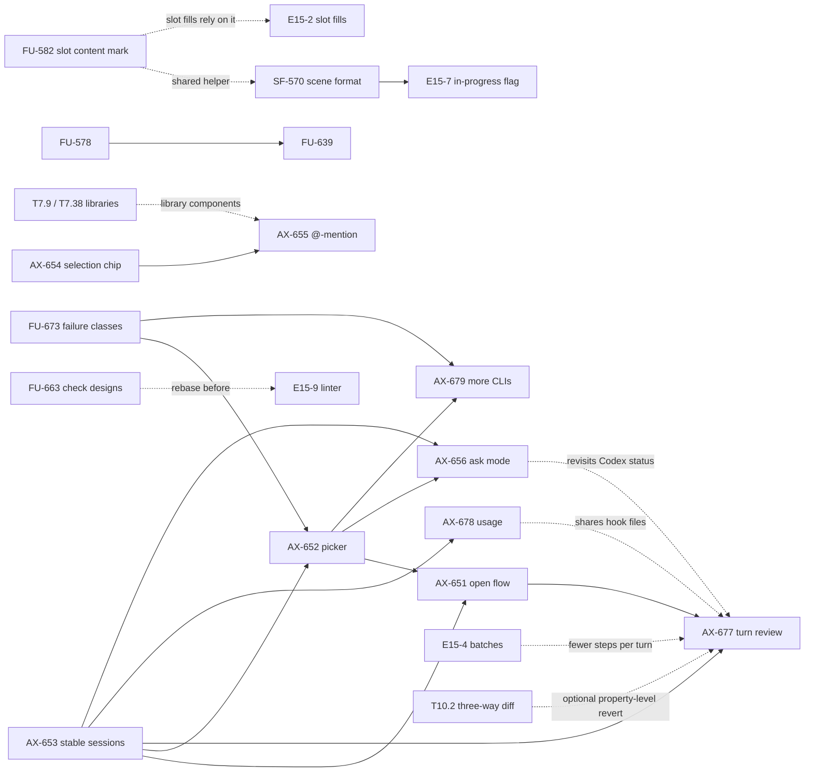

# v0.6 AI design: task specs, part 3 (follow-ups and agent terminal UX)

Part 3 completes the spec-ready gate for the 20 v0.6 issues that had no spec: the review follow-ups of the 0.4 and 0.5 packs, the JSON scene-format work
that E15-7 waits for, and the agent terminal UX items ruled for v0.6 on 2026-10-19. Parts 1 and 2 are in [README.md](README.md) (from #615, which is
not on `main` yet, so that link resolves once #615 merges) and its part-2 sibling from #641.

Code baseline of every part-3 spec: `origin/main@01d48f2` (0.5.0). Line numbers are fresh; where an issue cited a moved line the spec says so once.
Every spec follows the section layout of parts 1 and 2 (header table with "Touches", current state as FACT, behaviour rules, data model, contracts,
file-format mapping, UI in words, edge cases, non-goals, red-first test plan, performance budgets, dependencies, owner rulings). The agent UX specs and
two bug follow-ups end with **Open questions for the owner** (a recommended option first, with its reason); nothing in them is decided for the owner.

Ids: `FU` = follow-up bug or review item, `SF` = scene format, `AX` = agent terminal UX. The number is the issue number.

## Index

| Task | Issue | Title | Spec | Size |
|---|---|---|---|---|
| SF-570 | #570 | JSON scene format: importer and exporter at schema 2.21 with a version-migration chain | [570-json-scene-format-schema-2-21-migration-chain.md](570-json-scene-format-schema-2-21-migration-chain.md) | L |
| FU-578 | #578 | Codegen: a counter-axis Fill child in a hugging parent prints its solved length | [578-codegen-counter-fill-hugging-parent.md](578-codegen-counter-fill-hugging-parent.md) | S |
| FU-582 | #582 | Mark slot content from MCP, live patches and `.fig` import so a main-component sync keeps it | [582-slot-content-mark-for-mcp-live-patch-and-fig-import.md](582-slot-content-mark-for-mcp-live-patch-and-fig-import.md) | M |
| FU-583 | #583 | A headless direction change before the first solve leaves one stretch signal per child | [583-headless-direction-flip-single-stretch-signal.md](583-headless-direction-flip-single-stretch-signal.md) | S |
| FU-605 | #605 | React codegen: declare variant and property props on generated components | [605-react-codegen-declare-variant-and-property-props.md](605-react-codegen-declare-variant-and-property-props.md) | M |
| FU-639 | #639 | Codegen: a grid child with counter-axis Fill exports its solved size | [639-codegen-grid-child-counter-fill-solved-size.md](639-codegen-grid-child-counter-fill-solved-size.md) | S |
| FU-644 | #644 | Apply slot stretch on canvas drag, library drop and media placement into a slot | [644-slot-stretch-on-drag-library-drop-and-media-place.md](644-slot-stretch-on-drag-library-drop-and-media-place.md) | M |
| FU-645 | #645 | Migrate to slot: an unbound instance in one variant must not leave a set-level slot only one variant has | [645-migrate-to-slot-unbound-instance-in-a-variant-set.md](645-migrate-to-slot-unbound-instance-in-a-variant-set.md) | S |
| FU-663 | #663 | Check designs inside instances: scan cap, contrast suppression, bound-override fixture | [663-check-designs-in-instances-scan-cap-contrast-suppression-bound-override.md](663-check-designs-in-instances-scan-cap-contrast-suppression-bound-override.md) | M |
| FU-669 | #669 | Follow-ups from the v0.5 rollup integration review (five subsections) | [669-v050-rollup-review-followups.md](669-v050-rollup-review-followups.md) | M |
| FU-673 | #673 | Agent start failure: classify unknown-flag and not-logged-in from the output before "not installed" | [673-agent-start-failure-classify-output-before-not-installed.md](673-agent-start-failure-classify-output-before-not-installed.md) | S |
| AX-651 | #651 | Agent open flow: resume the last session for this file, or start a new one | [651-agent-open-flow-resume-or-new.md](651-agent-open-flow-resume-or-new.md) | M |
| AX-652 | #652 | New-session picker: installed CLIs first, with version and login state | [652-new-session-picker-installed-clis-version-login.md](652-new-session-picker-installed-clis-version-login.md) | M |
| AX-653 | #653 | Stable per-file agent sessions that survive a restart | [653-stable-per-file-agent-sessions.md](653-stable-per-file-agent-sessions.md) | L |
| AX-654 | #654 | Live selection chip in the Agents panel; click to send | [654-live-selection-chip-click-to-send.md](654-live-selection-chip-click-to-send.md) | M |
| AX-655 | #655 | @-mention picker in the agent composer | [655-at-mention-picker-in-the-agent-composer.md](655-at-mention-picker-in-the-agent-composer.md) | L |
| AX-656 | #656 | Agents settings: optional "ask" permission mode with in-panel approvals | [656-agents-ask-permission-mode-with-in-panel-approvals.md](656-agents-ask-permission-mode-with-in-panel-approvals.md) | L |
| AX-677 | #677 | Agent tabs: review each turn's canvas edits and keep or revert them as one step | [677-agent-turn-review-keep-or-revert.md](677-agent-turn-review-keep-or-revert.md) | L |
| AX-678 | #678 | Agent tabs: show each CLI tab's token and cost usage | [678-agent-tab-token-and-cost-usage.md](678-agent-tab-token-and-cost-usage.md) | M |
| AX-679 | #679 | Agents panel: offer more agent CLIs in the new-tab picker | [679-more-agent-clis-in-the-new-tab-picker.md](679-more-agent-clis-in-the-new-tab-picker.md) | L |

Sizes: S under about a day, M one to three days, L more than three days, for one worker with the specs' fixtures and gates.

## Dependencies on other v0.6 tasks and on each other

Task ids of part 1 are from the E15 graph in `README.md` (#615). External prerequisites outside the pack are unchanged.

- FU-578, FU-583, FU-605, FU-639, FU-645, FU-663, FU-669, FU-673 and SF-570 (its mechanism part) need no other part-3 or part-1 task.
- SF-570 finishes only when the coordinator hands over the step list and the 2.21 key shapes (its last section lists exactly what is missing). E15-7's scene-format test is gated on it, the rest of E15-7 is not.
- Owner rulings of 2026-10-19 (`plans/reports/release-060-evidence/owner-rulings-v06.md`, round 2) are applied as behaviour rules in FU-644, FU-645, FU-663, AX-651 and AX-652, and their questions are gone.
  AX-653, AX-654, AX-655, AX-656, AX-677, AX-678 and AX-679 still carry **Open questions for the owner** (collected in the PR body and in `plans/reports/release-060-evidence/specs-part3-report.md`); the owner is
  answering them one spec at a time, and a task becomes Ready only after its questions are answered. Behaviour tagged "pending Qn" in AX-656 is not built and not covered by a required test until then.
- Live checks that gate a task before it becomes Ready (not decided here, only recorded): Codex `resume --last` and agy `--continue` working-directory scoping (AX-653); the Codex signed-out output of
  `codex login status` (AX-652); Claude honouring a `permissions.allow` rule from a `--settings` file (AX-656, pending Q3); Gemini's `mcp add` argument parsing and project-settings path (AX-679).
- The recorded rulings that every agent UX spec respects: clicking Agent resumes the last session; skip-permissions stays the default and ask mode is optional (#656); the
  selection is a live chip sent only on click, never auto-injected (#654); Codex tabs keep the heuristic status for now and it is revisited with #656; `GROK_FOLDER_TRUST=0` stays.

## Waves

Parallel workers need disjoint file ownership (section "Touches" in each spec). The numbers follow part 1's waves, so part-3 wave N runs beside part-1 wave N once its own prerequisites have merged.

1. FU-578, FU-583, FU-605, FU-645, FU-663, FU-669, FU-673, FU-582, SF-570 (mechanism first), AX-653, AX-654.
   - Inside wave 1, `terminal.rs` is a queue: FU-673 first, then AX-653, then AX-654.
2. FU-639 (after FU-578), FU-644, AX-652 (after FU-673 and AX-653), AX-651 (with AX-652, one worker), AX-677 (after AX-651).
3. AX-655 (after AX-654), AX-656 (after AX-652), AX-678 (after AX-653), AX-679 (after AX-652 and FU-673).
   - SF-570's remaining hops land here at the latest, before E15-7's scene-format test runs.

## File-ownership hot spots

- **`crates/designos-app/src/terminal.rs` (5,729 lines) is the hot spot.** Part 1 already lists E15-7, E15-14, E15-16, RD-3, RD-4 and E5-10 as editing it; part 3 adds FU-673 and
  AX-651, 652, 653, 654, 655, 656, 677, 678, 679. Rules for all of them:
  - new logic goes into new modules named in each spec (`agent_sessions.rs`, `agent_open_flow.rs`, `agent_cli_catalog.rs`, `agent_picker.rs`, `agent_selection_chip.rs`, `agent_mention.rs`,
    `agent_permissions.rs`, `agent_turn_ledger.rs`, `agent_usage.rs`); `terminal.rs` gets call sites only;
  - the shared edit points are few: `AgentCliPreset` and its `match` sites (FU-673, AX-652, AX-679), `cli_launch_command` / `build_real_cli_command` (AX-653, AX-656, AX-679),
    `session_hooks_settings` and the per-CLI hook files (AX-656, AX-677, AX-678, E15-14), `provision_session_agent_files` (AX-653, AX-655, AX-679, RD-4, E15-16), `show_left` /
    `render_terminal_surface` (AX-651, AX-654, AX-656, AX-677, AX-678), `poll_live_agent_bridge` (AX-656, AX-677). Rebase on the previous merge rather than hand-merging these.
  - recommended merge order for the whole panel family: FU-673, AX-653, AX-651 with AX-652, AX-654, E15-7, AX-656, AX-677, AX-678, AX-655, AX-679, E15-16, RD-4, RD-3, E15-14, E5-10.
- `crates/designos-doc/src/live_patch/mod.rs`: E15-4 (`label`), E15-7 (`LiveOp::SetInProgress`), E15-14 (report payload) and RD-3 (`run_id`) each add a variant or field here; AX-677 no longer does (its turn marks live in their own `turn-marks.jsonl`, ordered by byte offset). Serialize the
  edits to this file; each adds one variant or field.
- `crates/designos-doc/src/components.rs`, `history.rs`, `live_patch/replay.rs`: FU-582 and FU-583 (both add a step to the new `designos-doc/src/writer_command.rs`, called from `Engine::exec` and the replay; `Command::apply` is not touched), FU-645; E15-14 adds
  `SetAutoFix` to `history.rs`. Hand-merge conflicts are not acceptable here: rebase.
- `crates/designos-fig`: `fig.rs`, `fig_export.rs`, `rest_import.rs` follow the existing hot-file rule (one at a time): FU-669.1 and 669.2, FU-582 (import pass) and part 1's E1-4 (queue position 22).
  SF-570 works in `pen.rs` and a new `pen/` folder that no other v0.6 task edits.
- `crates/designos-export`: `codegen.rs` (`sizes_along`) is shared by FU-578 then FU-639 (strictly in that order); `slots.rs`, `react.rs`, `tailwind.rs` by FU-605; part 1's T7.29 (HTML codegen)
  and T7.3 add new files but read CSS output that FU-578 and FU-639 change: rebase T7.29's goldens after them.
- `crates/designos-app/src/check_designs/`: FU-663 edits `mod.rs`, `contrast.rs`, `tests/`; part 1's E15-9 and E15-11 turn the module into a consumer of the new linter. Land FU-663 first or rebase.
- `crates/designos-app/src/comments/settings.rs` (the shared `settings.json` store): AX-656 and part 1's E15-14. Use the existing `load_flag` / `save_flag` pattern and add no second store.
- `crates/designos-mcp/src/engine.rs`: FU-582 touches `Engine::exec` only; E15-4 adds dispatch arms. No tool schema changes in part 3, so the T7.6 tool snapshot is not regenerated by it.
- `crates/designos-app/src/canvas/interact.rs` (FU-644) is large and shared: keep the change to the two call sites and the helper.

## More agent-panel issues without a spec yet

Fourteen further v0.6 issues were filed after the specs above were written and have **no spec yet**. They are listed here so the spec-ready gate knows they exist; none is written in this PR. Titles are from the
issues, all in milestone "v0.6 AI design". Several touch the same files as part 3 (`terminal.rs` above all), so their specs must name their place in the merge order of the hot-spot section.

| Issue | Title |
|---|---|
| #681 | Agents panel shows agent output that no agent produced (template on send, canned transcript, fake mic) |
| #682 | Show each agent on the canvas: a named cursor that moves to what it edits, and a flash on every write |
| #683 | Agent tabs: live turn status, a 'worked for' receipt per turn, and a notification when an agent finishes in the background |
| #684 | Stop an agent from the panel: interrupt the CLI, close its open edit batch as one undo step, and record that it was stopped |
| #685 | Cmd+Z and Shift+Cmd+Z undo document edits while an agent terminal has focus |
| #686 | Agent tabs: classify mid-session failures (rate limit, login expired, billing, server error, context full) and show the next action |
| #687 | Agents panel accessibility: announce finished, needs-input and error states, and label the panel regions |
| #688 | Agents panel empty state: sample prompts that send a real prompt, and attach hints |
| #689 | Agent composer: send into the tab's live CLI session, with prompt history and a draft per tab |
| #690 | Agent session files: per-window and per-session paths, cleanup on close, and no full-document JSON on the UI thread |
| #691 | Constraint pass: one shared solver that matches Figma for rotated children, rounding and sub-1 sizes (import and editor) |
| #693 | User edits inside a frame an agent is working on: show who is working there and offer Make a copy or Edit anyway |
| #695 | When an agent turn ends with changes off-screen, show an 'N changes -> Show' chip instead of moving the view |
| #696 | Scoped live canvas: carry variables and styles so var: and text_style resolve on large files |

Overlaps already visible from the titles, to resolve when they are specced: #683 with AX-656 (notifications) and AX-677 (turn receipts); #684 with AX-677 (revert and undo groups); #689 and #681 with the composer in AX-655;
#690 with AX-653 (session paths and cleanup); #693 with RD-3 (frame ownership) and E15-7.

## UI rules checked for part 3

Every UI section of an agent UX spec (AX-651, 652, 654, 655, 656, 677, 678) was checked against `design/principles.md` (P1 to P10) and `design/soul.md`, and where it named a value, against
`crates/designos-app/src/theme.rs`:

- **P1 single token authority.** Colours, spacing, insets, heights and radii are `theme.rs` constants. The panel's own `TERM_*` and `STATUS_*` constants (`terminal.rs:29-55`) are existing debt used for the
  terminal viewport and the tab status dots; part 3 does not extend them. `theme.rs` has no warning or info colour; a new one needs a token there and in `design/design.tokens.json` (AX-656 open question 6).
- **P2.** Selected and active rows use the neutral fill `BG_SELECTED`; the brand orange (`BG_BRAND`, dark label) is the view's one primary action; Selection Blue stays on the canvas; no purple.
- **P3.** Gaps are ladder constants (`SPACE_FACT` 4, `SPACE_ROW` 4, `SPACE_INLINE` 8, `SPACE_GROUP` 12, `SPACE_BLOCK` 16, `SPACE_SECTION` 24); insets are inset constants; control heights are `CONTROL_DENSE` 24,
  `CONTROL_STANDARD` 28, `CONTROL_TOOL` 32, `CONTROL_ROW` 40; pointer targets are at least `TARGET_MIN` 24. Earlier drafts that used 34, 56 or 20 px literals were replaced.
- **P4.** Hairlines are `BORDER` 1 px; floating chrome and in-panel cards use `RADIUS_FRAME` 14, controls `RADIUS_CONTROL` 6, pills `radius_full(height)`, inner shapes `theme::concentric`.
- **P5.** Type by role (`font_caption`, `font_body`, `font_body_medium`); numbers and counters in `font_mono`; counts in a separate pill (the Check designs count pill, `panels/check_designs.rs:186-196`), never inside a label.
  The owner-ruled chip text of AX-654 (`page · N selected · first names`) is kept as ruled.
- **P6, P7.** Nothing is drawn that is not real state; the panel stays terminal-first and per-file.

## Shared conventions used by part 3

- **CLI facts.** Every claim about an agent CLI's flags or behaviour names its source in the spec: the CLI's own `--help` or `--version` (run on 2026-10-19; captures in
  `plans/reports/release-060-evidence/cli-help-261019/`), the CLI's bundled documentation (Grok's user guide, version 1.0.62), or official web documentation (Claude Code hooks, permissions and
  status line pages). Claims that rest on files observed on disk, community pages or third-party mirrors are marked as such, and what could not be verified is under "Could not ground" in the spec.
- **Launch-string pin tests.** Each launch or resume string is checked against the flag sets in the captured help files, extending the #642 and #646 pin tests.
- **Idle and UI-thread invariants.** CLAUDE.md section 4 applies: no periodic repaint when idle, no `to_json` on the UI thread, subprocess calls and file tails run off the UI thread.
- **UI tasks.** Load es-designer first, follow `design/principles.md` (recap above) and `crates/designos-app/src/theme.rs`, pass `scripts/zero_fake_ui_gate.py`, capture at 1440 (responsive SKIPPED unless the owner asks),
  update the Figma frames from the verified captures before gates and CI.
- **Visual evidence.** Every PR carries a screenshot or terminal capture; owner-manual legs (live runs of real CLIs, the Playground pixel check in FU-669.5) are flagged and never claimed by an agent.
