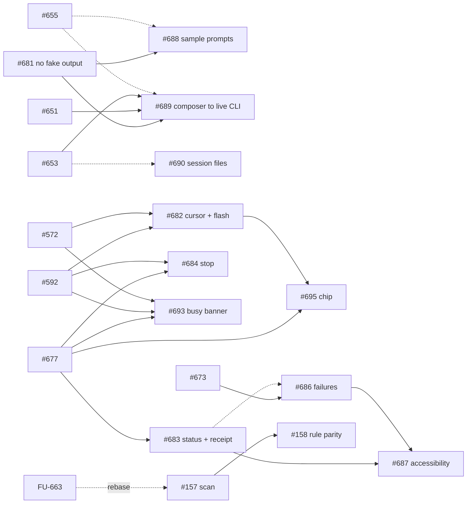

# v0.6 AI design: task specs, part 4 (agent terminal UX, constraint solver, import and Check designs follow-ups)

Part 4 completes the spec-ready gate for 17 more open v0.6 issues: the ten agent-terminal UX items ruled on 2026-10-19 that part 3 did not cover, the user-facing "agent output" bug, the shared constraint solver, and four follow-ups found by a coverage check (import budget, Check designs at scale and parity, scoped canvas tokens).
Parts 1 and 2 are in [README.md](README.md) (from #615, not on `main` yet, so that link resolves once #615 merges) and its part-2 sibling from #641. Part 3 is [README-part3.md](README-part3.md) (PR #694).

Code baseline of every part-4 spec: `origin/main@9f3f7a5` (`docs(readme): add the Unikorn daily rank badge (#680)`). Part 3 was written against `01d48f2`; where a part-3 line number moved, the part-4 spec cites the new one. Every spec follows the 13-section layout of parts 1 to 3 (header table with "Touches", current state as FACT with file and line, behaviour rules, data model, contracts, file-format mapping, UI in words, edge cases, non-goals, red-first test plan, performance budgets, dependencies, owner rulings), and ends with **Open questions for the owner** where a decision is the owner's.

Ids: `AX` = agent terminal UX, `CS` = constraint solver, `IM` = import, `CD` = Check designs, `LS` = live sync. The number is the issue number.

## Index

| Task | Issue | Title | Spec | Size |
|---|---|---|---|---|
| AX-681 | #681 | Agents panel shows agent output that no agent produced | [681-agents-panel-no-fake-agent-output.md](681-agents-panel-no-fake-agent-output.md) | M |
| AX-682 | #682 | Agent cursor and write flash on the canvas | [682-agent-cursor-and-write-flash-on-the-canvas.md](682-agent-cursor-and-write-flash-on-the-canvas.md) | L |
| AX-683 | #683 | Live turn status, "worked for" receipt, background notification | [683-agent-tab-live-status-turn-receipt-and-background-notification.md](683-agent-tab-live-status-turn-receipt-and-background-notification.md) | L |
| AX-684 | #684 | Stop an agent from the panel | [684-stop-an-agent-from-the-panel.md](684-stop-an-agent-from-the-panel.md) | M |
| AX-685 | #685 | Undo and redo the document while an agent terminal has focus | [685-undo-and-redo-the-document-while-an-agent-terminal-has-focus.md](685-undo-and-redo-the-document-while-an-agent-terminal-has-focus.md) | S |
| AX-686 | #686 | Classify mid-session failures and show the next action | [686-classify-mid-session-agent-failures-and-show-the-next-action.md](686-classify-mid-session-agent-failures-and-show-the-next-action.md) | M |
| AX-687 | #687 | Agents panel accessibility: announcements and labelled regions | [687-agents-panel-accessibility-announcements-and-labelled-regions.md](687-agents-panel-accessibility-announcements-and-labelled-regions.md) | M |
| AX-688 | #688 | Empty state: sample prompts and attach hints | [688-agents-panel-empty-state-sample-prompts-and-attach-hints.md](688-agents-panel-empty-state-sample-prompts-and-attach-hints.md) | S |
| AX-689 | #689 | Composer sends into the live CLI session, history, draft per tab | [689-agent-composer-send-into-the-live-cli-session.md](689-agent-composer-send-into-the-live-cli-session.md) | L |
| AX-690 | #690 | Session files: per-window paths, cleanup, off-UI-thread snapshot | [690-agent-session-files-per-session-paths-cleanup-and-off-ui-thread-snapshot.md](690-agent-session-files-per-session-paths-cleanup-and-off-ui-thread-snapshot.md) | M |
| CS-691 | #691 | Constraint pass: one shared solver matching Figma | [691-constraint-pass-one-shared-solver-matching-figma.md](691-constraint-pass-one-shared-solver-matching-figma.md) | L |
| AX-693 | #693 | Edits inside a frame an agent is working on: Make a copy or Edit anyway | [693-user-edits-inside-a-frame-an-agent-is-working-on.md](693-user-edits-inside-a-frame-an-agent-is-working-on.md) | M |
| AX-695 | #695 | Off-screen agent changes: "N changes" chip, never move the view | [695-off-screen-agent-changes-show-chip-instead-of-moving-the-view.md](695-off-screen-agent-changes-show-chip-instead-of-moving-the-view.md) | S |
| IM-5 | #5 | Import: global clone budget and remaining review backlog | [5-import-global-clone-budget-and-review-backlog.md](5-import-global-clone-budget-and-review-backlog.md) | L |
| CD-157 | #157 | Check designs: scan whole pages incrementally (E3-12) | [157-check-designs-scan-whole-pages-incrementally.md](157-check-designs-scan-whole-pages-incrementally.md) | M |
| CD-158 | #158 | Check designs: rule parity, thresholds, ignore (E3-13) | [158-check-designs-rule-parity-thresholds-and-ignore.md](158-check-designs-rule-parity-thresholds-and-ignore.md) | M |
| LS-696 | #696 | Scoped live canvas carries variables and styles | [696-scoped-live-canvas-carries-variables-and-styles.md](696-scoped-live-canvas-carries-variables-and-styles.md) | M |

Sizes: S under about a day, M one to three days, L more than three days, for one worker with the specs' fixtures and gates.

## Dependencies on other v0.6 tasks and on each other

Hard dependencies are listed first; "soft" means the task can start without it but cannot finish its last test or label.

| Task | Needs (hard) | Soft |
|---|---|---|
| #681 | #650 (merged) | |
| #682 | #592, #572 | #653, #683 |
| #683 | #677 | #651, #653, #647 (merged), #678 (shares the hook files) |
| #684 | #589, #592, #677 | #572, #683 |
| #685 | none | #589 (granularity text only) |
| #686 | #650 (merged), #673 | #683, #647 (merged) |
| #687 | #683, #686 | #654, #684, #689 |
| #688 | #681 | #652, #654, #655 |
| #689 | #651, #653, #681 | #655, #656 |
| #690 | none | #653 |
| #691 | none | |
| #693 | #592, #572, #677 | #682 |
| #695 | #677, #682 | |
| #5 | none | |
| #157 | #35 (merged) | FU-663 (rebase) |
| #158 | #157, the E3-d read | FU-663 (rebase) |
| #696 | none | #588, #670 (end-to-end test only) |

- #685, #691, #5 and #696 depend on no other v0.6 task and can start at once.
- #689 retires the one-shot composer path that part 3's #651 spec still mentions ("the chat-mode composer starts one-shot shell on first submit"); #651's implementer leaves that line out.
- #683 and part 3's #677 both mark turns. #677's `turn_mark` lines give the boundary; #683's `agent-events.jsonl` gives tool counts, step text and per-tab attribution. They do not duplicate each other (spec 683, contracts).
- The recorded rulings every agent UX spec respects (part 3): clicking Agent resumes the last session; skip-permissions stays the default and ask mode is optional (#656); the selection is a live chip sent only on click (#654); Codex tabs keep the heuristic status; `GROK_FOLDER_TRUST=0` stays. Part 4 adds the rulings of 2026-10-19 quoted in each issue: cursor size Small by default (#682), notification only when Studio is unfocused or the tab hidden (#683), banner with Make a copy and Edit anyway (#693), never move the view automatically (#695), variables and styles in the scoped canvas (#696).

## Waves

Parallel workers need disjoint file ownership (the "Touches" row of each spec). Waves 1 to 3 follow part 3's; wave 4 waits for part 1's RD-3.

1. #681, #685, #691, #696, #5, #690 (the part that removes global `/tmp` paths and adds the owner marker; the rest after #653).
2. #157 (after FU-663), #158 (after #157 and the E3-d read), #686 (after FU-673), #690 (cleanup and off-thread snapshot, after #653).
3. #683 (after #677), #684 (after #683, #589, #592), #689 (after #651, #653, #681, #655), #688 (after #681, #652, #655), #687 (last of the panel UI).
4. #682 (after #592 and #572), #693 (after #682, #677), #695 (after #682, #677).

## Merge order on `crates/designos-app/src/terminal.rs` (explicit, relative to part 3)

`terminal.rs` (5,729 lines on this commit) is shared with part 1 (E15-7, E15-14, E15-16, RD-3, RD-4, E5-10) and part 3 (FU-673, AX-651 to AX-656, AX-677 to AX-679). Part 3's README recommends: FU-673, AX-653, AX-651 with AX-652, AX-654, E15-7, AX-656, AX-677, AX-678, AX-655, AX-679, E15-16, RD-4, RD-3, E15-14, E5-10. The part-4 tasks that edit `terminal.rs` slot in as follows; rebase on the previous merge, never hand-merge.

1. **#681** (before FU-673: it rewrites `submit_chat_prompt` and the composer, which #651 and #689 touch next)
2. FU-673
3. AX-653
4. **#690** (after AX-653: it changes the folder rules that AX-653 rewrites; its global-path slice may go earlier, it is about ten lines)
5. AX-651 with AX-652
6. AX-654
7. E15-7 (#592)
8. AX-656
9. AX-677
10. AX-678
11. **#683**
12. **#684**
13. AX-655
14. **#689**
15. AX-679
16. **#686**
17. **#688**
18. **#687**
19. E15-16, then RD-4, then RD-3
20. **#682, #693, #695** (canvas-side; `terminal.rs` gets call sites only, and they need RD-3 and #677)
21. E15-14, then E5-10

Tasks of part 4 that do not edit `terminal.rs`: #685 (`shell.rs`), #691, #5, #157, #158, #696.

## File-ownership hot spots (part 4 additions)

New logic goes into new modules named in each spec (`agent_turn_status.rs`, `agent_notify.rs`, `agent_stop.rs`, `agent_session_failure.rs`, `agent_failure_redact.rs`, `agent_a11y.rs`, `agent_sample_prompts.rs`, `agent_composer.rs`, `agent_session_files.rs`, `agent_presence.rs`, `agent_busy_frames.rs`, `canvas/agent_overlay.rs`, `canvas/agent_banner.rs`, `canvas/agent_changes_chip.rs`, `check_designs/job.rs`, `check_designs/ignore.rs`, `layout_constraints.rs`); `terminal.rs` gets call sites only.

- `crates/designos-doc/src/live_patch/mod.rs` and `replay.rs`: #682 (`touched`), #696 (two `LiveOp` variants), part 3's #677 (`TurnMark`), part 1's E15-4, E15-7, E15-14, RD-3. Each adds one variant or field: serialize, rebase. #696 has no dependency and may go early.
- `crates/designos-doc/src/history.rs`: part 1's E15-14 (`SetAutoFix`), then #684 (`History::fold_since`), then #158 (`SetCheckIgnored`). #677 reads `peek_undo` only.
- `crates/designos-app/src/live_patch_apply.rs`: #677, then #682, #693, #695 (call sites).
- `crates/designos-fig/src/rest_import.rs` and `kiwi.rs` (hot files, `docs/releasing.md:21`): FU-669.1 and .2, FU-582, then #691, then #5, then part 1's E1-4. `kiwi.rs` also by #5 item 2.
- `crates/designos-app/src/check_designs/*`: FU-663, then #157, then #158; part 1's E15-9 and E15-11 after.
- `scripts/zero_fake_ui_gate.py` and `zero_fake_ui_gate_selftest.py`: #681 (adds `Z15`, updates `Z04`), #689 (rewrites `Z01` and `Z02`), #690 (adds `Z16`). Gate numbers follow merge order; renumber at rebase if the order changes.
- `crates/designos-app/src/theme.rs` and `design/design.tokens.json`: #683 (`INFO`, `SUCCESS`, `WARNING`) and #682 (agent colours). Whoever lands first adds the shared tokens; `design_os_self_evolve.py` checks parity.
- `crates/designos-app/Cargo.toml`: #688 and #686 read TOML data; the first to land adds `toml` as a direct dependency (it is in `Cargo.lock` already). `ureq` is already a dependency (used by #686).
- `crates/designos-app/src/comments/settings.rs`: #682 (`load_choice`), part 3's AX-656 and part 1's E15-14 (flags). One store, no second file.
- `crates/designos-mcp/src/server.rs`: #690 (`:53-61`), part 1's E15-5 and issue #43. `live_patch/record.rs`: #696.
- `crates/designos-app/src/shell.rs`: #685 (`handle_keys`), #687 (focus shortcut): small, independent.

## UI rules checked for part 4

Every UI section (#681, #682, #683, #684, #686, #687, #688, #689, #693, #695, #157, #158) was checked against `design/principles.md` (P1 to P10), `design/soul.md` and `crates/designos-app/src/theme.rs`; `ui ds context --dir .` was run (generation 28); its soul section equals `design/soul.md`, and token names come from `theme.rs` and `design/design.tokens.json`.

- Tokens: zinc surfaces (`BG`, `BG_SECONDARY`, `BG_TERTIARY`, `BORDER`); cyan `#06B6D4` only for components; orange `#E36323` (`BG_BRAND`) only for the one primary action of a view, with a dark label; `INFO` for running states; no purple.
- Sizes: control height 28 px (`CONTROL_STANDARD`), dense 24 px, pointer target at least `TARGET_MIN` 24 px; gaps are ladder constants; numbers in `font_mono`; counts in a separate pill, never inside a label (#695 asks the owner about its literal chip text).
- Existing debt: the panel's `TERM_*` and `STATUS_*` constants and many hex literals in `terminal.rs` (for example `:2800-2830`, `:2951-2953`, `:1980-2040`). Part 4 retires the literals in the blocks it rewrites and does not extend the debt. `theme.rs` has no `info`, `success` or `warning` constant; #683 adds them with the token file.
- Idle invariants (CLAUDE.md section 4): animation frames only while animating (#682, #683); viewport-only work never calls `app.changed()` or bumps `TileView::rev` (#682, #693 banner, #695); no UI-thread `to_json` (#690, #157).
- Every UI spec's test plan names es-designer before UI code, a desktop capture at 1440 in the PR, and "responsive: SKIPPED (owner default)". Figma is updated from the verified captures first.
- The shared visual reference (the agents-panel anatomy: session status dot, Stop, selection chip, collapsed tool rows, turn receipt, needs-input card, typed error, composer) is internal and is not copied into the repository. The specs describe the same layout in words: status dot and Stop in the header (#683, #684), the chip beside the file strip (part 3's #654), the receipt line under the last turn (#683), the typed error as a banner over the terminal (#686), the composer at the bottom (#689).

## Conflicts found between issues and code (each is stated in the spec's current-state section)

1. #681: the composer, the empty state and the chat thread exist only in chat mode; the default panel is the terminal view. The gate checks `Z01` and `Z04` bind to the code the issue removes. Tests always take the fake branch because of `cfg!(test)`.
2. #682: no `Replace` op exists; patches carry no agent or run id; `theme.rs` has no `info` colour; the fade-in has no known cheap render path (spike).
3. #683: hooks write one fixed word and never read the payload; the status file is shared by all tabs of a file and applied to the active tab only.
4. #684: Esc never cancels a Grok turn (its bundled guide); on Windows and Linux the terminal key map never forwards Ctrl keys (egui sets `command` equal to `ctrl`); "one undo step" conflicts with part 3's #677 rule 10.
5. #685: the issue says Ctrl+Z "stays the shell's suspend key"; the key map forwards no Ctrl+Z on any platform. The cited lines had moved.
6. #688: the cited lines (`terminal.rs:2604-2630`) are the file strip; the empty state is at `:2790-2940`. `designos-app` has no TOML dependency.
7. #689: the chat bubbles rely on printed markers that a live TUI does not print; `Z01` and `Z02` require the `-p`/`exec` path that acceptance criterion 4 forbids.
8. #690: the cited lines differ; the autosave does not work "the same way" the issue says (it saves synchronously; only the thumbnail is cloned and threaded); a `Document` clone is a full copy.
9. #691: the importer and the editor differ in more than the issue's table (group parents, baked geometry, zero extent). I re-derived the 30-degree example by hand: 175.13 by 44.27, matching the issue.
10. #693: the cited status line is at `shell.rs:1317-1320`; there is no busy-frame concept on `main`.
11. #695: `replace_live_document` calls `fit_all` (`live_patch_apply.rs:42`), which moves the view on a document switch; the soul bans counts inside labels, the issue's chip text embeds one.
12. #5: item 4 (NaN as `null`) is already fixed on `main` (`finite_json`, 0.4.1); the review report is not in the repository; `kiwi.rs` is a hot file.
13. #157: the title says "off the UI thread"; a worker needs a full copy of a 700,000-node page. The spec uses time slices and asks.
14. #158: depends on a reverse-engineering read that has no result on `main`.
15. #696: `var:` and `text_style` are not on `main`, and style and variable commands are refused in a live session today, so "merge back" needs two new log ops.
16. Spec-ready gate text: `docs/releasing.md` on `main` holds the hot-file rule (`:21`) but no "spec-ready" wording; the gate wording is in the task brief only.

## Follow-ups found and not done here

- Ctrl keys are not forwarded to the PTY on Windows and Linux (`terminal.rs:3724`).
- The command palette rows "Make an image" and the image-search button apply a template under labels that say otherwise (`cmdk.rs:146-152`, `:363`); #681 decides the wording with the owner.
- `terminal.rs` hex literals in the chat-mode panel (P1 debt).

## Open questions for the owner

Each has a recommended answer. None blocks the specs; the task that needs the answer starts after it.

1. **#681 wording of "Make design"** and **palette labels**: recommended "Design a first draft for the selected frame, or for this page if nothing is selected, using this file's variables and styles."; rename "Make an image" to "Insert example card (template)".
2. **#682 agent colours:** recommended amber, emerald, pink and one more warm neutral, as tokens; **size setting home:** recommended the Agents settings of #656; **fade-in:** if it needs a per-frame recompile, ship cursor and flash and file the fade as a render task.
3. **#683:** "layers changed" comes from Studio's own record: recommended accept; notification library: recommended one cross-platform crate on a worker thread, click-to-focus only where proven; running-dot colour: recommended `info` blue, as the brief says (the soul also names orange for "live state").
4. **#684:** a stopped turn folds into one undo step while finished turns keep single steps: recommended yes; the interrupt keys of Claude, Codex and Antigravity are ungrounded: recommended ship with Grok grounded and block "done" on one captured run per CLI.
5. **#685 Windows and Linux rule:** recommended agent tabs undo unless the CLI uses Ctrl+Z, shell tabs keep the key; file the Ctrl-forwarding bug separately.
6. **#686:** which status pages to read: recommended only those with a machine-readable incident list; "Wait and retry" sends "continue" after the reset time.
7. **#687 focus shortcut:** recommended `Cmd+Alt+J` (`Ctrl+Alt+J` elsewhere) if free; in terminal view it focuses the terminal.
8. **#688 and #689 where the conversation lives:** recommended the terminal is the conversation, the composer sits at the bottom of the terminal view in both modes, and the chat bubble thread is retired; sample-prompt wording: recommended the starter set in spec 688; history across restarts: not persisted in v0.6.
9. **#690:** if cloning a 24,000-node document is itself over budget, report and make the snapshot incremental as its own task; add the `owner.json` marker.
10. **#691:** accept the editor behaviour change (rotated children move, children may be thinner than 1 px); run spike S1 on group-like parents first.
11. **#693:** copy gap 40 px; "Make a copy" is the primary button.
12. **#695:** count inside its own pill within the chip; keep the fit on a document switch.
13. **#5:** approve the input-derived zero-size struct cap with the `1 << 24` bound; supply the review report path; set the clone budget from the kit measurement.
14. **#157:** time slices instead of a worker thread; a deterministic synthetic 723k fixture now.
15. **#158:** AAA presentation follows what the read finds (else a collapsed second group); one "Ignore" verb per finding; if Figma stores no ignore list in `.fig`, keep ours in `.designos` only.
16. **#696:** confirm the "replay guard from #670" is the by-id last-write-wins rule; accept last-write-wins at the variable level.
