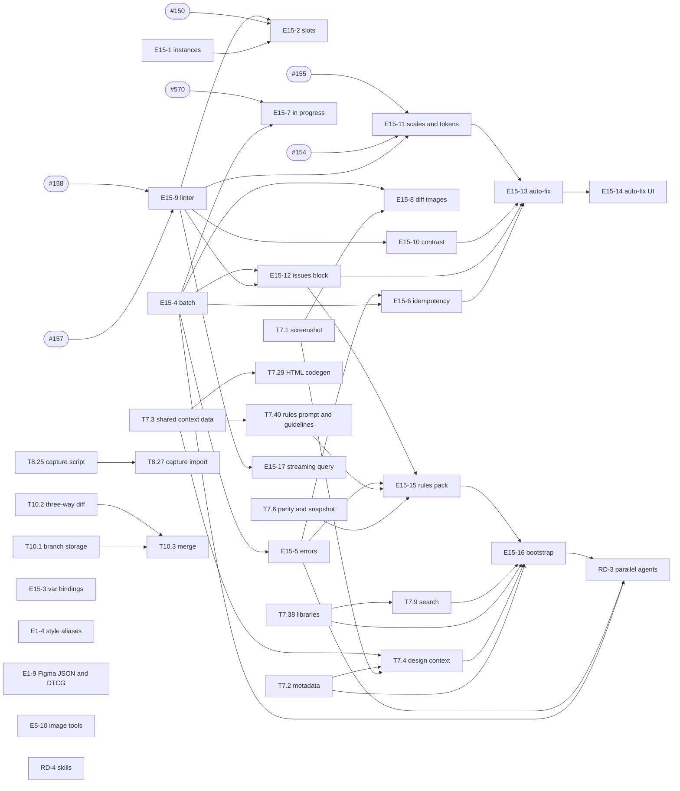

# v0.6 AI design — task specs

**Pack goal.** Make design:os the best place for an agent to design: agents get eyes (screenshots,
outlines, design context), grounding (real component instances, slots, variables and styles), a safe
write protocol (batched transactions, dry run, one undo group, named errors with corrected examples,
`safe_to_retry`, idempotency keys, in-progress flags, before/after diff images), an exact
solver-backed linter returned on every write with configurable engine auto-fix, generated rules and
first-turn context, and large-document queries — all through the user's own agent CLI, with parallel
agents hard-locked to their frames. Epic E15 (P0, owner ruling 2026-10-18), right after v0.5. Pack
title: `v0.6 AI design`; source of truth: `plans/261017-epics-full-scope/e15-tasks.json`.

Part 1 (this folder, E15-1 … E15-17 plus the 19 tasks pulled into the pack) is listed below. Part 2
(E15-18 … E15-48: styles, surfaces, eval, critique, variants, assets, code round trip, skills pack) is
written separately and gets its own rows in the second table.

## Index — part 1

| Task | Issue | Title | Spec |
|---|---|---|---|
| E15-1 | — | Place component instances and variants from apply_spec | [E15-1-apply-spec-instances.md](E15-1-apply-spec-instances.md) |
| E15-2 | — | Fill component slots from apply_spec, validated against recommended components | [E15-2-apply-spec-slot-fills.md](E15-2-apply-spec-slot-fills.md) |
| E15-3 | — | Bind fills, strokes, numbers and styles to variables (`var:` references) | [E15-3-apply-spec-variable-bindings.md](E15-3-apply-spec-variable-bindings.md) |
| E15-4 | — | Batched agent writes as one transaction: dry run, one undo group, name-to-id map | [E15-4-apply-batch-transactions.md](E15-4-apply-batch-transactions.md) |
| E15-5 | — | Named MCP errors, corrected examples, `safe_to_retry`, structured output | [E15-5-named-errors-structured-output.md](E15-5-named-errors-structured-output.md) |
| E15-6 | — | Deduplicate replayed writes with idempotency keys | [E15-6-idempotency-keys.md](E15-6-idempotency-keys.md) |
| E15-7 | — | Flag frames as in progress while an agent works | [E15-7-in-progress-flag.md](E15-7-in-progress-flag.md) |
| E15-8 | — | Before/after diff images for the touched region | [E15-8-before-after-diff-images.md](E15-8-before-after-diff-images.md) |
| E15-9 | — | One solver-backed geometric linter | [E15-9-unified-geometric-linter.md](E15-9-unified-geometric-linter.md) |
| E15-10 | — | WCAG contrast against the resolved backdrop | [E15-10-wcag-contrast-resolved-backdrop.md](E15-10-wcag-contrast-resolved-backdrop.md) |
| E15-11 | — | Spacing scale, type scale and token-match lint | [E15-11-spacing-type-scale-token-lint.md](E15-11-spacing-type-scale-token-lint.md) |
| E15-12 | — | Lint issues block on every mutating MCP call | [E15-12-per-call-issues-block.md](E15-12-per-call-issues-block.md) |
| E15-13 | — | Engine auto-fix of safe mechanical findings with a diff report | [E15-13-engine-auto-fix.md](E15-13-engine-auto-fix.md) |
| E15-14 | — | Configure auto-fix and review its report in Studio | [E15-14-auto-fix-settings-and-report-ui.md](E15-14-auto-fix-settings-and-report-ui.md) |
| E15-15 | — | Generated design-agent rules pack with a build-verify-fix workflow | [E15-15-generated-rules-pack.md](E15-15-generated-rules-pack.md) |
| E15-16 | — | Prefetch design context on an agent's first turn | [E15-16-first-turn-bootstrap.md](E15-16-first-turn-bootstrap.md) |
| E15-17 | — | Streaming large-document query: paging, node budget, compact rows | [E15-17-streaming-large-document-query.md](E15-17-streaming-large-document-query.md) |
| RD-3 | #572 | Parallel designer agents with enforced frame ownership | [RD-3-parallel-agents-frame-ownership.md](RD-3-parallel-agents-frame-ownership.md) |
| RD-4 | #573 | Attach skills (bundled and user SKILL.md) to agent runs | [RD-4-skills-attachments.md](RD-4-skills-attachments.md) |
| T7.1 | #238 | `designos_get_screenshot` (region, long-edge cap) | [T7.1-get-screenshot.md](T7.1-get-screenshot.md) |
| T7.2 | #239 | `designos_get_metadata` sparse XML (bounds, in-progress, issue counts) | [T7.2-get-metadata.md](T7.2-get-metadata.md) |
| T7.3 | #240 | Design-context data shared in designos-export | [T7.3-shared-design-context-data.md](T7.3-shared-design-context-data.md) |
| T7.4 | #241 | `designos_get_design_context`: code, hints, screenshot | [T7.4-get-design-context.md](T7.4-get-design-context.md) |
| T7.6 | #243 | MCP parity matrix and tool-list snapshot | [T7.6-mcp-parity-matrix.md](T7.6-mcp-parity-matrix.md) |
| T7.9 | #272 | `designos_search_design_system` with instance-ready results | [T7.9-search-design-system.md](T7.9-search-design-system.md) |
| T7.29 | #250 | HTML codegen target | [T7.29-html-codegen.md](T7.29-html-codegen.md) |
| T7.38 | #247 | `designos_get_libraries` | [T7.38-get-libraries.md](T7.38-get-libraries.md) |
| T7.40 | #248 | `create_design_system_rules` prompt and `designos_get_guidelines` | [T7.40-design-system-rules-prompt.md](T7.40-design-system-rules-prompt.md) |
| E1-4 | #131 | Colour, effect and text styles hold variable aliases | [E1-4-styles-hold-variable-aliases.md](E1-4-styles-hold-variable-aliases.md) |
| E1-9 | #138 | Variables as Figma JSON and W3C DTCG tokens | [E1-9-variables-figma-json-dtcg.md](E1-9-variables-figma-json-dtcg.md) |
| T10.1 | #343 | Branch metadata and branch copies inside a file | [T10.1-branch-storage.md](T10.1-branch-storage.md) |
| T10.2 | #344 | Three-way diff engine | [T10.2-three-way-diff.md](T10.2-three-way-diff.md) |
| T10.3 | #345 | Merge with ID remap and per-layer conflict resolution | [T10.3-branch-merge.md](T10.3-branch-merge.md) |
| T8.25 | #276 | Web capture script (styles, boxes, text runs, images, CSS vars, component hints) | [T8.25-web-capture-script.md](T8.25-web-capture-script.md) |
| T8.27 | #277 | Import web captures as auto layout with editable text | [T8.27-web-capture-import.md](T8.27-web-capture-import.md) |
| E5-10 | #177 | AI image tools through the agent CLI | [E5-10-agent-cli-image-tools.md](E5-10-agent-cli-image-tools.md) |

E15 issue numbers are added when the issues are filed.

## Index — part 2 (to be written)

| Task | Issue | Title | Spec |
|---|---|---|---|
| E15-18 … E15-48 | — | Styles and archetypes, preset gallery, surface guides and templates, eval harness and suites, critique, repair, variants, assets, code-token round trip, verified codegen, skills pack, image fills in NodeSpec | — |

## Build order

External prerequisites (outside this pack): #150 (E3-7 recommended slot components), #154 (E3-10
number variables in Check designs), #155 (E3-11 library suggestions), #157 (E3-12 off-thread scanner),
#158 (E3-13 rule set and ignore), #570 (JSON scene format schema 2.21).

Waves (each wave can run in parallel once the previous one and the external prerequisites have
merged; parallel workers need disjoint file ownership, noted per spec under "Touches"):

1. E15-1, E15-3, E15-4, T7.1, T7.2, T7.3, T7.6, T7.38, T8.25, T10.1, T10.2, E1-4 (hot-file queue
   position 22), E1-9, E5-10, RD-4.
2. E15-2, E15-5, E15-7, E15-8, E15-9, T7.4, T7.9, T7.29, T7.40, T8.27, T10.3. Order inside the wave:
   E15-9 merges before E15-2, because E15-2's PR appends `slot-non-recommended` to E15-9's `agent`
   preset and extends its `presets_name_only_registered_rules` test.
3. E15-6, E15-10, E15-11, E15-12, E15-17.
4. E15-13, E15-15.
5. E15-14, E15-16.
6. RD-3.

File-ownership hot spots: `crates/designos-mcp/src/engine.rs` (dispatch arms only; every new tool lives
in `crates/designos-mcp/src/tools/`), `crates/designos-doc/src/spec.rs` (E15-1/2/3/5 — serialize these
four), the tool snapshot (T7.6; every new tool regenerates it — rebase and regenerate rather than
hand-merge), `crates/designos-app/src/terminal.rs` (E15-7, E15-14, E15-16, RD-3, RD-4, E5-10 — serialize
or split into new modules first).

## Shared conventions (defined once, referenced by the specs)

- **Error envelope, catalogue, `safe_to_retry`, `outputSchema`:** E15-5.
- **Batch ops, references (`@as/path`), `touched_roots`, `name_to_id`, undo labels:** E15-4.
- **Issues block and session options (`designos_configure_session`):** E15-12; auto-fix options and
  report: E15-13.
- **Rule registry, presets, findings, ignore list, `LintEnv`:** E15-9.
- **Leases and authorship (`plugin_data["designos:run"]`):** RD-3.
- **Images:** T7.1 `render_target` (default scale 0.5, long edge 1024, named `IMAGE_TOO_LARGE`).
- **Tool list truth:** T7.6 snapshot and generated doc blocks; regenerate with the generator, never by
  hand.
- **Legacy lint/XPath module:** the 17-rule linter, `lint_fix_document` and the XPath engine live in one
  legacy compatibility module in `crates/designos-doc/src/`; specs cite it by function name and line.
- **Large fixture:** "the large fixture" means the benchmark scale of 723,136 Kiwi records / 112,474
  scene nodes (7-page subset; 1,082,324 scene nodes in the full file). CI and every automated test use a
  deterministic synthetic generator of that size and depth profile (pattern:
  `crates/designos-gpu/tests/large_file_perf.rs`, 50,041-node builder, scaled up; replaced by part-2
  E15-24 when it lands). The real benchmark file is used only for local, manual perf recording, is never
  committed, and is never used by the eval (owner ruling: the eval never uses client files).
- **Performance invariants:** CLAUDE.md §4 applies to every task: no `to_json` on the UI thread or in
  hashing, no viewport-driven revision bumps, no periodic idle repaints, GPU interactive guards
  untouched; heavy work (lint scans, diffs, bootstrap, imports) runs off the UI thread.
- **UI tasks:** load es-designer first, follow `design/principles.md` and
  `crates/designos-app/src/theme.rs`, pass `scripts/zero_fake_ui_gate.py`; desktop capture at 1440 in
  the PR, responsive SKIPPED unless the owner asks.
- **Visual evidence:** every PR carries a screenshot or terminal capture.

## Owner rulings that apply across the pack

- Auto-fix applies safe mechanical fixes that leave the rendered result unchanged, with a diff report, and is configurable (on, report-only, off).
- All AI goes through the user's agent CLI; no bundled model (R4.13).
- Parallel agents are hard-locked to their frames (RD-3).
- The eval never uses client files.
- Full scope, never MVP; packs only order the work.

## Owner answers (2026-10-18)
- **Q1, branch storage:** branches live **in the library next to the file**: `FileEntry.branches` plus `branches/<file-id>/`. The switcher shows them inside the file. They are not embedded in the `.designos` file. The T10.1–T10.3 specs stand as written.
- **Q2, MCP limits:** raise them to **1,200,000 layers** (`validate_document`) and **512 MiB** (imports). The other safety limits, such as deadlines and memory, stay. E15-17 stands as written.
- **Q6, auto-fix tiers:** "missing text fill" and "absolute child inside auto layout" visibly change the design, so they move to the **suggest tier**: reported with a Fix action, never auto-applied. Automatic fixes are only those that leave the rendered result unchanged, so `off-scale` snaps (they change spacing) are suggest-only too, and the safe tier is `sizing-conflict` and exact `hardcoded-value` binds. See the E15-13 note at the end of that spec.
- **Q3, coordinator:** the E15-7 task text is corrected; critique is E15-34, not E15-23.
- **Q5, coordinator:** `TOPIC_NOT_AVAILABLE` is accepted until part 2 (E15-18 and E15-21) lands in the same pack.
