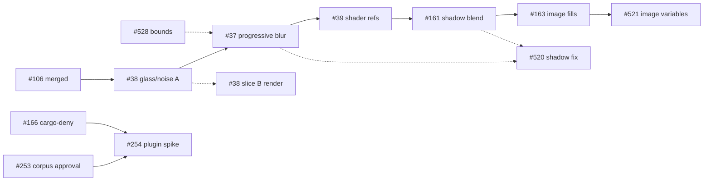

# v0.7 Effects & Export: task specs, part 2 (effects, image fills, plugin runtime, export bounds)

Part 2 completes the spec-ready gate for the 10 reverse-engineering-backed issues of pack v0.7 "Effects & Export": progressive blur, glass and noise parity, custom shader references, blend modes on shadows, image fill adjustments and crop, the plugin corpus and runtime spike, the shadow and image-fill differences found on kit frames, and the export bounds.
Part 1 owns [README.md](README.md) (from its own PR, not on `main` yet, so that link resolves once part 1 merges). This file does not replace it and does not edit it.

Code baseline of every part-2 spec: `origin/main@0e8a9a5` (`docs(specs): v0.6 task specs, part 4 (agent terminal UX and constraint solver) (#697)`). Every spec follows the 13-section layout of the v0.6 specs (header table with "Touches", current state as FACT with file and line, behaviour rules, data model, contracts, file-format mapping, UI in words, edge cases, non-goals, red-first test plan, performance budgets, dependencies, owner rulings) and ends with **Open questions for the owner**, recommended answer first.

Evidence labels: FACT (observed in the repository or through the GitHub API in this work), INFERENCE (derived, with the rule that makes it so), UNKNOWN (with its closing check). Reverse-engineering facts are cited as "REA 2026-10-19" with the source named in each spec (Figma fullscreen wasm shader source, plugin typings 1.142.0, the kiwi schema in `crates/designos-fig/src/figma_schema.txt`). Formulas are written in the specs' own words; no Figma code or shader text is reproduced anywhere in this folder. Each UNKNOWN closes through a flagged owner-manual step (a live Figma read, a kit scan, or an owner approval) that an agent never claims.

## Index

| Task | Issue | Title | Spec | Size |
|---|---|---|---|---|
| FX-38 | #38 | Glass splay and bevel, noise and texture X/Y size and type rules | [38-glass-splay-bevel-noise-xy-size-and-texture-parity.md](38-glass-splay-bevel-noise-xy-size-and-texture-parity.md) | L |
| FX-37 | #37 | Progressive blur (model, CPU and GPU render, `.fig` round trip) | [37-progressive-blur-model-render-and-fig-round-trip.md](37-progressive-blur-model-render-and-fig-round-trip.md) | L |
| FX-39 | #39 | Preserve custom shader effect and paint references | [39-preserve-custom-shader-effect-and-paint-refs.md](39-preserve-custom-shader-effect-and-paint-refs.md) | M |
| FX-161 | #161 | Blend modes on drop and inner shadows | [161-blend-modes-on-drop-and-inner-shadows.md](161-blend-modes-on-drop-and-inner-shadows.md) | M |
| FX-163 | #163 | Image fill adjustments, rotation, tile scale and crop | [163-image-fill-adjustments-rotation-tile-scale-and-crop.md](163-image-fill-adjustments-rotation-tile-scale-and-crop.md) | L |
| FX-521 | #521 | Image fills: image variables by mode, crop verification | [521-image-fills-variable-mode-image-and-crop-transform.md](521-image-fills-variable-mode-image-and-crop-transform.md) | M |
| FX-520 | #520 | Shadows and layer effects on shadowed device mockups | [520-shadows-and-layer-effects-differ-from-figma-on-device-mockups.md](520-shadows-and-layer-effects-differ-from-figma-on-device-mockups.md) | M |
| EX-528 | #528 | Export bounds match Figma's per-side rule | [528-export-bounds-match-figma-per-side-rule.md](528-export-bounds-match-figma-per-side-rule.md) | M |
| PL-253 | #253 | The 8-plugin compatibility corpus and its approval | [253-plugin-compatibility-corpus-of-eight-plugins.md](253-plugin-compatibility-corpus-of-eight-plugins.md) | S |
| PL-254 | #254 | Plugin runtime spike (QuickJS worker) and design doc | [254-plugin-runtime-spike-quickjs-worker-and-design-doc.md](254-plugin-runtime-spike-quickjs-worker-and-design-doc.md) | M |

Sizes: S under about a day, M one to three days, L more than three days, for one worker with the specs' fixtures and gates. #161 is raised from the issue's S to M and #520 and #528 are M because their diagnosis and fixes are separate steps.

## Dependencies

"Hard" blocks starting; "soft" blocks only the last test or label.

| Task | Needs (hard) | Soft |
|---|---|---|
| #38 | #106 (merged); hot-file queue position 16 | the live read for slice B numbers |
| #37 | #38 (queue 17 to 18) | #528 for its bounds line; the live read for the radius mapping |
| #39 | #37 (queue 19) | a Figma file with a real shader |
| #161 | #39 (queue 20) | the live read for the isolated-layer case |
| #163 | #161 (queue 21) | the live read for the three numeric holes of the adjustment pipeline |
| #521 | #163 (queue 22) | the kit scan (decides whether the variable slice is needed) |
| #520 | none for tests; the fix needs the owner-manual read | #37 and #161 (same render functions) |
| #528 | none for causes 1 to 3 | the per-descendant read (cause 5) and the calibration (rounding) |
| #253 | none | owner approval (the record stays "Proposed" until then) |
| #254 | #253 approval, #166 (`cargo-deny`) | the live read for limits and globals |

## Hot-file merge order (explicit)

`fig.rs`, `fig_export.rs`, `rest_import.rs`, `kiwi.rs` and `engine.rs` run one task at a time (`docs/releasing.md:21` names `fig.rs`, `kiwi.rs` and `rest_import.rs`; `fig_export.rs` and `engine.rs` come from the pack's hot-file list). All six effect and image tasks also edit `crates/designos-doc/src/paint.rs` and construct the same enums in 38 to 51 files (51 for the shadow variants, 38 for `PaintKind::Image`), so they are serialised too. Order, which follows the queue positions printed in the issues (#38 position 17, #37 18, #39 19, #161 20, #163 21) and adds #521 at 22:

1. **#38** slice A (queue 17): `convert_effect`, `parse_effect`, `encode_effect` (glass, noise and texture fields), `paint.rs` model.
2. **#37** (18): the same three functions (blur fields), `paint.rs`.
3. **#39** (19): `convert_effect`, `convert_paint`, `parse_effect`, `parse_paint`, `encode_effect`, `encode_paint`, `paint.rs` (two new variants).
4. **#161** (20): shadow `blendMode` in the same functions, `export.rs`, `paint.rs`, and the one test literal in `designos-mcp/src/engine.rs:901`.
5. **#163** (21): `convert_paint`, `parse_paint`, `encode_paint`, `paint.rs` (`ImageParams`).
6. **#521** (22): `bound_variables` in `fig.rs`, the variable export in `fig_export.rs`, `variables.rs` in `designos-fig` and `designos-doc`.

- `kiwi.rs`: no part-2 task changes it (the encoder is schema driven; #39 only calls `Schema::field_from_json`). If #39's byte-equality test needs a change there, it becomes its own queue entry at that moment.
- `engine.rs`: only #161 (one test literal).
- Each task rebases on the previous merge and never hand-merges. Each of #161, #37, #38, #39, #163 and #521 lands its enum or field change as a mechanical first commit (every construction site and pattern updated, no behaviour change), then the behaviour commits; the mechanical commit of a task may be pushed early but is itself merged in the order above.
- Non-hot files shared by several tasks, in the same order: `designos-doc/src/paint.rs`, `designos-doc/src/variables.rs` (#521 only), `designos-app/src/panels/effects.rs` (#38, #37, #39, #161), `designos-app/src/widgets/picker.rs` (#161 extracts the blend dropdown, then #163 adds the image section rows).
- Render files, outside the hot queue but ordered because the functions overlap: `designos-render/src/effects.rs` and `designos-gpu/src/compile.rs`: #37, then #161, then #520's fix; `fx.rs` and the GPU glass and noise code: #38 slice B after #37; `designos-render/src/paint.rs`, `designos-gpu/src/paintconv.rs`, `draw.wgsl`: #163.
- Export: `designos-export/src/bounds.rs`: #528 first, then #37's single arm.

## Waves

1. At once, no hot file: #528 (causes 1 to 3), #253 (proposal, record, fixtures), #520's diagnosis (the owner-manual read), #38 slice A when the queue reaches it.
2. In queue order: #37, #39; #254 after #166 and the #253 approval.
3. In queue order: #161, #163, then #521. Beside them: #520's fix (after the read), #528's rounding (after the calibration), #38 slice B (after the read), #37's bounds arm (after #528).

## Owner-manual live reads (one session closes most UNKNOWNs)

Nothing here is done by an agent; each spec lists its own steps. Estimated effort with a scratch Figma file and the kit:

| For | Step | About |
|---|---|---|
| #37 | hard edge at blur radius 10, 20, 40; progressive defaults and labels; two layer blurs | 30 min |
| #38 | Glass, three Noise types, Texture: plugin values, `.fig` values, panel screenshots | 20 min |
| #39 | what Figma draws for a missing shader | 10 min |
| #161 | PASS_THROUGH on a shadow; shadow blend inside a 50% opacity frame | 10 min |
| #163 | gray-ramp exports per adjustment; rotation unit and direction; crop outside rule; contrast scale | 45 min |
| #520 | two fixture frames, three pixels | 10 min |
| #521 | kit scan of 8 frames and the contact-map read | 15 min |
| #528 | per-descendant bounds of 10 frames; calibration rectangles (needs the owner's approval to write nodes) | about 2 h |
| #254 | timeout, memory ceiling, `typeof` probes in three throwaway plugins | 20 min |
| #253 | approval through `AskUserQuestion` | 5 min |

## UI rules checked for part 2

The UI sections of #37, #38, #39, #161, #163 and #521 were checked against `design/principles.md` (P1 to P10) and `design/soul.md`; `ui ds context --dir .` was run (generation 28); its soul section equals `design/soul.md`, and token names come from the principles, the soul and `crates/designos-app/src/theme.rs` as named there.

- Tokens: zinc surfaces; orange only for the one primary action and live state; no purple; no new colour, size or radius literal (existing literals in the effect and picker panels stay as debt, not extended).
- Sizes: controls at `CONTROL_STANDARD` 28 px, segmented strips 24 px, pointer targets at least `TARGET_MIN` 24 px; numbers in `font_mono`; units as suffixes; no count inside a label.
- Zero Fake UI (P6): every new row edits real state; the "Shader (not rendered)" text of #39 is status, not a control, and the disabled "Shader / Soon" menu entry (`panels/effects.rs:138`) is unchanged; image variable cells in #521 are read-only text; no control is added without an effect.
- The popovers have fixed row counts (`effect_rows`, `panels/effects.rs:304-318`) and a fixed-width picker (`widgets/picker.rs`); the specs grow them vertically only.
- Idle invariants (CLAUDE.md section 4): no frame requests while idle, no `app.changed()` from viewport work, no UI-thread `to_json`, GPU programs capped at 64 with the refine VRAM budget.
- Every UI spec names es-designer before UI code, a desktop capture at 1440 in the PR, "responsive: SKIPPED (owner default)", and updating Figma from the verified capture first.

## Conflicts found between issues and code (each is stated in the spec's current-state section)

1. #37: the issue says the offset units are unverified; the plugin typings fix them as normalized. The issue's lines `convert_effect fig.rs:1849` and `encode_effect fig_export.rs:1640` are now `fig.rs:2525` and `fig_export.rs:1887`. A progressive blur imported today silently becomes a uniform blur at the end radius.
2. #38: "Map GRAIN to Texture on import" is already done; `noiseSize` keeps only X on import (Y is lost); the issue's `paint.rs:328` is now `:356` and `:369`; the `depth` doc comment calls the refraction radius a bevel depth.
3. #39: the amendment says X1 typed passthrough may land first; #174 landed but covers node-level fields only, so effect and paint shaders still vanish at `rest_import.rs:157` and `fig.rs:2520`.
4. #161: the body says "Pack: v0.6"; the milestone is v0.7. The REST exporter writes the constant `NORMAL` for shadows (`export.rs:94`). 51 files construct or match the shadow variants.
5. #163: the body says "Pack: v0.6" and cites `paint.rs:207-210` (now `:208-212`); the GPU instance already carries a full matrix for images but only its diagonal is used.
6. #520: the cited `lib.rs:507-587` and `compile.rs:998-1050` are from 0.3.0; now `lib.rs:513-591` and `compile.rs:1134-1189`. No Figma ground truth exists yet.
7. #521: the crop sub-pattern is #163's model and render; the variable-mode sub-pattern needs a new `VariableKind` (32 non-test sites mention `VariableKind::Boolean`). `paintVar` has no home.
8. #528: the acceptance case "100 x 40 rectangle, shadow (0, 4), blur 8" already passes today (116 x 56), so it only guards; Figma's value for it is unmeasured. The 10 frames cannot all be fixed from code: causes 1 to 3 explain about four, cause 5 is unknown.
9. #253: the issue says "plans/ corpus record"; the record needs vendored manifests and a licence notice for a real test. Six of the eight plugins ship sources only (a build is needed), `themer` keeps its manifest in `public/`, and three of the eight come from one repository.
10. #254: its dependencies name #166, which is open and has no `deny.toml` on `main`; the issue bodies of #253, #254 and #166 say "Pack: v0.7 Agent design context" while the milestone is "v0.7 Effects & Export". The fixture plugin ships `code.ts` only.
11. Import report: `import_fig` returns a `Document` only (`fig.rs:206`) and `export_fig` returns bytes only (`fig_export.rs:115`); there is no report or warnings channel on `main`. v0.6's #5 adds `ImportReport`; #37, #38 and #521 add `dropped_variable_bindings` to it, created by whichever starts first if #5 has not landed.
12. #521 has no queue position in its issue; part 2 proposes 22.

## Follow-ups found and not done here

- Fills of paint type NOISE and PATTERN are dropped on import (`fig.rs:2520`).
- Paint-valued and gradient variables (`paintVar`, `gradientVar`), and numeric effect variable bindings (`radiusVar` and the rest) are not read.
- Canvas handles for the progressive-blur ramp and for crop editing.
- SVG and PDF export of image adjustments, rotation, tile scale and crop; the non-rectangular glass variant.
- A warnings channel for `.fig` and SVG export.

## Open questions for the owner

Each has a recommended answer; none blocks writing the specs; the task that needs the answer starts after it. The owner-manual reads above are the same kind of decision and are listed in each spec.

1. **Live Figma session** for the table above. Recommended: one session of about four and a half hours with a scratch file; it closes most of the UNKNOWNs the specs list.
2. **#38 slice split**: model, round trip and labels first, render parity after the read. Recommended: yes.
3. **#37 kernel**: answered 2026-10-19. Every blur and shadow moves to the tent kernel (owner ruling).
4. **#39**: carry the whole shader message verbatim; an old Studio cannot read a file with a shader. Recommended: yes, and say so in the release notes.
5. **#161** size M and PASS_THROUGH kept verbatim. Recommended: yes.
6. **#163** crop editing and SVG export of adjustments as follow-ups; contrast slider shows the stored value times 100 until the read. Recommended: yes.
7. **#521** separate from #163; image variables read-only in the panel. Recommended: yes.
8. **#520** run the two-frame read before any renderer change. Recommended: yes.
9. **#528** approve the calibration rectangles (a dozen nodes in a scratch Figma file); largest-side stroke weight on every side. Recommended: yes and yes.
10. **#253** answered 2026-10-19: approved. (Original question: approve the 8 plugins; count the three same-repository plugins as three; vendor built plugin output once. Recommended: yes, yes, yes.)
11. **#254** in-process engine answered 2026-10-19 (worker thread). Still open: spike limits 64 MiB, 1 MiB, 5 s, 60 s. Recommended: yes.
12. **Import report**: let the first of #37, #38, #521 create `ImportReport` in #5's shape if #5 has not landed. Recommended: yes.
