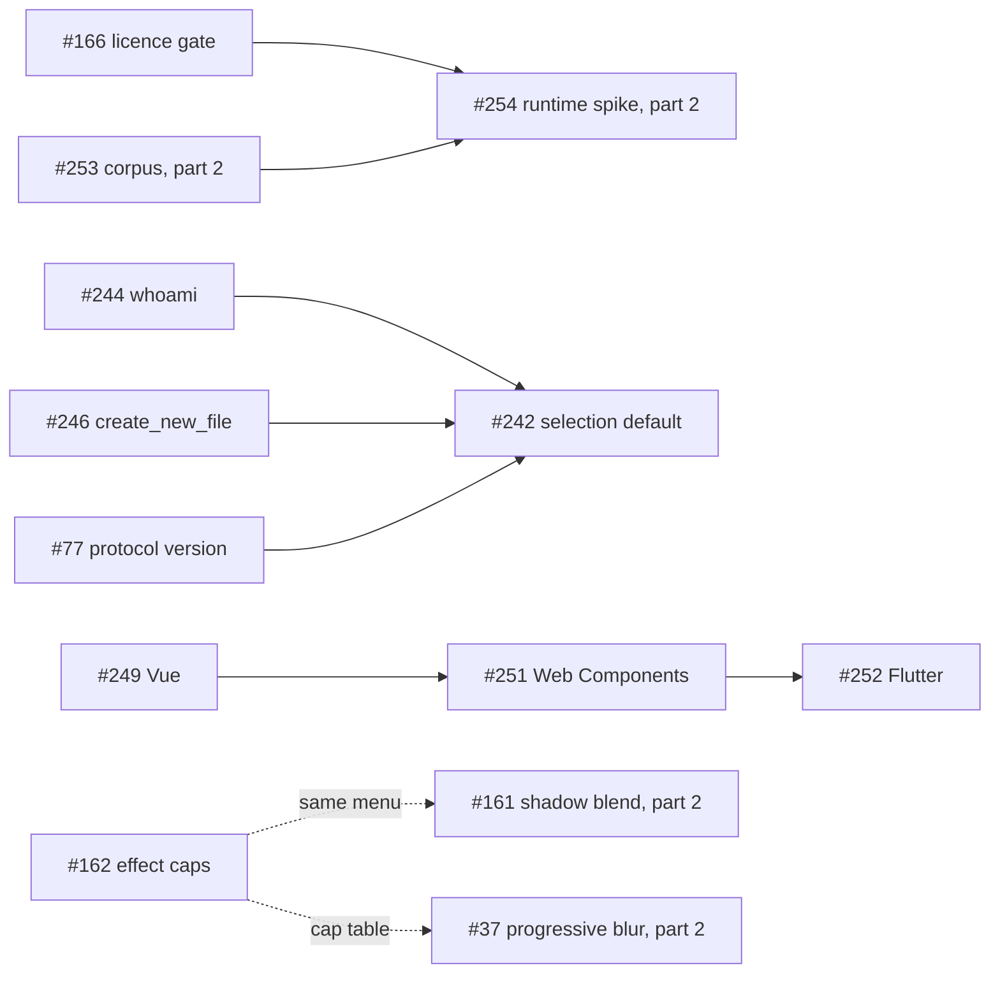

# v0.7 Effects & Export: task specs

**Pack goal.** Effects and export match Figma: progressive blur, glass and noise parity, custom shader references that round-trip, blend modes on shadows, image fill adjustments, and the export-bounds, shadow and image-fill differences found on the kit frames. The pack also carries the MCP additions (the editor selection as the default target, `whoami`, `create_new_file`), three more codegen targets (Vue, Web Components, Flutter), and the infrastructure items (the licence gate, the plugin corpus and the plugin runtime spike). It ships after v0.6 AI design. Source of truth for the scope: the milestone `v0.7 Effects & Export` and `plans/261017-epics-full-scope/`.

The pack's specs are written in two parts so that work with reverse-engineering needs does not hold up the rest:

- **Part 1 (this folder, 8 specs):** the issues that need no reverse-engineering. Listed with links below.
- **Part 2 (written separately, REA in progress):** the 10 issues whose field ids, units or rules come from reverse engineering. Their rows are reserved below and say "spec in part 2 (REA in progress)". Part 2 fills in their sizes and dependencies; nothing for them is decided here.

Code baseline of every part-1 spec: `origin/main@0e8a9a5` (`docs(specs): v0.6 task specs, part 4 (agent terminal UX and constraint solver) (#697)`). v0.7 opens after v0.6 is tagged, so line numbers move when v0.6 tasks merge; each spec tells the worker to re-anchor every cited line against HEAD and report drift before writing code. Every part-1 spec follows the 13-section layout of the v0.6 specs (header table with "Touches", current state as FACT with file and line, behaviour rules, data model, contracts, file-format mapping, UI in words, edge cases, non-goals, red-first test plan with a fail-before column, performance budgets, dependencies and build order, owner rulings) and ends with **Open questions for the owner**, recommended answer first.

Ids: `E5` = effects and export, `X` = infrastructure, `T7` = MCP and codegen tools. The number in a file name is the issue number.

## Index

| Task | Issue | Title | Spec | Size |
|---|---|---|---|---|
| E5-2 | #162 | Cap effect counts in the "+" control without trimming imported effects | [162-cap-effect-counts-in-the-plus-control.md](162-cap-effect-counts-in-the-plus-control.md) | S |
| X3 | #166 | Gate dependencies on licence with cargo-deny | [166-licence-gate-with-cargo-deny.md](166-licence-gate-with-cargo-deny.md) | S |
| T7.5 | #242 | Target the editor selection by default, configurable per user and session | [242-mcp-targets-the-editor-selection-by-default.md](242-mcp-targets-the-editor-selection-by-default.md) | M |
| T7.35 | #244 | Add the whoami MCP tool returning the local user | [244-whoami-mcp-tool-returns-the-local-user.md](244-whoami-mcp-tool-returns-the-local-user.md) | S |
| T7.36 | #246 | Add create_new_file without replacing the open document | [246-create-new-file-without-replacing-the-open-document.md](246-create-new-file-without-replacing-the-open-document.md) | M |
| T7.28 | #249 | Add the Vue codegen target | [249-vue-codegen-target.md](249-vue-codegen-target.md) | M |
| T7.30 | #251 | Add the Web Components codegen target | [251-web-components-codegen-target.md](251-web-components-codegen-target.md) | M |
| T7.31 | #252 | Add the Flutter codegen target | [252-flutter-codegen-target.md](252-flutter-codegen-target.md) | L |
| | #37 | Progressive blur effect (model, CPU + GPU render, .fig round-trip) | spec in part 2 (REA in progress) | set in part 2 |
| | #38 | Glass effect parameter parity (splay) + noise/texture parity | spec in part 2 (REA in progress) | set in part 2 |
| | #39 | Preserve custom shader effect/paint refs on round-trip | spec in part 2 (REA in progress) | set in part 2 |
| | #161 | Add blend modes to drop and inner shadows | spec in part 2 (REA in progress) | S (issue) |
| | #163 | Add image fill adjustments, rotation, tile scale and crop | spec in part 2 (REA in progress) | L (issue) |
| | #253 | Propose the 8-plugin compatibility corpus and get owner approval | spec in part 2 (REA in progress) | S (issue) |
| | #254 | Spike the plugin runtime and write its design doc (behind a flag) | spec in part 2 (REA in progress) | M (issue) |
| | #520 | Drop shadows and layer effects differ from Figma on shadowed device mockups | spec in part 2 (REA in progress) | set in part 2 |
| | #521 | Image fills: the wrong image is picked inside a variable-mode scope, and fill-mode crops differ | spec in part 2 (REA in progress) | set in part 2 |
| | #528 | Export bounds differ from Figma by 1 to 84 px on 10 kit frames | spec in part 2 (REA in progress) | set in part 2 |

Sizes: S under about a day, M one to three days, L more than three days, for one worker with the specs' fixtures and gates. Four part-1 sizes differ from the issue's, each with its reason in the spec: #246 is M (issue S: a cross-process library lock and shared blank-file constructors), #249 and #251 are M (issue S: slots, props, escaping and a validator project), #252 is L (issue M: the widest mapping, a Dart escaping layer, `const` rules and a Flutter SDK check). Part 2's sizes come from its own specs; the "(issue)" values are what the issue bodies state.

## Dependencies

"Hard" means the task cannot finish without it; "soft" means it can start and only its last test or label waits. Items in other packs are named with their issue or task id.

| Task | Needs (hard) | Soft |
|---|---|---|
| #162 | none | order with #161 and #37 (same menu and cap table) |
| #166 | none | |
| #242 | #77 (protocol version in `context.json`) | #238 (T7.1; the resolver is schema-driven), #75, #76, #81 (the issue lists them; the spec's reading is that they change the edit log, not `context.json`: open question 4 of spec 242), v0.6's E15-5 and T7.6 |
| #244 | none | #246 (exports the library root to the agent), v0.6's T7.6 (tool snapshot, parity matrix) |
| #246 | none in code (issue lists #43: open question 3 of spec 246) | v0.6's E15-5, T7.6 |
| #249 | none in the issue; v0.6's T7.3 and T7.29 are expected on `main` | fallbacks in spec 249, section 12 |
| #251 | #249 (shared lines, order only) | T7.3, T7.29 as above |
| #252 | #251 (order only) | T7.3 as above |
| #254 (part 2) | #253 and **#166** (a part-1 task) | |
| #37, #38, #39, #161, #163, #520, #521, #528 | stated in part 2 | |

#43, #75, #76, #77 and #81 have no milestone, although the 2026-10-17 amendments on #75, #76, #77 and #81 say they block #242 and propose v0.7, and #43's amendment says it blocks #246. `docs/releasing.md` says every task belongs to exactly one pack. The coordinator decides their pack (open questions below).

## Waves

Parallel workers need disjoint file ownership (the "Touches" row of each spec). The waves follow the dependencies and the hot-file order below; a coordinator may overlap them where files are disjoint.

1. #166, #162, #244, #249. (CI and `deny.toml`; `effects.rs` and `menu.rs`; `designos-mcp` plus `designos-library/src/settings.rs`; `designos-export`.)
2. #251 (after #249), #246 (after #244: both add a tool in the same MCP files, and #244's name lookup follows the library root that #246 exports).
3. #252 (after #251), #242 (last of the MCP tasks, after #244 and #246 and once #77 is scheduled and done).

Part 2's tasks run in the same pack under their own queue (the hot-file queue below).

## Hot files and merge order

Hot files run one at a time, never in parallel (`docs/releasing.md:21` names `fig.rs`, `kiwi.rs` and `rest_import.rs`; the pack extends the rule to `terminal.rs` and `engine.rs`). Rebase on the previous merge; never hand-merge.

| File | Order |
|---|---|
| `crates/designos-fig/src/fig.rs`, `kiwi.rs`, `rest_import.rs` | no part-1 task touches them. Part 2 owns the queue: the issue bodies give #161 position 20 and #163 position 21 of the single hot-file queue (`fig.rs`, `fig_export.rs`, `kiwi.rs`, `rest_import.rs`). |
| `crates/designos-mcp/src/engine.rs` | #244 (one dispatch arm and one tool entry) -> #249, #251, #252 only if v0.6's T7.3 has not unified the language lists -> #242 (argument parsing of seven tools; last). v0.6's E15-4 and E15-5 land before all of them. |
| `crates/designos-mcp/src/server.rs` | #246 (one arm and one tool entry) -> #242 (bridge and `context.json` reading). Shared with v0.6's #43, E15-5 and #690. |
| `crates/designos-app/src/terminal.rs` | #246 (one `cmd.env` line) -> #242 (sync key, `context.json` fields, per-tab override, call sites into a new `agent_target.rs`). All v0.6 `terminal.rs` tasks land first. |
| `crates/designos-app/src/comments/settings.rs` | #244 (the read side moves to `designos-library`; re-exports) -> #242 (one string choice). v0.6's #656, #682 and E15-14 land first. |
| `crates/designos-app/src/panels/effects.rs` and `widgets/menu.rs` | #162 -> #161 (part 2) -> #37 (part 2). |
| `.github/workflows/ci.yml` | #166 (job `licences`) -> #249 (the `codegen-validators` job or its Vue step) -> #251 -> #252. |
| `crates/designos-export/src/lib.rs`, `language.rs`, `slots.rs` (`Lang`) | #249 -> #251 -> #252. `codegen.rs` gets `dart_quote` from #252 only. |
| `crates/designos-library/src/store.rs` | #246 only in part 1 (the lock; keep that PR free of other edits). |

## UI rules checked for part 1

The UI sections (#162, #242, and the dropdown entries of #249, #251, #252) were checked against `design/principles.md` (P1 to P10), `design/soul.md` and `crates/designos-app/src/theme.rs`; `ui ds context --dir .` is run by the worker before the PR.

- Tokens come from `theme.rs` and `design/design.tokens.json`: zinc surfaces; orange only for the one primary action of a view; no purple; control heights 24 (dense) and 28; pointer targets at least 24 px; counts never concatenated into a label (`design/soul.md:19`). #162's "Max 8" is a limit in its own column, not a count in a label.
- No animation, no timer and no `app.changed()` for painting: idle CPU stays at zero (CLAUDE.md section 4). No UI-thread `to_json` (#242 writes one more field in the file Studio already writes; #246 adds nothing to the UI thread beyond a lock wait bounded at 5 seconds).
- Every UI section's test plan names `es-designer` before UI code, a desktop capture at 1440 in the PR, and "responsive: SKIPPED (owner default)". Figma is updated from the verified captures first, then the remaining gates run (owner rule).
- #244, #246, #166 and the Rust parts of #249, #251 and #252 have no UI; their evidence is terminal output.

## Conflicts found between issues and code (each is stated in the spec's current-state section)

1. **#162:** the issue lists four caps (8/8/1/1); Figma's help page lists seven (adds noise 2, texture 1, glass 1). `MenuItem` has no tooltip field and keyboard navigation skips disabled rows, so the tooltip alone is unreachable without a mouse. The body says "Pack: v0.6", the milestone is v0.7.
2. **#166:** the issue's allow list fails on today's tree (26 rejected). The tree already contains an MPL-2.0 crate (`option-ext`) while R4.16 and acceptance criterion 3 name only symphonia, plus font licences (OFL-1.1, Ubuntu-font-1.0) in egui's default fonts and four more permissive licences the list omits. The usual `cargo-deny` GitHub Action is a container action; the job runs on macOS, so the binary is installed instead.
3. **#242:** no conflict with the #654 ruling that the selection is never injected into a prompt (the tool reads it server side), but a selection default means a write can act on a selection the user never "sent"; the spec asks. Figma's public tools page documents no selection fallback. Five dependencies have no milestone. `designos-mcp` reads `current_page_id` from `context.json` today and never `selected_node_ids`.
4. **#244:** Figma's `whoami` returns an email; there is no account here, so the email is `null`. The "T10.14 identity" the issue mentions is already on `main` (`CommentAuthor`). The display-name setting lives in `designos-app`, which the MCP crate cannot call; its read side moves to `designos-library`. Studio does not pass its library root to the agent.
5. **#246:** the issue's dependency on #43 has no code basis (the tool never touches the replace path) and #43 has no milestone. The library manifest lock is in-process only, so the MCP process and Studio can lose an update. Board and deck constructors live in `designos-app`. The agent cannot edit the new file in the same session until a non-replacing open exists.
6. **#249, #251, #252:** the issues name `Language::ALL`, which is in `designos-app` today, not in `designos-export`; v0.6's T7.3 moves it. `vue-tsc` 3.3.13 does not start with the current TypeScript 7.0.2 and does not flag a wrong prop without `strictTemplates`, so the validators pin TypeScript 5.9.3 and enable strict templates. The native targets print fragments that nothing compiles; Flutter must print a whole file. Figma has no Dart code-syntax platform, so "Flutter prints code_syntax" is not literally satisfiable (spec 252, open question 1).
7. **Spec-ready gate:** `docs/releasing.md` on `main` holds the hot-file rule (`:21`) but no "spec-ready" wording; the gate is in the task brief only (the same finding as the v0.6 part-4 README).

## Follow-ups found and not done here

- Five manifest methods of `designos-library` take no lock at all (`rename_project`, `delete_project`, `create_folder`, `rename_folder`, `move_folder`); #246 locks only the eight that take the in-process mutex today.
- A Home view that is already on screen does not refresh when the MCP process creates a file; it refreshes on the next in-app action or on return to Home (`home/mod.rs:431`, `home/session.rs:453-466`).
- CI's Clippy step runs without `-D warnings` (`.github/workflows/ci.yml:76`) while `CONTRIBUTING.md:29` and the release gates say it does.
- `designos-doc/src/comments.rs:35` keeps a private copy of `os_user_name`; after #244 the app and MCP share one in `designos-library`, and the doc crate's copy is still a duplicate.

## Owner rulings that apply across the part-1 specs

- Full scope, never MVP: packs only order the work (2026-10-17).
- All AI goes through the user's own agent CLI; nothing is sent anywhere; no bundled model (R4.13).
- R1.4: MCP targets the editor selection by default when attached, configurable, everything exposed (#242). R4.14: hosted identity replaced by a local equivalent (#244). R4.16: MPL-2.0 only as an explicit exception (#166).
- A5 and A7: bound variables print code syntax with resolved fallbacks, WEB for web targets, iOS and ANDROID verbatim for native targets (#249, #251, #252).
- The selection is never auto-injected into a prompt; the chip is click-to-send (#654, accepted v0.6 spec).
- Limits are enforced in the UI only and imported data is never dropped (#162).
- Desktop capture at 1440 in the PR; responsive checks skipped by default (owner default).

## Open questions for the owner

Each has a recommended answer. None blocks writing the specs; the task that needs the answer starts after it.

1. **#162 which effect kinds are capped:** recommended all seven, with Figma's numbers (8 drop, 8 inner, 1 layer blur, 1 background blur, 2 noise, 1 texture, 1 glass); alternative: only the issue's four. Also: show "Max 8" in the disabled row next to the tooltip (recommended), and count hidden effects (recommended; an assumption about Figma that an owner-manual check in Figma settles).
2. **#166 licence policy:** recommended to allow `Unicode-3.0`, `CDLA-Permissive-2.0`, `CC0-1.0` and `BSL-1.0` besides the issue's list, with named exceptions for `option-ext` (MPL-2.0) and egui's default font crate (OFL-1.1, Ubuntu-font-1.0); the symphonia exceptions arrive with that crate. Make the `licences` job a required check after three green runs on `main` (the ruleset is the owner's).
3. **#242 writes and defaults:** recommended that every required-`node_id` tool, including edit and delete, follows the selection default (every reply names the layer; one undo step per call); `parent_id` tools stay on the active page; the per-session control is a small pill in the agent panel header beside the selection chip.
4. **Schedule the unmilestoned dependencies:** recommended to put #77 (and, if wanted, #75, #76, #81) into v0.7 ahead of #242, and to let #246 start without waiting for #43 while giving #43 a milestone for the non-replacing open.
5. **#244:** share the user's chosen display name with the agent (recommended; Figma returns an email); plan wording "Local library", tier "free".
6. **#246:** create design, board and deck files, matching Figma's three types (recommended); unnamed files go to a "Drafts" project created on first use (recommended; alternative: Home's first-project rule).
7. **#249, #251:** Vue styles in a `<style scoped>` block (recommended); Web Components as vanilla custom elements, no Lit, with a fixed `ds-` tag prefix (recommended); pin the validators to TypeScript 5.9.3.
8. **#252:** Flutter prints the generated token reference (`Tokens.colorPrimary`), not any platform's code syntax (recommended; the alternative reads ANDROID or WEB verbatim); import `widgets.dart` only; minimum Flutter 3.27.
