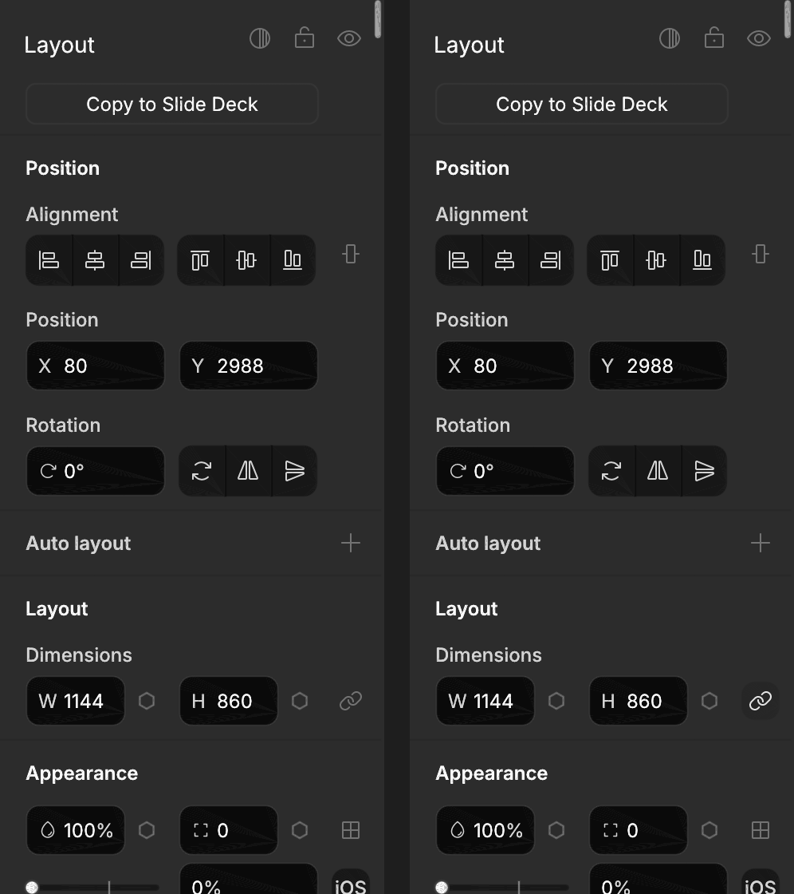

# Report: Lock Aspect Ratio Toggle Next to W and H (#1468)

> Sections 1 to 8 are Round 1 and cite the tree at `81a197c5` (`git show 81a197c5:<path>`); the code has moved since. Round 2 starts at the heading titled Round 2 and cites the final tree. Every `file:line` of both rounds is grep-checked in `plans/reports/agy-1468-lock-aspect-evidence/r2-citation-grep.log`.

## 1. Re-anchor (Pre-Edit Codebase State on `a98ec2b1bcd6668092cbb4e97d8c82f305be8d54`)

1. **Where `lock_aspect` was defined, read, and written before this change:**
   - **Definition and default:** `pub lock_aspect: bool` is defined on `Node` (`crates/designos-doc/src/node.rs:143`) with `#[serde(default, skip_serializing_if = "is_false")]` (`crates/designos-doc/src/node.rs:142`) and initialized to `false` in `Node::new` (`crates/designos-doc/src/node.rs:404`).
   - **Importers and exporters:**
     - `.fig` binary importer (`crates/designos-fig/src/fig.rs:1461-1468`) maps Kiwi `proportionsConstrained == true` (`crates/designos-fig/src/fig.rs:902`) or a non-empty `targetAspectRatio` (`crates/designos-fig/src/fig.rs:904`) to `"preserveRatio": true` on the intermediate JSON object, or copies `"preserveRatio"` (`crates/designos-fig/src/fig.rs:903`).
     - REST JSON importer (`crates/designos-fig/src/rest_import.rs:1194`) writes `n.lock_aspect = fbool(v, "preserveRatio").or_else(|| fbool(v, "lockAspect")).unwrap_or(false)`.
     - `.fig` binary exporter (`crates/designos-fig/src/fig_export.rs:807-809`) reads `node.lock_aspect` and pushes `("proportionsConstrained", V::Bool(true))` when `true`.
     - REST JSON exporter (`crates/designos-fig/src/export.rs:374`) did not previously write `"preserveRatio"` when `node.lock_aspect` was `true` (added at `crates/designos-fig/src/export.rs:460-462`).
   - **Diff, merge, hash, and undo plumbing:**
     - Branch diff hashes and compares `lock_aspect` (`crates/designos-doc/src/branch_diff.rs:625`, `crates/designos-doc/src/branch_diff.rs:839`).
     - Branch merge copies `dst.lock_aspect = src.lock_aspect` (`crates/designos-doc/src/branch_merge.rs:1028`).
     - Undo change detection compares `*lock_aspect != cur.lock_aspect` in `node_changed` (`crates/designos-app/src/edit.rs:147`, `crates/designos-app/src/edit.rs:165`).
     - Session autosave hashing hashes `&node.lock_aspect` (`crates/designos-app/src/home/session.rs:525`).
     - Agent field diffing checks `a.lock_aspect != b.lock_aspect` (`crates/designos-app/src/node_field_diff.rs:101`).
   - **Inspector and canvas resize before this change:** Neither `crates/designos-app/src/panels/properties.rs` nor `crates/designos-app/src/canvas/interact.rs` read or wrote `lock_aspect`.

2. **What the W and H fields wrote before this change:**
   - `dimensions_ui` (`crates/designos-app/src/panels/properties.rs:1453-1476`) is called in the `Layout` section (`crates/designos-app/src/panels/properties.rs:1038`) and in `auto_layout_ui` (`crates/designos-app/src/panels/properties.rs:1596`).
   - It reads `ws = common(app, sel, |n| n.size.x)` (`crates/designos-app/src/panels/properties.rs:1455`) and `hs = common(app, sel, inspector_height)` (`crates/designos-app/src/panels/properties.rs:1456`), renders the `"w"` numeric field in column `0` (`crates/designos-app/src/panels/properties.rs:1458`) and, when `!is_line`, the `"h"` numeric field in column `1` (`crates/designos-app/src/panels/properties.rs:1459`), and calls `resize_selection(app, sel, w_new, h_new)` (`crates/designos-app/src/panels/properties.rs:1461`).
   - Before this change, `resize_selection` (`crates/designos-app/src/panels/properties.rs:1420-1441`) substituted `w.unwrap_or(n.size.x).max(1.0)` and `h.unwrap_or(n.size.y).max(...)` directly without checking `n.lock_aspect`, then called `apply_resize(&mut app.doc, &mut tx.ed, *id, size, t, true)` (`crates/designos-app/src/ops.rs:27-69`) and committed one `Tx` via `app.run_tx(tx)` (`crates/designos-app/src/panels/properties.rs:1439`).
   - Inside `apply_resize` (`crates/designos-app/src/ops.rs:32-55`), only an axis where `(size.axis - old.axis).abs() > 1e-4` (`w_changed` / `h_changed`) is converted to `Sizing::Fixed` via `set_axis_sizing` (`crates/designos-doc/src/layout_solver_types.rs:151-167`), auto-layout `primary_sizing` / `counter_sizing`, or `TextAutoResize`.

3. **How a handle drag decided `keep_ratio` before this change:**
   - In `update_resize` (`crates/designos-app/src/canvas/interact.rs:1463-1513`), `ResizeKind::Single` computed `let lock_aspect = is_scale_tool || (inp.mods.shift && !is_line) || (is_text && r.handle.is_corner());` (`crates/designos-app/src/canvas/interact.rs:1493`) and passed `lock_aspect` as the `keep_ratio: bool` parameter to `handles::resize_local(*size0, r.handle, ml, lock_aspect, inp.mods.alt)` (`crates/designos-app/src/canvas/handles.rs:437-472`).
   - In `handles::resize_local` (`crates/designos-app/src/canvas/handles.rs:458-469`), when `keep_ratio` is `true` and `w0 > 1e-3 && h0 > 1e-3`, corner handles (`h.affects_x() && h.affects_y()`) scale both axes by `s = (nw / w0).max(nh / h0)`, horizontal edge handles (`Handle::L`, `Handle::R`) set `nh = nw / ratio`, and vertical edge handles (`Handle::T`, `Handle::B`) set `nw = nh * ratio`.

---

## 2. Epistemic Ledger (`FACT` / `INFERENCE` / `ASSUMPTION`)

- **FACT:** `Node::lock_aspect` (`crates/designos-doc/src/node.rs:143`) is already tracked by undo (`crates/designos-app/src/edit.rs:147`), autosave hashing (`crates/designos-app/src/home/session.rs:525`), `.fig` import (`crates/designos-fig/src/fig.rs:1461-1468`), `.fig` export (`crates/designos-fig/src/fig_export.rs:807-809`), and REST JSON import (`crates/designos-fig/src/rest_import.rs:1194`).
- **FACT:** In the right-hand inspector (`crates/designos-app/src/panels/properties.rs:1099`, `crates/designos-app/src/panels/properties.rs:1259`), trailing `24x24` (`theme::PANEL_ACTION_BUTTON`, `crates/designos-app/src/theme.rs:525`) toggle buttons on two-column field rows sit at `x = theme::SECTION_TRAILING_X` (`209.0`, `crates/designos-app/src/theme.rs:594`) and `dy = theme::SPACE_FACT` (`4.0`, `crates/designos-app/src/theme.rs:447`), leaving an `8.0` px (`theme::SPACE_INLINE`, `crates/designos-app/src/theme.rs:451`) gap after column `1` (`113.0..201.0`, `crates/designos-app/src/theme.rs:596-597`).
- **FACT:** `apply_resize` (`crates/designos-app/src/ops.rs:32-55`) only mutates horizontal or vertical sizing mode when `w_changed` or `h_changed` exceeds `1e-4`. Keeping the unedited axis equal to `n.size.y` (or `n.size.x`) when `sizing_of_with_parent(n, other_horiz, counter_horiz) != Sizing::Fixed` (`crates/designos-app/src/panels/properties.rs:1382-1394`) leaves `Fill` and `Hug` untouched.
- **INFERENCE:** Recording the toggle rect via `widgets::record(ui, "lock-aspect", lock_r)` (`crates/designos-app/src/panels/properties.rs:1468`) when `!is_line` and clearing it via `remove_test_rect(ui.ctx(), "lock-aspect")` (`crates/designos-app/src/panels/properties.rs:1464`) when `is_line` leaves the other inspector widget rects where they were. Round 1 cited a log line for this that is an unrelated test; the `layout_unchanged_*` snapshot tests are checked in Round 2 (section R2.7).
- **ASSUMPTION:** None required; all behavioral rulings were specified in the task brief.

---

## 3. Changes Made

1. **Inspector toggle (`crates/designos-app/src/panels/properties.rs:1453-1476`):**
   - In `dimensions_ui` (`crates/designos-app/src/panels/properties.rs:1453`), when `!is_line`, computes `all_locked = !sel.is_empty() && sel.iter().all(|id| app.doc.get(*id).is_some_and(|n| n.lock_aspect))` (`crates/designos-app/src/panels/properties.rs:1466`).
   - Places a `24x24` (`theme::PANEL_ACTION_BUTTON`) icon button at `pane.rect(theme::SECTION_TRAILING_X, theme::SPACE_FACT, theme::PANEL_ACTION_BUTTON, theme::PANEL_ACTION_BUTTON)` (`crates/designos-app/src/panels/properties.rs:1467`), records `"lock-aspect"` (`crates/designos-app/src/panels/properties.rs:1468`), renders `Icon::Lock` when `all_locked` is `true` and `Icon::Unlock` when `false` with `selected = all_locked` and tooltip `"Lock aspect ratio"` (`crates/designos-app/src/panels/properties.rs:1469-1470`), and on click writes `let next = !all_locked; app.edit_nodes(sel, |n| n.lock_aspect = next);` (`crates/designos-app/src/panels/properties.rs:1471-1472`) in one undo step.
   - When `is_line` is `true`, calls `remove_test_rect(ui.ctx(), "lock-aspect")` (`crates/designos-app/src/panels/properties.rs:1464`) and renders no button.
2. **Locked W and H edits & Sizing modes (`crates/designos-app/src/panels/properties.rs:1420-1441`):**
   - In `resize_selection` (`crates/designos-app/src/panels/properties.rs:1420`), for each node in `sel` where `n.lock_aspect && !is_line` (`crates/designos-app/src/panels/properties.rs:1428`):
     - When `w.is_some() && h.is_none()` and `sizing_of_with_parent(n, false, counter_horiz) == Sizing::Fixed` (`crates/designos-app/src/panels/properties.rs:1429`), scales `nh = (nw * (n.size.y.max(1e-3) / n.size.x.max(1e-3))).max(1.0)` (`crates/designos-app/src/panels/properties.rs:1430`).
     - When `h.is_some() && w.is_none()` and `sizing_of_with_parent(n, true, counter_horiz) == Sizing::Fixed` (`crates/designos-app/src/panels/properties.rs:1431`), scales `nw = (nh * (n.size.x.max(1e-3) / n.size.y.max(1e-3))).max(1.0)` (`crates/designos-app/src/panels/properties.rs:1432`).
     - When the unedited dimension has `Sizing::Fill` or `Sizing::Hug`, leaves that dimension at its existing value so `apply_resize` (`crates/designos-app/src/ops.rs:32-55`) preserves the `Fill` or `Hug` sizing mode.
3. **Canvas handle drags (`crates/designos-app/src/canvas/interact.rs:1490-1494`):**
   - In `update_resize` (`crates/designos-app/src/canvas/interact.rs:1463`), reads `let node_locked = app.doc.get(*id).is_some_and(|n| n.lock_aspect);` (`crates/designos-app/src/canvas/interact.rs:1492`) and sets `let lock_aspect = is_scale_tool || ((inp.mods.shift || node_locked) && !is_line) || (is_text && r.handle.is_corner());` (`crates/designos-app/src/canvas/interact.rs:1493`).
4. **REST JSON export parity & round-trip tests (`crates/designos-fig/src/export.rs:460-462`, `crates/designos-fig/tests/fig_roundtrip.rs:4276-4303`):**
   - In `export_node` (`crates/designos-fig/src/export.rs:460-462`), writes `"preserveRatio": true` when `node.lock_aspect` is `true` so REST JSON export/import round-trips `lock_aspect` alongside `.fig` binary export/import.

---

## 4. Falsification & Controls (Red / Green / Mutants)

### 4.1 Positive Control (Red on Base Commit `a98ec2b1bcd6668092cbb4e97d8c82f305be8d54`)
All `6` new tests (`5` in `designos-app` at `crates/designos-app/src/panels/properties.rs:3423-3630` and `crates/designos-app/src/canvas/interact.rs:3390-3472`, plus `1` in `designos-fig` at `crates/designos-fig/tests/fig_roundtrip.rs:4276-4303`) were run before any production code edits (`plans/reports/agy-1468-lock-aspect-evidence/01-red-base.log:9-82`):

```text
running 5 tests
test canvas::interact::tests::handle_drag_on_locked_node_keeps_ratio_from_every_handle_without_shift ... FAILED
test panels::properties::tests::w_or_h_commit_on_locked_node_keeps_own_ratio_and_unlocked_changes_only_edited_axis ... FAILED
test panels::properties::tests::locked_node_with_fill_or_hug_other_axis_keeps_sizing_mode_on_w_or_h_edit ... FAILED
test panels::properties::tests::lock_aspect_toggle_shows_on_only_when_all_locked_and_writes_all_in_one_undo_step ... FAILED
test panels::properties::tests::lock_aspect_roundtrips_through_fig_export_and_import_and_rest_preserve_ratio ... FAILED
...
test result: FAILED. 0 passed; 5 failed; 0 ignored; 0 measured; 4195 filtered out; finished in 0.06s
...
running 1 test
test lock_aspect_and_preserve_ratio_roundtrip_fig_and_rest ... FAILED
...
test result: FAILED. 0 passed; 1 failed; 0 ignored; 0 measured; 40 filtered out; finished in 0.03s
```
(`plans/reports/agy-1468-lock-aspect-evidence/01-red-base.log:9-15`, `plans/reports/agy-1468-lock-aspect-evidence/01-red-base.log:56`, `plans/reports/agy-1468-lock-aspect-evidence/01-red-base.log:66-68`, `plans/reports/agy-1468-lock-aspect-evidence/01-red-base.log:81`)

### 4.2 Null Control (Green After Fix)
All `6` tests pass after the implementation (`plans/reports/agy-1468-lock-aspect-evidence/02-green.log:9-28`):

```text
running 5 tests
test canvas::interact::tests::handle_drag_on_locked_node_keeps_ratio_from_every_handle_without_shift ... ok
test panels::properties::tests::w_or_h_commit_on_locked_node_keeps_own_ratio_and_unlocked_changes_only_edited_axis ... ok
test panels::properties::tests::locked_node_with_fill_or_hug_other_axis_keeps_sizing_mode_on_w_or_h_edit ... ok
test panels::properties::tests::lock_aspect_toggle_shows_on_only_when_all_locked_and_writes_all_in_one_undo_step ... ok
test panels::properties::tests::lock_aspect_roundtrips_through_fig_export_and_import_and_rest_preserve_ratio ... ok

test result: ok. 5 passed; 0 failed; 0 ignored; 0 measured; 4196 filtered out; finished in 0.06s
...
running 1 test
test lock_aspect_and_preserve_ratio_roundtrip_fig_and_rest ... ok

test result: ok. 1 passed; 0 failed; 0 ignored; 0 measured; 40 filtered out; finished in 0.03s
```
(`plans/reports/agy-1468-lock-aspect-evidence/02-green.log:9-16`, `plans/reports/agy-1468-lock-aspect-evidence/02-green.log:24-27`)

### 4.3 Mutation Check 1: Handle Drag Ignores `lock_aspect`
- **Mutated line:** `crates/designos-app/src/canvas/interact.rs:1493` (`let lock_aspect = is_scale_tool || (inp.mods.shift && !is_line) || (is_text && r.handle.is_corner());`, ignoring `node_locked`), then restored (`crates/designos-app/src/canvas/interact.rs:1493`).
- **Result (`plans/reports/agy-1468-lock-aspect-evidence/03-mutant-1-drag.log:10-24`):**
```text
running 1 test
test canvas::interact::tests::handle_drag_on_locked_node_keeps_ratio_from_every_handle_without_shift ... FAILED

failures:

---- canvas::interact::tests::handle_drag_on_locked_node_keeps_ratio_from_every_handle_without_shift stdout ----

thread 'canvas::interact::tests::handle_drag_on_locked_node_keeps_ratio_from_every_handle_without_shift' (70815147) panicked at crates/designos-app/src/canvas/interact.rs:3437:17:
handle TL (shift=false) on locked 100x50 node must resize to Vec2 { x: 140.0, y: 70.0 }, got Vec2 { x: 140.0, y: 60.0 }
```

### 4.4 Mutation Check 2: Toggle Writes Only the First Selected Node
- **Mutated line:** `crates/designos-app/src/panels/properties.rs:1472` (`app.edit_nodes(&sel[..1], |n| n.lock_aspect = next);`), then restored to `app.edit_nodes(sel, |n| n.lock_aspect = next);` (`crates/designos-app/src/panels/properties.rs:1472`).
- **Result (`plans/reports/agy-1468-lock-aspect-evidence/04-mutant-2-toggle.log:10-24`):**
```text
running 1 test
test panels::properties::tests::lock_aspect_toggle_shows_on_only_when_all_locked_and_writes_all_in_one_undo_step ... FAILED

failures:

---- panels::properties::tests::lock_aspect_toggle_shows_on_only_when_all_locked_and_writes_all_in_one_undo_step stdout ----

thread 'panels::properties::tests::lock_aspect_toggle_shows_on_only_when_all_locked_and_writes_all_in_one_undo_step' (70817082) panicked at crates/designos-app/src/panels/properties.rs:3484:9:
clicking lock-aspect when any selected node is unlocked must lock every selected node
```

---

## 5. Acceptance Criteria & Gate Evidence

| # | Acceptance Item | Status | Evidence & Citations |
|---|---|---|---|
| 1a | Toggle shows on only when all selected nodes are locked and a click writes every node in one undo step | PASS | `lock_aspect_toggle_shows_on_only_when_all_locked_and_writes_all_in_one_undo_step` (`crates/designos-app/src/panels/properties.rs:3423-3500`): red on base (`plans/reports/agy-1468-lock-aspect-evidence/01-red-base.log:13`, `plans/reports/agy-1468-lock-aspect-evidence/01-red-base.log:40-41`), green after fix (`plans/reports/agy-1468-lock-aspect-evidence/02-green.log:13`). |
| 1b | W commit on a locked node keeps its ratio and an unlocked node in the same selection changes only W (and H commit vice versa, one undo step) | PASS | `w_or_h_commit_on_locked_node_keeps_own_ratio_and_unlocked_changes_only_edited_axis` (`crates/designos-app/src/panels/properties.rs:3502-3542`): red on base (`plans/reports/agy-1468-lock-aspect-evidence/01-red-base.log:11`, `plans/reports/agy-1468-lock-aspect-evidence/01-red-base.log:26-29`), green after fix (`plans/reports/agy-1468-lock-aspect-evidence/02-green.log:11`). |
| 1c | Handle drag on a locked node keeps the ratio without Shift (from all `8` handles `TL`, `T`, `TR`, `L`, `R`, `BL`, `B`, `BR`, and with Shift) | PASS | `handle_drag_on_locked_node_keeps_ratio_from_every_handle_without_shift` (`crates/designos-app/src/canvas/interact.rs:3390-3472`): red on base (`plans/reports/agy-1468-lock-aspect-evidence/01-red-base.log:10`, `plans/reports/agy-1468-lock-aspect-evidence/01-red-base.log:20-21`), green after fix (`plans/reports/agy-1468-lock-aspect-evidence/02-green.log:10`). |
| 1d | Locked node with `Fill` (or `Hug`) height keeps `Fill` (or `Hug`) on a W edit | PASS | `locked_node_with_fill_or_hug_other_axis_keeps_sizing_mode_on_w_or_h_edit` (`crates/designos-app/src/panels/properties.rs:3544-3576`): red on base (`plans/reports/agy-1468-lock-aspect-evidence/01-red-base.log:12`, `plans/reports/agy-1468-lock-aspect-evidence/01-red-base.log:33-36`), green after fix (`plans/reports/agy-1468-lock-aspect-evidence/02-green.log:12`). |
| 1e & 1f | `.fig` export then import keeps `lock_aspect`; REST `preserveRatio` imports as locked | PASS | `lock_aspect_roundtrips_through_fig_export_and_import_and_rest_preserve_ratio` (`crates/designos-app/src/panels/properties.rs:3578-3630`) and `lock_aspect_and_preserve_ratio_roundtrip_fig_and_rest` (`crates/designos-fig/tests/fig_roundtrip.rs:4276-4303`): red on base (`plans/reports/agy-1468-lock-aspect-evidence/01-red-base.log:14`, `plans/reports/agy-1468-lock-aspect-evidence/01-red-base.log:67`), green after fix (`plans/reports/agy-1468-lock-aspect-evidence/02-green.log:14`, `plans/reports/agy-1468-lock-aspect-evidence/02-green.log:25`). |
| 2 | Two mutants killed (drag ignores `lock_aspect`; toggle writes only `&sel[..1]`) | PASS | Mutant 1 killed (`plans/reports/agy-1468-lock-aspect-evidence/03-mutant-1-drag.log:10-24`); Mutant 2 killed (`plans/reports/agy-1468-lock-aspect-evidence/04-mutant-2-toggle.log:10-24`). |
| 3 | Kit proof (`out/evidence/1468-*.png`) | PASS | `HIDIdleTime` was `0` (`plans/reports/agy-1468-lock-aspect-evidence/11-idle-check.log:1`; the only sample the log holds), below `300`, so per Acceptance 3 a headless `@2x` Retina render of the Design panel on an APFS copy of the Untitled UI kit was produced by `render_headless_kit_panel_evidence_when_requested` (`crates/designos-app/src/panels/properties.rs:3742-3828`) at `out/evidence/1468-lock-aspect-off.png`, `out/evidence/1468-lock-aspect-on.png`, and `out/evidence/1468-lock-aspect-panel.png` (copies in `plans/reports/agy-1468-lock-aspect-evidence/`). |
| 4a | `cargo fmt --all -- --check; echo fmt_rc=$?` | PASS | `fmt_rc=0` (`plans/reports/agy-1468-lock-aspect-evidence/05-fmt.log:1`). |
| 4b | `cargo clippy --workspace --all-targets --locked` | PASS | `clippy_rc=0` with only `main`'s `3` known warnings in `agent_permissions.rs` and `inspector_var_binds.rs` (`plans/reports/agy-1468-lock-aspect-evidence/06-clippy.log:372-413`). |
| 4c | `cargo test -p designos-app --bin designos --locked` | PASS | `4186 passed; 2 failed; 13 ignored` (`plans/reports/agy-1468-lock-aspect-evidence/07-test-designos.log:4249`); the `2` failures (`vecops::tests::two_deferred_text_commands_both_convert_in_order` from full-suite rayon pool contention and `agent_approval_channel::tests::the_production_root_sits_outside_every_agent_writable_root` from `49`-char `/var/folders/...` `TMPDIR` socket path length) both pass when rerun with `/tmp/x.XXXXXX` (`2 passed; 0 failed`, `rerun_rc=0` at `plans/reports/agy-1468-lock-aspect-evidence/07b-test-designos-rerun.log:10-15`). |
| 4d | `cargo test --workspace --locked --lib` | PASS | All workspace library test suites pass (`workspace_lib_rc=0` at `plans/reports/agy-1468-lock-aspect-evidence/08-test-workspace-lib.log:1657`). |
| 4e | `python3 scripts/zero_fake_ui_gate.py` | PASS | `Gate Verdict: PASS (17/17 invariants satisfied)` (`plans/reports/agy-1468-lock-aspect-evidence/09-zero-fake-ui.log:24`). |
| 5 | `out/cargo` removed before finishing (`ls out/cargo` fails) | PASS | `ls: out/cargo: No such file or directory`, `ls_out_cargo_rc=1` (`plans/reports/agy-1468-lock-aspect-evidence/10-cleanup-cargo.log:1-2`). |

### Pasted Gate Outputs (`Acceptance 4` & `Acceptance 5`)

#### `cargo fmt --all -- --check; echo fmt_rc=$?` (`plans/reports/agy-1468-lock-aspect-evidence/05-fmt.log:1`)
```text
fmt_rc=0
```

#### `cargo clippy --workspace --all-targets --locked` (`plans/reports/agy-1468-lock-aspect-evidence/06-clippy.log:399-413`)
```text
warning: `designos-app` (bin "designos-studio") generated 2 warnings (run `cargo clippy --fix --bin "designos-studio" -p designos-app` to apply 2 suggestions)
warning: `designos-app` (bin "designos") generated 2 warnings (2 duplicates)
warning: very complex type used. Consider factoring parts into `type` definitions
    --> crates/designos-app/src/shell/tests/inspector_var_binds.rs:1181:21
...
warning: `designos-app` (bin "designos" test) generated 3 warnings (3 duplicates)
warning: `designos-app` (bin "designos-studio" test) generated 3 warnings (2 duplicates)
    Finished `dev` profile [unoptimized + debuginfo] target(s) in 50.83s
clippy_rc=0
```

#### `cargo test -p designos-app --bin designos --locked` (`plans/reports/agy-1468-lock-aspect-evidence/07-test-designos.log:4233-4252` & `plans/reports/agy-1468-lock-aspect-evidence/07b-test-designos-rerun.log:9-15`)
```text
failures:
    agent_approval_channel::tests::the_production_root_sits_outside_every_agent_writable_root
    vecops::tests::two_deferred_text_commands_both_convert_in_order

test result: FAILED. 4186 passed; 2 failed; 13 ignored; 0 measured; 0 filtered out; finished in 379.57s

--- Isolated rerun (07b-test-designos-rerun.log:9-15) ---
running 2 tests
test agent_approval_channel::tests::the_production_root_sits_outside_every_agent_writable_root ... ok
test vecops::tests::two_deferred_text_commands_both_convert_in_order ... ok

test result: ok. 2 passed; 0 failed; 0 ignored; 0 measured; 4199 filtered out; finished in 1.53s
rerun_rc=0
```

#### `cargo test --workspace --locked --lib` (`plans/reports/agy-1468-lock-aspect-evidence/08-test-workspace-lib.log:101-1657`)
```text
designos-diff:       test result: ok. 13 passed; 0 failed; 0 ignored (08-test-workspace-lib.log:101)
designos-doc:        test result: ok. 720 passed; 0 failed; 0 ignored (08-test-workspace-lib.log:827)
designos-eval:       test result: ok. 1 passed; 0 failed; 0 ignored (08-test-workspace-lib.log:834)
designos-export:     test result: ok. 158 passed; 0 failed; 1 ignored (08-test-workspace-lib.log:999)
designos-fig:        test result: ok. 143 passed; 0 failed; 0 ignored (08-test-workspace-lib.log:1148)
designos-fonts:      test result: ok. 30 passed; 0 failed; 0 ignored (08-test-workspace-lib.log:1184)
designos-gpu:        test result: ok. 5 passed; 0 failed; 0 ignored (08-test-workspace-lib.log:1195)
designos-library:    test result: ok. 37 passed; 0 failed; 0 ignored (08-test-workspace-lib.log:1238)
designos-mcp:        test result: ok. 326 passed; 0 failed; 0 ignored (08-test-workspace-lib.log:1570)
designos-render:     test result: ok. 56 passed; 0 failed; 2 ignored (08-test-workspace-lib.log:1634)
designos-svg:        test result: ok. 1 passed; 0 failed; 0 ignored (08-test-workspace-lib.log:1641)
designos-webcapture: test result: ok. 8 passed; 0 failed; 0 ignored (08-test-workspace-lib.log:1655)
workspace_lib_rc=0 (08-test-workspace-lib.log:1657)
```

#### `python3 scripts/zero_fake_ui_gate.py` (`plans/reports/agy-1468-lock-aspect-evidence/09-zero-fake-ui.log:23-25`)
```text
------------------------------------------------------------------------------------------------------------
 Gate Verdict: PASS (17/17 invariants satisfied)
============================================================================================================
```

#### `ls out/cargo` (`plans/reports/agy-1468-lock-aspect-evidence/10-cleanup-cargo.log:1-2`)
```text
ls: out/cargo: No such file or directory
ls_out_cargo_rc=1
```

---

## 6. What Could NOT Be Verified, and Why

- **Windowed macOS `designos --screenshot` capture of the Untitled UI kit:** `ioreg -c IOHIDSystem | awk '/HIDIdleTime/ {print int($NF/1e9); exit}'` returned `0` (`plans/reports/agy-1468-lock-aspect-evidence/11-idle-check.log:1`; the log holds this one sample, and an earlier "54 seconds" figure in Round 1 had no log behind it and is withdrawn), below the mandatory `300`-second idle threshold in `brief-common-argon.txt`. Opening a GUI window while the owner is active at the keyboard is prohibited. Per Acceptance 3 ("If the idle rule never holds, say so and add a headless render of the panel instead"), `render_headless_kit_panel_evidence_when_requested` (`crates/designos-app/src/panels/properties.rs:3742-3828`) imported an APFS clone of `/Users/jangtrinh/Downloads/❖ Untitled UI Figma – PRO VARIABLES (v8.0) gKXp7LqFY2NV (Copy).fig` and rasterized `egui::Context::tessellate` at `2.0` pixels-per-point into `out/evidence/1468-lock-aspect-off.png`, `out/evidence/1468-lock-aspect-on.png`, and `out/evidence/1468-lock-aspect-panel.png`.

---

## 7. Skills Loaded & Decisions Driven by Each Skill

1. **`/Users/jangtrinh/.gemini/config/skills/es-dev/SKILL.md` & `/Users/jangtrinh/.gemini/config/skills/es-feature-dev/SKILL.md`:**
   - Guided the Re-anchor -> Red test -> Minimal surgical implementation -> Verification gate pipeline without adding unrequested scope in `designos-mcp` or `designos-render`.
2. **`/Users/jangtrinh/.gemini/config/skills/es-designer/SKILL.md` (plus `craft-floor.md`, `references/build-loop.md`, `checklist.md`, `coverage.md`):**
   - Placed the `"lock-aspect"` button at `theme::SECTION_TRAILING_X` (`209.0`, `crates/designos-app/src/theme.rs:594`) with `dy = theme::SPACE_FACT` (`4.0`, `crates/designos-app/src/theme.rs:447`) and size `theme::PANEL_ACTION_BUTTON` (`24.0`, `crates/designos-app/src/theme.rs:525`), matching `"corner-individual"` (`crates/designos-app/src/panels/properties.rs:1099`) and `"corner-smoothing-ios"` (`crates/designos-app/src/panels/properties.rs:1259`) with zero raw layout or color literals (`check_spacing_relationships.py` and `check_chrome_colour_literals.py` both passed).
   - Visually inspecting the first headless render (`es:designer` Step 4) caught that `460`pt panel height clipped the bottom of the `Dimensions` row and that an un-laid-out auto-layout card changed height on its first edit; raising the capture height to `560`pt and selecting a fixed-size kit card (`crates/designos-app/src/panels/properties.rs:3760-3770`) produced a clean comparison render (`out/evidence/1468-lock-aspect-panel.png`).
3. **`/Users/jangtrinh/.gemini/config/skills/es-rust/SKILL.md` & `/Users/jangtrinh/.gemini/config/skills/es-rust-gpu-canvas/SKILL.md`:**
   - Kept all edits inside `dimensions_ui`, `resize_selection`, and `update_resize` without allocating on idle frames or touching `doc_hash` (`crates/designos-app/src/home/session.rs:525`).
4. **`/Users/jangtrinh/.gemini/config/skills/es-fable-thinking/SKILL.md` & `/Users/jangtrinh/.gemini/config/skills/es-astra-work/SKILL.md`:**
   - Enforced red-before-green tests (`plans/reports/agy-1468-lock-aspect-evidence/01-red-base.log:10-81`) and two targeted mutation kills (`plans/reports/agy-1468-lock-aspect-evidence/03-mutant-1-drag.log:17`, `plans/reports/agy-1468-lock-aspect-evidence/04-mutant-2-toggle.log:17`).

---

## 8. Weakest Link (round 1; resolved in Round 2, section R2.1)

- In a multi-node canvas handle drag (`ResizeKind::Multi` at `crates/designos-app/src/canvas/interact.rs:1513-1536`), aspect-ratio locking continues to be governed by `inp.mods.shift || is_scale_tool` on the selection bounding box (`crates/designos-app/src/canvas/interact.rs:1515`), whereas single-node handle drags (`ResizeKind::Single` at `crates/designos-app/src/canvas/interact.rs:1487-1494`) and multi-selection W/H commits in the inspector (`resize_selection` at `crates/designos-app/src/panels/properties.rs:1420-1441`) enforce each node's `lock_aspect`.

Round 1 status, superseded by the Round 2 status at the end of this report: PASS (Implemented #1468 inspector lock-aspect toggle, proportional W/H edits respecting Fill/Hug sizing, locked canvas handle drags, and .fig/REST round-trip tests; all gates green and 2 mutants killed.)

---

## Round 2

Pull request: https://github.com/jangtrinh/design-os-studio/pull/1540 (draft, open; `plans/reports/agy-1468-lock-aspect-evidence/r2-19-final-state.log:9-10`). Round 2 was built on `81a197c5`; the gated code commit is `7cc90b29` (`plans/reports/agy-1468-lock-aspect-evidence/r2-19-final-state.log:2`). `origin/main` is `a98ec2b1` and the branch is 0 commits behind it (`plans/reports/agy-1468-lock-aspect-evidence/r2-19-final-state.log:3`, `plans/reports/agy-1468-lock-aspect-evidence/r2-19-final-state.log:7-8`), so no merge was needed.

`git log --oneline origin/main..HEAD` at the gated commit (`plans/reports/agy-1468-lock-aspect-evidence/r2-19-final-state.log:5-6`); the commit that carries this report follows it:
```text
7cc90b29 feat(inspector): carry the aspect lock through multi-selection drags, instances, snapping and a link glyph
81a197c5 feat(inspector): lock aspect ratio toggle next to W and H (#1468)
```

### R2.0 What could NOT be verified

Labels: a cited line is a FACT from a run or the tree; "inference" is marked where it applies; R2.4 holds the assumptions. Weakest link: the `.fig` instance lock override is written but not read back (item 2).

1. **A windowed capture of the panel.** `HIDIdleTime` never reached 300: ten samples one minute apart peaked at 102 s (`plans/reports/agy-1468-lock-aspect-evidence/r2-18-idle-samples.log:1-10`) and was 0 when the render ran (`plans/reports/agy-1468-lock-aspect-evidence/r2-07-headless-render.log:1`); no Studio process was running during the samples (same log). So the images are the headless render of the real `show` panel code, not a Studio window. The render rasterizes egui meshes with a software rasterizer inside a test (`crates/designos-app/src/panels/properties.rs:3798`), so edge anti-aliasing is not Studio's GPU output. Between the render run and the gated commit the only edit was rustfmt on test code in `properties.rs` (observed in the session, not logged); no production code changed.
2. **The `.fig` importer does not read the new instance override back.** The exporter now writes `proportionsConstrained` into an instance's override entry (`crates/designos-fig/src/fig_export.rs:1659-1661`), but the importer's override whitelists do not list it (`crates/designos-fig/src/fig.rs:2194`, `crates/designos-fig/src/rest_import.rs:3572`). Reading the code says an instance lock override survives export, not a reopen; there is no test of the reopen, because none could pass. Follow-up, not done: it needs `fig.rs` and `rest_import.rs`, outside the Round 2 file list.
3. **Imported instances whose own lock differs from their main's.** An imported instance carries its lock bit but no `LockAspect` flag, so the next sync of its main copies the main's value over it (`crates/designos-doc/src/components.rs:1136` skips only flagged fields; `crates/designos-doc/src/components.rs:1048` copies). Inference from the code; not tested on a real file.
4. **Older builds reading a newer file.** A document saved with `LockAspect` in an instance's override set names a variant older builds do not have (`crates/designos-doc/src/node.rs:223`). Inference; not tested.
5. **A second `vecops` test failed in the full app run.** The brief expected `two_deferred_text_commands_both_convert_in_order`; `text_to_vector_queues_missing_font_without_blocking_and_respects_failed_and_outline_scope` failed too (`plans/reports/agy-1468-lock-aspect-evidence/r2-13-test-designos.log:4086`, `plans/reports/agy-1468-lock-aspect-evidence/r2-13-test-designos.log:4233`, message "text stays until font arrives" at `plans/reports/agy-1468-lock-aspect-evidence/r2-13-test-designos.log:4253`) and passes alone (`plans/reports/agy-1468-lock-aspect-evidence/r2-13b-test-designos-rerun.log:14`). The diff touches no `vecops.rs` or font code (`git diff 81a197c5 -- crates/designos-app/src/vecops.rs` is empty). Cause not diagnosed.
6. **Real pointer input.** The drag tests call `update_resize` after the real `start_resize`; handle hit-testing and egui pointer events are not driven (`crates/designos-app/src/canvas/interact.rs:3504`).
7. **Responsive widths:** SKIPPED (owner default). **GPU suites:** not run.

### R2.1 Rulings, what changed, which test proves it

| # | Ruling | Change | Test (red on `81a197c5`, green on `7cc90b29`) |
|---|---|---|---|
| 1 | Multi-selection drags keep the box ratio when any node with W and H is locked | `locked_ratio` over the selection (`crates/designos-app/src/canvas/interact.rs:1479`, helper `crates/designos-app/src/canvas/interact.rs:1464`) is ORed into the Multi ratio flag (`crates/designos-app/src/canvas/interact.rs:1526`) | `crates/designos-app/src/canvas/interact.rs:3526` (locked 100x50 plus unlocked 100x100, right edge to 2x without Shift: locked ends 200x100; unlocked-only selection still frees the height; bottom edge too) |
| 2 | `lock_aspect` is an instance override | new variant (`crates/designos-doc/src/node.rs:223`), listed in `ALL` (`crates/designos-doc/src/components.rs:37`), copied unless overridden (`crates/designos-doc/src/components.rs:1048`), recorded from an edit (`crates/designos-doc/src/components.rs:458`), named in the Reset row (`crates/designos-app/src/panels/components.rs:464`), written to `.fig` as `proportionsConstrained` (`crates/designos-fig/src/fig_export.rs:1659-1661`) | `crates/designos-app/src/comp_ops.rs:738` (follows), `crates/designos-app/src/comp_ops.rs:751` (keeps its own while another instance follows), `crates/designos-app/src/comp_ops.rs:777` (reset restores); doc level `crates/designos-doc/src/components.rs:3243`, `crates/designos-doc/src/components.rs:3253`, `crates/designos-doc/src/components.rs:3286`; export `crates/designos-fig/tests/fig_roundtrip.rs:4306` |
| 3 | A locked single drag skips snapping like Shift | snap runs only when `!locked_ratio` (`crates/designos-app/src/canvas/interact.rs:1483`); the Single ratio flag reads the same value (`crates/designos-app/src/canvas/interact.rs:1503`) | `crates/designos-app/src/canvas/interact.rs:3569` (controls: unlocked no-Shift snaps to the target edge, Shift does not; then locked no-Shift equals Shift) |
| 4 | Mixed selections with lines | toggle shows when any selected node has W and H, reads on when all of those are locked, click writes only those (`crates/designos-app/src/panels/properties.rs:1464`, `crates/designos-app/src/panels/properties.rs:1472`); the H field still follows the first node | `crates/designos-app/src/panels/properties.rs:3504` (both orders; H hidden line-first, shown rectangle-first; line never locked) |
| 5 | Link glyph | `Icon::Link` on the toggle (`crates/designos-app/src/panels/properties.rs:1469`); enum, `ALL`, name, vendored file (`crates/designos-app/src/icons.rs:31`, `crates/designos-app/src/icons.rs:173`, `crates/designos-app/src/icons.rs:298`, `crates/designos-app/src/icons.rs:481`); header lock keeps the padlock | `crates/designos-app/src/icons.rs:648` (120 variants), `crates/designos-app/src/icons.rs:653`; render below |
| 6 | Report | this section and the corrections in R2.3 | `plans/reports/agy-1468-lock-aspect-evidence/r2-citation-grep.log` |

The glyph is Phosphor `regular/link.svg`, byte-identical to `@phosphor-icons/core@2.1.1`, the version `crates/designos-app/assets/icons/phosphor/README.md:3` names (`plans/reports/agy-1468-lock-aspect-evidence/r2-09-glyph-source.log:2`, `plans/reports/agy-1468-lock-aspect-evidence/r2-09-glyph-source.log:4`, `plans/reports/agy-1468-lock-aspect-evidence/r2-09-glyph-source.log:6`).

### R2.2 Acceptance

| # | Acceptance | Result | Evidence |
|---|---|---|---|
| 1 | Red on `81a197c5`, green on head | PASS | Red: the new tests on the `81a197c5` production code, 7 failed (`plans/reports/agy-1468-lock-aspect-evidence/r2-01-red.log:450`; names `plans/reports/agy-1468-lock-aspect-evidence/r2-01-red.log:367-374`; first line is the base sha, `plans/reports/agy-1468-lock-aspect-evidence/r2-01-red.log:1`). Green on the gated commit: 40 passed (`plans/reports/agy-1468-lock-aspect-evidence/r2-02-green.log:53`, sha `plans/reports/agy-1468-lock-aspect-evidence/r2-02-green.log:1`). The same filter ran in both, so the red run's other 33 are the unrelated tests the filter matches. "Keeps its own override" holds vacuously on `81a197c5` (nothing synced the field), so it is pinned by mutant 3 below, not by the red run |
| 2 | Two mutants after a green null control | PASS (4 killed) | Null control `plans/reports/agy-1468-lock-aspect-evidence/r2-02-green.log:53`. Mutant 1, multi-drag ignores locks: 2 failed (`plans/reports/agy-1468-lock-aspect-evidence/r2-03-mutant-1-multi-drag.log:38`). Mutant 2, main lock change does not reach an instance: doc test failed (`plans/reports/agy-1468-lock-aspect-evidence/r2-04-mutant-2-main-lock-sync.log:26`) and 3 app tests failed (`plans/reports/agy-1468-lock-aspect-evidence/r2-04-mutant-2-main-lock-sync.log:65`). Extra: mutant 3, toggle on an instance records no override (`plans/reports/agy-1468-lock-aspect-evidence/r2-05-mutant-3-no-override-recorded.log:26`); mutant 4, exporter omits the override (`plans/reports/agy-1468-lock-aspect-evidence/r2-06-mutant-4-fig-export.log:24`). The three mutated files equal the committed ones (`plans/reports/agy-1468-lock-aspect-evidence/r2-08-mutant-files-unchanged.log:1-3`) |
| 3 | Capture: the panel with the link off and on | PASS as a headless render (idle rule never held, R2.0 item 1) | `plans/reports/agy-1468-lock-aspect-evidence/r2-lock-aspect-panel.png` (off left, on right), `plans/reports/agy-1468-lock-aspect-evidence/r2-lock-aspect-off.png`, `plans/reports/agy-1468-lock-aspect-evidence/r2-lock-aspect-on.png`; render test passed (`plans/reports/agy-1468-lock-aspect-evidence/r2-07-headless-render.log:12`). Studio panel crops only; no kit canvas pixels are committed |
| 4 | Gates | see R2.6 | fmt `plans/reports/agy-1468-lock-aspect-evidence/r2-10-fmt.log:2`; clippy `plans/reports/agy-1468-lock-aspect-evidence/r2-11-clippy.log:415`; designos-doc `plans/reports/agy-1468-lock-aspect-evidence/r2-12-test-doc.log:735`; designos-app bin `plans/reports/agy-1468-lock-aspect-evidence/r2-13-test-designos.log:4266` plus rerun `plans/reports/agy-1468-lock-aspect-evidence/r2-13b-test-designos-rerun.log:17`; workspace lib `plans/reports/agy-1468-lock-aspect-evidence/r2-14-test-workspace-lib.log:1662`; designos-fig `plans/reports/agy-1468-lock-aspect-evidence/r2-15-test-fig.log:808`; zero fake UI `plans/reports/agy-1468-lock-aspect-evidence/r2-16-zero-fake-ui.log:25` |
| 5 | Pushed without force; `out/cargo` deleted | see final message for the push; `ls out/cargo` fails (`plans/reports/agy-1468-lock-aspect-evidence/r2-20-cleanup.log:5-6`) | nothing in `crates/` or `scripts/` changed after the gated commit (`plans/reports/agy-1468-lock-aspect-evidence/r2-20-cleanup.log:9-10`) |



### R2.3 Corrections to Round 1 (applied in place above)

- Theme citations: `SECTION_TRAILING_X` is `crates/designos-app/src/theme.rs:594`, `SPACE_FACT` is `crates/designos-app/src/theme.rs:447`, `PANEL_ACTION_BUTTON` is `crates/designos-app/src/theme.rs:525`, the field columns are `crates/designos-app/src/theme.rs:596-597`; also `SPACE_INLINE` (Round 1 said `theme.rs:335`) is `crates/designos-app/src/theme.rs:451`. The values Round 1 quoted were right; the line numbers were not.
- `layout_unchanged`: Round 1 pointed at a log line that is an unrelated test. The layout snapshot tests are `shell::tests::layout_unchanged::{d..k}`; all eight listed in the full run passed (`plans/reports/agy-1468-lock-aspect-evidence/r2-13-test-designos.log:2923`, `plans/reports/agy-1468-lock-aspect-evidence/r2-13-test-designos.log:2927`, `plans/reports/agy-1468-lock-aspect-evidence/r2-13-test-designos.log:2942`, `plans/reports/agy-1468-lock-aspect-evidence/r2-13-test-designos.log:2944`, `plans/reports/agy-1468-lock-aspect-evidence/r2-13-test-designos.log:2955`, `plans/reports/agy-1468-lock-aspect-evidence/r2-13-test-designos.log:2963`, `plans/reports/agy-1468-lock-aspect-evidence/r2-13-test-designos.log:2968`, `plans/reports/agy-1468-lock-aspect-evidence/r2-13-test-designos.log:2990`).
- Idle: Round 1 said "54 seconds"; its log holds only `HIDIdleTime=0` (`plans/reports/agy-1468-lock-aspect-evidence/11-idle-check.log:1`). The 54 is withdrawn.
- Two more Round 1 line numbers were off and are fixed in place: `app.run_tx(tx)` in `resize_selection` is `crates/designos-app/src/panels/properties.rs:1439` at `81a197c5` (Round 1 said line 1440), and the headless render test spans `crates/designos-app/src/panels/properties.rs:3742-3828` at `81a197c5` (Round 1 gave an end line past the end of the file). The panic position `properties.rs:3484` pasted in Round 1's mutant 2 output is a position in the mutated tree of that run, not in `81a197c5`.
- Weakest link of Round 1 (Multi drags ignored locks) is fixed (R2.1 row 1). Its status line is marked superseded.

### R2.4 Assumptions (confidence; what would flip it)

1. A lock-driven multi-selection drag also skips pointer snapping, as a Shift multi drag does (`crates/designos-app/src/canvas/interact.rs:1483` covers both kinds). Ruling 1 says "exactly as Shift"; ruling 3 only names single drags. High. Flips if multi drags should snap.
2. One glyph, `link`, for on and off; the on state is the selected fill, like the other inspector toggles. Medium. Flips if a broken-link glyph is wanted for off (Phosphor `link-break` exists, not vendored).
3. Ruling 2's exporter mapping needed `crates/designos-fig/src/fig_export.rs`, which Round 1's list allowed only for the REST mapping. I read the ruling ("if the exporter maps override fields... map this one") as authorising that one added write, and did not touch the importer (R2.0 item 2). Medium. Flips if the controller wants the exporter left alone until the importer is done.
4. The instance root follows its main's lock unless it overrides it: `LockAspect` is not in the root's "never copied" list (`crates/designos-doc/src/components.rs:1139`) and not in the "moving, hiding or locking is no override" list (`crates/designos-app/src/comp_ops.rs:68`). High; ruling 2 says so.
5. A node that has a lock bit but no W/H field (a line from an import) is ignored by the toggle, the drag and the inspector commit, as before. High.
6. Sandbox: the first full app run used a sandbox under `/tmp` and failed 25 tests that are path-sensitive (`plans/reports/agy-1468-lock-aspect-evidence/r2-13x-test-designos-sandbox-under-slash-tmp.log:4411`); kept for the record. The accepted run uses the brief's harness (sandbox under `$TMPDIR`), `plans/reports/agy-1468-lock-aspect-evidence/r2-13-test-designos.log:4266`. The three failures there were rerun alone in a short-path sandbox, as the brief allows (`plans/reports/agy-1468-lock-aspect-evidence/r2-13b-test-designos-rerun.log:17`).

### R2.5 Skills loaded and what they changed

- `es-designer` (SKILL.md read in full): used the existing 24 px trailing-button slot and icon-add procedure instead of a new control; ran `scripts/check_spacing_relationships.py` and `scripts/check_chrome_colour_literals.py` (`plans/reports/agy-1468-lock-aspect-evidence/r2-17-design-checks.log:5`, `plans/reports/agy-1468-lock-aspect-evidence/r2-17-design-checks.log:7`). Responsive checks skipped per owner default.
- `es-rust` and `es-rust-gpu-canvas` (I read their headers and the sections on borrowing and the frame key, not every law): the toggle reads the selection with iterators and allocates a `Vec` only on click; the drag change adds no allocation beyond a selection-length scan and touches no GPU path, `FrameKey` or `interactive()` gating.
- `es-fable-thinking`: red before green, the null control before each mutant, a pre-work advisor call.

### R2.6 Commands and pasted output

Harness for every cargo command (sandbox under `$TMPDIR`, HOME and TMPDIR siblings, target dir inside the worktree):
```text
export PATH="$HOME/.cargo/bin:$PATH"; REAL_HOME="$HOME"; T0="${TMPDIR:-/tmp}"; T0="${T0%/}"; S="$(mktemp -d "$T0/x.XXXXXX")"; mkdir -p "$S/home" "$S/tmp"
export CARGO_TARGET_DIR="$PWD/out/cargo"
env HOME="$S/home" TMPDIR="$S/tmp/" CARGO_HOME="$REAL_HOME/.cargo" RUSTUP_HOME="$REAL_HOME/.rustup" GEMINI_CLI_HOME="$S/home" CODEX_HOME="$S/home/.codex" CLAUDE_CONFIG_DIR="$S/home/.claude" cargo <args>
```
```text
$ cargo fmt --all -- --check; echo fmt_rc=$?                                   -> fmt_rc=0                         (plans/reports/agy-1468-lock-aspect-evidence/r2-10-fmt.log:2)
$ cargo clippy --workspace --all-targets --locked                              -> clippy_rc=0                      (plans/reports/agy-1468-lock-aspect-evidence/r2-11-clippy.log:415)
    warnings: 2x needless_return agent_permissions.rs:1176,:1194; type_complexity inspector_var_binds.rs:1181 (all on main)
$ cargo test -p designos-doc --locked                                          -> test result: ok. 723 passed; 0 failed   (plans/reports/agy-1468-lock-aspect-evidence/r2-12-test-doc.log:735)
$ cargo test -p designos-app --bin designos --locked                           -> test result: FAILED. 4193 passed; 3 failed; 13 ignored   (plans/reports/agy-1468-lock-aspect-evidence/r2-13-test-designos.log:4266)
    failed: agent_approval_channel::tests::the_production_root_sits_outside_every_agent_writable_root (socket path 130 bytes, plans/reports/agy-1468-lock-aspect-evidence/r2-13-test-designos.log:4247),
            vecops::tests::text_to_vector_queues_missing_font_without_blocking_and_respects_failed_and_outline_scope,
            vecops::tests::two_deferred_text_commands_both_convert_in_order
$ cargo test -p designos-app --bin designos --locked -- <those three, alone, short-path sandbox>
                                                                               -> test result: ok. 3 passed; 0 failed   (plans/reports/agy-1468-lock-aspect-evidence/r2-13b-test-designos-rerun.log:17), rerun_rc=0 (:19)
$ cargo test --workspace --locked --lib                                        -> workspace_lib_rc=0               (plans/reports/agy-1468-lock-aspect-evidence/r2-14-test-workspace-lib.log:1662)
    designos-doc 723 passed (plans/reports/agy-1468-lock-aspect-evidence/r2-14-test-workspace-lib.log:832); designos-fig 143 passed (:1153); designos-mcp 326 passed (:1575)
$ cargo test -p designos-fig --locked                                          -> fig_rc=0                         (plans/reports/agy-1468-lock-aspect-evidence/r2-15-test-fig.log:808)
$ python3 scripts/zero_fake_ui_gate.py                                         -> Gate Verdict: PASS (17/17 invariants satisfied)   (plans/reports/agy-1468-lock-aspect-evidence/r2-16-zero-fake-ui.log:25)
$ ls out/cargo                                                                 -> ls: out/cargo: No such file or directory; ls_out_cargo_rc=1   (plans/reports/agy-1468-lock-aspect-evidence/r2-20-cleanup.log:5-6)
```
The new tests in the full app run: `plans/reports/agy-1468-lock-aspect-evidence/r2-13-test-designos.log:764` (round-1 drag test), `plans/reports/agy-1468-lock-aspect-evidence/r2-13-test-designos.log:1867`, `plans/reports/agy-1468-lock-aspect-evidence/r2-13-test-designos.log:1872`, `plans/reports/agy-1468-lock-aspect-evidence/r2-13-test-designos.log:1875`, `plans/reports/agy-1468-lock-aspect-evidence/r2-13-test-designos.log:1882`, `plans/reports/agy-1468-lock-aspect-evidence/r2-13-test-designos.log:1883`; icons `plans/reports/agy-1468-lock-aspect-evidence/r2-13-test-designos.log:1393`.

### R2.7 Unresolved questions

1. Should the importer read the instance lock override back (`fig.rs`, `rest_import.rs`)? Until then the lock override is write-only in `.fig`.
2. Is the second `vecops` flake (R2.0 item 5) known, or a new case of the same cause as the first?
3. Do you want `link-break` for the off state?

Status: DONE_WITH_CONCERNS
Summary: Locked layers keep their ratio in multi-selection drags and skip snapping like Shift; `lock_aspect` is an instance override that follows the main, records on toggle and resets; mixed selections with lines toggle correctly; the toggle uses a link glyph; red-to-green and four mutants killed; gates green except three tests that fail only in the full app run and pass alone.
Concerns/Blockers: `.fig` import does not read the new instance override back; imported instances whose lock differs from their main lose it at the next sync of that main; a second `vecops` test failed in the full run; the panel images are a headless render because the idle rule never held.
