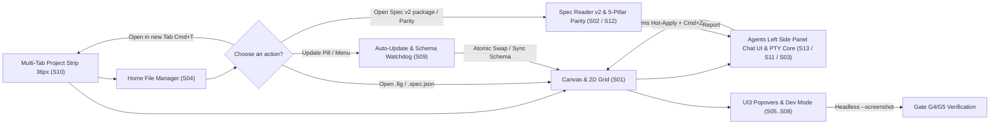

- Owner, revision, template version: po@designos.local · rev 2.8 · template v2

## 1. Problem and context

Product engineers, systems designers and AI coding agents (`claude`, `codex`, `agy`, `grok`) need a unified 120fps native workspace branded **`design`:os studio** (always all lowercase, with **`design`** in bold and `:os studio` in lowercase), where:
1. Binary `.fig` design files (Kiwi container v106) are read/written losslessly 1:1, with direct interaction on all 17 node kinds and 2D CSS Grid layout.
2. The whole Figma UI3 Dark Mode surface (`Desktop Tab Strip 36px`, `Home File Manager`, `Canvas`, `Left Rail 48px`, `Left Sidebar 240px`, `Agents Left Side Panel 240px–320px`, `Right Inspector 240px`, `Bottom Floating Toolbar 528×48px`, 3-tab `Type settings`, `Actions Cmd+K`, `Zoom/View`, `Color/Variables Picker`, `Dev Mode </>`) works exactly 1:1.
3. Users can open and work on **multiple project tabs at once (`Multiple Tab Project Workspace`, `S10`)**, with `Document`, `History` (Undo/Redo), `Page`, `Selection`, `View` (Zoom/Pan) and `Dev Mode` state fully isolated per tab.
4. The `product-os-spec-driven` Format v2 spec package (11 stages, 5 Role Views, 12-column `ui-contract.md`, `G1..G5` gates), the **5-Pillar Quantitative Figma Parity Meter (`S12`)** scorecard and the PTY Agent Terminal window (`S03` / `S11` / `S13`) are wired directly to the Canvas and 100% automatically verified in the background (`with_active(false)`).
5. The system has the **Dual-Layer Auto-Update Architecture (`S09`)**, the **Unified Phosphor Icons System (`https://phosphoricons.com/`, `DIR-19`, `US-14`)** and the **Pure Chat UI Wrapped over the PTY Terminal Shell (`Claude Code`, `Codex`, `Antigravity CLI` · `DIR-21`, `US-15`)** across all 13 screens `S01..S13`.

## 2. Product Goals & Success Metrics

- **`.fig` v106 binary compatibility**: Preserve 100% of `raw_fields`, `parameterConsumptionMap` (id=445), `symbolOverrides` and 2D CSS Grid layout on `.fig` round-trip (`SCN-01-01..03`, `SCN-07-01..03`).
- **UI, brand, Phosphor icon system & Figma UI3 interaction coverage**: Reach 99%+ visual and behavioural match across all 13 standard screens `S01..S13`, 17 node kinds and 8 interaction flows `UF-01..UF-08`; 100% of brand labels show **`design`:os studio** correctly; and 100% of `crate::icons::Icon` variants (except `Icon::Logo`) render from `@phosphor-icons/core` SVGs (`256×256`) through `resvg` snapped to the DPR pixel grid (`SCN-04-01..SCN-06-03`, `SCN-10-01..SCN-15-03`).
- **Spec Driven v2 traceability & Parity Meter accuracy**: 100% match between `REQ-01..REQ-18`, `US-01..US-15`, the 78 `ui-contract.md` rows, the 46 `SCN-*` scenarios, the 5-pillar `parity-scorecard.json` scorecard and the 5 review gates `G1..G5` (`SCN-02-01..03`, `SCN-12-01..03`).
- **Non-intrusive background verification & atomic updates**: 100% of test screenshot commands (`--screenshot`, `--parity-report`) run in the background with `with_active(false)` (`SCN-08-01..03`) and 100% of update packages are `SHA-256` verified with `.bak` restore (`SCN-09-01..03`).

## 3. End-to-End Flow Architecture

## 4. Requirements and rules (`REQ-01..REQ-18`)

### 4.1 1:1 Figma Canvas Core, `.fig` v106 Binary & 2D CSS Grid

| ID | Requirement | Source | US |
|---|---|---|---|
| REQ-01 | Read and write the binary `.fig` format (Kiwi v106) directly, losslessly preserving extended fields (`raw_fields`, `parameterConsumptionMap`, `symbolOverrides`, `fontVariations`, `toggledOnOTFeatures`), and support Auto-Layout 2D CSS Grid (`fr`, `px`, `auto`, `col_span`, `row_span`). | contract BR-01 (D1) | US-01, US-06 |
| REQ-02 | Allow applying a declarative `.spec.json` design (`NodeSpec`) directly to the current Canvas, or exporting the selected Frame to `.spec.json` / `.fig`, in 1 click. | contract BR-01, BR-05 (D1, D5) | US-01 |

### 4.2 PRODUCT:OS Spec Driven v2 Reader & Role Views

| ID | Requirement | Source | US |
|---|---|---|---|
| REQ-03 | Automatically detect and load both the Spec Format v2 package (`spec.manifest.json`, `config/pipeline.yaml`, `clarify/clarifications.md`, `contract/FC-001.md`, `prd/PRD.md`, `us/US-*.md`, `wireframe/W-01.md`, `prototype/P-01.md`, `design/tokens.md`, `tdd/test-plan.md`, `ux/ui-contract.md`, `handoff/READY.md`, `review/gates/*.md`) and legacy packages (`brainstorm.md`, `usecases.md`, `plan.md`). | contract BR-02, BR-03 (D2, D3) | US-02, US-11 |
| REQ-04 | Show the 5 standard Role Views (`PO View`, `Dev View (US & AC)`, `QA & Coverage`, `Wireframes & UI Contract`, `Gates & Canvas`) with the 4-Metric KPI Strip, the Attention Line and a `Copy for AI` button that cites the exact source line. | contract BR-02, BR-04 (D4) | US-02, US-12 |

### 4.3 Embedded PTY Agent Terminal & Live Canvas Bridge

| ID | Requirement | Source | US |
|---|---|---|---|
| REQ-05 | Integrate a multi-tab PTY terminal (`claude`, `codex`, `agy`, `grok`, `$SHELL`) inside Studio, automatically inject `DESIGNOS_*` environment variables, receive `Copy for AI` content directly from the Spec Reader and sync generated `NodeSpec` to the Canvas at 120fps. | contract BR-04, BR-05 (D4, D5) | US-03, US-11, US-15 |

### 4.4 Home Screen, UI3 Chrome, Popovers & 17 Node Kind Interactions

| ID | Requirement | Source | US |
|---|---|---|---|
| REQ-06 | Provide a Figma UI3 standard Home & File Manager screen (`S04`) with 5 sections (`Drafts`, `All folders`, `Resources / Templates`, `Starred`, `Trash`), search, file-type filter, sorting, Grid/List toggle, file-type badges and a right-click context menu. | contract BR-06 (D6) | US-04 |
| REQ-07 | Render the Figma UI3 Chrome, the **`design`:os studio** brand (always lowercase, with **`design`** in bold), Settings, Menus and Popovers (`S05..S08`) exactly: the `#1E1E1E`/`#2C2C2C`/`#383838`/`#0D99FF` palette, the 3-tab `Type settings` dialog (`Basic \| Details \| Variable`), the bottom-docked `Actions (Cmd+K)` bar, the `Zoom/View` menu with a `%` input, `Color Picker`, `Scoped Variables Picker` and `Dev Mode (</>)` Box Model + 5-language code generation. | contract BR-07, BR-08, BR-14, BR-22 (D6, D10, D17) | US-05, US-14 |
| REQ-08 | Support 1:1 Figma direct interaction on all 17 node kinds on the Canvas (`S01`): `#0D99FF` and `#9747FF` hover/selection outlines, `double-click` drill-down, 8 resize handles, corner-radius handles, pink padding/gap handles, `Alt` distance measurement and the dotted 2D CSS Grid overlay. | contract BR-09 (D1, D6) | US-06 |

### 4.5 Figma Architecture Reverse Engineering (`REA`) & Background Verification (`Headless Verification`)

| ID | Requirement | Source | US |
|---|---|---|---|
| REQ-09 | Run the reverse-engineering process (`morluto/rea`) on `/Applications/Figma.app` (`app.asar`) and `/Users/jangtrinh/Downloads/VSF - PCP.fig` to extract and automatically verify the Kiwi v106 binary schema, the variable mapping table and the UI3 token system. | contract BR-10 (D7) | US-07 |
| REQ-10 | Ensure every automated screenshot and UI test command (`--screenshot`, `--panel`, `--menu`, `--popover`, `--parity-report`) runs entirely in the background (`with_visible(false).with_active(false)`), never takes macOS window focus, and verifies 99%+ parity for Gates `G4`/`G5`. | contract BR-11, BR-12 (D8) | US-08 |
| REQ-20 | Automatically regenerate the 16 Retina 2x visual proof images (`docs/screenshots/*.png`) in the background (`with_visible(false).with_active(false)`) via `scripts/capture-visual-proof.sh`, fully reflecting Phosphor Icons (`DIR-19`), the `Agents` Pure PTY Chat Wrapper (`DIR-21`), `387/387 (100.00%)` Parity (`DIR-20`) and cross-platform packaging (`DIR-22`), and upgrade `README.md` (12-Section AI-Ready README, 5-Gate `D1..D5`) and `docs/index.html` (9-Tier GitHub Pages, SEO/AEO/GEO `G1..G5`) to the `https://github.com/jangtrinh/design-os-github-page` standard (`DIR-23`). | contract BR-25 (D20) | US-08, US-15 |

### 4.6 Dual-Layer Auto-Update & Cross-Platform Release Packaging (`DIR-11`, `DIR-22`)

| ID | Requirement | Source | US |
|---|---|---|---|
| REQ-11 | Provide a 2-layer auto-update mechanism (`updater.rs` + `designos update` + screen `S09`): (1) automatically check, download in the background, verify the `SHA-256` hash, swap atomically (`.staged` → `.bak` → rename) and support `Rollback` across the 3 channels `Stable \| Beta \| Nightly`; (2) passively watch `/Applications/Figma.app/Contents/Info.plist` & `app.asar` / the Kiwi schema (`v106`) read-only to warn and sync the schema instantly (`Sync Figma Schema`). | contract BR-13 (D9) | US-09 |
| REQ-19 | Provide a final cross-platform release packaging workflow (`macOS`, `Windows`, `Linux` · `DIR-22`) including all 4 executables (`designos-studio`, `designos`, `designos-mcp`, `designos-diff`): a `.app` bundle (`os.design.studio`) + a `.dmg` drag-to-`/Applications` installer + `install-cli.command` + `.tar.gz` on macOS (`scripts/package-macos.sh`), an NSIS GUI installer `-setup.exe` (`packaging/windows/installer.nsi`) + PowerShell scripts `install.ps1`/`uninstall.ps1` + `.zip` on Windows (`scripts/package-windows.ps1`), a Debian/Ubuntu `.deb` package + `.tar.gz` with `./install.sh` / `.desktop` / MIME XML / `AppRun` on Linux (`scripts/package-linux.sh`), plus the `scripts/build-release.sh` orchestrator and `.github/workflows/release.yml`, which automatically generate `dist/release-manifest.json` + `SHA256SUMS` for `updater.rs`. | contract BR-24 (D19) | US-09 |

### 4.7 Multiple Tab Project Workspace & Brand Wordmark

| ID | Requirement | Source | US |
|---|---|---|---|
| REQ-12 | Provide the **Figma UI3 Desktop Tab Strip (`36px`, `S10`)**, supporting opening, pinning (`Pin`), duplicating (`Duplicate`), closing (`×` / `Cmd+W`) and instant switching (`Cmd+T`, `Ctrl+Tab` / `Cmd+Shift+]`, `Cmd+1..9`) between multiple parallel project tabs (`Design`, `FigJam`, `Slides`, `Specs`) with fully isolated per-tab state (`Document`, `History` undo/redo, active `Page`, `Selection`, `View` zoom/pan, `Dev Mode`, `dirty`, `file_path`), while applying the lowercase **`design`:os studio** brand rule (**`design`** in bold `700`, `:os studio` in regular `400`). | contract BR-14, BR-15 (D10, D11) | US-10 |

### 4.8 1:1 Figma AI Agent Suite, 5-Runtime PTY Core & Quantitative `%` Parity Meter

| ID | Requirement | Source | US |
|---|---|---|---|
| REQ-13 | Provide the full set of **6 Figma AI actions** (`Make Design / First Draft`, `Make Prototype`, `Rename Layers`, `Rewrite / Translate / Shorten Text`, `Populate Realistic Data`, `Design Gate Audit & Auto-Fix`) on `Actions (⌘K)` (`S06`), `Agents` (`S11`/`S13`) and the Canvas Context Menu, connected directly to the **5 CLI Runtime Presets (`claude`, `codex`, `agy`, `grok`, `$SHELL`)**, with `$DESIGNOS_LIVE_SPEC` hot-apply in `<50ms`, 1-step `Cmd+Z` undo, and closing Figma `126.9.13` Gaps A–F. | contract BR-16, BR-17, BR-18 (D12, D13) | US-11 |
| REQ-14 | Provide the **5-Pillar Quantitative 1:1 Figma Parity Meter (`S12`)** ($\text{Total} = 0.25 P_1 + 0.20 P_2 + 0.20 P_3 + 0.20 P_4 + 0.15 P_5$) through `scripts/figma_parity_meter.py`, `research/parity-scorecard.json`, the `designos --parity-report` CLI flag and the Live Parity Scorecard card in Spec Reader v2 (`S02` / `S12`). | contract BR-19 (D14) | US-12 |

### 4.9 `Agents` Left Side Panel (`DIR-17`), 9 Visual Deltas, 8 Userflows (`DIR-18`, `DIR-20`), Phosphor Icons System (`DIR-19`) & Pure PTY Chat Wrapper (`DIR-21`)

| ID | Requirement | Source | US |
|---|---|---|---|
| REQ-15 | Place the **`Agents` (`✦`)** item second on the Left Rail right below `File` (`DIR-17`) and render the **1:1 Figma UI3 `Agents` Left Side Panel (`240px–320px`, `S13`)** taking the full height from the panel top, with `< New chat / Shared` + `[AI]` + `[↗]` + `•••`, a `#26354A` banner, `"What's next?"`, 3 suggestion groups (`Tidy and polish`, `Generate designs`, `Create plugins and shaders`), an inline VT100 PTY `>_ Terminal` window (`claude`/`codex`/`grok`/`$SHELL`) and an `"Ask for changes"` input with a `#0D99FF` border, while fixing all **9 Visual Deltas (`DIR-18`)**. | contract BR-20 (D15) | US-13, US-15 |
| REQ-16 | Implement the exact 1:1 state machine for the **8 end-to-end user interaction flows (`UF-01..UF-08`, `DIR-18`, `DIR-20`)**: `UF-01` (clicking `File` on the Left Rail while on another item switches straight back to `File` in 1 click before collapsing), `UF-02` (`Agents` and `Assets` own the full Left Side Panel height), `UF-03` (two-way `Design \| Prototype \| </>` sync between the Bottom Toolbar and the Right Inspector), `UF-04` (`Home <-> Multi-Tab` switching preserves 100% of per-tab state), `UF-05` (suggestions and the input in the `Agents` Side Panel dispatch directly to the PTY/Canvas with 1-step `Undo`), `UF-06..UF-08` (end-to-end test `userflows_uf01_to_uf08_end_to_end_figma_parity`). | contract BR-21 (D16) | US-13 |
| REQ-17 | Unify 100% of the **`design`:os studio** icon system (`crate::icons::Icon`, except the `Icon::Logo` brand mark) across all 13 screens `S01..S13` onto the **official Phosphor Icons set (`https://phosphoricons.com/`, `@phosphor-icons/core` `viewBox="0 0 256 256"`, `fill="currentColor"`)** bundled at `crates/designos-app/assets/icons/phosphor/*.svg` and rasterised through `resvg` with an `SVG_CACHE` keyed by `(Icon, physical_px)` and DPR pixel-grid alignment (`round_to_pixel`) (`DIR-19`). | contract BR-22 (D17) | US-14 |
| REQ-18 | Implement the `Agents` surface (`RailItem::Agents`, `S13`) purely as a **Native Chat UI wrapped directly over the PTY Terminal Shell (`Claude Code`, `Codex`, `Antigravity CLI` · `DIR-21`)**: a 1-click quick selector (`Claude Code \| Codex \| Antigravity`), User/Assistant chat bubbles (`AgentChatTurn` / `AgentChatRole`) streaming ANSI-stripped stdout directly (`sync_chat_from_pty` + `strip_ansi_codes`), inline `NodeSpec` detection with a button/badge to apply it to the Canvas (`1-step Undo`), Selection + Pin-Comment (`+`) context attachment and instant switching between the clean Chat thread and the raw VT100 Terminal screen, with no paid external API key. | contract BR-23 (D18) | US-15 |
| REQ-21 | Implement the full set of **20 micro-interaction state machines 1:1 with Figma Desktop `126.9.13` (`MI-01..MI-20`, `ux/figma-micro-interactions-spec.md`)**, including: keyboard `ArrowUp`/`ArrowDown` number nudging (`±1`/`±10`/`±0.1`) that keeps the selection (`MI-01`), a Shunting-Yard math expression evaluator & `Mixed` relative math (`MI-02`), prefix label `Scrub` dragging (`1×`/`10×`/`0.1×`, `Alt+Wheel`, `<2px` click-to-focus, `Escape` rollback, `MI-03`), per-channel Hex `RR`/`GG`/`BB` nudging and `1–8` character Hex shorthand + CSS colour names (`MI-04`, `MI-05`), direct on-Canvas handles for Corner Radius (`MI-06`), Ellipse Arc/Donut/StartAngle (`MI-07`), Polygon/Star (`MI-08`), Auto-Layout Pink Padding/Gap (`MI-09`, `MI-10`), `Shift`/`Alt`/`Cmd`/`Space` modifier keys (`MI-11`, `MI-12`), the `#F24822` `Alt` distance measurement & smart guides (`MI-13`, `MI-14`), the `0–9` opacity key buffer `400ms` (`MI-15`), keyboard hierarchy navigation (`MI-16`), two-way Layer ↔ Canvas hover sync & quick `Tab` rename (`MI-17`, `MI-18`), the `I` Eyedropper colour loupe (`MI-19`) and quick Component/Auto-Layout actions (`MI-20`). | contract BR-09, BR-26 (D1, D6) | US-17 |

## 5. Dependencies, Assumptions and Handoff

- **Internal dependencies**: `crates/designos-doc`, `crates/designos-fig`, `crates/designos-render`, `crates/designos-gpu`, `crates/designos-export`, `crates/designos-app` (`src/icons.rs`, `src/terminal.rs`, `src/updater.rs`, `src/widgets/field.rs`, `src/widgets/picker.rs`, `src/canvas/handles.rs`, `src/canvas/interact.rs`, `src/canvas/draw.rs`, `assets/icons/phosphor/*.svg`), `crates/designos-mcp`, `scripts/build-release.sh`, `scripts/package-macos.sh`, `scripts/package-windows.ps1`, `scripts/package-linux.sh`, `scripts/capture-visual-proof.sh`, `README.md`, `docs/index.html`, `.github/workflows/release.yml`.
- **Handoff**: All 21 requirements `REQ-01..REQ-21` are broken down into `US-01..US-17`, verified through 52 `SCN-*` scenarios and signed off in `handoff/READY.md`.

