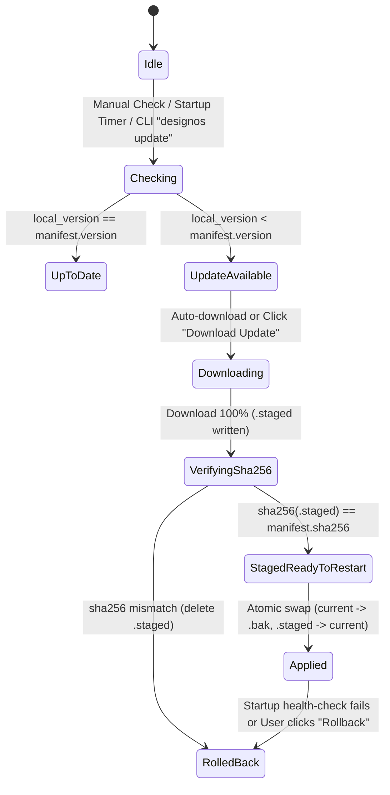

This document describes the Interactive State Machine, the 8 interaction flows 1:1 with Figma (`UF-01..UF-08`), the unified Phosphor Icons system (`DIR-19` / `US-14`), the native Chat UI wrapped directly over the PTY terminal shell (`Claude Code` / `Codex` / `Antigravity CLI`, `DIR-21` / `US-15`), the Figma UI3 standard shortcuts and the screen transition flow between `S01..S13` in **`design`:os studio**.

---

## 1. Screen Navigation State Machine (`S01..S13`)

```mermaid
stateDiagram-v2
    [*] --> S04_Home: Launch / Click Home Icon on S10 Tab Strip
    S04_Home --> S10_MultiTab: Open .fig / + New Design File (UF-04)
    S10_MultiTab --> S01_Canvas: Activate Project Tab (Isolated Document/History/View)
    S04_Home --> S02_SpecReader: Open Spec Format v2 Bundle
    S04_Home --> S09_AutoUpdate: Click Update Available Pill / Check for Updates
    S01_Canvas --> S13_AgentsSidePanel: Left Rail #2 -> Agents (✦) (UF-01 / UF-02 / DIR-21)
    S13_AgentsSidePanel --> S01_Canvas: Click File on Left Rail (1-Click Return UF-01) or Inline NodeSpec Apply
    S13_AgentsSidePanel --> S03_Terminal: Instant Toggle Chat Thread <-> Raw VT100 >_ Terminal or Pop-out [↗]
    S13_AgentsSidePanel --> S11_AgentSuite: Run Suggestion / Ask for changes (UF-05)
    S11_AgentSuite --> S01_Canvas: <50ms Live Spec Hot-Apply + 1-Step Cmd+Z Undo
    S01_Canvas --> S02_SpecReader: Left Rail -> Specs (RailItem::Specs)
    S02_SpecReader --> S12_ParityScorecard: View 5-Pillar Figma 1:1 Parity Meter
    S12_ParityScorecard --> S03_Terminal: Click "Copy Parity Report cho AI"
    S02_SpecReader --> S01_Canvas: Click "Apply Spec to Canvas" / "Focus Frame"
    S02_SpecReader --> S03_Terminal: Click "Copy for AI" -> Paste Citation
    S01_Canvas --> S05_TypeAndZoom: Click Typography "⋯" or "Zoom % ⌄"
    S01_Canvas --> S06_ActionsCmdK: Press Cmd+K / Click Bottom Toolbar Actions
    S01_Canvas --> S07_DevMode: Toggle Dev Mode "</>" (Shift+D / UF-03)
    S01_Canvas --> S08_ColorAndVars: Click Fill/Stroke Swatch or Variable Pill
    S01_Canvas --> S09_AutoUpdate: Main Menu -> Desktop app -> Check for Updates
```

---

## 2. Dual-Layer Auto-Update State Machine (`S09`)



---

## 3. Shortcuts, 8 Userflows (`UF-01..UF-08`) & Figma UI3 Standard Interactions (`S01..S13`)

| Shortcut / Mouse action | Source screen | Target screen / state | Observable Behavior | Scenario (`SCN`) |
|---|---|---|---|---|
| `V` / `F` / `R` / `O` / `P` / `T` / `C` | `S01` | `S01` (`Active Tool`) | Switch tools on the floating bottom bar (`Move`, `Frame`, `Rectangle`, `Ellipse`, `Pen`, `Text`, `Comment`) using standard Phosphor icons; the selected button is filled `#0D99FF` blue. | `SCN-06-01`, `SCN-13-02`, `SCN-14-03` |
| Mouse `Hover` on a Canvas element | `S01` | `S01` (`Hover Outline`) | Draw a `1px` `#0D99FF` outline (`#9747FF` for Component/Instance) around the bounding box of any node of the 17 `NodeKind` kinds. | `SCN-06-01` |
| `Double-click` on a Frame/Group/Instance | `S01` | `S01` (`Drill-Down`) | Drill one level into the subtree; for a `Text` node open an in-place edit cursor; for a `Vector` turn on Bezier vertex editing. | `SCN-06-01` |
| Drag a corner-radius handle / pink Auto-Layout handle | `S01` | `S01` (`Live Handle Drag`) | Update `corner_radius`, `padding` or `item_spacing` / `grid_gap` live with a floating number label and record an `Undo` command. | `SCN-06-02` |
| Hold `Alt` (`Option`) with 1 node selected | `S01`, `S07` | `S01`, `S07` (`Redline Measure`) | Draw red/orange guides with the exact pixel distance from the selected node to the hovered element or the parent Frame edge. | `SCN-06-02`, `SCN-05-03` |
| Choose `Flow: Grid` in the Right Inspector | `S01` | `S01` (`2D CSS Grid`) | Switch the Frame to `LayoutDirection::Grid`, showing dotted grid cell lines and track labels (`1fr`, `2fr`, `auto`, `px`) on the Canvas. | `SCN-01-02`, `SCN-06-03` |
| Press `Cmd+K` or the bottom `Actions` button | `S01` | `S06`, `S11` (`Bottom Cmd+K`) | Open the `Actions` dialog docked `68px` from the bottom with 4 underlined tabs `All \| Assets \| Plugins & widgets \| Design Gate`, `[AI]`/`[Development]` labels and the 6 Figma AI actions. | `SCN-05-02`, `SCN-11-02`, `SCN-13-02` |
| Click `⋯` in the `Typography` section | `S01` | `S05` (`Type Settings`) | Open the `Type settings` popover with content filtered per tab (`Basic \| Details \| Variable`), drag variable axes and toggle OpenType flags. | `SCN-05-01`, `SCN-11-04` |
| Click `Zoom % ⌄` in the top-right corner | `S01` | `S05` (`Zoom/View Menu`) | Open the Zoom menu with a direct `%` input and the `Pixel grid`, `Snap to pixel grid`, `Layout grids`, `Rulers` toggles. | `SCN-05-02` |
| Press `Shift+D` or `Draw \| Design \| </>` (`UF-03`) | `S01` | `S07` (`Dev Mode / Mode Sync`) | Instant two-way sync between the Bottom Toolbar 3-way switcher and the Right Inspector (`RightTab::Design`, `RightTab::Prototype`, or `Inspect \| Plugins` with `v MCP` & `Code Connect` in Dev Mode). | `SCN-05-03`, `SCN-13-02`, `SCN-13-03` |
| Click a colour swatch or the 4-dot `∷` icon | `S01` | `S08` (`Color / Variables`) | Open the `Color Picker` (with WCAG AA/AAA contrast check) or the `Scoped Variables Picker` with `/` group headings. | `SCN-05-03`, `SCN-11-04` |
| Click `Copy for AI` / `Copy Parity Report for AI` | `S02`, `S12` | `S02`/`S12` → `S03` | Generate a standard Markdown citation block (`File: <path>:<start>-<end>`), store it in `last_ai_copy` and pass it to the PTY Terminal. | `SCN-02-02`, `SCN-03-02`, `SCN-12-03` |
| Click `Update available` or `Check for Updates…` | `S04`, `S01` | `S09` (`Auto-Update Modal`) | Open the `Auto-Update & Figma Schema Watchdog` dialog, switch the `Stable/Beta/Nightly` channel, apply `.staged`, restore `.bak` or run `Sync Figma Schema`. | `SCN-09-01..03` |
| Press `+` / `Cmd+T` / `Cmd+W` / `Home <-> Tab` (`UF-04`) | `S10`, `S04`, `S01` | `S10` (`Multi-Tab Project Switch`) | Open/switch instantly between `Home` and the open project tabs with fully independent `Document`, `History` (Undo/Redo), `Page`, `Selection` and `Zoom/Pan` state; show the **`design`:os studio** brand. | `SCN-10-01..03`, `SCN-13-03` |
| Click `Agents` (`✦`) then click `File` on the Left Rail (`UF-01`, `UF-02`, `UF-05`) | `S01`, `S13` | `S13` ↔ `S01` (`Agents Side Panel`) | Clicking `Agents` (`✦`, item #2 on the Left Rail) opens the `Agents` panel taking the full Left Side Panel height (`240px–320px`) with a VT100 PTY `>_ Terminal` and a `#0D99FF` `"Ask for changes"` input; clicking `File` once switches straight back to `Pages & Layers`, and only a second click collapses the panel. | `SCN-13-01`, `SCN-13-03` |
| Choose the `Claude Code \| Codex \| Antigravity` pill & send a message in `Agents` (`DIR-21`) | `S13` | `S13` ↔ `S03` ↔ `S01` (`Pure PTY Chat Wrapper`) | Start/switch the `claude`/`codex`/`agy` PTY session, write the command to stdin, sync ANSI-stripped stdout (`sync_chat_from_pty` + `strip_ansi_codes`) into the Assistant bubble (`AgentChatTurn`), detect inline `NodeSpec` to apply to the Canvas (`1-step Undo`), attach Selection/Pin-Comment (`+`) context and switch instantly between the Chat thread and the raw VT100 Terminal screen. | `SCN-15-01..03` |
| Render `Icon` on `S01..S13` (`DIR-19`) | `S01..S13` | `S01..S13` (`Phosphor Icons`) | Every `crate::icons::Icon` variant (except `Icon::Logo`) loads its SVG from `assets/icons/phosphor/*.svg` (`256×256`), is rasterised through `resvg` into `SVG_CACHE` keyed by `(Icon, physical_px)` and aligned to the DPR pixel grid (`round_to_pixel`). | `SCN-14-01..03` |
| Run the CLI `--screenshot <path.png>` / `--parity-report` | CLI | `S01..S13` (`Headless`) | Launch with `with_visible(false).with_active(false)` and render/report in the background without taking macOS window focus. | `SCN-08-01..03`, `SCN-12-02` |
