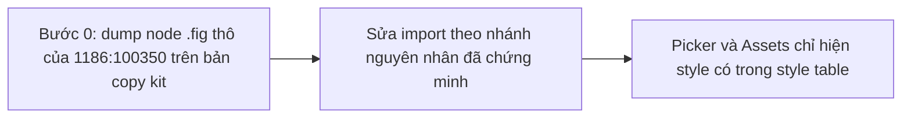
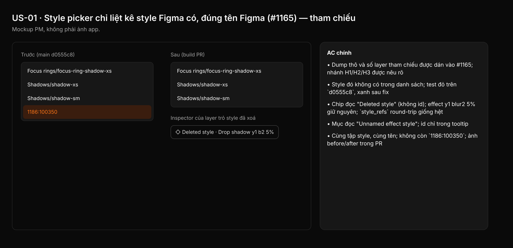

## 1. User Story
Là designer mở kit Untitled UI PRO v8.0, tôi thấy trong style picker đúng các style Figma liệt kê, dưới tên Figma, để không gặp mục lạ như `1186:100350` mà không biết là gì.

## 2. Flow
| Bước | Hành động | Phản hồi |
|---|---|---|
| 1 | Bước 0: dump node .fig thô của 1186:100350 trên bản copy kit | Xem AC liên quan |
| 2 | Sửa import theo nhánh nguyên nhân đã chứng minh | Xem AC liên quan |
| 3 | Picker và Assets chỉ hiện style có trong style table | Xem AC liên quan |

## 3. Data and rules
Phát hiện từ code (origin/main `d0555c8`):
- `designos-doc::Document::style_name` trả về key khi `style_meta` thiếu hoặc tên rỗng; MCP `get_document` cũng thế. Vì vậy "name = `1186:100350`" có nghĩa: **không có meta**, hoặc meta có tên rỗng.
- `rest_import::apply_style_node_values` và đoạn seed giá trị "from the first consumer" tạo `doc.styles[id]` cho mọi style id mà một layer tham chiếu, kể cả khi id đó không có trong style table. `style_meta()` chỉ tạo meta cho id có trong map `styles`.
- `fig.rs::style_table` bỏ style `isSoftDeletedStyle`/`isSoftDeleted` nhưng không lọc `phase == "REMOVED"` như bộ lọc node (khoảng dòng 386). Nó cũng ghi `name` rỗng mà không có fallback.
- Ba nhánh nguyên nhân: (H1) style đã xoá mềm hoặc REMOVED nhưng layer vẫn trỏ tới, nên bị seed thành style không meta (khả năng cao nhất, vì description cũng rỗng); (H2) layer trỏ tới style của library ngoài, node không có trong file; (H3) style thật có `name` rỗng.

Rule:
- R1. Chỉ liệt kê trong picker, Assets và `search_design_system` các style có trong style table của file (đã lọc soft-deleted và REMOVED). Style chỉ được layer tham chiếu ("orphan") không vào danh sách.
- R2. Layer đang trỏ tới style orphan giữ nguyên giá trị hiển thị và `style_refs`, để export .fig round-trip không đổi. Inspector hiện chip "Deleted style" (hoặc "Missing library style" với H2), không hiện id thô.
- R3. Style có trong table mà tên rỗng: hiện "Unnamed effect style" (theo loại: fill, text, effect, grid). Id chỉ nằm trong tooltip.
- R4. Không đoán. Bước 0 phải dán dump node thô (`name`, `styleType`, `isSoftDeletedStyle`, `isSoftDeleted`, `phase`, `isPublishable`, `key`) và số layer tham chiếu vào issue trước khi code.

Dependency: Cần bản copy kit Untitled UI PRO VARIABLES v8.0 trên máy dev (không có trên box). Phối hợp #129 / PR #1153 (thứ tự và folder của picker).

## 4. Acceptance Criteria
| ID | Given | When | Then | Source |
|---|---|---|---|---|
| AC-01 | Bản copy kit, build `d0555c8` | Chạy dump Bước 0 cho `1186:100350` | Dump thô và số layer tham chiếu được dán vào #1165; nhánh H1/H2/H3 được nêu rõ | R4 |
| AC-02 | Fixture .fig tối giản: 1 effect style soft-deleted (và 1 với `phase: REMOVED`) có 1 layer tham chiếu | Import rồi gọi `style_entries_of(Effect)` | Style đó không có trong danh sách; test đỏ trên `d0555c8`, xanh sau fix | R1 |
| AC-03 | Cùng fixture | Chọn layer tham chiếu, mở Inspector, rồi export .fig và import lại | Chip đọc "Deleted style" (không id); effect y1 blur2 5% giữ nguyên; `style_refs` round-trip giống hệt | R2 |
| AC-04 | Fixture style trong table, `name` rỗng | Mở picker | Mục đọc "Unnamed effect style"; id chỉ trong tooltip | R3 |
| AC-05 | Bản copy kit | Mở effect style picker trên build PR, đặt cạnh danh sách Local styles của Figma | Cùng tập style, cùng tên; không còn `1186:100350`; ảnh before/after trong PR | Expected của #1165 |

Test steps: [tests/cases/US-01.md](../tests/cases/US-01.md).

## 5. Edge cases
- Style orphan được nhiều layer dùng: mọi layer giữ giá trị, không layer nào tự detach.
- Người dùng chọn lại style khác cho layer orphan: ref cũ thay bằng ref mới như bình thường.
- Style library ngoài (H2) mà library đã nối: dùng tên từ library, không coi là orphan.
- Style hidden khi publish (`isPublishable: false`, tên bắt đầu `_` hoặc `.`): Figma vẫn liệt kê trong Local styles, nên Studio vẫn liệt kê.
- MCP `search_design_system` và `get_document` dùng cùng rule R1–R3 với app.
- File .designos cũ đã lưu style orphan trong `doc.styles`: mở lại vẫn ẩn khỏi picker (rule tính lúc liệt kê, không cần migrate).
- Tên chỉ có khoảng trắng: coi như rỗng.

## 6. UI
Ảnh tham chiếu (mockup PM, không phải ảnh app): 

Bằng chứng thật bắt buộc trong PR: ảnh picker before/after trên bản copy kit, đặt cạnh Local styles của Figma.
