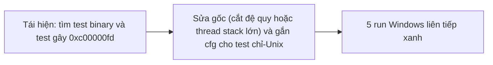
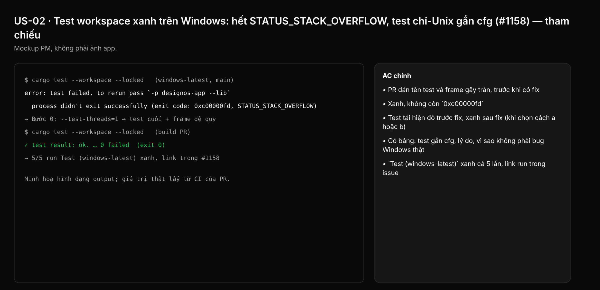

## 1. User Story
Là maintainer, tôi cần `Test (windows-latest)` xanh vì lý do thật, không vì tắt test, để một lần CI đỏ có nghĩa là có lỗi (hiện 84% run PR đỏ chỉ do Windows).

## 2. Flow
| Bước | Hành động | Phản hồi |
|---|---|---|
| 1 | Tái hiện: tìm test binary và test gây 0xc00000fd | Xem AC liên quan |
| 2 | Sửa gốc (cắt đệ quy hoặc thread stack lớn) và gắn cfg cho test chỉ-Unix | Xem AC liên quan |
| 3 | 5 run Windows liên tiếp xanh | Xem AC liên quan |

## 3. Data and rules
- Nguồn: issue #1158; bằng chứng job 120860483725 (`exit code: 0xc00000fd, STATUS_STACK_OVERFLOW`). Main thread Windows có stack 1 MB; Linux/macOS 8 MB. Thread test của libtest mặc định 2 MB trên mọi OS, nên tràn có thể ở main thread của một test binary chạy UI/harness, hoặc ở đệ quy sâu.
- R1. Bước 0: xác định test và stack frame gây tràn (chạy từng test binary với `--test-threads=1`, ghi tên test cuối). Dán vào PR.
- R2. Thứ tự ưu tiên sửa: (a) cắt đệ quy nếu đệ quy theo độ sâu dữ liệu; (b) chạy phần nặng trong `std::thread::Builder::new().stack_size(..)`; (c) `RUST_MIN_STACK` chỉ cho test. Nếu bin release có cùng đường đệ quy, ghi rõ có cần `/STACK` hay không.
- R3. Test giả định POSIX (`sh`, đường dẫn Unix) gắn `#[cfg(unix)]` hoặc `#[cfg_attr(windows, ignore = "lý do")]`. Danh sách test kèm lý do nằm trong mô tả PR. Không gắn ignore cho test fail vì bug thật trên Windows.
- R4. Mọi thay đổi `.github/workflows` cần Jang review khi merge. Ngoài scope (Jang chưa duyệt): cho Windows optional trên PR, path filters, cache.
- R5. Spec này không cho phép ship v0.6.3+ với Windows đỏ. Quyết định đó vẫn là OPEN DECISION của Jang.

Dependency: Không chặn bởi issue khác. Mở khoá gate "Windows xanh" trong `pm/v063-ship-runbook-2026-10-25.md`.

## 4. Acceptance Criteria
| ID | Given | When | Then | Source |
|---|---|---|---|---|
| AC-01 | Runner windows-latest, main hiện tại | Chạy Bước 0 | PR dán tên test và frame gây tràn, trước khi có fix | R1 |
| AC-02 | Build PR trên Windows | `cargo test --workspace --locked` | Xanh, không còn `0xc00000fd` | Issue: Cách test |
| AC-03 | Test đệ quy sâu hoặc fixture lớn gây tràn | Chạy trên Linux với `ulimit -s 1024` hoặc thread 1 MB | Test tái hiện đỏ trước fix, xanh sau fix (khi chọn cách a hoặc b) | R2 |
| AC-04 | Mô tả PR | Review | Có bảng: test gắn cfg, lý do, vì sao không phải bug Windows thật | R3 |
| AC-05 | Sau merge | 5 run CI liên tiếp trên main hoặc PR | `Test (windows-latest)` xanh cả 5 lần, link run trong issue | Issue: Done khi |

Test steps: [tests/cases/US-02.md](../tests/cases/US-02.md).

## 5. Edge cases
- Tràn chỉ xảy ra trong debug (frame lớn hơn), không trong release: vẫn phải sửa vì CI chạy debug.
- `RUST_MIN_STACK` không đổi stack của main thread: không dùng nó cho test chạy trên main thread.
- Test fail trên Windows vì CRLF hoặc `\\`: đây là bug thật, sửa code hoặc test, không ignore.
- Test `io::dialog_probe` dựa vào thư mục data chuẩn: dùng thư mục đúng của Windows thay vì ignore nếu được.
- Flake (đỏ rồi xanh không đổi code): ghi lại, không tính vào 5 run xanh.
- Fix chạm workflow: dừng, chờ Jang review.

## 6. UI
Ảnh tham chiếu (mockup PM, không phải ảnh app): 

Bằng chứng thật bắt buộc trong PR: log CI/terminal trên build PR (không có UI mới).
