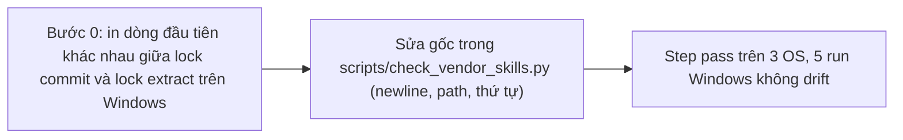

## 1. User Story
Là maintainer, tôi cần step "Validate vendored skills" cho cùng kết quả trên cả 3 OS, để `rules-lock-drift` chỉ báo khi upstream rules đổi thật (hiện fail 313 lần trên Windows trong 10 ngày).

## 2. Flow
| Bước | Hành động | Phản hồi |
|---|---|---|
| 1 | Bước 0: in dòng đầu tiên khác nhau giữa lock commit và lock extract trên Windows | Xem AC liên quan |
| 2 | Sửa gốc trong `scripts/check_vendor_skills.py` (newline, path, thứ tự) | Xem AC liên quan |
| 3 | Step pass trên 3 OS, 5 run Windows không drift | Xem AC liên quan |

## 3. Data and rules
- Nguồn: issue #1159; bằng chứng job 118576713464 (`AssertionError: 1 != 0 : Expected extract exit 0, got: ['rules-lock-drift: …']`), tức lỗi nằm ở `scripts/test_check_vendor_skills.py` gọi `extract`.
- Phát hiện mới (origin/main): `skills/vendor/jakubkrehel-skills/rules.lock` đã nằm dưới `skills/vendor/** -text` nên git **không** đổi nó sang CRLF. `cmd_extract` so `read_text()` với chuỗi tạo ra, mà `read_text` đã gộp CRLF về LF. Vậy giả thuyết CRLF trong issue có thể không phải gốc. Nghi vấn khác: `write_text` trong test fixture trên Windows ghi CRLF vào file .md upstream và làm đổi text rule/sha1; thứ tự `rglob` + `rule_file_order_key` khác theo OS; hoặc `\\` trong rule id.
- R1. Bước 0 bắt buộc: thêm vào thông báo `rules-lock-drift` số dòng và nội dung dòng đầu tiên khác nhau (cả hai phía). Thay đổi này tự nó có ích và giữ lại sau fix.
- R2. Sửa đúng gốc đã thấy ở R1. Đọc/ghi file dùng `newline="\n"`. Rule id và mọi đường dẫn so sánh dùng `.as_posix()`. Thứ tự file không phụ thuộc OS hay hoa thường.
- R3. Thêm `rules.lock text eol=lf` cụ thể vào `.gitattributes` chỉ khi Bước 0 cho thấy cần; nếu không, ghi lý do không thêm trong PR.
- R4. Không sửa `.github/workflows` (cần Jang).

Dependency: Độc lập với US-02; cùng mục tiêu Windows xanh.

## 4. Acceptance Criteria
| ID | Given | When | Then | Source |
|---|---|---|---|---|
| AC-01 | Runner windows-latest, main hiện tại | Chạy step với R1 | Log có dòng đầu tiên khác nhau; dán vào PR làm bằng chứng gốc | R1 |
| AC-02 | Unit test mới mô phỏng Windows (CRLF trong upstream .md, path `\\`, thứ tự file đảo) | `python3 -B -m unittest scripts/test_check_vendor_skills.py` trên Linux | Đỏ trước fix, xanh sau fix | R2 |
| AC-03 | Build PR | `python3 -B scripts/check_vendor_skills.py verify && … extract && … map-coverage` + unittest trên Windows, Linux, macOS | Exit 0 cả 3 OS | Issue: Cách test |
| AC-04 | Lock commit không đổi | Chạy `extract --write` trên Windows | `git diff --exit-code` sạch (byte-identical) | R2 |
| AC-05 | Sau merge | 5 run Windows liên tiếp | Không còn `rules-lock-drift` | Issue: Done khi |

Test steps: [tests/cases/US-03.md](../tests/cases/US-03.md).

## 5. Edge cases
- Upstream rules đổi thật: drift vẫn phải báo đỏ trên cả 3 OS (không làm mù check).
- Text rule chứa `\r` giữa dòng: đã thay bằng khoảng trắng, giữ nguyên hành vi.
- Repo checkout với `core.autocrlf=true`: kết quả giống `false`.
- Tên file upstream khác hoa thường: thứ tự xác định, như nhau trên mọi OS.
- File lock có BOM: báo lỗi rõ, không im lặng coi là drift.

## 6. UI
Ảnh tham chiếu (mockup PM, không phải ảnh app): 

Bằng chứng thật bắt buộc trong PR: log CI/terminal trên build PR (không có UI mới).
