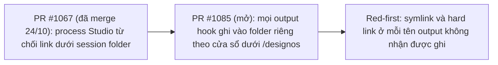

## 1. User Story
Là người dùng chạy nhiều tab agent trong một cửa sổ, tôi cần hook của một tab không bao giờ ghi đè file khác của tôi qua một link mà agent tab khác cài vào session folder.

## 2. Flow
| Bước | Hành động | Phản hồi |
|---|---|---|
| 1 | PR #1067 (đã merge 24/10): process Studio từ chối link dưới session folder | Xem AC liên quan |
| 2 | PR #1085 (mở): mọi output hook ghi vào folder riêng theo cửa sổ dưới `<data dir>/designos` | Xem AC liên quan |
| 3 | Red-first: symlink và hard link ở mỗi tên output không nhận được ghi | Xem AC liên quan |

## 3. Data and rules
- Trạng thái "partial": #1067 và #1078 đã merge; phần còn lại là PR #1085 (`fix/1072-private-hook-outputs`, head cập nhật 25/10 22:48 ICT, MERGEABLE). CI lúc viết: Clippy, Codegen, Design, Rustfmt, macOS xanh; Ubuntu và Windows đang chạy.
- Threat model đã chỉnh (comment của Jang 24/10): cần config Codex của chính người dùng cho phép ghi session folder không hỏi (`workspace-write`, `[projects]` trust, `auto_review`), một lần "Trust and continue" cho repo chứa folder, hoặc một lệnh người dùng duyệt. Fix vẫn giữ; release notes nêu điều kiện này.
- R1. Mọi output hook (`agent-status.json`, `agent-events.jsonl`, `turn-marks.jsonl`, capture transcript `claude-transcript.json.tmp.$$`, marker) ghi vào folder riêng theo cửa sổ, nằm ngoài mọi grant của agent. Studio đọc từ đó.
- R2. Không còn lệnh hook nào dùng `>` hay `>>` vào session folder dùng chung.
- R3. Status, stop, receipts và turn marks hoạt động như trước với Claude, Codex, Gemini, Grok, Antigravity.
- R4. Hook chạy được trên `dash` (Ubuntu) và `sh` của macOS.
- R5. Ship theo `pm/v063-ship-runbook-2026-10-25.md`: Windows phải xanh, trừ khi Jang chấp nhận Windows đỏ (OPEN DECISION, chưa quyết). Chỉ Jang merge.

Dependency: PR #1085 (mở) rebase lên `v0.6.2`, retarget `release/v0.6.3`. Gate Windows phụ thuộc US-02 (#1158) hoặc quyết định của Jang.

## 4. Acceptance Criteria
| ID | Given | When | Then | Source |
|---|---|---|---|---|
| AC-01 | Lệnh hook chính xác Studio cài (lấy từ `hooks.json` của build PR) | Đặt symlink ở mỗi tên output trong session folder, rồi kích SessionStart, UserPromptSubmit, Pre/PostToolUse, Stop | File đích của link không đổi byte nào | R1, R2; issue Red first |
| AC-02 | Như trên với hard link | Kích cùng các hook | File đích không đổi | R1 |
| AC-03 | Một tab Claude và một tab Codex cùng cửa sổ | Chạy một turn mỗi tab | Status, events, turn marks, stop và receipts hiện như build `v0.6.2` | R3 |
| AC-04 | Ubuntu với `/bin/sh` = dash | Chạy test hook quoting | Xanh, không lỗi cú pháp | R4 |
| AC-05 | PR #1085 trên `release/v0.6.3` | Đọc `gh pr checks` | Mọi check xanh, gồm Windows; nếu Windows đỏ thì dừng chờ Jang | R5 |
| AC-06 | Tìm trong source | `rg -n "> *'?\$?\{?.*(agent-status\|agent-events\|turn-marks)" crates/designos-app/src` | Không còn redirect nào vào session folder dùng chung | R2 |

Test steps: [tests/cases/US-04.md](../tests/cases/US-04.md).

## 5. Edge cases
- Folder riêng không tạo được (ổ đầy, quyền): tab mở ở chế độ không hook và báo rõ, không rơi về session folder.
- Link được cài sau khi Studio kiểm: ghi vẫn ở folder riêng nên không bị ảnh hưởng (TOCTOU).
- Hai cửa sổ Studio: mỗi cửa sổ một folder riêng, không đọc nhầm.
- Agent đoán được đường dẫn folder riêng: folder nằm ngoài grant ghi của mọi agent.
- Studio crash rồi mở lại: folder cũ được dọn hoặc dùng lại an toàn.
- Gemini hooks (`gemini_status_hooks.rs`) cùng rule.

## 6. UI
Ảnh tham chiếu (mockup PM, không phải ảnh app): 

Bằng chứng thật bắt buộc trong PR: log CI/terminal trên build PR (không có UI mới).
