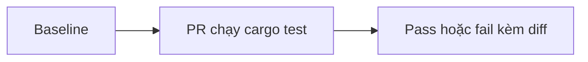
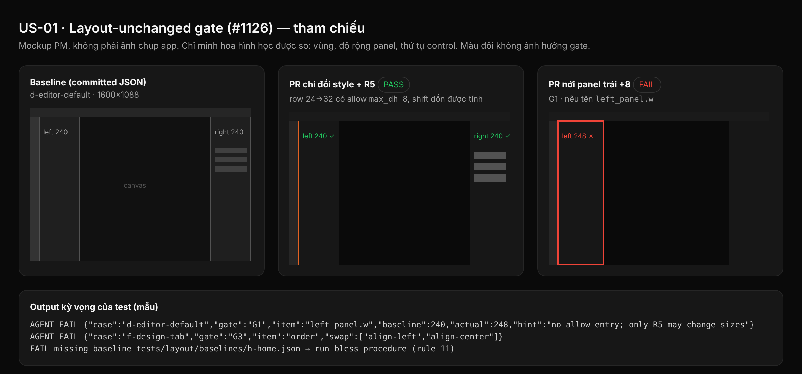

## 1. User Story
Là PM merge PR revamp, tôi muốn một check hình học chạy trong `cargo test` để biết PR chỉ đổi style, không đổi layout.

## 2. Flow
| Bước | Hành động | Phản hồi |
|---|---|---|
| 1 | Ghi baseline hình học mọi surface | Baseline commit |
| 2 | PR revamp chạy `cargo test` | Comparer so với baseline |
| 3 | Lệch vùng/độ rộng/thứ tự | Test fail kèm diff |

## 3. Data and rules
Spec chi tiết (nguồn chuẩn cho rule, contract, số liệu): `docs/specs/ui-revamp-untitled-dark/1126-layout-unchanged-gate-baseline-capture.md` trên nhánh `docs/specs-untitled-ui-dark`. Re-anchor mọi dòng trích dẫn với HEAD trước khi code.
Bất biến: vùng, độ rộng panel, thứ tự control. Chiều cao được tăng khi R5 tăng size. Nguồn: #1126.

## 4. Acceptance Criteria
| ID | Given | When | Then | Source |
|---|---|---|---|---|
| AC-01 | Baseline hình học 74 case đã bless và commit | PR không đổi layout chạy `cargo test -p designos-app --bin designos layout_` | Mọi `layout_unchanged_<spec>` xanh, hai lần liên tiếp, JSON giống hệt | FC-UIR.AC-01; spec L Acceptance 2 |
| AC-02 | Baseline đã commit | PR nới một panel +8 hoặc đổi thứ tự hai control | Gate fail, dòng `AGENT_FAIL` nêu case, gate (G1/G3) và item (vd `left_panel.w`) | FC-UIR.AC-01; spec L test 3, 5 |
| AC-03 | Row tăng 24→32 theo R5 có entry allow `max_dh` | Chạy gate | Pass; shift dồn của row phía dưới được tính, không dùng khoảng | spec L test 4, 4c |
| AC-04 | Tests H1–H11 và 4b–4e, 6c, 8b–8e | Chạy trước và sau fix | Đỏ trước fix, xanh sau; log dán trong PR | spec L Acceptance 1, 3 |
| AC-05 | `DESIGNOS_AGENT_CLI_DIR` đặt mà thiếu marker hoặc `--screenshot` | Chạy binary | Exit 2, không ghi gì | spec L Acceptance 4 |
| AC-06 | Toàn workspace | `cargo test --workspace --locked` | Xanh, số test = main + đúng số test PR thêm; không đổi expected value cũ | spec L Acceptance 7 |

Test steps: [tests/cases/US-01.md](../tests/cases/US-01.md).

## 5. Edge cases
- Popover xuất hiện sau frame build: 8 frame, frame 8 = frame 12 lúc bless.
- Widget nằm giữa hai vùng: tâm quyết định; hoà thì về trái.
- Vùng scroll bị clip: dùng `rect`; overflow chỉ thêm entry `scroll`.
- Widget hug-width: cần entry `dw`; widget sau trong hàng nhận shift x dẫn xuất.
- Lệnh CLI lạ/compound ở hermetic mode: bị từ chối, case fail rõ ràng.
- Stub thiếu trong `DIR`: spawn bị từ chối, picker hiện hàng not-installed.
- #1141 INFRA: retry, exit 3; case sở hữu exit 1.
- Thiếu file baseline: fail kèm gợi ý bless.
- Surface mới chưa có baseline: fail cho đến khi thêm; re-bless chỉ ở cuối revamp (sau M).

## 6. UI
Ảnh tham chiếu (mockup PM, không phải ảnh app): 

Bằng chứng thật bắt buộc trong PR: ảnh chụp/terminal theo §7 spec chi tiết; responsive SKIPPED (owner default).
