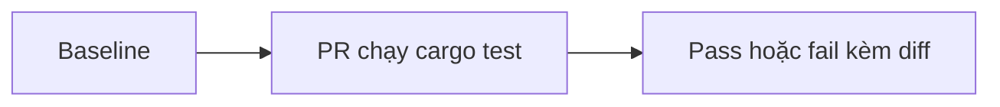

## 1. User Story
Là PM merge PR revamp, tôi muốn một check hình học chạy trong `cargo test` để biết PR chỉ đổi style, không đổi layout.

## 2. Flow
| Bước | Hành động | Phản hồi |
|---|---|---|
| 1 | Ghi baseline hình học mọi surface | Baseline commit |
| 2 | PR revamp chạy `cargo test` | Comparer so với baseline |
| 3 | Lệch vùng/độ rộng/thứ tự | Test fail kèm diff |

## 3. Data and rules
Bất biến: vùng, độ rộng panel, thứ tự control. Chiều cao được tăng khi R5 tăng size. Nguồn: #1126.

## 4. Acceptance Criteria
| ID | Given | When | Then | Source |
|---|---|---|---|---|
| AC-01 | Baseline đã commit | PR không đổi layout chạy test | Gate pass | FC-UIR.AC-01 |
| AC-02 | Baseline đã commit | PR đổi độ rộng một panel | Gate fail, chỉ ra surface | FC-UIR.AC-01 |

## 5. Edge cases
Surface mới chưa có baseline: fail cho đến khi được thêm. Re-bless chỉ ở cuối revamp.

## 6. UI
no_ui cho thay đổi gate/token; bằng chứng hình bắt buộc trong PR.
