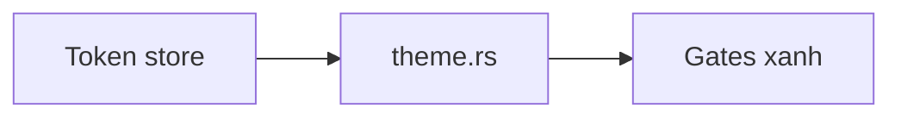
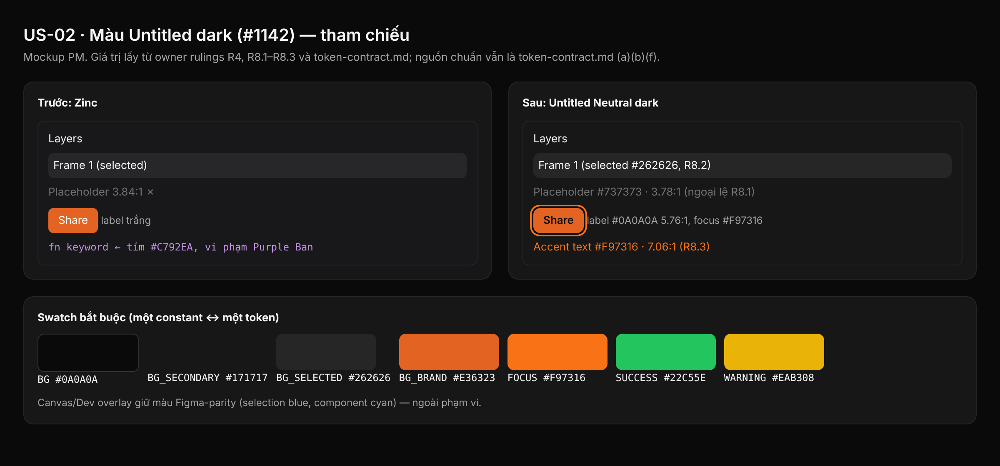

## 1. User Story
Là owner, tôi muốn chrome dùng màu Untitled dark với brand cam, onboard bằng CLI design:os, để mỗi surface gọi màu bằng token.

## 2. Flow
| Bước | Hành động | Phản hồi |
|---|---|---|
| 1 | Re-value token store bằng script | `design/design.tokens.json` mới |
| 2 | Cập nhật `theme.rs` | Constant khớp token |
| 3 | Chạy gate | G01, Purple Ban, AA, soul, agents xanh |

## 3. Data and rules
Spec chi tiết (nguồn chuẩn cho rule, contract, số liệu): `docs/specs/ui-revamp-untitled-dark/1142-onboard-untitled-dark-colour-roles-and-soul.md` trên nhánh `docs/specs-untitled-ui-dark`. Re-anchor mọi dòng trích dẫn với HEAD trước khi code.
Palette trong #1118; brand `#E36323`, focus `#F97316`. Canvas/overlay giữ màu Figma-parity.

## 4. Acceptance Criteria
| ID | Given | When | Then | Source |
|---|---|---|---|---|
| AC-01 | Token store và `theme.rs` đã re-value | Chạy G01 `python3 scripts/design_os_self_evolve.py` | 35/35, 0 vi phạm Purple Ban; G05/G06/G08 xanh | FC-UIR.AC-02; spec A AC 4 |
| AC-02 | Constant màu mới | `cargo test -p designos-app chrome_contrast_pairs` và check C-1 | 62/62 dòng đạt min (4.5 text, 3.0 ngoại lệ placeholder/non-text) | spec A AC 3 |
| AC-03 | `TEXT_ON_BRAND` #0A0A0A trên `BG_BRAND*` | `brand_label_passes_aa` | Mọi cặp ≥ 4.5 | spec A test 2; R4 |
| AC-04 | Soul và principles thay bằng draft | `ui ds soul check --dir .`; `ui agents check --dir .` | 0 finding, `status: ratified`; file byte-equal draft | spec A AC 5, 6 |
| AC-05 | `theme.rs` sau PR | So với token-contract.md (a) | Bằng nhau từng dòng (116 + 46 mới) | spec A AC 1 |

Test steps: [tests/cases/US-02.md](../tests/cases/US-02.md).

## 5. Edge cases
- Store sealed không thêm được key mới (T1): re-value key có sẵn, phần còn lại là constant `theme.rs` có test + `RUST_ONLY`.
- `ui ds preview` fail usage-lint (T2): sửa giá trị in trong specimen tại chỗ.
- Không bao giờ dùng `ui ds import --force` (T3).
- `ui ds a11y` mặc định cho kết quả giả (T4): luôn truyền `--pairs` với path `colors.`.
- `BG_HOVER == BG_SECONDARY` #171717: surface nền secondary dùng `BG_SECONDARY_HOVER`.
- `TEXT_SECONDARY/TERTIARY` từ alpha sang opaque: text trên ảnh/canvas không còn blend.
- `terminal.rs` pin hex SUCCESS/WARNING: sửa hai literal trong cùng commit.
- Xoá constant 0 reference: grep lại khi re-anchor trước khi xoá.

## 6. UI
Ảnh tham chiếu (mockup PM, không phải ảnh app): 

Bằng chứng thật bắt buộc trong PR: ảnh chụp/terminal theo §7 spec chi tiết; responsive SKIPPED (owner default).
