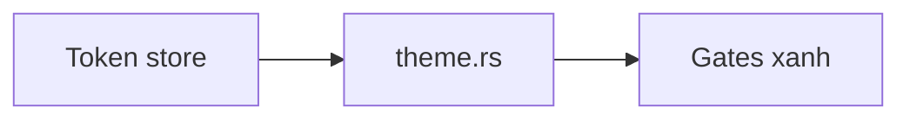

## 1. User Story
Là owner, tôi muốn chrome dùng màu Untitled dark với brand cam, onboard bằng CLI design:os, để mỗi surface gọi màu bằng token.

## 2. Flow
| Bước | Hành động | Phản hồi |
|---|---|---|
| 1 | Re-value token store bằng script | `design/design.tokens.json` mới |
| 2 | Cập nhật `theme.rs` | Constant khớp token |
| 3 | Chạy gate | G01, Purple Ban, AA, soul, agents xanh |

## 3. Data and rules
Palette trong #1118; brand `#E36323`, focus `#F97316`. Canvas/overlay giữ màu Figma-parity.

## 4. Acceptance Criteria
| ID | Given | When | Then | Source |
|---|---|---|---|---|
| AC-01 | Token đã re-value | Chạy G01 parity và AA | Xanh trên mọi cặp text×surface | FC-UIR.AC-02 |
| AC-02 | Soul/principles mới | Agent gọi `ui ds context` | Nhận stance Untitled dark | FC-UIR.AC-02 |

## 5. Edge cases
Màu tím bị chặn (Purple Ban). Cặp dưới AA làm fail gate.

## 6. UI
no_ui cho thay đổi gate/token; bằng chứng hình bắt buộc trong PR.
