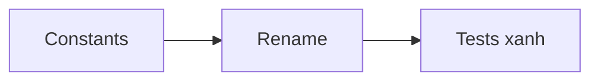

## 1. User Story
Là người làm surface C–K, tôi muốn mỗi bước Untitled có một constant trong `theme.rs` với invariant test.

## 2. Flow
| Bước | Hành động | Phản hồi |
|---|---|---|
| 1 | Thêm constant theo bước | 16 constant mới |
| 2 | Đổi tên cơ học các tham chiếu | Build xanh |
| 3 | Chạy theme tests + ratchet | Xanh |

## 3. Data and rules
R5: editor text-xs 12/18, row 32, button xs 32, radius md 8; Home/dialog sm 36 / md 40. Phụ thuộc US-02 (cùng file).

## 4. Acceptance Criteria
| ID | Given | When | Then | Source |
|---|---|---|---|---|
| AC-01 | Constant mới | Chạy theme tests | Mọi constant nằm trên scale Untitled | FC-UIR.AC-03 |
| AC-02 | Ratchet concentric | Một site mới không concentric | Ratchet báo | FC-UIR.AC-03 |

## 5. Edge cases
PR B chỉ mở sau khi A merge (một writer).

## 6. UI
no_ui cho thay đổi gate/token; bằng chứng hình bắt buộc trong PR.
