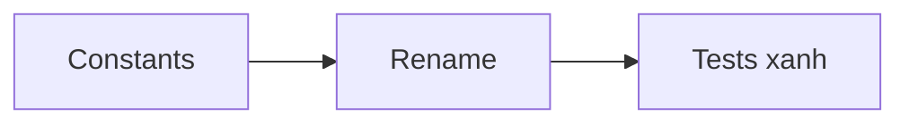
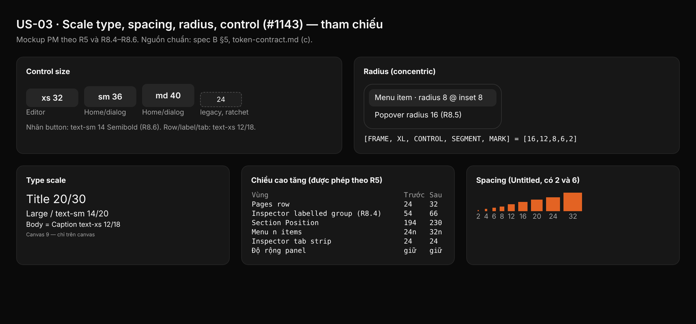

## 1. User Story
Là người làm surface C–K, tôi muốn mỗi bước Untitled có một constant trong `theme.rs` với invariant test.

## 2. Flow
| Bước | Hành động | Phản hồi |
|---|---|---|
| 1 | Thêm constant theo bước | 16 constant mới |
| 2 | Đổi tên cơ học các tham chiếu | Build xanh |
| 3 | Chạy theme tests + ratchet | Xanh |

## 3. Data and rules
Spec chi tiết (nguồn chuẩn cho rule, contract, số liệu): `docs/specs/ui-revamp-untitled-dark/1143-untitled-type-spacing-radius-control-scale.md` trên nhánh `docs/specs-untitled-ui-dark`. Re-anchor mọi dòng trích dẫn với HEAD trước khi code.
R5: editor text-xs 12/18, row 32, button xs 32, radius md 8; Home/dialog sm 36 / md 40. Phụ thuộc US-02 (cùng file).

## 4. Acceptance Criteria
| ID | Given | When | Then | Source |
|---|---|---|---|---|
| AC-01 | Constant scale mới | Chạy theme tests 1–7 | Xanh; mọi giá trị nằm trên scale Untitled | FC-UIR.AC-03; spec B AC 2 |
| AC-02 | Code sau rename | `grep -rnwE 'CONTROL_(TOOL|ROW)' crates scripts` | Không in gì | spec B AC 1 |
| AC-03 | Ratchet `check_spacing_relationships.py` | Thêm một `CONTROL_DENSE` mới trong file tạm | Ratchet fail; baseline chỉ giảm | FC-UIR.AC-03; spec B test 9, AC 3 |
| AC-04 | L đã merge | PR B chạy layout gate | Không đổi vùng/độ rộng/thứ tự; chỉ chiều cao tăng theo R5 | spec B AC 6; R1 |
| AC-05 | Token store | `ui ds status --dir .` | Generation 79; radius/typography = token-contract.md (c) | spec B AC 4 |

Test steps: [tests/cases/US-03.md](../tests/cases/US-03.md).

## 5. Edge cases
- `FONT_SIZE_CAPTION == FONT_SIZE_BODY`: code so sánh size sẽ đổi nhánh; grep lại khi re-anchor.
- `RADIUS_*` là `u8`: 16, 8, 6, 2 vừa.
- Pages list 5 row × 32: tăng 40 px; Layers thấy 23 row thay vì 24.
- `CONTROL_DENSE` = `TARGET_MIN`: không dùng cho button mới (ratchet).
- Text 12 px rộng hơn có thể ellipsize trong panel 240: surface spec D–K kiểm (L gate).
- Size 9 chỉ cho canvas; test giữ nó là size duy nhất < 12.
- PR B chỉ mở sau khi A merge (cùng file, một writer).

## 6. UI
Ảnh tham chiếu (mockup PM, không phải ảnh app): 

Bằng chứng thật bắt buộc trong PR: ảnh chụp/terminal theo §7 spec chi tiết; responsive SKIPPED (owner default).
