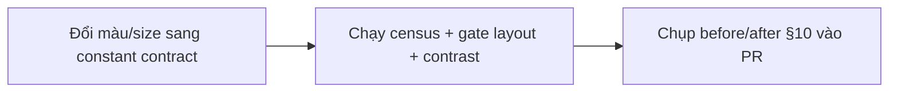
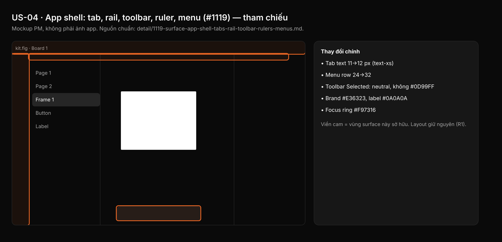

## 1. User Story
Là designer, tôi thấy chrome cửa sổ (title bar, tab, rail trái, toolbar nổi, ruler, menu shell) theo Untitled UI dark: cùng neutral, hairline, type scale, radius, state và focus ring như phần còn lại của app, layout giữ nguyên.

## 2. Flow
| Bước | Hành động | Phản hồi |
|---|---|---|
| 1 | Đổi màu/size sang constant contract | Xem AC liên quan |
| 2 | Chạy census + gate layout + contrast | Xem AC liên quan |
| 3 | Chụp before/after §10 vào PR | Xem AC liên quan |

## 3. Data and rules
Spec chi tiết (nguồn chuẩn cho rule, contract, số liệu, danh sách file và test): [detail/1119-surface-app-shell-tabs-rail-toolbar-rulers-menus.md](../detail/1119-surface-app-shell-tabs-rail-toolbar-rulers-menus.md). Re-anchor mọi số dòng trích dẫn với HEAD trước khi code.
D sở hữu `panels/menus.rs` (cả menu palette). Cmd+K bar thuộc J (US-11).
Dependency: Cần A (US-02), B (US-03), C (US-09), L (US-01).

## 4. Acceptance Criteria
| ID | Given | When | Then | Source |
|---|---|---|---|---|
| AC-01 | Nhánh PR đã restyle `tabs.rs`, `shell.rs`, `panels/rail.rs`, `panels/toolbar.rs`, `panels/menus.rs`, `canvas/rulers.rs` | Chạy census chrome literal của §2 (hoặc `check_chrome_colour_literals.py` của A) | `chrome_sites=0` cho mọi file sở hữu, trừ các site allowlist ghi trong §10 | §10 AC1 |
| AC-02 | Baseline L (#1126) đã commit | Chạy gate layout của L cho các capture D-xx | Cùng vùng, độ rộng, thứ tự control; mọi thay đổi chiều cao khớp bảng §7 | §10 AC3; R1 |
| AC-03 | Constant mới trong file sở hữu | `cargo test -p designos-app --bin designos theme::`; `python3 scripts/check_spacing_relationships.py`; `python3 scripts/zero_fake_ui_gate.py`; `python3 scripts/design_os_self_evolve.py` | Tất cả exit 0; đếm literal radius/font ≤ `scripts/spacing_baseline.json` | §10 AC2,4,5 |
| AC-04 | Bảng cặp tương phản D-P / C-1 trong spec chi tiết | Chạy snippet python C-1 của token-contract.md (f) và bảng D-P | Exit 0, mọi dòng ≥ min (4.5 text, 3.0 non-text; ngoại lệ E-1 có tên). Không dùng `ui ds a11y` (false green) | §10 AC contrast |
| AC-05 | Hit box close tab và chevron toolbar | `cargo test` các test đỏ mới của §10 | Cả hai ≥ `TARGET_MIN`; không hit box nào chồng nhau | §10 AC8; edge 2–3 |

Test steps: [tests/cases/US-04.md](../tests/cases/US-04.md). "§" trỏ tới spec chi tiết.

## 5. Edge cases
- Text 11→12 px trong ô cố định: tiêu đề tab và nhãn menu elide sớm hơn, elide theo ký tự.
- Tab ở độ rộng tối thiểu 112: thân tab giữ ≥ 24 px hit.
- Dev mode: badge tab, segment mode và toolbar đổi sang `DEV_READY` cùng lúc, glyph tối trên nền Dev.
- Actions mở: nút hiện `Button/Tool` Selected, không xanh dương.
- Menu cao hơn cửa sổ (900×600, row 32): clamp và scroll như cũ, không row nào mất.
- `clear_color` hiện 1 frame trước paint đầu: trả `BG`.
- Board/deck/presentation dùng chung tab bar và rail; toolbar riêng của chúng ngoài phạm vi.
- Ruler giữ font 9 px proportional (ghi lý do trong §8).
- Handle resize panel trái 6 px không nới.
- HUD recording đổi look: film marketing phải render lại.

## 6. UI
Ảnh tham chiếu (mockup PM, không phải ảnh app): 

Bằng chứng thật bắt buộc trong PR: ảnh before/after theo §10 spec chi tiết; responsive SKIPPED (owner default).
