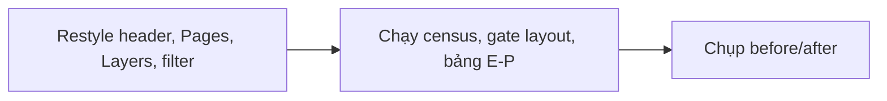
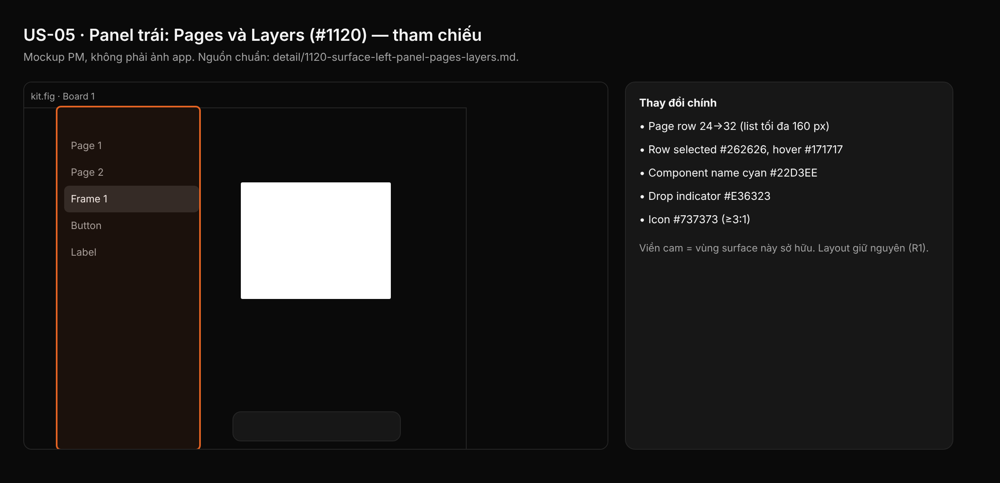

## 1. User Story
Là designer, tôi đọc và thao tác panel trái (tên file, Pages, Layers) theo Untitled UI dark: fill row neutral, type đầu nhỏ, state List/Tree row của C; cam Studio chỉ cho state live; layer component vẫn cyan.

## 2. Flow
| Bước | Hành động | Phản hồi |
|---|---|---|
| 1 | Restyle header, Pages, Layers, filter | Xem AC liên quan |
| 2 | Chạy census, gate layout, bảng E-P | Xem AC liên quan |
| 3 | Chụp before/after | Xem AC liên quan |

## 3. Data and rules
Spec chi tiết (nguồn chuẩn cho rule, contract, số liệu, danh sách file và test): [detail/1120-surface-left-panel-pages-layers.md](../detail/1120-surface-left-panel-pages-layers.md). Re-anchor mọi số dòng trích dẫn với HEAD trước khi code.
Không đổi độ rộng 240 và handle resize. Separator Pages/Layers thuộc #1108.
Dependency: Cần A, B, C, L; phối hợp #1108.

## 4. Acceptance Criteria
| ID | Given | When | Then | Source |
|---|---|---|---|---|
| AC-01 | Nhánh PR đã restyle `panels/left.rs`, `panels/layers.rs`, `find/filter.rs` | Chạy census chrome literal của §2 (hoặc `check_chrome_colour_literals.py` của A) | `chrome_sites=0` cho mọi file sở hữu, trừ các site allowlist ghi trong §10 | §10 AC1 |
| AC-02 | Baseline L (#1126) đã commit | Chạy gate layout của L cho các capture E-xx | Cùng vùng, độ rộng, thứ tự control; mọi thay đổi chiều cao khớp bảng §7 | §10 AC3; R1 |
| AC-03 | Constant mới trong file sở hữu | `cargo test -p designos-app --bin designos theme::`; `python3 scripts/check_spacing_relationships.py`; `python3 scripts/zero_fake_ui_gate.py`; `python3 scripts/design_os_self_evolve.py` | Tất cả exit 0; đếm literal radius/font ≤ `scripts/spacing_baseline.json` | §10 AC2,4,5 |
| AC-04 | Bảng cặp tương phản E-P / C-1 trong spec chi tiết | Chạy snippet python C-1 của token-contract.md (f) và bảng E-P | Exit 0, mọi dòng ≥ min (4.5 text, 3.0 non-text; ngoại lệ E-1 có tên). Không dùng `ui ds a11y` (false green) | §10 AC contrast |
| AC-05 | Danh sách Pages và nút clear filter | `cargo test` `pages_list_is_five_rows_of_the_row_height`, `clear_button_hit_box_meets_the_target_floor`, `row_states_use_tree_row_roles` | List = min(n,5) × `PAGE_ROW_HEIGHT` (32); clear ≥ `TARGET_MIN`; fill row đúng role Tree/Row | §10 AC8; tests |

Test steps: [tests/cases/US-05.md](../tests/cases/US-05.md). "§" trỏ tới spec chi tiết.

## 5. Edge cases
- File > 5 trang: list scroll trong 5 × 32 = 160 px.
- #1108 đã merge: chiều cao Pages user kéo lưu theo px; clamp của #1108 vẫn áp dụng.
- Tên layer dài ở 12 px: tên elide trước, rồi ẩn type label; không đè eye/lock.
- Row component được chọn: pill neutral, tên vẫn cyan.
- Canvas hover trên row đã chọn: fill Selected-Hover, không viền cam.
- Hidden + locked: eye-off và lock cùng hiện không cần hover.
- Filter bật: tắt drag-drop; ký tự match giữ `FIND_HIGHLIGHT`.
- Dev mode: header Layers đổi sang tab Dev (G); row giữ style E.
- Nút action panel 32 px chiếm thêm 16 px bên phải hàng tiêu đề 40.

## 6. UI
Ảnh tham chiếu (mockup PM, không phải ảnh app): 

Bằng chứng thật bắt buộc trong PR: ảnh before/after theo §10 spec chi tiết; responsive SKIPPED (owner default).
