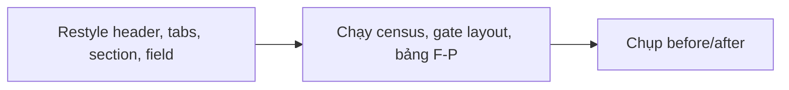
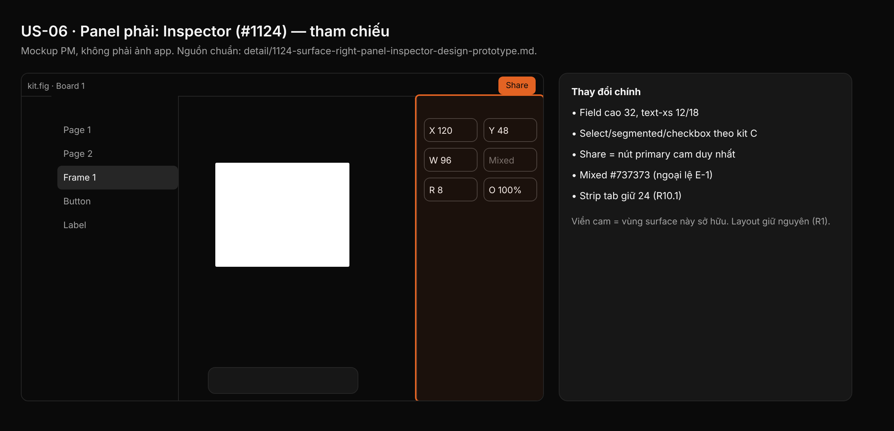

## 1. User Story
Là designer, tôi đọc và sửa thuộc tính ở panel phải theo Untitled UI dark: field, select, segmented, checkbox, section header của Untitled ở đầu nhỏ của scale, fill neutral, cam chỉ cho Share và state live.

## 2. Flow
| Bước | Hành động | Phản hồi |
|---|---|---|
| 1 | Restyle header, tabs, section, field | Xem AC liên quan |
| 2 | Chạy census, gate layout, bảng F-P | Xem AC liên quan |
| 3 | Chụp before/after | Xem AC liên quan |

## 3. Data and rules
Spec chi tiết (nguồn chuẩn cho rule, contract, số liệu, danh sách file và test): [detail/1124-surface-right-panel-inspector-design-prototype.md](../detail/1124-surface-right-panel-inspector-design-prototype.md). Re-anchor mọi số dòng trích dẫn với HEAD trước khi code.
`panels/export.rs` còn 1 site allowlist (dòng 308).
Dependency: Cần A, B, C, L.

## 4. Acceptance Criteria
| ID | Given | When | Then | Source |
|---|---|---|---|---|
| AC-01 | Nhánh PR đã restyle các file inspector/`panels/*` của F (danh sách §2) | Chạy census chrome literal của §2 (hoặc `check_chrome_colour_literals.py` của A) | `chrome_sites=0` cho mọi file sở hữu, trừ các site allowlist ghi trong §10 | §10 AC1 |
| AC-02 | Baseline L (#1126) đã commit | Chạy gate layout của L cho các capture F-xx | Cùng vùng, độ rộng, thứ tự control; mọi thay đổi chiều cao khớp bảng §7 | §10 AC3; R1 |
| AC-03 | Constant mới trong file sở hữu | `cargo test -p designos-app --bin designos theme::`; `python3 scripts/check_spacing_relationships.py`; `python3 scripts/zero_fake_ui_gate.py`; `python3 scripts/design_os_self_evolve.py` | Tất cả exit 0; đếm literal radius/font ≤ `scripts/spacing_baseline.json` | §10 AC2,4,5 |
| AC-04 | Bảng cặp tương phản F-P / C-1 trong spec chi tiết | Chạy snippet python C-1 của token-contract.md (f) và bảng F-P | Exit 0, mọi dòng ≥ min (4.5 text, 3.0 non-text; ngoại lệ E-1 có tên). Không dùng `ui ds a11y` (false green) | §10 AC contrast |
| AC-05 | Chevron nút Present | Test đỏ hit box mới §10 | Rộng ≥ `TARGET_MIN`; `RIGHT_TABS_H` giữ 24 (R10.1) | §10 AC8; R10.1 |

Test steps: [tests/cases/US-06.md](../tests/cases/US-06.md). "§" trỏ tới spec chi tiết.

## 5. Edge cases
- Giá trị dài ở 12 px trong field nửa 88 px: elide bằng dấu …, không tràn.
- Selection hỗn hợp: "Mixed" dùng `TEXT_PLACEHOLDER` #737373 (ngoại lệ E-1, R8.1).
- Field bind variable: hiện `Tag/Chip` của C; nút bind giữ hit area trong field.
- Dev mode: Share vẫn cam; row Plugins dùng `DEV_READY` label tối (R10.4).
- Color picker trên màu tài liệu rất sáng/tối: handle trắng viền đen-alpha.
- Popover cao hơn do row 32: clamp vào cửa sổ và scroll.
- Cửa sổ 900×600: inspector scroll; header, tab strip, footer cố định.
- Không có selection / Frame tool: section page, styles, frame presets dùng cùng constant.
- Viền checkbox chưa chọn #404040 1.91:1: ngoại lệ có tên của owner (R10.7).

## 6. UI
Ảnh tham chiếu (mockup PM, không phải ảnh app): 

Bằng chứng thật bắt buộc trong PR: ảnh before/after theo §10 spec chi tiết; responsive SKIPPED (owner default).
