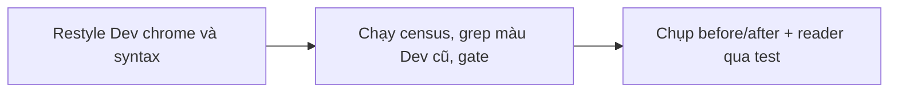
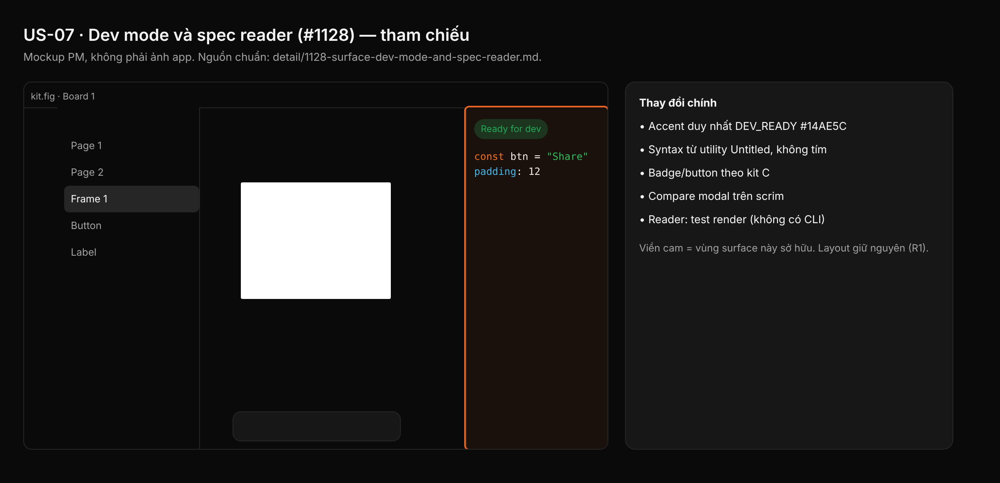

## 1. User Story
Là developer trong Dev mode, tôi thấy Inspect, danh sách Ready for dev, cửa sổ Compare và code sinh ra theo Untitled UI dark: surface neutral, badge/nút Untitled, bảng màu syntax không tím, accent Dev duy nhất `DEV_READY`.

## 2. Flow
| Bước | Hành động | Phản hồi |
|---|---|---|
| 1 | Restyle Dev chrome và syntax | Xem AC liên quan |
| 2 | Chạy census, grep màu Dev cũ, gate | Xem AC liên quan |
| 3 | Chụp before/after + reader qua test | Xem AC liên quan |

## 3. Data and rules
Spec chi tiết (nguồn chuẩn cho rule, contract, số liệu, danh sách file và test): [detail/1128-surface-dev-mode-and-spec-reader.md](../detail/1128-surface-dev-mode-and-spec-reader.md). Re-anchor mọi số dòng trích dẫn với HEAD trước khi code.
Allowlist: `dev/compare.rs`, `dev/playground.rs` mỗi file 1 site tint ảnh.
Dependency: Cần A, B, C, L.

## 4. Acceptance Criteria
| ID | Given | When | Then | Source |
|---|---|---|---|---|
| AC-01 | Nhánh PR đã restyle `specs.rs` và `dev/*` | Chạy census chrome literal của §2 (hoặc `check_chrome_colour_literals.py` của A) | `chrome_sites=0` cho mọi file sở hữu, trừ các site allowlist ghi trong §10 | §10 AC1 |
| AC-02 | Baseline L (#1126) đã commit | Chạy gate layout của L cho các capture G-xx | Cùng vùng, độ rộng, thứ tự control; mọi thay đổi chiều cao khớp bảng §7 | §10 AC3; R1 |
| AC-03 | Constant mới trong file sở hữu | `cargo test -p designos-app --bin designos theme::`; `python3 scripts/check_spacing_relationships.py`; `python3 scripts/zero_fake_ui_gate.py`; `python3 scripts/design_os_self_evolve.py` | Tất cả exit 0; đếm literal radius/font ≤ `scripts/spacing_baseline.json` | §10 AC2,4,5 |
| AC-04 | Bảng cặp tương phản G-P / C-1 trong spec chi tiết | Chạy snippet python C-1 của token-contract.md (f) và bảng G-P | Exit 0, mọi dòng ≥ min (4.5 text, 3.0 non-text; ngoại lệ E-1 có tên). Không dùng `ui ds a11y` (false green) | §10 AC contrast |
| AC-05 | Code panel và Dev chrome | `grep -rnE '0x1B, 0xC4, 0x7D\|0x22, 0xD4, 0x89\|0x34, 0xD3, 0x99' crates/designos-app/src --include='*.rs'`; test `SYNTAX_*` | Chỉ còn `updater.rs:43`; mọi `SYNTAX_*` = contract dòng 89–97, không tím, ≥ 4.5:1 trên nền code; G01 fail nếu đặt lại tím | §10 AC2,3 |

Test steps: [tests/cases/US-07.md](../tests/cases/US-07.md). "§" trỏ tới spec chi tiết.

## 5. Edge cases
- Dòng code dài ở 12 px: `highlight::wrap` wrap theo cột, dòng tiếp giữ indent.
- Layer không có Dev status: không pill; hiện nút primary "Ready for dev".
- Layer Changed: pill amber và "Compare changes"; Escape đóng Compare.
- Annotation dài và nhiều chip: wrap trong panel 240 px.
- Tài liệu sáng trong Compare: pane giữ viền `BORDER`.
- Playground không có prop boolean/variant: text rỗng `TEXT_TERTIARY`.
- Spec reader light mode: không constant dark nào lọt (có test).
- Kotlin/Swift/CSS/Tailwind/HTML/UIKit: mọi token map vào `SYNTAX_*`.
- Annotation rỗng: placeholder #737373 chỉ trên `BG`/`BG_SECONDARY`.

## 6. UI
Ảnh tham chiếu (mockup PM, không phải ảnh app): 

Bằng chứng thật bắt buộc trong PR: ảnh before/after theo §10 spec chi tiết; responsive SKIPPED (owner default).
