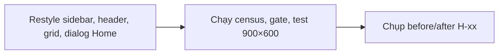
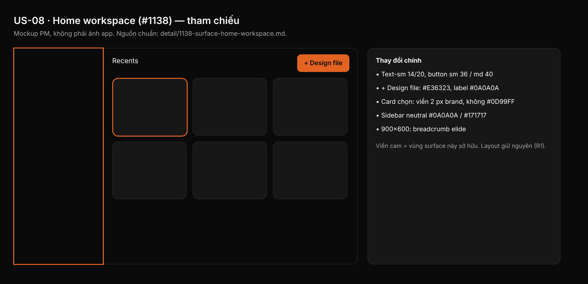

## 1. User Story
Là designer mở Studio, tôi vào Home và thấy theo Untitled UI dark: surface neutral (#0A0A0A, #171717), hairline, nút/input/menu/badge Untitled ở mật độ Home của R5 (text-sm 14/20, button sm 36 / md 40), cam Studio cho hành động chính.

## 2. Flow
| Bước | Hành động | Phản hồi |
|---|---|---|
| 1 | Restyle sidebar, header, grid, dialog Home | Xem AC liên quan |
| 2 | Chạy census, gate, test 900×600 | Xem AC liên quan |
| 3 | Chụp before/after H-xx | Xem AC liên quan |

## 3. Data and rules
Spec chi tiết (nguồn chuẩn cho rule, contract, số liệu, danh sách file và test): [detail/1138-surface-home-workspace.md](../detail/1138-surface-home-workspace.md). Re-anchor mọi số dòng trích dẫn với HEAD trước khi code.
Home dùng sm 36 / md 40 (R5), không dùng mật độ editor. `UPDATER_UI_ENABLED` không đổi (Z14).
Dependency: Cần A, B, C, L.

## 4. Acceptance Criteria
| ID | Given | When | Then | Source |
|---|---|---|---|---|
| AC-01 | Nhánh PR restyle `home/` | Chạy census §2 | `home/mod.rs` = 2 (hai tint texture), các file `home/` khác = 0 | §10 AC1 |
| AC-02 | Màn Home sau PR | Chụp `--home` và xem pixel | "+ Design file" nền #E36323 label #0A0A0A; không còn pixel #0D99FF trong chrome Home (kể cả card chọn) | §10 AC2; R4 |
| AC-03 | Baseline L | Gate layout cho Home | Cùng vùng/độ rộng/thứ tự; thay đổi cao chỉ theo bảng §7 | §10 AC3; R1 |
| AC-04 | Type Home | `python3 scripts/check_spacing_relationships.py --verbose` | Chỉ text-sm/xs/md/xl của B; `home/mod.rs` không còn font literal | §10 AC4 |
| AC-05 | Cửa sổ 900×600 | Test rule 7 và ảnh H-03 | Breadcrumb elide, không chồng | §10 AC5 |
| AC-06 | Toàn bộ test §10 | `cargo test`; Z09, Z14; ratchet | Pass; baseline ratchet chỉ giảm | §10 AC6 |

Test steps: [tests/cases/US-08.md](../tests/cases/US-08.md). "§" trỏ tới spec chi tiết.

## 5. Edge cases
- Cửa sổ 900×600: breadcrumb elide; section project có "+ New folder" là ca rộng nhất.
- Tên file/project dài: elide "…" ở 14/12, không đè badge loại hay sao.
- Nhiều project: tree scroll; row 36 làm tree ngắn đi 64 px ở cao 1088.
- Starred mở 3 file + cửa sổ 600 px: tree vẫn ≥ 64 px.
- Đang search: tiêu đề "Search results"; filter/sort vẫn chạy; Escape xoá.
- Trash rỗng: không có "Empty trash".
- File board: thumbnail giữ màu giấy và dot grid; chỉ badge "Board" đổi.
- Thiếu thumbnail: stage + icon file `fg-quaternary`.
- Card vừa chọn vừa hover: viền chọn 2 px brand thắng.
- Updater card ẩn bởi Z14; không đổi `UPDATER_UI_ENABLED`.

## 6. UI
Ảnh tham chiếu (mockup PM, không phải ảnh app): 

Bằng chứng thật bắt buộc trong PR: ảnh before/after theo §10 spec chi tiết; responsive SKIPPED (owner default).
