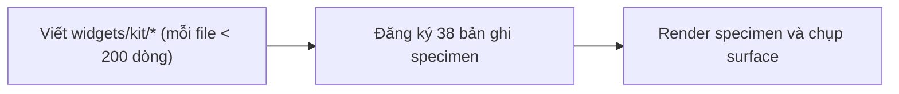
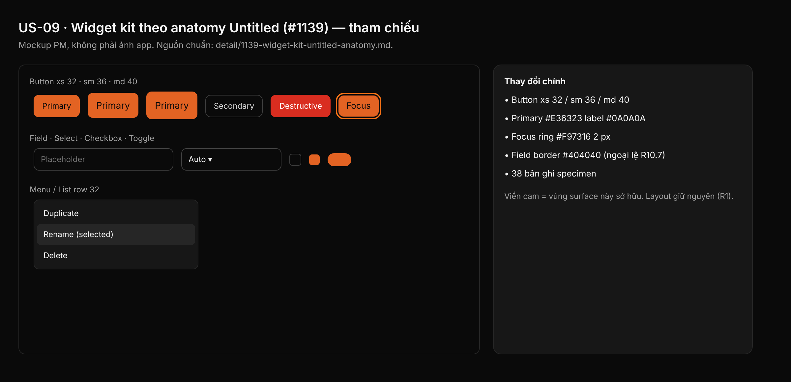

## 1. User Story
Là designer, mọi nút, field, menu, row, toggle và dialog trông và hoạt động như một component Untitled dark ở mọi state, focus luôn thấy. Là người làm D–K, tôi gọi một hàm kit cho mỗi loại widget với size và hierarchy.

## 2. Flow
| Bước | Hành động | Phản hồi |
|---|---|---|
| 1 | Viết `widgets/kit/*` (mỗi file < 200 dòng) | Xem AC liên quan |
| 2 | Đăng ký 38 bản ghi specimen | Xem AC liên quan |
| 3 | Render specimen và chụp surface | Xem AC liên quan |

## 3. Data and rules
Spec chi tiết (nguồn chuẩn cho rule, contract, số liệu, danh sách file và test): [detail/1139-widget-kit-untitled-anatomy.md](../detail/1139-widget-kit-untitled-anatomy.md). Re-anchor mọi số dòng trích dẫn với HEAD trước khi code.
Bảng anatomy §3.4 là nguồn chuẩn; checkbox/field border #404040 là ngoại lệ có tên (R10.7).
Dependency: Cần A, B. Chặn D–K.

## 4. Acceptance Criteria
| ID | Given | When | Then | Source |
|---|---|---|---|---|
| AC-01 | Thư mục `widgets/kit/` | `wc -l crates/designos-app/src/widgets/kit/*.rs`; `grep -rnE '0x[0-9A-Fa-f]{6}\|rgb\(' crates/designos-app/src/widgets/kit/` | Mọi file < 200 dòng; grep không ra gì | §10 AC1,5 |
| AC-02 | Kit đã viết | `cargo test -p designos-app widgets::kit`; `cargo test -p designos-app field_tab` | Pass, gồm `every_table_row_matches_its_look`, `every_state_meets_c1_contrast`; field_tab không đổi | §10 AC2,3 |
| AC-03 | Code sạch | `cargo clippy -p designos-app --all-targets -- -D warnings`; `cargo fmt --all --check`; ba script gate | Sạch, exit 0 | §10 AC4,6 |
| AC-04 | Design store | `ui ds specimen --dir . --strict`; `ui ds docs` | Sạch, 38 bản ghi kit; `design/DESIGN.md` regen | §10 AC7 |
| AC-05 | Script specimen | `python3 specs/C-widget-kit-specimen-spec.py --md` diff với §3.4 | Giống hệt (exit 0); gate L sạch trên surface PR chạm | §10 AC8,10 |

Test steps: [tests/cases/US-09.md](../tests/cases/US-09.md). "§" trỏ tới spec chi tiết.

## 5. Edge cases
- Viền checkbox/radio chưa chọn #404040 (1.91:1): ngoại lệ có tên R10.7.
- Viền text field #404040: cùng ngoại lệ; focus ring #F97316 mới là chỉ báo.
- Disabled: opacity 50% cả fill và label.
- Focus bàn phím luôn vẽ ring 2 px offset, kể cả trên nền brand.
- Size xs 32 trong editor, sm 36 / md 40 ở Home/dialog (R5).
- Hierarchy Destructive: label trắng 4.83:1 trên nền error.

## 6. UI
Ảnh tham chiếu (mockup PM, không phải ảnh app): 

Bằng chứng thật bắt buộc trong PR: ảnh before/after theo §10 spec chi tiết; responsive SKIPPED (owner default).
