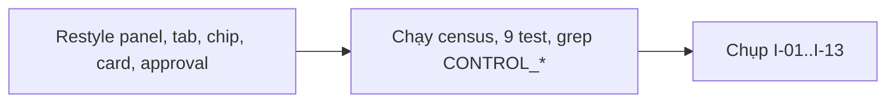
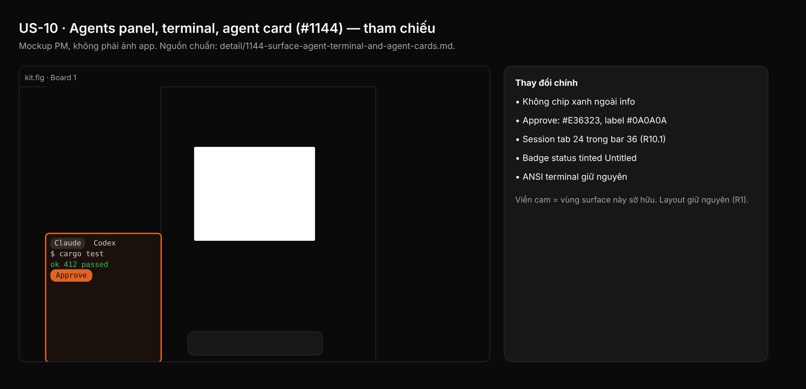

## 1. User Story
Là designer chạy coding agent trong Studio, tôi muốn panel Agents, terminal và mọi agent card trông như phần còn lại của app Untitled, không còn xám riêng, chip xanh dương hay nút chữ trắng trên cam.

## 2. Flow
| Bước | Hành động | Phản hồi |
|---|---|---|
| 1 | Restyle panel, tab, chip, card, approval | Xem AC liên quan |
| 2 | Chạy census, 9 test, grep CONTROL_* | Xem AC liên quan |
| 3 | Chụp I-01..I-13 | Xem AC liên quan |

## 3. Data and rules
Spec chi tiết (nguồn chuẩn cho rule, contract, số liệu, danh sách file và test): [detail/1144-surface-agent-terminal-and-agent-cards.md](../detail/1144-surface-agent-terminal-and-agent-cards.md). Re-anchor mọi số dòng trích dẫn với HEAD trước khi code.
Nội dung terminal (màu ANSI) giữ nguyên (SC-07). Màu provider là identity content (`theme::PROVIDER_*`). Session tab giữ 24 (R10.1).
Dependency: Cần A, B, C, L.

## 4. Acceptance Criteria
| ID | Given | When | Then | Source |
|---|---|---|---|---|
| AC-01 | File của I | Census §2 | Mọi file = 0, riêng `terminal.rs` đúng 6 site allowlist | §10 AC1 |
| AC-02 | Test của I | `cargo test` 9 test mới + test cũ liệt kê; `grep -rnwE 'CONTROL_(DENSE\|STANDARD)' <file I>` | Pass; grep rỗng | §10 AC2,3 |
| AC-03 | Ảnh I-01..I-13 | Xem after-shot và gate L | Không chip xanh ngoài họ info, không chữ trắng trên cam, session tab 24 trong bar 36, viewport cùng vị trí | §10 AC4 |
| AC-04 | Gate | `python3 scripts/zero_fake_ui_gate.py`; `python3 scripts/check_spacing_relationships.py` | Exit 0 | §10 AC5 |
| AC-05 | Cặp tương phản | Snippet C-1 token-contract.md (f) | Exit 0 cho mọi cặp I dùng | §10 AC7 |

Test steps: [tests/cases/US-10.md](../tests/cases/US-10.md). "§" trỏ tới spec chi tiết.

## 5. Edge cases
- Nhiều tab: elide tiêu đề; cao 24 và luật rộng không đổi.
- Panel hẹp tối thiểu: header vẫn chứa nút stop, `+` và ≥ 1 tab.
- Approval queue với tool input dài: summary elide ở cao 32; "1 of N" căn phải.
- Inverse video: chữ `#0A0A0A` trên nền sáng, vẫn đọc được.
- Nhánh chat cũ vẫn phải restyle (`--panel agents-chat`).
- Không có skill: chip Skills không badge số.
- Approve disabled: 50% opacity, vẫn `TEXT_ON_BRAND`.
- Tab Shell/DESIGN:OS help không có identity: dùng `ICON_TERTIARY`.
- Label trên màu presence đổi sang chữ tối #0A0A0A.

## 6. UI
Ảnh tham chiếu (mockup PM, không phải ảnh app): 

Bằng chứng thật bắt buộc trong PR: ảnh before/after theo §10 spec chi tiết; responsive SKIPPED (owner default).
