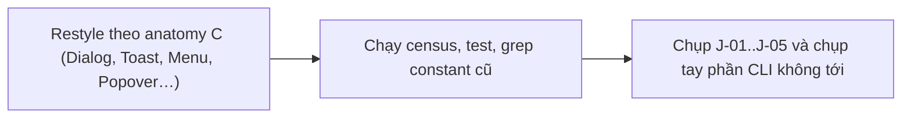
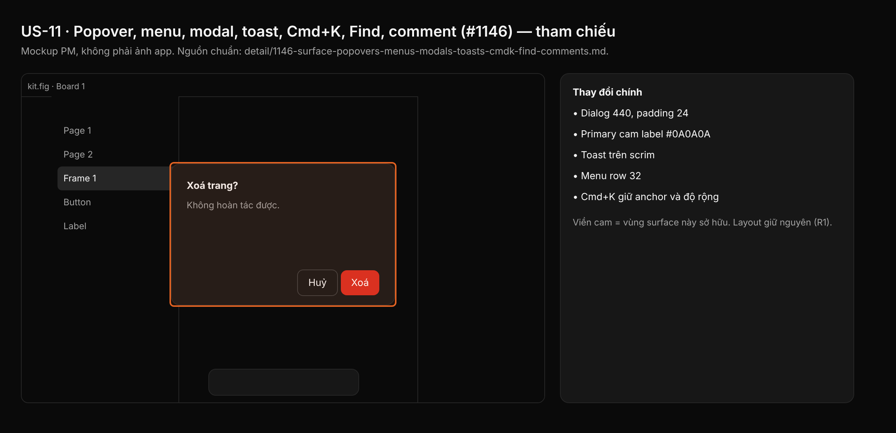

## 1. User Story
Là designer, tôi muốn mọi surface nổi (Cmd+K, dialog xác nhận/chọn, context menu, toast, Find & Replace, comment, version history, control player) trông như kit Untitled dark, không còn trộn kiểu Figma.

## 2. Flow
| Bước | Hành động | Phản hồi |
|---|---|---|
| 1 | Restyle theo anatomy C (Dialog, Toast, Menu, Popover…) | Xem AC liên quan |
| 2 | Chạy census, test, grep constant cũ | Xem AC liên quan |
| 3 | Chụp J-01..J-05 và chụp tay phần CLI không tới | Xem AC liên quan |

## 3. Data and rules
Spec chi tiết (nguồn chuẩn cho rule, contract, số liệu, danh sách file và test): [detail/1146-surface-popovers-menus-modals-toasts-cmdk-find-comments.md](../detail/1146-surface-popovers-menus-modals-toasts-cmdk-find-comments.md). Re-anchor mọi số dòng trích dẫn với HEAD trước khi code.
J sở hữu thanh Actions ở `cmdk.rs`; không sửa `panels/menus.rs` (của D). Vị trí, độ rộng, thứ tự giữ (R1).
Dependency: Cần A, B, C, L; toast test land cùng D (US-04).

## 4. Acceptance Criteria
| ID | Given | When | Then | Source |
|---|---|---|---|---|
| AC-01 | File của J | Census | = 0, riêng `present.rs` 3 site allowlist | §10 AC1 |
| AC-02 | Test J | `cargo test`; `grep -rnwE 'CONTROL_(DENSE\|STANDARD)\|FIND_BUTTON_H\|COMMENT_BTN_H\|COMMENT_FILTER_H\|COMMENT_ICON_BTN' <file J>` | Pass; grep rỗng | §10 AC2,3 |
| AC-03 | Ảnh J-01..J-05 | Xem after-shot và gate L | Màu contract, không chữ trắng trên cam, không gạch chân tab trắng, command bar cùng anchor/độ rộng | §10 AC4 |
| AC-04 | Gate | Z08, Z14, Z15; `check_spacing_relationships.py` | OK; exit 0 | §10 AC5 |
| AC-05 | Cặp tương phản | Snippet C-1 | Exit 0 | §10 AC7 |

Test steps: [tests/cases/US-11.md](../tests/cases/US-11.md). "§" trỏ tới spec chi tiết.

## 5. Edge cases
- Cửa sổ 900×600: command bar tăng 4 px/row; max-height và scroll giữ.
- Text dialog dài: wrap trong 440 − 2×24.
- Dialog danger: hierarchy Destructive, label trắng 4.83:1.
- Toast khi dialog mở: nằm trên scrim, không đổi z-order.
- Find 0 kết quả: status `TEXT_TERTIARY`; nút Replace disabled 50%.
- Thread popover sát mép: flip như cũ; nút cao hơn có thể đẩy đáy, cần clamp.
- Updater ẩn: Z14 giữ OK; verify bằng census + unit test.
- Avatar comment trên `BG_SECONDARY`: giữ check tương phản.
- Presentation prototype sáng: stage #0A0A0A.

## 6. UI
Ảnh tham chiếu (mockup PM, không phải ảnh app): 

Bằng chứng thật bắt buộc trong PR: ảnh before/after theo §10 spec chi tiết; responsive SKIPPED (owner default).
