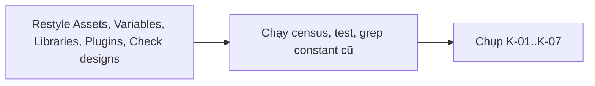
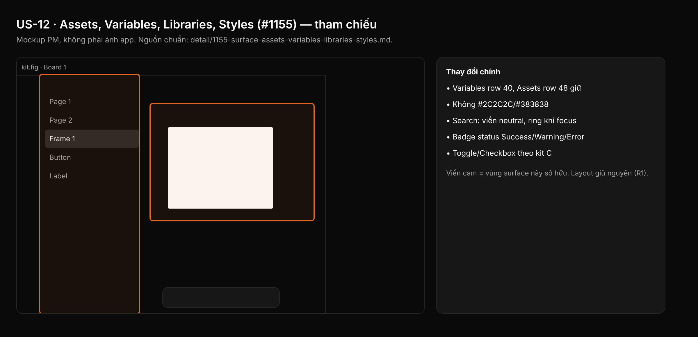

## 1. User Story
Là designer quản lý component, variable và library, tôi muốn panel Assets, bảng Variables, dialog Libraries/cập nhật, Plugins và Check designs theo Untitled dark, bỏ xám Figma UI3 (#2C2C2C, #383838…).

## 2. Flow
| Bước | Hành động | Phản hồi |
|---|---|---|
| 1 | Restyle Assets, Variables, Libraries, Plugins, Check designs | Xem AC liên quan |
| 2 | Chạy census, test, grep constant cũ | Xem AC liên quan |
| 3 | Chụp K-01..K-07 | Xem AC liên quan |

## 3. Data and rules
Spec chi tiết (nguồn chuẩn cho rule, contract, số liệu, danh sách file và test): [detail/1155-surface-assets-variables-libraries-styles.md](../detail/1155-surface-assets-variables-libraries-styles.md). Re-anchor mọi số dòng trích dẫn với HEAD trước khi code.
Variables row 40, Assets row 48 giữ (R1). Search Assets: viền neutral, ring cam chỉ khi focus bàn phím.
Dependency: Cần A, B, C, L.

## 4. Acceptance Criteria
| ID | Given | When | Then | Source |
|---|---|---|---|---|
| AC-01 | File của K | Census | = 0, riêng `panels/assets.rs`, `libraries/modal.rs` 1 tint thumbnail mỗi file | §10 AC1 |
| AC-02 | Test K | `cargo test`; `grep -rnwE 'CONTROL_(DENSE\|STANDARD\|TOOL\|ROW)\|VAR_FIELD_H' <file K>` | Pass; grep rỗng | §10 AC2,3 |
| AC-03 | Ảnh K-01..K-07 | After-shot và gate L | Màu contract, không viền xanh Figma, không chữ trắng trên cam; hình học Assets/Variables/Check designs không đổi | §10 AC4 |
| AC-04 | Gate | Z12; `check_spacing_relationships.py` | OK; exit 0 | §10 AC5 |
| AC-05 | Cặp tương phản | Snippet C-1 | Exit 0 | §10 AC7 |

Test steps: [tests/cases/US-12.md](../tests/cases/US-12.md). "§" trỏ tới spec chi tiết.

## 5. Edge cases
- Nhiều library: row 60 giữ; tên elide.
- Variables nhiều mode (scroll ngang): độ rộng cột giữ; field 32 vừa row 40.
- Cửa sổ Variables nổi 642×380: số row hiển thị không đổi.
- Tên asset dài ở grid: label 24, elide.
- Badge Variants trên thumbnail sáng: `CANVAS_COMPONENT` với label tối.
- Search Assets: viền `BORDER_STRONG`, ring cam chỉ khi focus bàn phím.
- Dialog cài plugin và list plugin dùng chung `plugins/ui.rs`.
- Banner cập nhật library chỉ khi có update: chụp từ library seed hoặc ghi là chụp tay.
- Check designs trên canvas thấp: cao tối đa = canvas − 24.

## 6. UI
Ảnh tham chiếu (mockup PM, không phải ảnh app): 

Bằng chứng thật bắt buộc trong PR: ảnh before/after theo §10 spec chi tiết; responsive SKIPPED (owner default).
