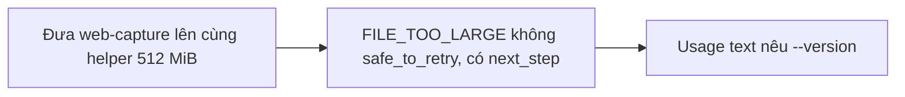
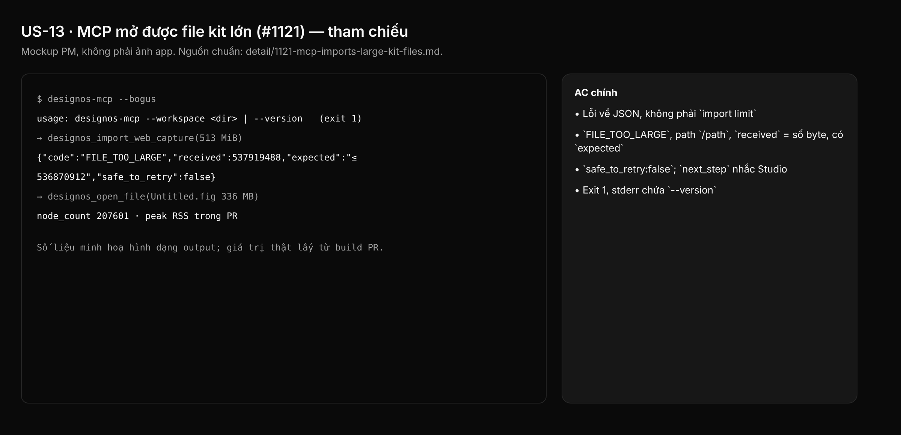

## 1. User Story
Là agent điều khiển Studio qua `designos-mcp`, tôi mở kit Untitled 336 MB bằng `designos_open_file`. Mọi tool import trả cùng lỗi typed `FILE_TOO_LARGE` với cùng giới hạn 512 MiB; usage error nhắc `--version`.

## 2. Flow
| Bước | Hành động | Phản hồi |
|---|---|---|
| 1 | Đưa web-capture lên cùng helper 512 MiB | Xem AC liên quan |
| 2 | `FILE_TOO_LARGE` không safe_to_retry, có next_step | Xem AC liên quan |
| 3 | Usage text nêu `--version` | Xem AC liên quan |

## 3. Data and rules
Spec chi tiết (nguồn chuẩn cho rule, contract, số liệu, danh sách file và test): [detail/1121-mcp-imports-large-kit-files.md](../detail/1121-mcp-imports-large-kit-files.md). Re-anchor mọi số dòng trích dẫn với HEAD trước khi code.
Giới hạn 512 MiB theo owner ruling Q2 (18/10). Lỗi cũ chỉ xảy ra với bản 0.4.0 cũ; 0.6.0+ mở được kit.
Dependency: Độc lập slice 1.

## 4. Acceptance Criteria
| ID | Given | When | Then | Source |
|---|---|---|---|---|
| AC-01 | File capture 65 MiB sparse | `cargo test -p designos-mcp --test session` (`web_capture_between_64_and_512_mib_passes_the_size_gate`) | Lỗi về JSON, không phải `import limit` | §10 |
| AC-02 | File capture 513 MiB sparse | `web_capture_over_512_mib_is_file_too_large` | `FILE_TOO_LARGE`, path `/path`, `received` = số byte, có `expected` | §10 |
| AC-03 | Fixture 44 | `cargo test -p designos-mcp every_code_has_a_fixture` | `safe_to_retry:false`; `next_step` nhắc Studio | §10 |
| AC-04 | `designos-mcp --bogus` | `cargo test -p designos-mcp --test version` | Exit 1, stderr chứa `--version` | §10 |
| AC-05 | Bản build PR | `cargo run -p designos-mcp --bin gen-tool-docs`; fmt; clippy | Không diff generated; sạch | §10 Run |

Test steps: [tests/cases/US-13.md](../tests/cases/US-13.md). "§" trỏ tới spec chi tiết.

## 5. Edge cases
- Capture giữa 64 và 512 MiB: qua gate, JSON sai giữ lỗi cũ.
- Capture đúng 536,870,912 byte: chấp nhận.
- File lớn lên giữa lúc check và đọc: vẫn đọc trọn (file workspace cục bộ).
- `.designos` vượt giới hạn nhưng hợp lệ: `FILE_TOO_LARGE`, không mở một phần.

## 6. UI
Ảnh tham chiếu (mockup PM, không phải ảnh app): 

Bằng chứng thật bắt buộc trong PR: terminal capture trên build PR theo §10 spec chi tiết (không có UI mới).
