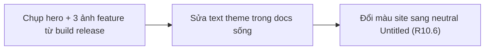
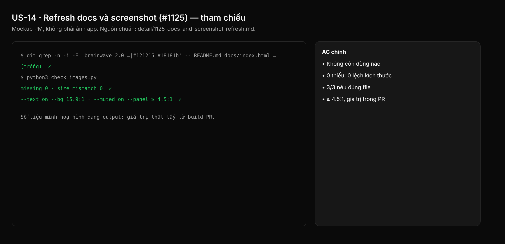

## 1. User Story
Là người đọc README hoặc site sau revamp, tôi thấy đúng Studio sẽ tải về: chrome Untitled dark với cam Studio, chữ mô tả cũng đúng theme. Là agent đọc `.project-agent.md`/`CLAUDE.md`, tôi có thông tin theme hiện tại.

## 2. Flow
| Bước | Hành động | Phản hồi |
|---|---|---|
| 1 | Chụp hero + 3 ảnh feature từ build release | Xem AC liên quan |
| 2 | Sửa text theme trong docs sống | Xem AC liên quan |
| 3 | Đổi màu site sang neutral Untitled (R10.6) | Xem AC liên quan |

## 3. Data and rules
Spec chi tiết (nguồn chuẩn cho rule, contract, số liệu, danh sách file và test): [detail/1125-docs-and-screenshot-refresh.md](../detail/1125-docs-and-screenshot-refresh.md). Re-anchor mọi số dòng trích dẫn với HEAD trước khi code.
Chạy sau khi D–K ship. Không ghi đè file trong `docs/images/v<pack>/`. Ảnh không lộ dữ liệu cá nhân.
Dependency: Cần D–K (US-04..US-12) ship.

## 4. Acceptance Criteria
| ID | Given | When | Then | Source |
|---|---|---|---|---|
| AC-01 | Docs sống | `git grep -n -i -E "brainwave 2\.0 (dark\|theme\|aesthetic\|dark/light)\|#121215\|#18181b\|#1e1e22" -- README.md docs/index.html .project-agent.md CLAUDE.md` | Không còn dòng nào | §10 check 1 |
| AC-02 | Ảnh tham chiếu trong README/site | Script Python inline kiểm `src=`/`href=` và kích thước khai báo | 0 thiếu; 0 lệch kích thước | §10 check 2,3 |
| AC-03 | Ảnh feature README | Kiểm dòng `Command:` dưới mỗi ảnh | 3/3 nêu đúng file | §10 check 4 |
| AC-04 | Site màu mới | Tính WCAG `--text`, `--muted` trên `--bg`, `--panel` | ≥ 4.5:1, giá trị trong PR | §10 check 5; R10.6 |
| AC-05 | Release commit | Gate L; `python3 scripts/zero_fake_ui_gate.py`; render site local | Xanh; ảnh hero và agents trong PR | §10 check 6,7 |

Test steps: [tests/cases/US-14.md](../tests/cases/US-14.md). "§" trỏ tới spec chi tiết.

## 5. Edge cases
- Lệnh README dùng flag đổi trong D–K (vd `--select id:`): cập nhật lệnh.
- Ảnh lộ dữ liệu cá nhân (recents, home path): dùng dữ liệu demo.
- Panel Agents liệt kê CLI cài trên máy chụp: chấp nhận như caption 0.6.0.
- Chưa cắt release khi D–K xong: dùng `.dmg` dry-run của commit sẽ tag.
- `docs/images/v<pack>/` đã có: thêm file, không ghi đè.

## 6. UI
Ảnh tham chiếu (mockup PM, không phải ảnh app): 

Bằng chứng thật bắt buộc trong PR: terminal capture trên build PR theo §10 spec chi tiết (không có UI mới).
