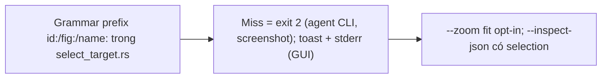
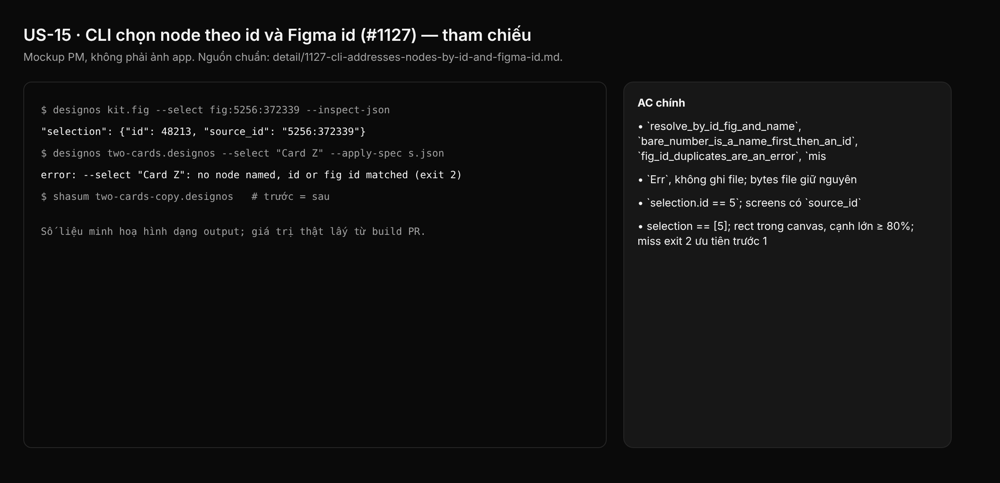

## 1. User Story
Là agent làm việc với `.fig` qua CLI, tôi truyền `--select fig:5256:372339` hoặc `--select id:4` và nhận đúng node đó, hoặc exit khác 0 với thông báo nói đã tìm gì. Lệnh không bao giờ tác động lên node khác.

## 2. Flow
| Bước | Hành động | Phản hồi |
|---|---|---|
| 1 | Grammar prefix `id:`/`fig:`/`name:` trong `select_target.rs` | Xem AC liên quan |
| 2 | Miss = exit 2 (agent CLI, screenshot); toast + stderr (GUI) | Xem AC liên quan |
| 3 | `--zoom fit` opt-in; `--inspect-json` có selection | Xem AC liên quan |

## 3. Data and rules
Spec chi tiết (nguồn chuẩn cho rule, contract, số liệu, danh sách file và test): [detail/1127-cli-addresses-nodes-by-id-and-figma-id.md](../detail/1127-cli-addresses-nodes-by-id-and-figma-id.md). Re-anchor mọi số dòng trích dẫn với HEAD trước khi code.
Không đổi mặc định framing (capture cũ giữ nguyên).
Dependency: Độc lập slice 1; giúp evidence L và D–K.

## 4. Acceptance Criteria
| ID | Given | When | Then | Source |
|---|---|---|---|---|
| AC-01 | Fixture có `source_id` | `cargo test -p designos-app --bin designos select` | `resolve_by_id_fig_and_name`, `bare_number_is_a_name_first_then_an_id`, `fig_id_duplicates_are_an_error`, `miss_hydrates_lazy_pages_once` pass | §10 |
| AC-02 | `--select` không tồn tại | `export_spec…`, `apply_spec…unchanged`, `codegen_and_add_comment…fail` | `Err`, không ghi file; bytes file giữ nguyên | §10 |
| AC-03 | `--select "Card B" --inspect-json` | `inspect_json_reports_the_selection_and_screen_source_ids` | `selection.id == 5`; screens có `source_id` | §10 |
| AC-04 | GUI `id:5`, `--zoom fit` | `gui_select_by_id_selects_the_node`, `zoom_fit_frames_the_selection`, `screenshot_exit_code_for_a_select_miss` | selection == [5]; rect trong canvas, cạnh lớn ≥ 80%; miss exit 2 ưu tiên trước 1 | §10 |
| AC-05 | Toàn workspace | `cargo test --workspace --locked`; fmt; clippy; zero_fake_ui_gate | Xanh | §10 Run |

Test steps: [tests/cases/US-15.md](../tests/cases/US-15.md). "§" trỏ tới spec chi tiết.

## 5. Edge cases
- `--select ""`: parse error, exit 2.
- `id:` số không tồn tại: exit 2; `id:-1`, `id:1.5`: malformed, exit 2.
- `fig:` trên tài liệu không phải Figma: không match, thông báo nói rõ.
- `fig:` trỏ sublayer instance trong kit lớn (đường clone nhanh bỏ id): không match, thông báo nói rõ.
- Tên chỉ match sau hydrate: tìm thấy sau một lần hydrate.
- `--select` với `--home`: parse error.
- `--edit-text` giữ lookup riêng; miss thành exit 2 ở screenshot.
- `--zoom fit` với `--present`: bị bỏ qua.

## 6. UI
Ảnh tham chiếu (mockup PM, không phải ảnh app): 

Bằng chứng thật bắt buộc trong PR: terminal capture trên build PR theo §10 spec chi tiết (không có UI mới).
