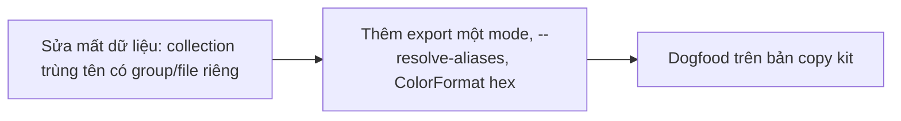
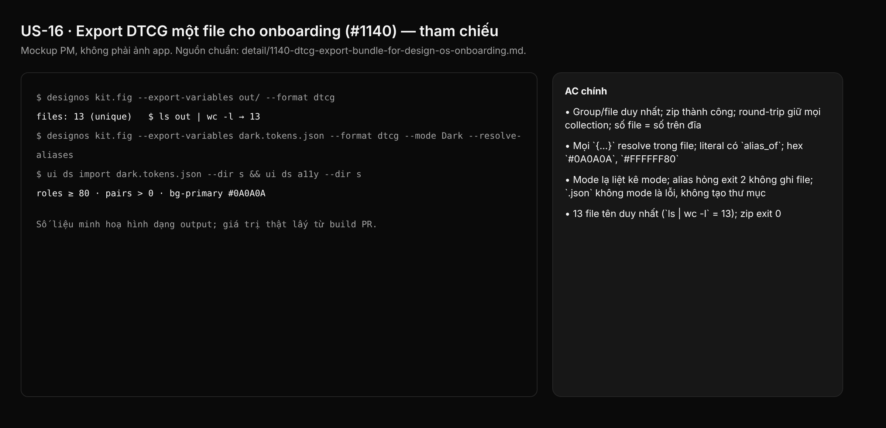

## 1. User Story
Là agent designer onboard kit Untitled vào `design/` không qua Figma (R3), tôi chạy một lệnh Studio ghi mode Dark thành một file DTCG tự đủ, để `ui ds import` có mọi colour role và `ui ds a11y` đo cặp thật.

## 2. Flow
| Bước | Hành động | Phản hồi |
|---|---|---|
| 1 | Sửa mất dữ liệu: collection trùng tên có group/file riêng | Xem AC liên quan |
| 2 | Thêm export một mode, `--resolve-aliases`, `ColorFormat` hex | Xem AC liên quan |
| 3 | Dogfood trên bản copy kit | Xem AC liên quan |

## 3. Data and rules
Spec chi tiết (nguồn chuẩn cho rule, contract, số liệu, danh sách file và test): [detail/1140-dtcg-export-bundle-for-design-os-onboarding.md](../detail/1140-dtcg-export-bundle-for-design-os-onboarding.md). Re-anchor mọi số dòng trích dẫn với HEAD trước khi code.
Collection local giữ tên gốc; bản trùng thêm `(2)`, `(3)` theo id. Không commit export kit thô.
Dependency: Phục vụ A (US-02).

## 4. Acceptance Criteria
| ID | Given | When | Then | Source |
|---|---|---|---|---|
| AC-01 | Hai collection cùng tên `_Primitives` | `cargo test -p designos-fig variables_dtcg` (test 1–4) | Group/file duy nhất; zip thành công; round-trip giữ mọi collection; số file = số trên đĩa | §10 1–4 |
| AC-02 | Export một mode | test 5, 6, 7 | Mọi `{…}` resolve trong file; literal có `alias_of`; hex `#0A0A0A`, `#FFFFFF80` | §10 5–7 |
| AC-03 | Input sai | test 8, 9, 10 | Mode lạ liệt kê mode; alias hỏng exit 2 không ghi file; `.json` không mode là lỗi, không tạo thư mục | §10 8–10 |
| AC-04 | Bản copy kit | `--export-variables dtcg --format dtcg`; `.zip` | 13 file tên duy nhất (`ls \| wc -l` = 13); zip exit 0 | Dogfood 1,2 |
| AC-05 | File dark.tokens.json | `ui ds import` rồi `ui ds a11y --dir <scratch>` | ≥ 80 role; > 0 cặp; `bg-primary` = #0A0A0A; Typography 32 token | Dogfood 3–5 |

Test steps: [tests/cases/US-16.md](../tests/cases/US-16.md). "§" trỏ tới spec chi tiết.

## 5. Edge cases
- Ba collection cùng tên: `(2)`, `(3)` theo id; local giữ tên gốc.
- Hai collection cùng tên đều không local: cái đầu theo id giữ tên gốc.
- Mode yêu cầu có trong hai collection cùng tên: cả hai vào file.
- Mode khác hoa thường: không match, lỗi liệt kê tên.
- Alias qua collection giữa không có mode đó: fallback như `resolve_literal_in_mode`.
- Màu alpha 0: `#RRGGBB00`.
- Alias số/chuỗi với `--resolve-aliases`: ghi literal; boolean giữ dạng cũ.
- Tài liệu không variable: `--mode` lỗi, exit 2.

## 6. UI
Ảnh tham chiếu (mockup PM, không phải ảnh app): 

Bằng chứng thật bắt buộc trong PR: terminal capture trên build PR theo §10 spec chi tiết (không có UI mới).
