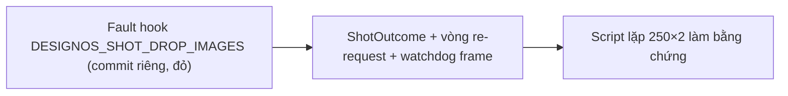
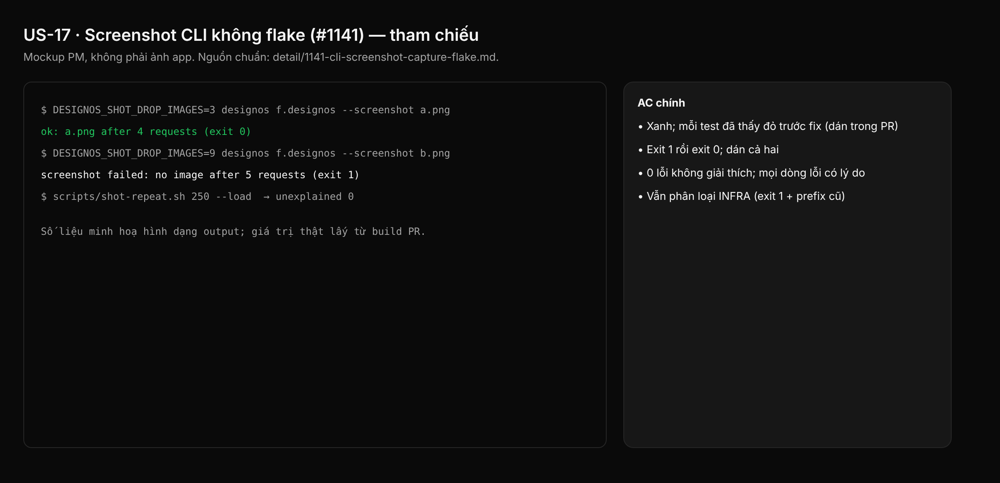

## 1. User Story
Là PM chạy baseline L và evidence PR qua `designos <file> --screenshot out.png`, mỗi lần chụp phải ghi PNG hoặc exit kèm lý do hành động được ("no image after 5 requests", "window not drawn for 30 s").

## 2. Flow
| Bước | Hành động | Phản hồi |
|---|---|---|
| 1 | Fault hook `DESIGNOS_SHOT_DROP_IMAGES` (commit riêng, đỏ) | Xem AC liên quan |
| 2 | `ShotOutcome` + vòng re-request + watchdog frame | Xem AC liên quan |
| 3 | Script lặp 250×2 làm bằng chứng | Xem AC liên quan |

## 3. Data and rules
Spec chi tiết (nguồn chuẩn cho rule, contract, số liệu, danh sách file và test): [detail/1141-cli-screenshot-capture-flake.md](../detail/1141-cli-screenshot-capture-flake.md). Re-anchor mọi số dòng trích dẫn với HEAD trước khi code.
Lỗi luôn giữ prefix cũ để script L phân loại INFRA. Không bao giờ ghi frame dở.
Dependency: Chặn evidence L (US-01) và D–K.

## 4. Acceptance Criteria
| ID | Given | When | Then | Source |
|---|---|---|---|---|
| AC-01 | Test 1–6, 6b | `cargo test --workspace --locked` | Xanh; mỗi test đã thấy đỏ trước fix (dán trong PR) | §10 AC1 |
| AC-02 | Case 7 với hook | Chạy trên commit chỉ có hook rồi trên build PR | Exit 1 rồi exit 0; dán cả hai | §10 AC2 |
| AC-03 | Case 8 | Script lặp 250 lần có tải và 250 lần không tải | 0 lỗi không giải thích; mọi dòng lỗi có lý do | §10 AC3 |
| AC-04 | Script capture của L | Chạy một lần thất bại | Vẫn phân loại INFRA (exit 1 + prefix cũ) | §10 AC4 |

Test steps: [tests/cases/US-17.md](../tests/cases/US-17.md). "§" trỏ tới spec chi tiết.

## 5. Edge cases
- Ảnh tới sau khi đã tính là mất: ảnh đầu thắng, ảnh sau bỏ qua.
- Ảnh GPU bị cap tới sau re-request: áp luật at-rest cũ.
- Cửa sổ không đạt kích thước (lớn hơn màn hình): chụp với lý do rõ.
- Frame dở của lần bỏ cuộc không bao giờ được ghi.
- Thư mục không ghi được: thông báo `cannot write` như cũ.

## 6. UI
Ảnh tham chiếu (mockup PM, không phải ảnh app): 

Bằng chứng thật bắt buộc trong PR: terminal capture trên build PR theo §10 spec chi tiết (không có UI mới).
