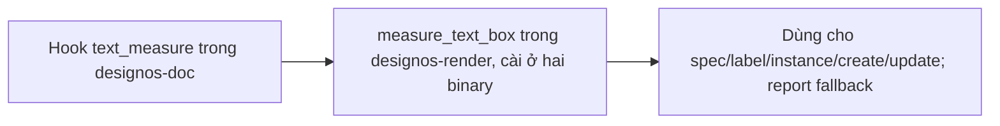
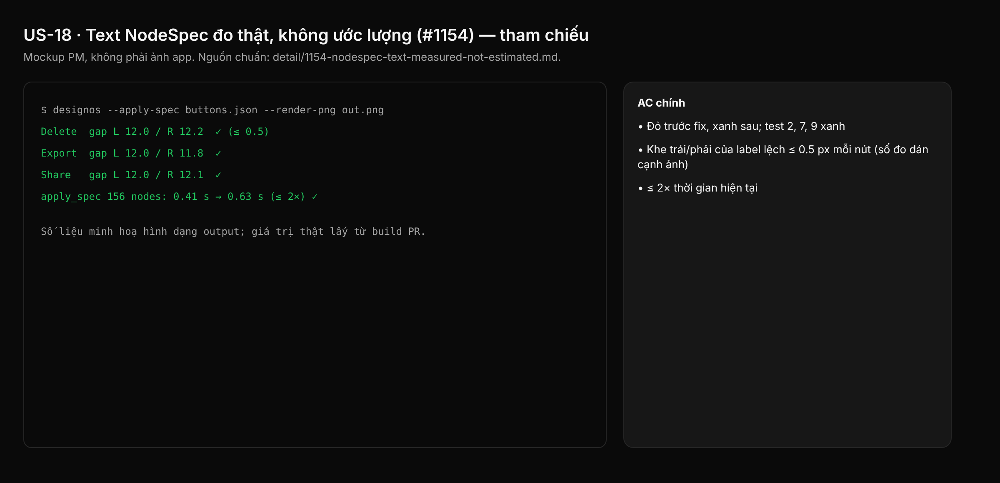

## 1. User Story
Là agent dựng UI qua designos-mcp hoặc `designos --apply-spec`, tôi muốn label của nút hug nằm giữa như trong Figma và editor Studio: hộp text đo bằng shaping, không ước lượng bảng độ rộng ký tự.

## 2. Flow
| Bước | Hành động | Phản hồi |
|---|---|---|
| 1 | Hook `text_measure` trong `designos-doc` | Xem AC liên quan |
| 2 | `measure_text_box` trong `designos-render`, cài ở hai binary | Xem AC liên quan |
| 3 | Dùng cho spec/label/instance/create/update; report fallback | Xem AC liên quan |

## 3. Data and rules
Spec chi tiết (nguồn chuẩn cho rule, contract, số liệu, danh sách file và test): [detail/1154-nodespec-text-measured-not-estimated.md](../detail/1154-nodespec-text-measured-not-estimated.md). Re-anchor mọi số dòng trích dẫn với HEAD trước khi code.
Không có measurer (unit test crate khác): giữ estimate như cũ. Test chỉ dùng Inter bundled.
Dependency: Độc lập slice 1.

## 4. Acceptance Criteria
| ID | Given | When | Then | Source |
|---|---|---|---|---|
| AC-01 | Test 1, 3, 4, 5, 6, 8 | `cargo test --workspace --locked` | Đỏ trước fix, xanh sau; test 2, 7, 9 xanh | §10 AC1 |
| AC-02 | Nút `Delete`, `Export`, `Share` | Dogfood render qua `--apply-spec` | Khe trái/phải của label lệch ≤ 0.5 px mỗi nút (số đo dán cạnh ảnh) | §10 AC2 |
| AC-03 | Board 156 node | Đo thời gian `apply_spec` trước/sau | ≤ 2× thời gian hiện tại | §10 AC3 |

Test steps: [tests/cases/US-18.md](../tests/cases/US-18.md). "§" trỏ tới spec chi tiết.

## 5. Edge cases
- Font fallback (không bundle, không cache): đo và render cùng fallback.
- Nhiều dòng (`\n`): lấy dòng shape rộng nhất.
- Letter spacing, text case, mixed run: shape như renderer vẽ.
- Text rỗng: giữ tối thiểu 16 px rộng, cao một dòng.
- Tất định: cùng binary, font, input → cùng số.
- Studio sửa text đã đo: `fit_text` fit lại theo đo editor.
- Không có measurer: estimate như cũ.
- Test binary không chạy `main()`: cài measurer trong test harness.
- Test cũ assert size ước lượng sẽ đổi: cập nhật số, ghi trong PR.

## 6. UI
Ảnh tham chiếu (mockup PM, không phải ảnh app): 

Bằng chứng thật bắt buộc trong PR: terminal capture trên build PR theo §10 spec chi tiết (không có UI mới).
