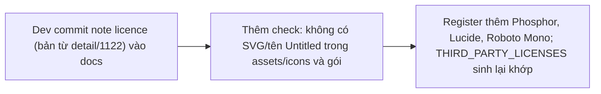
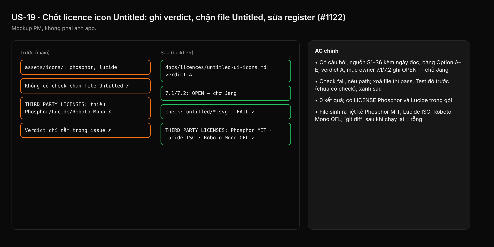

- Issue #1122 · milestone v0.6.11 · trạng thái code 26/10: research xong (detail/1122); chưa có PR; owner chưa xác nhận mục 7.1/7.2

## 1. User Story
Là maintainer Studio (repo public, PolyForm Shield), tôi muốn kết luận licence Untitled UI Icons được ghi vào repo, có check chặn file icon Untitled lọt vào repo/gói, và register licence khớp thứ gói thực sự ship, để không ai vô tình phân phối icon có bản quyền.

## 2. Flow
| Bước | Hành động | Phản hồi |
|---|---|---|
| 1 | Dev commit note licence (bản từ detail/1122) vào docs | Xem AC liên quan |
| 2 | Thêm check: không có SVG/tên Untitled trong assets/icons và gói | Xem AC liên quan |
| 3 | Register thêm Phosphor, Lucide, Roboto Mono; THIRD_PARTY_LICENSES sinh lại khớp | Xem AC liên quan |

## 3. Dữ liệu và quy tắc
Spec chi tiết (nguồn chuẩn): [detail/1122-research-untitled-icons-licence.md](../detail/1122-research-untitled-icons-licence.md). Đọc lại S1–S5 trước khi merge (trang licence có thể đổi).
- R1. Verdict ghi trong repo theo Option A (giữ Phosphor MIT + Lucide ISC, restyle theo R6) — Option A chính là owner ruling R6 đã có, nên story không chờ thêm quyết định để làm.
- R2. Mục 7.1/7.2 (đóng hẳn câu hỏi icon sau revamp; câu hỏi rộng về token/anatomy) ghi là **OPEN — chờ Jang** trong note; PR không tự ghi là đã duyệt, không ghi `GATE: APPROVED`.
- R3. Không trích npm `license: MIT` (S4) làm căn cứ cho phép.
- R4. Check tự động (test hoặc script trong CI hiện có, **không** sửa `.github/workflows`): fail nếu `crates/designos-app/assets/icons/**` hoặc nội dung gói release có file/thư mục/metadata chứa `untitled` (không phân biệt hoa thường) hoặc SVG không thuộc `phosphor/`/`lucide/`.
- R5. `docs/eval-licences.md` thêm Phosphor (MIT), Lucide (ISC), Roboto Mono (OFL-1.1); `THIRD_PARTY_LICENSES.md` sinh lại bằng generator hiện có, không sửa tay.
- R6. Không gửi email cho Untitled UI (Option D) — chỉ Jang quyết.

Dependency: Không chặn revamp (R6). Mở khoá mọi issue sau này muốn thay bộ icon. Epic #1118 (spec key Q).

## 4. Acceptance Criteria
| ID | Given | When | Then | Source |
|---|---|---|---|---|
| AC-01 | Repo tại HEAD của PR | Mở `docs/licences/untitled-ui-icons.md` (hoặc path tương đương ghi trong PR) | Có câu hỏi, nguồn S1–S6 kèm ngày đọc, bảng Option A–E, verdict A, mục owner 7.1/7.2 ghi OPEN — chờ Jang | #1122 §5–7 |
| AC-02 | Thêm tạm `assets/icons/untitled/arrow.svg` (hoặc SVG lạ ngoài phosphor/lucide) | Chạy check R4 (`cargo test` hoặc script trong job hiện có) | Check fail, nêu path; xoá file thì pass. Test đỏ trước (chưa có check), xanh sau | R4 |
| AC-03 | Gói build bởi `scripts/package.sh` và `scripts/package-macos.sh` | Liệt kê nội dung gói và grep `-i untitled` | 0 kết quả; có LICENSE Phosphor và Lucide trong gói | §2, finding 4 |
| AC-04 | `docs/eval-licences.md` đã thêm 3 mục | Chạy generator sinh `THIRD_PARTY_LICENSES.md` | File sinh ra liệt kê Phosphor MIT, Lucide ISC, Roboto Mono OFL; `git diff` sau khi chạy lại = rỗng | Side finding 2 |
| AC-05 | PR mở | Reviewer đọc note và mô tả PR | Không có câu nào coi npm MIT là quyền dùng; không có `GATE: APPROVED`; không có thay đổi `.github/workflows` | R2, R3, R4 |

Test steps: [tests/cases/US-19.md](../tests/cases/US-19.md). Mỗi fix: test đỏ trước trên main `ef26bcc`, xanh sau.

## 5. Edge cases
- Trang licence Untitled đổi sau 25/10: ghi ngày đọc mới và khác biệt trong PR; nếu đổi theo hướng cho phép, vẫn giữ A và để Jang quyết.
- Icon Lucide/Phosphor có tên chứa chữ 'untitled' (không có hiện tại): allowlist theo path, không theo tên.
- Kit Untitled của user mở trong canvas (file .fig): không phải asset của app, check không quét file người dùng.
- `docs/eval-licences.md:264` đã có Untitled trong `[ban]`: giữ, không trùng mục.
- Roboto Mono không vendor dưới assets/icons: register theo path font thực tế.

## 6. UI
Ảnh tham chiếu (mockup PM, không phải ảnh app): 

Bằng chứng thật bắt buộc trong PR: output check R4 đỏ→xanh, danh sách file trong gói, diff THIRD_PARTY_LICENSES.md.
