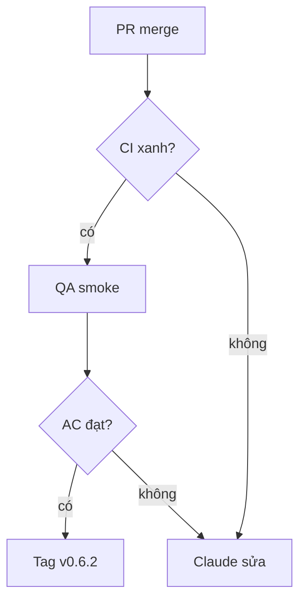

- Patch v0.6.2 · milestone v0.6.2 · 6 issue · safety: #1008, #1087, #1044, #1046, #1053, #1036

## 1. User Story
Là người dùng Studio, tôi muốn bản v0.6.2 sửa agent sandbox safety i để dùng agent và editor an toàn hơn.

## 2. Flow
- Bắt đầu: PR fix merge vào release/v0.6.2 (Fixes #).
- Chính: CI xanh → QA smoke theo AC → Claude tag v0.6.2 → PM xác minh G5.

## 3. Dữ liệu và quy tắc

| ID | Quy tắc | Nguồn |
|---|---|---|
| BR-01 | Không patch nào ship khi còn AC chưa đạt. | [contract](../contract/FC-V06.md) |

## 4. Acceptance Criteria

| ID | Given | When | Then | Scenario | Issue |
|---|---|---|---|---|---|
| AC-01 | Một .fig đích là symlink, file đã tồn tại, hoặc đuôi .FIG | Agent gọi designos_export_fig_file không có overwrite | Lệnh từ chối (FILE_EXISTS hoặc lỗi symlink), không file nào ngoài workspace bị sửa; .FIG được nhận. | SCN-01-01 | #1008 |
| AC-02 | Agent truyền tên file có ký tự đường dẫn hoặc trỏ ra ngoài workspace | Gọi một tool MCP có ghi file | Tool từ chối tên không hợp lệ và thông báo lỗi không lộ đường dẫn ngoài workspace. | SCN-01-02 | #1087 |
| AC-03 | Tab Claude ở Ask mode, thư mục session có .claude/settings*.json do sandbox Codex ghi | Mở tab Claude | Claude không nạp allow rule từ thư mục session; mọi thao tác vẫn hỏi duyệt trong panel. | SCN-01-03 | #1044 |
| AC-04 | Thư mục session có mcp-config.json do agent khác ghi | Mở tab Claude ở Ask mode | Studio không khởi chạy MCP server nào từ file đó; chỉ dùng cấu hình do Studio sinh ở vùng agent không ghi được. | SCN-01-04 | #1046 |
| AC-05 | Tên document hoặc page chứa dòng giống lệnh (ví dụ `/run`, backtick, xuống dòng) | Studio sinh skill Claude của mình | Tên được escape thành dữ liệu; skill sinh ra không có lệnh mới. | SCN-01-05 | #1053 |
| AC-06 | Agent ghi hooks.json hoặc .claude/settings.local.json vào thư mục session | Bắt đầu hoặc tiếp tục session Claude | Studio không dùng các file đó; hook và setting chỉ đến từ vị trí agent không ghi được. | SCN-01-06 | #1036 |

## 5. Edge cases
- Lỗi: một AC fail thì issue đó rời patch sang patch sau, patch vẫn ship phần còn lại (PM ghi decision).
- Rỗng: không áp dụng, slice có issue cố định.

## 6. UI
UI: tab agent và panel duyệt; không đổi giao diện, chỉ đổi hành vi.
