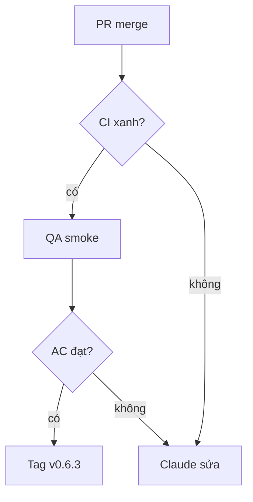

- Patch v0.6.3 · milestone v0.6.3 · 4 issue · safety: #1023, #1057, #1061, #1068

## 1. User Story
Là người dùng Studio, tôi muốn bản v0.6.3 sửa agent sandbox safety ii để dùng agent và editor an toàn hơn.

## 2. Flow
- Bắt đầu: PR fix merge vào release/v0.6.2 (Fixes #).
- Chính: CI xanh → QA smoke theo AC → Claude tag v0.6.3 → PM xác minh G5.

## 3. Dữ liệu và quy tắc

| ID | Quy tắc | Nguồn |
|---|---|---|
| BR-01 | Không patch nào ship khi còn AC chưa đạt. | [contract](../contract/FC-V06.md) |

## 4. Acceptance Criteria

| ID | Given | When | Then | Scenario | Issue |
|---|---|---|---|---|---|
| AC-01 | Agent đang chờ duyệt một thao tác | Agent tự ghi file trả lời vào thư mục approval | Thao tác vẫn chờ; chỉ click của người dùng trong panel mới duyệt được. | SCN-02-01 | #1023 |
| AC-02 | Một tab khác đặt link trong $TMPDIR trỏ vào thư mục session của tab hiện tại | Tab hiện tại tạo hoặc mở thư mục session | Studio từ chối đường dẫn qua link và dùng thư mục session riêng do Studio tạo. | SCN-02-02 | #1057 |
| AC-03 | Agent đặt link trong thư mục session trỏ ra ngoài | Studio ghi file cấu hình agent | Studio không đi theo link, báo lỗi rõ và không ghi ra ngoài thư mục session. | SCN-02-03 | #1061 |
| AC-04 | Agent đặt link trong thư mục session | designos-mcp ghi file session | designos-mcp không ghi theo link; file ngoài thư mục session không đổi. | SCN-02-04 | #1068 |

## 5. Edge cases
- Lỗi: một AC fail thì issue đó rời patch sang patch sau, patch vẫn ship phần còn lại (PM ghi decision).
- Rỗng: không áp dụng, slice có issue cố định.

## 6. UI
UI: tab agent và panel duyệt; không đổi giao diện, chỉ đổi hành vi.
