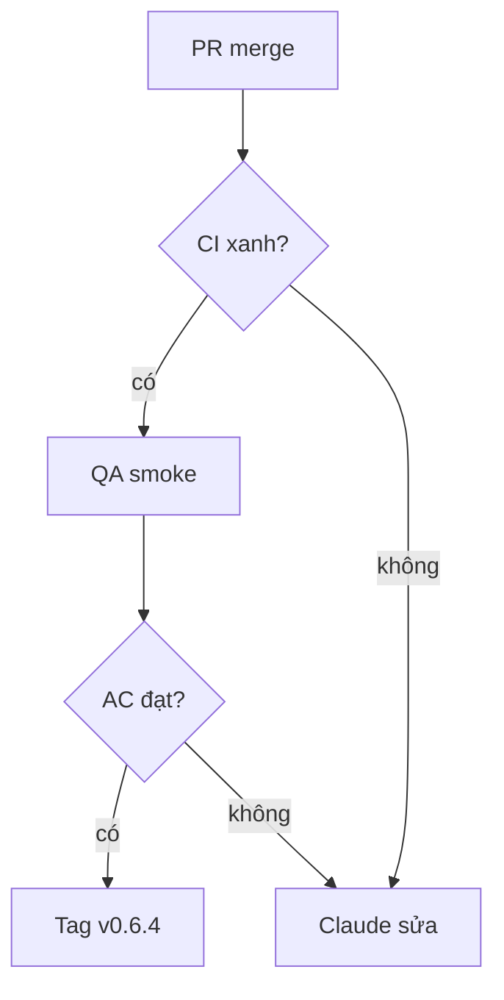

- Patch v0.6.4 · milestone v0.6.4 · 4 issue · safety: #1069

## 1. User Story
Là người dùng Studio, tôi muốn bản v0.6.4 sửa agent config and editor quality để dùng agent và editor an toàn hơn.

## 2. Flow
- Bắt đầu: PR fix merge vào release/v0.6.2 (Fixes #).
- Chính: CI xanh → QA smoke theo AC → Claude tag v0.6.4 → PM xác minh G5.

## 3. Dữ liệu và quy tắc

| ID | Quy tắc | Nguồn |
|---|---|---|
| BR-01 | Không patch nào ship khi còn AC chưa đạt. | [contract](../contract/FC-V06.md) |

## 4. Acceptance Criteria

| ID | Given | When | Then | Scenario | Issue |
|---|---|---|---|---|---|
| AC-01 | Thư mục cấu hình Grok hoặc Antigravity là read-only và có cấu hình do agent sửa | Mở tab Ask mode | Tab không khởi động với cấu hình đó; panel hiện lỗi và bước tiếp theo. | SCN-03-01 | #1069 |
| AC-02 | Người dùng chọn một đoạn text có style | Chọn Create text style | Một text style mới được tạo với font, cỡ, line height, letter spacing của đoạn chọn và áp vào đoạn đó. | SCN-03-02 | #875 |
| AC-03 | Dev Mode đang mở trên màn hình 1440 px | Mở code panel | Code panel đủ rộng để đọc một dòng 80 ký tự không cần cuộn ngang, và kéo rộng được. | SCN-03-03 | #887 |
| AC-04 | Một chỉnh sửa chạm 10.000 node | run_tx ghi nhận transaction | Mỗi node chỉ được serialize một lần; thời gian đo trước và sau được ghi trong PR. | SCN-03-04 | #993 |

## 5. Edge cases
- Lỗi: một AC fail thì issue đó rời patch sang patch sau, patch vẫn ship phần còn lại (PM ghi decision).
- Rỗng: không áp dụng, slice có issue cố định.

## 6. UI
UI: các màn hình nêu trong AC; QA chụp ảnh 1440 px làm bằng chứng G4.
