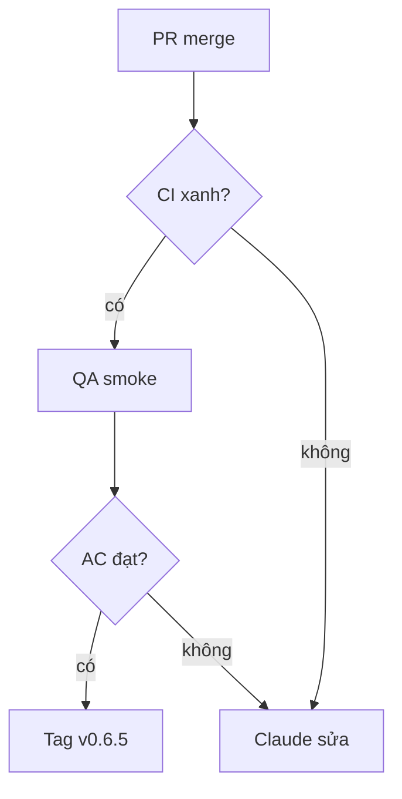

- Patch v0.6.5 · milestone v0.6.5 · 4 issue · safety: không

## 1. User Story
Là người dùng Studio, tôi muốn bản v0.6.5 sửa styles, tooling and headless checks để dùng agent và editor an toàn hơn.

## 2. Flow
- Bắt đầu: PR fix merge vào release/v0.6.2 (Fixes #).
- Chính: CI xanh → QA smoke theo AC → Claude tag v0.6.5 → PM xác minh G5.

## 3. Dữ liệu và quy tắc

| ID | Quy tắc | Nguồn |
|---|---|---|
| BR-01 | Không patch nào ship khi còn AC chưa đạt. | [contract](../contract/FC-V06.md) |

## 4. Acceptance Criteria

| ID | Given | When | Then | Scenario | Issue |
|---|---|---|---|---|---|
| AC-01 | File không có local style nhưng có library style đang dùng | Chọn layer và xem section Selection Styles | Section hiện các library style của selection. | SCN-04-01 | #1039 |
| AC-02 | designos-diff đã cài | Chạy `designos-diff --version` | In ra phiên bản và thoát với mã 0. | SCN-04-02 | #1088 |
| AC-03 | Main component có instance trên page chưa nạp | Đổi tên layer trong main component | Instance trên page chưa nạp giữ tên override của chúng sau khi page được nạp. | SCN-04-03 | #983 |
| AC-04 | Các input sai từ red team QA (escape SwiftUI, tên file, lỗi spec) | Chạy lệnh headless tương ứng | Mỗi case cho mã thoát khác 0 đúng loại, thông báo lỗi rõ, và không ghi file sai. | SCN-04-04 | #1003 |

## 5. Edge cases
- Lỗi: một AC fail thì issue đó rời patch sang patch sau, patch vẫn ship phần còn lại (PM ghi decision).
- Rỗng: không áp dụng, slice có issue cố định.

## 6. UI
UI: các màn hình nêu trong AC; QA chụp ảnh 1440 px làm bằng chứng G4.
