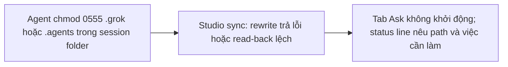
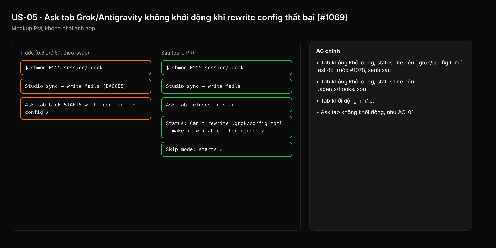

- Issue #1069 · milestone v0.6.4 · trạng thái code 25/10: fix đã merge (PR #1078, vào 0.6.2); còn xác minh trên tag và đóng issue

## 1. User Story
Là người dùng Studio chạy Grok hoặc Antigravity ở Ask mode, tôi muốn tab từ chối khởi động khi Studio không ghi lại được config của nó, để agent không giữ được cấu hình nó tự sửa (ví dụ bỏ hook status).

## 2. Flow
| Bước | Hành động | Phản hồi |
|---|---|---|
| 1 | Agent chmod 0555 .grok hoặc .agents trong session folder | Xem AC liên quan |
| 2 | Studio sync: rewrite trả lỗi hoặc read-back lệch | Xem AC liên quan |
| 3 | Tab Ask không khởi động; status line nêu path và việc cần làm | Xem AC liên quan |

## 3. Dữ liệu và quy tắc
- Paths: Grok `.grok/config.toml`, `.grok/hooks/designos-status.json`; Antigravity `.agents/hooks.json`, `.agents/plugins/designos`.
- R1. Rewrite trả `Result`; Ask tab chỉ khởi động khi ghi thành công **và** read-back khớp byte với nội dung Studio sinh (cùng cơ chế Gemini, PR #1067).
- R2. Skip mode vẫn khởi động (không có Ask gate để bảo vệ).
- R3. Status line: tên file lỗi + hành động ("Make <path> writable, then reopen the tab"). Không hiện stack trace.
- R4. Không tự chmod lại thư mục của người dùng.

Dependency: PR #1078 (merged). Liên quan #1048 (v0.7.3) — đường MCP config ngoài session folder.

## 4. Acceptance Criteria
| ID | Given | When | Then | Source |
|---|---|---|---|---|
| AC-01 | Session folder có `.grok` chmod 0555 và `config.toml` do agent sửa | Mở tab Grok ở Ask mode | Tab không khởi động; status line nêu `.grok/config.toml`; test đỏ trước #1078, xanh sau | #1069 red-first |
| AC-02 | `.agents` chmod 0555 | Mở tab Antigravity ở Ask mode | Tab không khởi động, status line nêu `.agents/hooks.json` | #1069 red-first |
| AC-03 | Cùng thư mục read-only | Mở tab ở Skip mode | Tab khởi động như cũ | #1069 |
| AC-04 | File ghi được nhưng read-back khác (agent sửa giữa write và read) | Studio sync | Ask tab không khởi động, như AC-01 | R1 |
| AC-05 | Build tag v0.6.4 | QA chạy AC-01..03 trên macOS | PASS được ghi trong issue rồi mới đóng | G5 |

Test steps: [tests/cases/US-05.md](../tests/cases/US-05.md). Mỗi fix: test đỏ trước trên main `d0555c8`, xanh sau.

## 5. Edge cases
- Thư mục không tồn tại: Studio tạo bình thường, không coi là lỗi.
- Read-only chỉ một file (chmod 0444 config.toml), thư mục ghi được: rename-over vẫn thành công → khởi động; nếu không thì từ chối.
- Đĩa đầy (ENOSPC): xử lý như ghi lỗi.
- Mở lại tab sau khi người dùng sửa quyền: khởi động bình thường, không cần restart Studio.
- Nhiều tab cùng session: mỗi tab báo lỗi riêng, không crash.

## 6. UI
Ảnh tham chiếu (mockup PM, không phải ảnh app): 

Bằng chứng thật bắt buộc trong PR: output test/terminal trên build PR.
