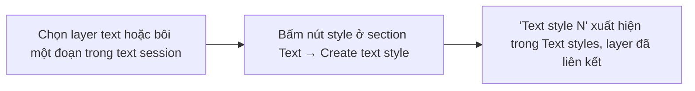
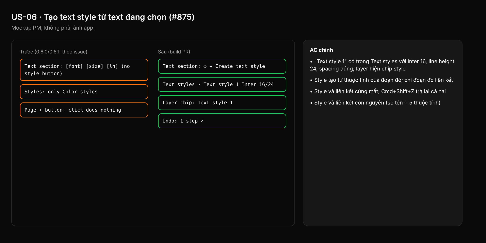

- Issue #875 · milestone v0.6.4 · trạng thái code 25/10: PR #1024 merged (0.6.2); còn xác minh AC trên tag, gồm nút + cấp page

## 1. User Story
Là designer, tôi muốn tạo một text style từ layer text (hoặc đoạn text) đang chọn bằng một nút, để dùng lại kiểu chữ mà không phải sang Figma.

## 2. Flow
| Bước | Hành động | Phản hồi |
|---|---|---|
| 1 | Chọn layer text hoặc bôi một đoạn trong text session | Xem AC liên quan |
| 2 | Bấm nút style ở section Text → Create text style | Xem AC liên quan |
| 3 | 'Text style N' xuất hiện trong Text styles, layer đã liên kết | Xem AC liên quan |

## 3. Dữ liệu và quy tắc
- Thuộc tính lưu: font family, size, weight, line height, letter spacing (giá trị của run đầu nếu chọn nhiều run — xem edge).
- R1. Tên mặc định "Text style N", N nhỏ nhất chưa dùng.
- R2. Tạo + liên kết là **một** bước undo.
- R3. Section Styles hiện khi có selection kể cả document chưa có style nào (hiện bị ẩn ở `properties.rs:970-973`).
- R4. Nút + cấp page (`properties.rs:455`) phải hoạt động (mở menu Color/Text/Effect/Grid) hoặc bị bỏ; không giữ nút chết.
- R5. Lưu .designos, mở lại, và round-trip .fig giữ style và liên kết.

Dependency: PR #1024 merged. Tương tác #1039/#1165 (picker).

## 4. Acceptance Criteria
| ID | Given | When | Then | Source |
|---|---|---|---|---|
| AC-01 | Document không có style, chọn một layer text Inter 16/24 | Bấm Create text style | "Text style 1" có trong Text styles với Inter 16, line height 24, spacing đúng; layer hiện chip style | #875 |
| AC-02 | Đang sửa text, bôi 1 từ | Create text style | Style tạo từ thuộc tính của đoạn đó; chỉ đoạn đó liên kết | #875 |
| AC-03 | Vừa tạo style | Cmd+Z một lần | Style và liên kết cùng mất; Cmd+Shift+Z trả lại cả hai | R2 |
| AC-04 | Document có style vừa tạo | Lưu, mở lại; export .fig rồi import | Style và liên kết còn nguyên (so tên + 5 thuộc tính) | R5 |
| AC-05 | Không chọn gì, mở panel Styles cấp page | Bấm + | Menu tạo style mở ra, hoặc nút không còn; không có click bị nuốt | R4 |

Test steps: [tests/cases/US-06.md](../tests/cases/US-06.md). Mỗi fix: test đỏ trước trên main `d0555c8`, xanh sau.

## 5. Edge cases
- Đoạn chọn nhiều font khác nhau: dùng thuộc tính run đầu, hiện toast "Mixed styles — used the first".
- Chọn nhiều layer text: nút disabled kèm tooltip 'Select one text layer' (đề xuất PM, chờ Jang).
- Font thiếu trên máy: vẫn tạo, style mang tên font gốc, cảnh báo font thiếu như layer.
- Trùng tên 'Text style 1' từ file import: N tăng tiếp.
- Layer nằm trong instance: tạo style được, liên kết là override.

## 6. UI
Ảnh tham chiếu (mockup PM, không phải ảnh app): 

Bằng chứng thật bắt buộc trong PR: ảnh panel Text styles trước/sau trên build tag.
